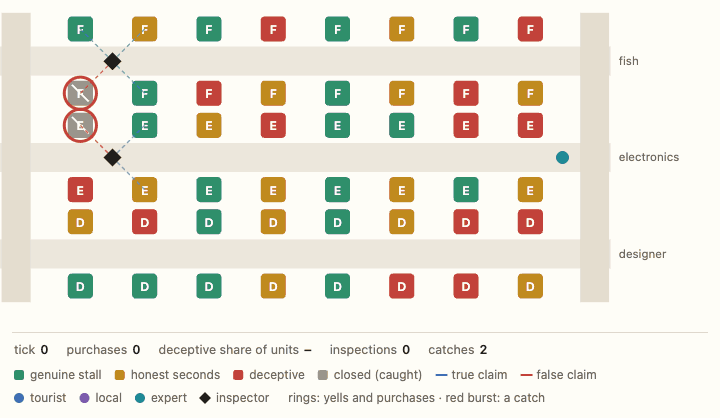

# Bazaar Markets: The Agentic Ad Engine

A deterministic market simulator for studying deception, verification and brand value, built as an evaluation environment for AI agents.

**Main result so far:** in this market, deception is bounded by verification. Once enough buyers check what they buy (about a third here), cashing in a good name stops paying, and enforcement does the same job where buyers don't check. A brand's reputation earns money only while rivals are still building theirs.

> Status: engine v1.0.0 is the frozen rule-based baseline; v1.2.0 adds price policies, logit choice, an undercut floor, an LLM spend ceiling and a seller state bank for agent evaluation, and reproduces v1.0.0 at its defaults. All agents are rule-based. LLM agent experiments are in progress and will be compared against the baseline.

## What it is

A bazaar of stalls selling fish, electronics and designer goods. Stalls are genuine, seconds (honestly labelled lower quality) or deceptive. They advertise by sign, yell, whisper and answer. Buyers (tourists, locals, experts, bargain hunters) compare stalls, read star ratings and sometimes inspect before buying. Inspectors patrol, stand on posts or work disguised; a catch fines the stall and closes it. Brands can be built, licensed, copied or cashed in.

The market engine is deterministic. Agents act only at decision points, so any agent (a rule, a human, or an LLM) can be dropped into the same market and compared on paired seeds.

*The first 150 ticks of one market day in the browser viewer (`viewer/index.html`), replayed from an engine log: default config, seed 0, rule-based agents.*

## Findings (v1.0.0, rule-based agents)

Each finding, its run, its estimate and its status (prespecified and supported, exploratory, or provisional) is listed in [`runs/BASELINE_1_0_0.md`](runs/BASELINE_1_0_0.md), with the 1.1.0 and 1.2.0 additions in [`runs/BASELINE_1_2_0.md`](runs/BASELINE_1_2_0.md). The headlines:

- **Verification sets the boundary for cashing in a brand.** With no inspectors, a stall that switches to cheap goods under its good name gains when no buyer checks and loses once enough buyers check (about a third in this market; the threshold is exploratory).
- **Enforcement substitutes for verification,** and raises honest sellers' profit, likely by closing deceptive stalls.
- **Enforcement leaks through gaps in space and time.** Fixed inspectors leave pockets; visible patrols get waited out.
- **Catch counts mislead.** Sellers who dodge inspectors earn more only by paying fewer fines.
- **A reputation is worth the head start it gives over rivals still building theirs, where buyers read ratings** (provisional): about $190 for each day of head start here, and nothing once rivals show the same stars.

The verification, enforcement and licensing results hold in all 15 cells of a robustness sweep over price policies and buyer-choice rules (PX1–PX3, engine 1.1.0); the exception found so far is a price war at unit cost, where a cash-in pays even though locals check, unless inspectors enforce; the payoff shrinks as a price floor above cost is raised (engine 1.2.0).

These are results of one stylized model, not claims about real markets.

## Quick start

    git clone https://github.com/RandallSPQR/Bazaar-Markets.git
    cd Bazaar-Markets
    python -m venv .venv && source .venv/bin/activate
    pip install -e ".[test]"
    pytest                                   # full suite (about 1.5 h; slow reference tests included)
    python -m cli.run --config configs/bazaar_default.json --seed 0 --log runs/s0.jsonl

The last command runs one market and prints its outcome; the event log it writes opens in `viewer/index.html`.

The reference market of v1.0.0 is `configs/reference_1_0.json`. It is the licensing market: 150 buyers comparing 3 stalls, 40% tourists, star ratings, brands, and 2 patrolling inspectors over 30 days. `configs/reference_1_0_variants.json` turns it into the market of each published run, as a list of `--set` overrides:

    python -m cli.run --config configs/reference_1_0.json --seed 0

Reproduce a published run, for example verification (stage A, about 7 h on 4 CPU workers; the summary and run record are written to `runs/`):

    python -m analysis.verification --stage A --seeds 200-219

Python 3.12, numpy 2.5. Chains are deterministic per seed; a run's record lists the engine, commit, command and seeds.

## How the research is run

- Every run has a written spec with predictions, committed before any run. The commit history is the preregistration.
- Pilot gates check identities, timing and guards before a main run.
- Results are paired by seed, with 95% intervals over seeds, unadjusted. Only prespecified predictions are confirmatory.
- Each summary in `runs/` has a run record, gates, a predictions table, a reading written after the results, and caveats.

## Repository layout

    engine/      market engine (deterministic)
    agents/      rule-based agents and the agent registry
    analysis/    one script per run
    cli/         run one configuration, sweeps, replay
    configs/     reference config and named variants
    runs/        run summaries, figures, plans, baseline manifest
    docs/        formal model, config reference, log schema, agent interface
    tests/       unit tests and frozen reference digests
    viewer/      browser viewer for engine logs

Large run caches are not in git; they are archived on Zenodo with each release (see Cite).

## For agent builders

See [`docs/agent_interface.md`](docs/agent_interface.md) for every decision point, what an agent sees, what it may return, and the deliberate rules of this world (for example: tourists cannot see ratings; prices follow displayed ratings).

## Origin

Inspired by Don Marti's posts on deceptive advertising and ad reform (blog.zgp.org), and by work on LLMs as simulated economic agents.

## Cite

See [`CITATION.cff`](CITATION.cff) (GitHub's "Cite this repository" reads it). Each release is archived on Zenodo, with its run caches as a separate dataset.

- Software, v1.0.0: [10.5281/zenodo.24406533](https://doi.org/10.5281/zenodo.24406533)
- Software, all versions (resolves to the latest): [10.5281/zenodo.24406532](https://doi.org/10.5281/zenodo.24406532)
- Run caches for v1.0.0 (dataset, CC BY 4.0): [10.5281/zenodo.24406657](https://doi.org/10.5281/zenodo.24406657)

> Bennington, R. S. (2026). *Bazaar Markets: The Agentic Ad Engine* (v1.0.0) [Software]. Zenodo. https://doi.org/10.5281/zenodo.24406533

## License

- Code (`engine/`, `agents/`, `analysis/`, `cli/`, `configs/`, `tests/`, `viewer/`): MIT, see [`LICENSE`](LICENSE).
- Docs and data (`docs/`, `runs/`, and the run caches archived with each release): [CC BY 4.0](https://creativecommons.org/licenses/by/4.0/).
