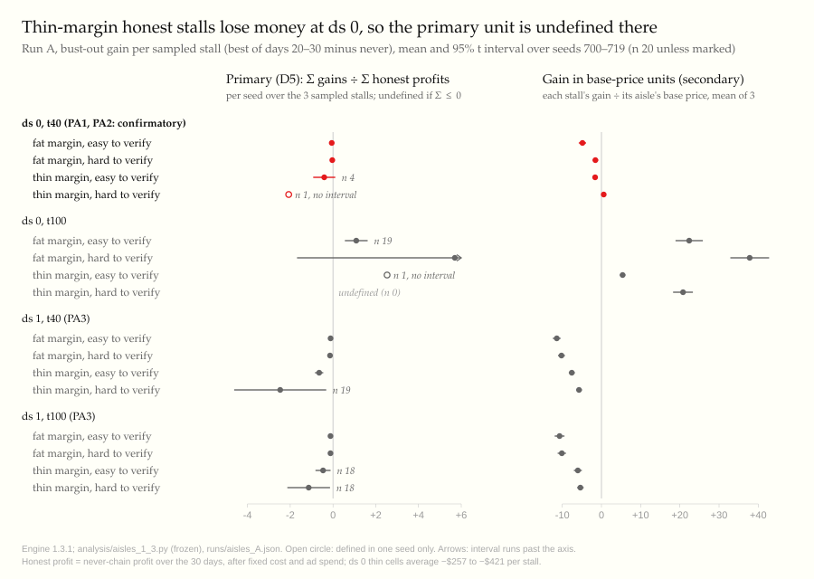

# Run A summary: margin × verifiability (plan 2026-11-27, engine 1.3.1), seeds 700–719

**BLUF.**
- **PA3 supported.** With detection on (ds 1), the bust-out gain is below 0 in all 8 profile cells on the D5 primary unit (n 18–20 seeds each).
- **PA1 partly supported.**
  - Fat margin: hard verifiability raises the gain over easy, +0.026 of honest profit [+0.011, +0.041], n 20.
  - Thin margin: **not testable** (n 1).
- **PA2 not supported** under the frozen verdict rule.
  - Easy: n 4, −0.38 [−0.86, +0.11].
  - Hard: **not testable** (n 1).
- **Why so few seeds.** In the four thin-margin ds 0 cells, honest (never-chain) profit is negative on average: −$257 to −$421 per stall over the 30 days. So the D5 ratio is undefined in 16–20 of 20 seeds there.
  - The cause is a calibration property, not a code bug. The fixed cost is 90% of baseline gross profit (revenue − unit cost), but honest profit also pays ad spend.
  - Ad spend is a flat amount per aisle, about $2.40, $16 and $39 a day in fish, electronics and designer. That is 14–34% of a thin stall's gross, against a 10% margin left after fixed cost.
- **Post hoc, in base-price units** (one of the plan's named secondary units; the contrasts are added after the results): all four PA1 and PA2 parts point the predicted way, with intervals above 0. At t40 ds 0 most of these gains are negative, so "larger" there mostly means "loses less".
- Guards are all 0 over 23,040,000 buyer-days. No genuine stall exits before day 10 in any cell.

## Record

- Engine 1.3.1 (3c4bd3b).
- Script `analysis/aisles_1_3.py`, sha256 16f8c60a…03cb, frozen since 4f66849.
- Calibration `runs/aisles_calibration.json`, from the second pilot (seeds 900–902; 060c02b).
- Full suite at 9023acf: 1,901 passed, 17 skipped, 0 failed.
- numpy 2.5.4, Python 3.12.7, macOS 27.2.1 arm64.
- 7 workers, normal priority, `caffeinate -i`, driver `analysis/aisles_main_driver.sh`, blocks ≤ 10 h:
  - block 1: 2026-11-26 21:05:21 (commit e4bed1c), 6,240 chains by 07:05:44;
  - block 2: 07:05:45 (commit 602513f), the remaining 1,560 chains by 09:35:03.
- Runs A, B and C together took 7,800 chains in 12.50 h of wall clock, against the pilot's projection of 13.02 h. Load averages ran 9–12. Memory pauses 0. Clean tree in both blocks.
- Analysis: `--phase analyse --runs A,B,C` at 09:37:50, giving `runs/aisles_A.json`, and Run A used all 5,120 of its chains.
- Post hoc contrasts: `analysis/aisles_secondary_units.py` → `runs/aisles_secondary_units.json`.
- Plot: `analysis/aisles_plots.py` → `runs/aisles_A_cells.svg`.

The deviations in force are D1–D7 (STATUS and `runs/pilot_aisles_131.md`).
- D2: one sampled stall per aisle per seed, from `default_rng([seed, 17])`.
- D5 primary: per seed, the sum of the sampled stalls' gains divided by the sum of their never-chain profits. It is undefined when that sum is ≤ 0. The result is then averaged over seeds with a 95% t interval.
- D5 secondary: the per-stall mean of ratios (stalls with never profit ≤ 0 dropped).
- A contrast uses only seeds where both cells are defined.

## Predictions

| Prediction | Contrast | Primary (D5), n | Verdict | Secondary (mean of ratios), n | Verdict |
|---|---|---|---|---|---|
| PA1 fat | t40 ds 0, hard − easy | +0.026 [+0.011, +0.041], 20 | supported | +0.034 [+0.018, +0.049], 20 | supported |
| PA1 thin | t40 ds 0, hard − easy | −1.21 (no interval), 1 | not testable | +1.49 [−4.52, +7.50], 3 | not supported |
| **PA1** | | | **partly supported** | | partly supported |
| PA2 easy | t40 ds 0, thin − fat | −0.38 [−0.86, +0.11], 4 | not supported | −5.89 [−17.40, +5.63], 11 | not supported |
| PA2 hard | t40 ds 0, thin − fat | −1.98 (no interval), 1 | not testable | +0.22 [−0.64, +1.08], 5 | not supported |
| **PA2** | | | **not supported** | | not supported |
| PA3 fat easy t40 | ds 1 gain | −0.113 [−0.124, −0.101], 20 | supported | −0.122 [−0.132, −0.112], 20 | supported |
| PA3 fat easy t100 | ds 1 gain | −0.116 [−0.135, −0.097], 20 | supported | −0.123 [−0.147, −0.098], 20 | supported |
| PA3 fat hard t40 | ds 1 gain | −0.141 [−0.161, −0.120], 20 | supported | −0.146 [−0.164, −0.129], 20 | supported |
| PA3 fat hard t100 | ds 1 gain | −0.117 [−0.140, −0.093], 20 | supported | −0.130 [−0.154, −0.106], 20 | supported |
| PA3 thin easy t40 | ds 1 gain | −0.648 [−0.840, −0.456], 20 | supported | −1.43 [−2.42, −0.43], 20 | supported |
| PA3 thin easy t100 | ds 1 gain | −0.467 [−0.821, −0.112], 18 | supported | −0.49 [−0.89, −0.09], 20 | supported |
| PA3 thin hard t40 | ds 1 gain | −2.47 [−4.62, −0.32], 19 | supported | −1.52 [−2.05, −0.98], 20 | supported |
| PA3 thin hard t100 | ds 1 gain | −1.14 [−2.13, −0.14], 18 | supported | −2.46 [−5.96, +1.04], 20 | not supported |
| **PA3** | | | **supported (8 of 8)** | | partly supported (7 of 8) |

The frozen rule labels PA2 "not supported", not "not testable": one part has an interval (n 4) that includes 0, and the other is not testable. Read it as untestable on the hard side and uninformative on the easy side, not as evidence against the prediction.

PA4 (exploratory) on the primary unit:
- Interaction at t40 ds 0: n 1.
- t100 analogues:
  - PA1 fat: +1.17 [−0.29, +2.63], n 19.
  - PA1 thin and PA2 hard: n 0.
  - PA2 easy: n 1.

## Why the primary is undefined in the thin ds 0 cells

These figures are per sampled genuine stall in the never chains at t40 ds 0, means over 20 seeds, in dollars a day:

| Cell | Aisle | Gross (revenue − unit cost) | Fixed cost | Ad spend and other | Other ÷ gross |
|---|---|---|---|---|---|
| fat easy | fish / electronics / designer | 49.11 / 256.82 / 762.86 | 25.53 / 135.44 / 371.84 | 2.44 / 16.38 / 39.35 | 0.05 / 0.06 / 0.05 |
| fat hard | | 37.30 / 188.63 / 593.98 | 18.55 / 100.69 / 276.79 | 2.43 / 16.31 / 39.28 | 0.07 / 0.09 / 0.07 |
| thin easy | | 17.49 / 92.70 / 272.78 | 16.62 / 88.80 / 245.12 | 2.44 / 16.38 / 39.35 | 0.14 / 0.18 / 0.14 |
| thin hard | | 9.30 / 46.51 / 154.42 | 8.47 / 46.10 / 132.22 | 2.42 / 15.93 / 39.25 | 0.26 / 0.34 / 0.25 |

- **The calibration itself is not off.** Realised genuine gross in the main runs matches the pilot calibration. For example, thin easy t40 ds 0 gives fish $18.18 a day against a baseline of $18.47, and designer $277.04 against $272.35.
- **What the margin leaves.** A thin stall keeps 10% of gross after the fixed cost. Ad spend, a flat amount per aisle (fish 2.4, electronics 16, designer 39 dollars a day), then takes 14–34% of gross. So the honest margin is negative before any bust-out.
- **Counts of stall-seeds (of 60) with never profit ≤ 0:**
  - thin easy t40: 47;
  - thin hard t40: 55;
  - thin easy t100: 47;
  - thin hard t100: 51;
  - every fat ds 0 cell: 0–4;
  - every ds 1 cell: 0–9.

  At ds 1, detection removes deceptive competitors and genuine gross rises, for example fish thin easy from $18.18 to $25.48 a day.
- **This follows the plan as written.** It defines the baseline as "a genuine stall's baseline daily gross profit", and `docs/formal_model.md` specifies revenue − unit cost. The 0.90 fixed-cost share is a PLACEHOLDER. Nothing was changed.

## Post hoc: the PA1 and PA2 contrasts in the plan's secondary units

**These contrasts were written after the results.** Dollars and base-price units are named in the plan as secondary units. The frozen script reports them per cell; `analysis/aisles_secondary_units.py` adds the paired contrasts with the same pairing and intervals. Base-price units are each stall's gain divided by its aisle's base price (fish $8, electronics $40, designer $120), averaged over the seed's 3 stalls.

| Contrast (t40 ds 0) | Base-price units, n 20 | Dollars per stall, n 20 |
|---|---|---|
| PA1 fat: hard − easy | +3.31 [+2.27, +4.34] | +153 [+91, +215] |
| PA1 thin: hard − easy | +2.19 [+1.64, +2.74] | +99 [+73, +125] |
| PA2 easy: thin − fat | +3.25 [+2.66, +3.84] | +181 [+137, +224] |
| PA2 hard: thin − fat | +2.12 [+1.64, +2.61] | +126 [+87, +166] |
| PA4 interaction (thin hard − thin easy) − (fat hard − fat easy) | −1.12 [−1.79, −0.46] | −55 [−98, −11] |

Cell gains in base-price units (frozen script, `base_units`, pooled, n 20):

| Margin and verifiability | t40 ds 0 | t100 ds 0 | t40 ds 1 | t100 ds 1 |
|---|---|---|---|---|
| fat easy | −4.85 [−5.79, −3.92] | +22.40 [+18.91, +25.88] | −11.41 [−12.39, −10.42] | −10.68 [−11.92, −9.44] |
| fat hard | −1.55 [−2.24, −0.85] | +37.83 [+32.89, +42.78] | −10.20 [−11.07, −9.33] | −10.11 [−11.17, −9.06] |
| thin easy | −1.61 [−1.96, −1.25] | +5.39 [+4.69, +6.09] | −7.56 [−8.32, −6.80] | −6.02 [−7.04, −5.00] |
| thin hard | +0.58 [+0.14, +1.02] | +20.81 [+18.28, +23.34] | −5.71 [−6.44, −4.99] | −5.37 [−6.19, −4.56] |

Best bust-out day (of 60 stall-seeds per cell):
- t40 ds 0: mostly day 30. The exception is thin hard, whose best days spread from day 20 to day 30.
- t100 ds 0: mostly day 20.
- ds 1: day 30 in 57–60 of 60.

## Exits by type and reason (never chains, exploratory, D7)

Each cell has 360 genuine, 300 seconds and 300 deceptive stall-seeds. Each entry reads before day 10 / by day 30. Every exit is an insolvency.

| Cell | Genuine | Seconds | Deceptive |
|---|---|---|---|
| fat · · ds 0 (4 cells) | 0 / 0 | 0 / 0 | 0 / 0 |
| fat easy t40 ds 1 | 0 / 0 | 0 / 0 | 0 / 9 |
| fat hard t40 ds 1 | 0 / 0 | 0 / 0 | 0 / 90 |
| fat easy t100 ds 1 | 0 / 0 | 0 / 0 | 0 / 163 |
| fat hard t100 ds 1 | 0 / 0 | 0 / 0 | 0 / 217 |
| thin easy t40 ds 0 | 0 / 0 | 0 / 0 | 0 / 0 |
| thin hard t40 ds 0 | 0 / 42 | 0 / 0 | 0 / 1 |
| thin easy t100 ds 0 | 0 / 94 | 0 / 81 | 0 / 44 |
| thin hard t100 ds 0 | 0 / 162 | 0 / 191 | 39 / 88 |
| thin easy t40 ds 1 | 0 / 0 | 0 / 0 | 66 / 300 |
| thin hard t40 ds 1 | 0 / 1 | 0 / 0 | 284 / 300 |
| thin easy t100 ds 1 | 0 / 1 | 0 / 0 | 280 / 300 |
| thin hard t100 ds 1 | 0 / 3 | 0 / 0 | 300 / 300 |

No genuine stall exits before day 10 in any cell. The highest share of all stalls exiting before day 10 is 31.3%, in thin hard t100 ds 1.

## Reading (written after the results)

- **The confirmatory question PA1 and PA2 asked can't be answered on the primary unit for thin margins.** That is because, in this calibration, honest thin-margin stalls do not make money at ds 0. The share-of-honest-profit unit presumes a positive honest profit, and ad spend is not in the baseline the fixed cost is sized to. Here that presumption fails for most thin stall-seeds.
- **The defined parts agree with the predictions.** In fat margins, hard verifiability raises the gain by about 3% of honest profit. The secondary unit agrees.
- **In base-price units the predicted pattern holds in all four parts.** Thin margins and hard verifiability each make busting out less costly at t40 ds 0, and in thin hard it turns slightly profitable (+0.58 base units). These contrasts are post hoc in form, so they don't replace the verdicts.
- **The negative interaction in base units has no preregistered sign.** It says the hard-verifiability effect is larger, in absolute terms, for fat margins, whose stakes are larger.
- **Detection (ds 1) makes bust-outs lose money everywhere, by 6–11 base-price units.** It also clears out most deceptive stalls in thin markets. PA3 holds on the primary unit in all 8 cells.
- **With tourists only (t100) and no detection, bust-outs pay well in every cell:** +5 to +38 base-price units, best on day 20. Fat margins gain more in absolute terms there.

## Caveats

- Under D2 each aisle contributes one sampled stall per seed, so all figures rest on 3 stalls per seed and 20 seeds.
- The fixed-cost shares, cost shares and seconds cost shares are PLACEHOLDERs. The thin-margin results depend on the 0.90 fixed-cost share and on ad spend not being in the baseline.
- The post hoc contrasts use a preregistered unit but were not preregistered as contrasts. They are labelled, and they change no verdict.
- Calibration came from 3 pilot seeds. In the Run A cells checked, realised genuine gross in the main runs is within about 7% of it per aisle. In Run B it is up to 16% higher (designer, cash 20, ds 0: $533.76 against $458.72 a day).
- Intervals are unadjusted 95% t over seeds.
