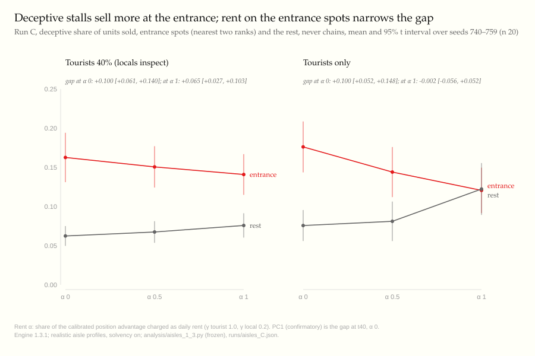

# Run C summary: tourist traps (plan 2026-11-27, engine 1.3.1), seeds 740–759

**BLUF.**
- **PC1 supported.** At t40 with no position rent (α 0), deceptive stalls take a larger share of units sold in the entrance spots (the nearest two ranks) than elsewhere. The gap is +0.100 [+0.061, +0.140], n 20: 16.3% of entrance units are deceptive, against 6.2% elsewhere. The gap is positive in every aisle.
- **Exploratory (PC2): position rent narrows the gap.**
  - t40: α 1 reduces it by −0.035 [−0.047, −0.023].
  - Tourists only (t100): α 1 reduces it by −0.102 [−0.135, −0.069], to −0.002 [−0.056, +0.052], so the gap closes.
- **Tourists bear the harm at the entrance.** At t40, α 0, 25.7% of the units tourists buy at entrance spots are short of the claimed quality, against 16.2% elsewhere. Their surplus is $1.27 a unit at the entrance and $4.90 elsewhere. Locals and experts are short on 1–3% of units in both places.
- Guards are all 0 over 540,000 buyer-days.

Record: as in `runs/aisles_A_summary.md`. Run C used 120 never chains (6 cells × 20 seeds; no benchmark). Analysis `runs/aisles_C.json`, plot `runs/aisles_C_entrance.svg` (`analysis/aisles_plots.py`). Deviations D1–D7 are in force; D1 applies here: `market.gamma` is `buyers.position_rent`, with γ tourist 1.0 and γ local 0.2.

## Predictions

| Prediction | Contrast | Estimate, n 20 | Verdict |
|---|---|---|---|
| PC1 | t40, α 0: deceptive share of units, entrance − rest | +0.100 [+0.061, +0.140] | **supported** |
| PC2 | t40: gap at α 0.5 − gap at α 0 | −0.017 [−0.024, −0.010] | exploratory |
| PC2 | t40: gap at α 1 − gap at α 0 | −0.035 [−0.047, −0.023] | exploratory |
| PC2 | t100: gap at α 0.5 − gap at α 0 | −0.037 [−0.061, −0.014] | exploratory |
| PC2 | t100: gap at α 1 − gap at α 0 | −0.102 [−0.135, −0.069] | exploratory |

Cells (deceptive share of units sold; gap = entrance − rest; n 20):

| Cell | Entrance | Rest | Gap | Gap fish / electronics / designer |
|---|---|---|---|---|
| t40, α 0 | 0.163 [0.131, 0.194] | 0.062 [0.050, 0.075] | +0.100 [+0.061, +0.140] | +0.105 / +0.077 / +0.110 |
| t40, α 0.5 | 0.151 [0.124, 0.177] | 0.067 [0.054, 0.081] | +0.083 [+0.047, +0.119] | +0.081 / +0.066 / +0.089 |
| t40, α 1 | 0.141 [0.115, 0.167] | 0.076 [0.060, 0.091] | +0.065 [+0.027, +0.103] | +0.059 / +0.070 / +0.051 |
| t100, α 0 | 0.176 [0.144, 0.209] | 0.076 [0.056, 0.095] | +0.100 [+0.052, +0.148] | +0.073 / +0.045 / +0.127 |
| t100, α 0.5 | 0.144 [0.112, 0.176] | 0.081 [0.056, 0.106] | +0.063 [+0.011, +0.115] | +0.041 / +0.034 / +0.059 |
| t100, α 1 | 0.121 [0.091, 0.150] | 0.122 [0.089, 0.155] | −0.002 [−0.056, +0.052] | +0.030 / +0.009 / −0.098 |

At t40, α 0, every per-aisle gap has an interval above 0: fish [+0.055, +0.156], electronics [+0.021, +0.133], designer [+0.029, +0.192].

## Buyer harm by profile and spot (exploratory)

Short share is the share of units bought below the claimed quality. Surplus is per unit, in dollars, pooled over seeds.

| Cell | Tourist, entrance | Tourist, rest | Local, entrance | Local, rest | Expert, entrance | Expert, rest |
|---|---|---|---|---|---|---|
| t40, α 0 | 0.257, $1.27 | 0.162, $4.90 | 0.025, $11.52 | 0.026, $9.17 | 0.014, $11.70 | 0.011, $9.85 |
| t40, α 0.5 | 0.239, $1.77 | 0.166, $4.08 | 0.025, $11.33 | 0.029, $8.93 | 0.014, $11.66 | 0.011, $9.68 |
| t40, α 1 | 0.222, $2.71 | 0.183, $2.68 | 0.023, $11.42 | 0.032, $9.00 | 0.012, $11.73 | 0.013, $9.75 |
| t100, α 0 | 0.163, $5.75 | 0.064, $10.58 | | | | |
| t100, α 0.5 | 0.131, $7.43 | 0.067, $9.27 | | | | |
| t100, α 1 | 0.110, $8.56 | 0.106, $6.43 | | | | |

At t40, about 78% of tourists' units are bought at the entrance spots (38,908 of 49,449 at α 0). For locals and experts it is about half.

## Exits by type and reason (never chains, exploratory, D7)

Each cell has 360 genuine, 300 seconds and 300 deceptive stall-seeds. Each entry reads before day 10 / by day 30. Every exit is an insolvency.

| Cell | Genuine | Seconds | Deceptive |
|---|---|---|---|
| t40, α 0 | 0 / 10 | 0 / 0 | 105 / 255 |
| t40, α 0.5 | 0 / 11 | 0 / 0 | 93 / 267 |
| t40, α 1 | 0 / 14 | 0 / 21 | 85 / 264 |
| t100, α 0 | 0 / 89 | 0 / 0 | 194 / 267 |
| t100, α 0.5 | 1 / 57 | 0 / 55 | 185 / 280 |
| t100, α 1 | 9 / 47 | 1 / 78 | 194 / 271 |

- At most 2.5% of genuine stalls exit before day 10 (t100, α 1).
- At most 21.3% of all stalls exit before day 10 (t100, α 1).
- Deceptive stalls exit heavily in every cell (255–280 of 300 by day 30). Run C runs with detection on (ds 1), start cash 10 days and the realistic profiles, and deceptive stalls exit heavily there as in the ds 1 cells of Runs A and B.
- The analysis script does not tabulate exits by spot (PC2 lists them). They are not reported here and are an open item.

## Reading (written after the results)

- **Tourist traps form where the plan expected.** With no rent on position, deceptive stalls sell a larger share at the entrance, where tourists, who mostly buy at the nearest stalls, do their buying. The gap is about 10 percentage points at both verification levels and holds in each aisle at t40.
- **Charging the position advantage as rent narrows the trap.** The rent takes away the margin a deceptive seller earns from the spot. At full rent with tourists only, the entrance is no more deceptive than the rest. The rest also gets more deceptive (0.076 to 0.122), so this is partly a redistribution rather than a removal.
- **Tourists carry almost all the harm.** They get far less surplus at the entrance ($1.27 a unit against $4.90 elsewhere at t40, α 0). Inspecting locals and experts are barely affected and get more surplus at the entrance than elsewhere.

## Caveats

- Run C runs with detection on (ds 1) in every cell, so the entrance gap is measured among the deceptive stalls that survive detection. Run C has no bust-out benchmark. Every figure is from never chains and is a market-level share, pooled over all stalls in each spot class.
- "Entrance" is the nearest two ranks of the spot classes from the calibration (`spot_classes`). The rent table comes from the same calibration (3 pilot seeds).
- The harm figures are pooled ratios over seeds, without intervals.
- Exits by spot (PC2) were not computed by the frozen script.
- Intervals are unadjusted 95% t over seeds.
