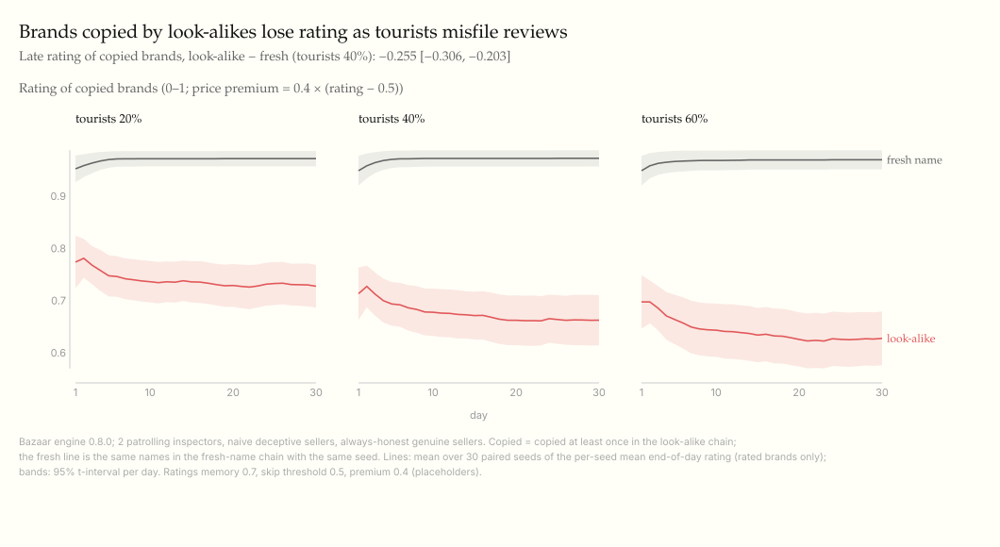
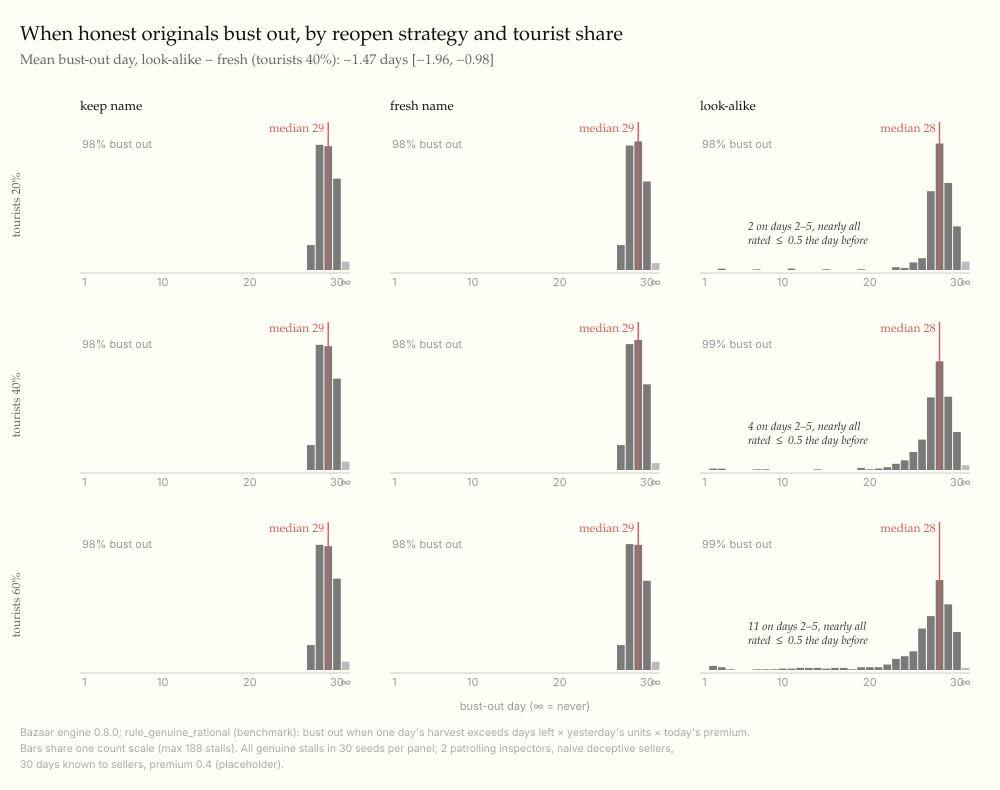

# Brands, look-alikes and bust-out — budgets 1.25 × base (exploratory)

> **Provisional: demand design flaw (most stalls unreachable) and an unexplained bust-out loss size; see the redesign run.** (Note added 2026-11-08.)

Run spec "brands, look-alikes and bust-out (rule-based only)", predictions written 2026-11-06 before any run.

**Exploratory run.** Identical to the prespecified run (`runs/brand_summary.md`) except buyers' budgets: `buyers.budget_level=above`, 1.25 × base price per unit instead of 1.0 ×. Added 2026-11-06, before either full run, because the 2-seed smoke test showed that with budgets at base price the reputation premium (up to 1.2 × base) prices buyers out instead of earning a margin. The PE labels below mark the same contrasts as the prespecified run, but nothing in this run is confirmatory.

## Run record

- Buyers' budget level: `above`
- Engine `0.8.0`; commit `0a22990a7537656fd0abf7aa3639a2b4ec7d7364`; uncommitted at run time: ['?? analysis/brands.py', '?? brand_run.log', '?? run_brands.sh', '?? runs/brand.csv', '?? runs/brand.json', '?? runs/brand_bust_days.svg', '?? runs/brand_copied_ratings.svg', '?? runs/brand_day1_v070.json', '?? runs/brand_day1_v070_budget125.json', '?? runs/brand_summary.md']
- Script sha256 `a196f4a5cbb02cd9a26e41cf6a314cee20270fec4d812a18ef6805a56671495c`
- Command: `.venv/bin/python -m analysis.brands --budget above --ref070 runs/brand_day1_v070_budget125.json --out runs/brand_budget125.json`
- Day-1 reference: engine 0.7.0 (`856d6f518baaf3bbb4c005c109aace945a33bdc0`), file `runs/brand_day1_v070_budget125.json`
- Python 3.12.7, numpy 2.5.4, macOS-26.6.2-arm64-arm-64bit
- 540 chains x 30 days on 8 workers; wall clock 70.1 min; load average [26.0, 23.77, 28.16] at start, [39.49, 34.45, 41.31] at end
- Seeds 0-29, paired

## Design (prespecified)

- Ratings public (memory 0.7, skip threshold 0.5; locals and experts see them); 2 patrolling inspectors, not uniformed; naive deceptive sellers (`rule_deceptive`); 30 days, known to sellers; imitation off; brands on, premium pi = 0.4 (placeholder).
- Factorial: reopen strategy (keep / fresh / look-alike) x tourist share (0.2 / 0.4 / 0.6; locals and experts split the rest evenly, so 0.4 is not the default 0.4 / 0.4 / 0.2 mix) x genuine policy (`rule_genuine` = `rule_honest`, always honest; `rule_genuine_rational`): 18 conditions.
- Decided 2026-11-06 before the run: the rational seller's "future" is the premium its name earns (days left including today x yesterday's units x today's price above the neutral-rating price); day 1 has no yesterday, so day 2 is the first decision day. Look-alikes copy the highest-rated full-price brand (genuine or deceptive tier, never a look-alike) on another stall of the category; unrated = 0.5; ties at random. A busted-out stall keeps claiming its old quality on every channel, with no caution, and keeps its name if caught.
- Late = mean of days 26–30. Intervals 95% paired t over seeds, unadjusted. Exploratory throughout.

## Gate

- Calibration: median bust-out day >= 25 (rational, fresh, tourists 40%): **passed** (median 29 over 540 genuine stalls x seeds; never = 31; 98.1% bust out; 0.0% before day 25)
- Day-1 outcomes equal engine 0.7.0 for the same conditions: **passed** (540 of 540 chains (outcome minus the 0.8.0 brands block, byte for byte))

## Prespecified contrasts (exploratory in this run)

- **PE1**: late profit per deceptive stall, look-alike − fresh (tourists 40%, rule_genuine): $−8.25 [−17.70, +1.19] per day. Prediction > 0. **Verdict: not supported (interval includes 0).**
- **PE2**: per-seed slope of that gap over tourist share: $−6.40 [−9.31, −3.48] * per +0.2 of tourist share. Prediction > 0. **Verdict: contradicted (interval on the opposite side of 0).**
- **PE3**: late rating of brands copied at least once, look-alike − fresh (same names and seeds; tourists 40%, rule_genuine): −0.255 [−0.306, −0.203] *. Prediction < 0. **Verdict: supported.**
- **PE4**: mean bust-out day of genuine stalls (never = 31), look-alike − fresh (tourists 40%, rule_genuine_rational): −1.47 [−1.96, −0.98] * days. Prediction < 0. **Verdict: supported.** Share that bust out: fresh 98.1 [97.2, 99.1]%, look-alike 98.7 [97.7, 99.7]%; difference +0.6 [−0.6, +1.7] points.

## By tourist share (all exploratory)

### Deceptive profit gap and copied-brand ratings

| Tourists | Genuine policy | Deceptive profit/stall/day, look-alike − fresh ($) | Copied brands' late rating: fresh | look-alike | look-alike − fresh | genuine originals only | Brands copied per seed |
|---|---|---|---|---|---|---|---|
| tourists 20% | rule_genuine | +1.06 [−5.66, +7.78] | 0.969 [0.953, 0.985] | 0.766 [0.722, 0.810] | −0.204 [−0.243, −0.164] * | −0.211 [−0.252, −0.170] * | 18.6 [17.7, 19.6] |
| tourists 40% | rule_genuine | −8.25 [−17.70, +1.19] | 0.969 [0.951, 0.986] | 0.714 [0.655, 0.773] | −0.255 [−0.306, −0.203] * | −0.265 [−0.320, −0.211] * | 18.9 [18.0, 19.7] |
| tourists 60% | rule_genuine | −11.73 [−21.33, −2.13] * | 0.965 [0.943, 0.986] | 0.690 [0.628, 0.752] | −0.275 [−0.335, −0.215] * | −0.285 [−0.346, −0.224] * | 19.6 [18.8, 20.3] |
| tourists 20% | rule_genuine_rational | +19.56 [+14.08, +25.03] * | 0.892 [0.881, 0.903] | 0.671 [0.641, 0.700] | −0.221 [−0.252, −0.191] * | −0.227 [−0.259, −0.195] * | 21.1 [20.5, 21.6] |
| tourists 40% | rule_genuine_rational | +14.43 [+7.18, +21.69] * | 0.883 [0.871, 0.894] | 0.593 [0.556, 0.630] | −0.290 [−0.326, −0.253] * | −0.297 [−0.336, −0.259] * | 21.1 [20.6, 21.6] |
| tourists 60% | rule_genuine_rational | +15.94 [+5.54, +26.33] * | 0.877 [0.864, 0.890] | 0.527 [0.477, 0.578] | −0.349 [−0.403, −0.296] * | −0.358 [−0.412, −0.303] * | 21.0 [20.6, 21.4] |

Slope of the profit gap with rule_genuine_rational: $−1.81 [−7.54, +3.92] per +0.2 of tourist share.

Copied originals by type (count over seeds):

- tourists 20%, rule_genuine: {'genuine': 465, 'deceptive': 94}
- tourists 40%, rule_genuine: {'genuine': 473, 'deceptive': 93}
- tourists 60%, rule_genuine: {'genuine': 497, 'deceptive': 90}
- tourists 20%, rule_genuine_rational: {'genuine': 538, 'deceptive': 94}
- tourists 40%, rule_genuine_rational: {'genuine': 540, 'deceptive': 93}
- tourists 60%, rule_genuine_rational: {'genuine': 540, 'deceptive': 90}

### Bust-out timing (rule_genuine_rational)

| Tourists | Strategy | Mean bust-out day (never = 31) | Median (pooled) | Share bust out (%) |
|---|---|---|---|---|
| tourists 20% | keep name | 28.82 [28.76, 28.88] | 29 | 97.8 [96.7, 98.8] |
| tourists 20% | fresh name | 28.81 [28.74, 28.87] | 29 | 98.1 [97.2, 99.1] |
| tourists 20% | look-alike | 27.90 [27.59, 28.21] | 28 | 97.8 [96.5, 99.1] |
| tourists 40% | keep name | 28.82 [28.76, 28.88] | 29 | 97.8 [96.7, 98.8] |
| tourists 40% | fresh name | 28.80 [28.73, 28.86] | 29 | 98.1 [97.2, 99.1] |
| tourists 40% | look-alike | 27.32 [26.85, 27.80] | 28 | 98.7 [97.7, 99.7] |
| tourists 60% | keep name | 28.82 [28.76, 28.88] | 29 | 97.8 [96.7, 98.8] |
| tourists 60% | fresh name | 28.81 [28.75, 28.88] | 29 | 97.8 [96.7, 98.8] |
| tourists 60% | look-alike | 26.11 [25.11, 27.11] | 28 | 99.4 [98.8, 100.1] |

Paired contrasts in mean bust-out day (days):

| Tourists | look-alike − fresh | keep − fresh | share busting, look-alike − fresh (pts) |
|---|---|---|---|
| tourists 20% | −0.90 [−1.23, −0.58] * | +0.01 [−0.00, +0.03] | −0.4 [−1.8, +1.1] |
| tourists 40% | −1.47 [−1.96, −0.98] * | +0.02 [+0.00, +0.04] * | +0.6 [−0.6, +1.7] |
| tourists 60% | −2.70 [−3.72, −1.68] * | +0.01 [−0.01, +0.02] | +1.7 [+0.7, +2.6] * |

Do bust-outs cluster on copied brands? Per seed, mean bust-out day of genuine stalls whose name was copied on or before their bust-out day (any day if they never busted) minus the other genuine stalls (look-alike chains):

| Tourists | Copied − not copied (days) | Copied stalls | Other stalls | Seeds with both |
|---|---|---|---|---|
| tourists 20% | −0.26 [−1.49, +0.96] | 534 | 6 | 4 |
| tourists 40% | −0.94 | 539 | 1 | 1 |
| tourists 60% | −0.94 | 539 | 1 | 1 |

## Keep against fresh and look-alike (exploratory)

| Tourists | Genuine policy | Deceptive profit: fresh − keep ($) | look-alike − keep ($) | Shortfall: fresh − keep (pts) | look-alike − keep (pts) | look-alike − fresh (pts) |
|---|---|---|---|---|---|---|
| tourists 20% | rule_genuine | +16.16 [+12.01, +20.31] * | +17.22 [+8.69, +25.75] * | +3.5 [+2.7, +4.2] * | −0.2 [−1.6, +1.2] | −3.7 [−4.8, −2.5] * |
| tourists 40% | rule_genuine | +19.50 [+15.34, +23.65] * | +11.24 [+1.24, +21.24] * | +2.7 [+2.1, +3.4] * | −4.1 [−6.1, −2.2] * | −6.9 [−8.7, −5.1] * |
| tourists 60% | rule_genuine | +23.93 [+18.53, +29.32] * | +12.20 [+0.72, +23.68] * | +1.6 [+1.1, +2.2] * | −7.2 [−9.5, −4.9] * | −8.8 [−11.0, −6.7] * |
| tourists 20% | rule_genuine_rational | +21.76 [+17.54, +25.97] * | +41.32 [+34.07, +48.56] * | +6.1 [+4.6, +7.6] * | +15.8 [+11.9, +19.6] * | +9.7 [+6.7, +12.7] * |
| tourists 40% | rule_genuine_rational | +26.20 [+22.00, +30.39] * | +40.63 [+31.95, +49.31] * | +4.8 [+3.8, +5.8] * | +16.1 [+12.0, +20.2] * | +11.3 [+7.8, +14.8] * |
| tourists 60% | rule_genuine_rational | +29.49 [+24.01, +34.97] * | +45.43 [+34.72, +56.14] * | +2.4 [+1.8, +3.1] * | +16.6 [+12.0, +21.2] * | +14.2 [+9.9, +18.5] * |

Buyer surplus per arrived buyer, late ($), paired contrasts:

| Tourists | Genuine policy | fresh − keep | look-alike − keep | look-alike − fresh |
|---|---|---|---|---|
| tourists 20% | rule_genuine | −2.68 [−3.25, −2.11] * | −0.14 [−0.90, +0.62] | +2.54 [+1.89, +3.20] * |
| tourists 40% | rule_genuine | −2.90 [−3.44, −2.37] * | +1.17 [+0.23, +2.10] * | +4.07 [+3.11, +5.03] * |
| tourists 60% | rule_genuine | −2.83 [−3.37, −2.29] * | +1.82 [+0.75, +2.90] * | +4.65 [+3.61, +5.70] * |
| tourists 20% | rule_genuine_rational | −5.36 [−6.31, −4.41] * | −7.27 [−8.60, −5.93] * | −1.91 [−2.69, −1.12] * |
| tourists 40% | rule_genuine_rational | −5.45 [−6.31, −4.60] * | −7.89 [−9.46, −6.32] * | −2.44 [−3.49, −1.38] * |
| tourists 60% | rule_genuine_rational | −4.85 [−5.63, −4.07] * | −7.63 [−8.99, −6.26] * | −2.78 [−3.74, −1.82] * |

Rational − always-honest genuine sellers, late:

| Tourists | Strategy | Shortfall (pts) | Buyer surplus ($) | Genuine profit/stall ($) |
|---|---|---|---|---|
| tourists 20% | keep name | +19.0 [+16.8, +21.2] * | −1.73 [−2.43, −1.02] * | −200.48 [−210.33, −190.64] * |
| tourists 20% | fresh name | +21.6 [+19.7, +23.6] * | −4.40 [−4.97, −3.84] * | −188.74 [−200.75, −176.72] * |
| tourists 20% | look-alike | +35.0 [+32.5, +37.5] * | −8.85 [−9.86, −7.84] * | −262.60 [−278.60, −246.60] * |
| tourists 40% | keep name | +21.0 [+19.1, +23.0] * | −3.55 [−4.44, −2.66] * | −191.14 [−200.61, −181.67] * |
| tourists 40% | fresh name | +23.1 [+21.2, +24.9] * | −6.10 [−6.84, −5.37] * | −182.41 [−193.74, −171.07] * |
| tourists 40% | look-alike | +41.3 [+38.9, +43.7] * | −12.61 [−13.71, −11.50] * | −276.99 [−297.83, −256.14] * |
| tourists 60% | keep name | +23.4 [+21.4, +25.4] * | −6.09 [−7.24, −4.95] * | −182.17 [−192.82, −171.53] * |
| tourists 60% | fresh name | +24.1 [+22.1, +26.2] * | −8.11 [−9.21, −7.02] * | −173.82 [−185.66, −161.98] * |
| tourists 60% | look-alike | +47.2 [+44.2, +50.2] * | −15.54 [−16.73, −14.35] * | −278.06 [−300.18, −255.94] * |

## Late levels (days 26–30)

| Genuine policy | Tourists | Strategy | Deceptive profit ($) | Genuine profit ($) | Shortfall (%) | Buyer surplus ($) | Genuine premium (%) | Deceptive premium (%) | Rating, genuine originals | Rating, deceptive (current name) | Catches/day | Renames/day | Look-alike stalls | Busted stalls |
|---|---|---|---|---|---|---|---|---|---|---|---|---|---|---|
| rule_genuine | tourists 20% | keep name | −151.35 [−162.53, −140.16] | 181.41 [174.63, 188.20] | 8.5 [7.2, 9.7] | 2.02 [1.54, 2.49] | 8.5 [8.0, 9.0] | −7.7 [−8.9, −6.5] | 1.000 [1.000, 1.000] | 0.000 [0.000, 0.000] | 28.0 [26.3, 29.8] | 0.00 [0.00, 0.00] | 0.0 [0.0, 0.0] | 0.0 [0.0, 0.0] |
| rule_genuine | tourists 20% | fresh name | −135.19 [−147.90, −122.47] | 165.60 [157.02, 174.17] | 11.9 [10.1, 13.7] | −0.66 [−1.61, 0.28] | 14.2 [12.8, 15.6] | −0.5 [−0.7, −0.3] | 1.000 [1.000, 1.000] | 0.000 [0.000, 0.000] | 28.0 [26.3, 29.7] | 27.95 [26.24, 29.67] | 0.0 [0.0, 0.0] | 0.0 [0.0, 0.0] |
| rule_genuine | tourists 20% | look-alike | −134.12 [−148.71, −119.54] | 168.71 [158.95, 178.47] | 8.3 [6.3, 10.2] | 1.88 [0.92, 2.84] | 6.4 [5.9, 6.9] | 17.9 [17.4, 18.4] | 0.767 [0.733, 0.802] | 0.000 [0.000, 0.000] | 28.0 [26.3, 29.7] | 27.92 [26.23, 29.61] | 15.0 [15.0, 15.0] | 0.0 [0.0, 0.0] |
| rule_genuine | tourists 40% | keep name | −157.36 [−170.05, −144.67] | 165.62 [157.44, 173.80] | 15.9 [13.7, 18.1] | −0.02 [−0.85, 0.81] | 8.5 [8.1, 9.0] | −7.8 [−9.0, −6.6] | 1.000 [1.000, 1.000] | 0.000 [0.000, 0.000] | 31.7 [30.1, 33.4] | 0.00 [0.00, 0.00] | 0.0 [0.0, 0.0] | 0.0 [0.0, 0.0] |
| rule_genuine | tourists 40% | fresh name | −137.87 [−152.77, −122.96] | 154.09 [144.78, 163.40] | 18.6 [16.1, 21.2] | −2.92 [−4.21, −1.63] | 14.1 [12.7, 15.6] | −0.3 [−0.5, −0.1] | 1.000 [1.000, 1.000] | 0.000 [0.000, 0.000] | 31.9 [30.2, 33.6] | 31.84 [30.19, 33.49] | 0.0 [0.0, 0.0] | 0.0 [0.0, 0.0] |
| rule_genuine | tourists 40% | look-alike | −146.12 [−163.58, −128.66] | 155.78 [143.29, 168.26] | 11.7 [9.0, 14.5] | 1.15 [−0.11, 2.40] | 4.3 [3.7, 4.9] | 16.5 [15.8, 17.3] | 0.695 [0.654, 0.735] | 0.000 [0.000, 0.000] | 32.1 [30.4, 33.8] | 32.08 [30.41, 33.75] | 15.0 [15.0, 15.0] | 0.0 [0.0, 0.0] |
| rule_genuine | tourists 60% | keep name | −178.78 [−190.85, −166.71] | 153.59 [144.81, 162.37] | 21.8 [18.9, 24.8] | −1.49 [−2.53, −0.46] | 8.4 [7.9, 8.9] | −7.8 [−9.0, −6.6] | 1.000 [1.000, 1.000] | 0.000 [0.000, 0.000] | 37.0 [35.2, 38.8] | 0.00 [0.00, 0.00] | 0.0 [0.0, 0.0] | 0.0 [0.0, 0.0] |
| rule_genuine | tourists 60% | fresh name | −154.85 [−169.48, −140.21] | 146.93 [136.93, 156.93] | 23.5 [20.2, 26.7] | −4.32 [−5.85, −2.79] | 14.2 [12.8, 15.6] | −0.2 [−0.3, −0.1] | 1.000 [1.000, 1.000] | 0.000 [0.000, 0.000] | 37.2 [35.4, 39.0] | 37.21 [35.44, 38.97] | 0.0 [0.0, 0.0] | 0.0 [0.0, 0.0] |
| rule_genuine | tourists 60% | look-alike | −166.58 [−185.35, −147.81] | 147.89 [133.78, 162.00] | 14.6 [11.3, 18.0] | 0.33 [−1.20, 1.86] | 3.4 [2.4, 4.3] | 15.7 [14.8, 16.6] | 0.659 [0.610, 0.708] | 0.000 [0.000, 0.000] | 37.3 [35.5, 39.1] | 37.28 [35.50, 39.06] | 15.0 [15.0, 15.0] | 0.0 [0.0, 0.0] |
| rule_genuine_rational | tourists 20% | keep name | −139.06 [−150.82, −127.30] | −19.07 [−30.50, −7.65] | 27.5 [25.3, 29.6] | 0.29 [−0.38, 0.96] | 10.8 [10.4, 11.2] | −9.9 [−10.8, −9.0] | 0.917 [0.907, 0.927] | 0.000 [0.000, 0.000] | 57.9 [56.2, 59.7] | 0.00 [0.00, 0.00] | 0.0 [0.0, 0.0] | 7.8 [7.6, 8.1] |
| rule_genuine_rational | tourists 20% | fresh name | −117.30 [−130.61, −103.99] | −23.14 [−34.37, −11.91] | 33.5 [31.3, 35.8] | −5.07 [−6.11, −4.02] | 14.6 [13.5, 15.6] | −0.6 [−0.9, −0.4] | 0.915 [0.905, 0.924] | 0.000 [0.000, 0.000] | 58.1 [56.3, 59.8] | 27.75 [25.99, 29.51] | 0.0 [0.0, 0.0] | 7.9 [7.7, 8.1] |
| rule_genuine_rational | tourists 20% | look-alike | −97.74 [−112.65, −82.83] | −93.89 [−115.35, −72.44] | 43.2 [39.3, 47.2] | −6.97 [−8.42, −5.53] | 6.4 [5.8, 7.0] | 16.9 [16.3, 17.5] | 0.675 [0.646, 0.704] | 0.000 [0.000, 0.000] | 67.2 [64.0, 70.3] | 28.11 [26.27, 29.94] | 15.0 [15.0, 15.0] | 10.2 [9.6, 10.8] |
| rule_genuine_rational | tourists 40% | keep name | −142.48 [−155.31, −129.65] | −25.52 [−36.64, −14.40] | 36.9 [35.0, 38.8] | −3.57 [−4.26, −2.88] | 10.6 [10.3, 10.9] | −9.9 [−10.9, −8.9] | 0.908 [0.896, 0.919] | 0.000 [0.000, 0.000] | 61.7 [60.0, 63.3] | 0.00 [0.00, 0.00] | 0.0 [0.0, 0.0] | 7.8 [7.6, 8.1] |
| rule_genuine_rational | tourists 40% | fresh name | −116.29 [−130.82, −101.75] | −28.31 [−39.84, −16.78] | 41.7 [39.5, 43.9] | −9.03 [−10.11, −7.94] | 14.4 [13.3, 15.4] | −0.5 [−0.7, −0.3] | 0.906 [0.897, 0.916] | 0.000 [0.000, 0.000] | 62.0 [60.3, 63.8] | 31.42 [29.63, 33.21] | 0.0 [0.0, 0.0] | 7.9 [7.7, 8.2] |
| rule_genuine_rational | tourists 40% | look-alike | −101.86 [−118.99, −84.72] | −121.21 [−151.57, −90.85] | 53.0 [48.4, 57.6] | −11.46 [−13.19, −9.73] | 3.8 [2.8, 4.7] | 14.6 [13.4, 15.9] | 0.589 [0.553, 0.626] | 0.000 [0.000, 0.000] | 75.5 [71.7, 79.2] | 31.65 [29.86, 33.44] | 15.0 [15.0, 15.0] | 11.4 [10.6, 12.2] |
| rule_genuine_rational | tourists 60% | keep name | −159.71 [−170.78, −148.65] | −28.58 [−41.05, −16.11] | 45.2 [43.5, 47.0] | −7.59 [−8.43, −6.74] | 10.4 [10.0, 10.7] | −9.8 [−10.8, −8.8] | 0.897 [0.887, 0.907] | 0.000 [0.000, 0.000] | 67.2 [65.2, 69.2] | 0.00 [0.00, 0.00] | 0.0 [0.0, 0.0] | 7.8 [7.6, 8.1] |
| rule_genuine_rational | tourists 60% | fresh name | −130.22 [−143.70, −116.75] | −26.89 [−38.64, −15.13] | 47.6 [45.7, 49.6] | −12.44 [−13.58, −11.29] | 14.3 [13.3, 15.3] | −0.3 [−0.4, −0.2] | 0.899 [0.891, 0.907] | 0.000 [0.000, 0.000] | 67.7 [65.8, 69.6] | 37.44 [35.73, 39.15] | 0.0 [0.0, 0.0] | 7.9 [7.6, 8.1] |
| rule_genuine_rational | tourists 60% | look-alike | −114.29 [−131.30, −97.27] | −130.17 [−163.77, −96.56] | 61.9 [56.3, 67.4] | −15.22 [−16.95, −13.48] | 1.4 [−0.2, 3.0] | 12.4 [10.3, 14.5] | 0.520 [0.469, 0.572] | 0.000 [0.000, 0.000] | 84.8 [80.5, 89.0] | 37.51 [35.68, 39.33] | 15.0 [15.0, 15.0] | 12.3 [11.3, 13.3] |

## Day 1 levels

| Genuine policy | Tourists | Strategy | Deceptive profit ($) | Shortfall (%) | Catches | Renames |
|---|---|---|---|---|---|---|
| rule_genuine | tourists 20% | keep name | −137.21 [−164.92, −109.49] | 8.8 [6.6, 10.9] | 26.9 [22.7, 31.2] | 0.00 [0.00, 0.00] |
| rule_genuine | tourists 20% | fresh name | −137.21 [−164.92, −109.49] | 8.8 [6.6, 10.9] | 26.9 [22.7, 31.2] | 25.73 [21.85, 29.61] |
| rule_genuine | tourists 20% | look-alike | −137.21 [−164.92, −109.49] | 8.8 [6.6, 10.9] | 26.9 [22.7, 31.2] | 25.73 [21.85, 29.61] |
| rule_genuine | tourists 40% | keep name | −148.78 [−177.20, −120.36] | 14.3 [11.0, 17.6] | 31.2 [27.5, 35.0] | 0.00 [0.00, 0.00] |
| rule_genuine | tourists 40% | fresh name | −148.78 [−177.20, −120.36] | 14.3 [11.0, 17.6] | 31.2 [27.5, 35.0] | 29.63 [26.23, 33.04] |
| rule_genuine | tourists 40% | look-alike | −148.78 [−177.20, −120.36] | 14.3 [11.0, 17.6] | 31.2 [27.5, 35.0] | 29.63 [26.23, 33.04] |
| rule_genuine | tourists 60% | keep name | −166.55 [−193.26, −139.83] | 16.9 [13.3, 20.6] | 37.9 [34.5, 41.2] | 0.00 [0.00, 0.00] |
| rule_genuine | tourists 60% | fresh name | −166.55 [−193.26, −139.83] | 16.9 [13.3, 20.6] | 37.9 [34.5, 41.2] | 35.60 [32.60, 38.60] |
| rule_genuine | tourists 60% | look-alike | −166.55 [−193.26, −139.83] | 16.9 [13.3, 20.6] | 37.9 [34.5, 41.2] | 35.60 [32.60, 38.60] |
| rule_genuine_rational | tourists 20% | keep name | −137.21 [−164.92, −109.49] | 8.8 [6.6, 10.9] | 26.9 [22.7, 31.2] | 0.00 [0.00, 0.00] |
| rule_genuine_rational | tourists 20% | fresh name | −137.21 [−164.92, −109.49] | 8.8 [6.6, 10.9] | 26.9 [22.7, 31.2] | 25.73 [21.85, 29.61] |
| rule_genuine_rational | tourists 20% | look-alike | −137.21 [−164.92, −109.49] | 8.8 [6.6, 10.9] | 26.9 [22.7, 31.2] | 25.73 [21.85, 29.61] |
| rule_genuine_rational | tourists 40% | keep name | −148.78 [−177.20, −120.36] | 14.3 [11.0, 17.6] | 31.2 [27.5, 35.0] | 0.00 [0.00, 0.00] |
| rule_genuine_rational | tourists 40% | fresh name | −148.78 [−177.20, −120.36] | 14.3 [11.0, 17.6] | 31.2 [27.5, 35.0] | 29.63 [26.23, 33.04] |
| rule_genuine_rational | tourists 40% | look-alike | −148.78 [−177.20, −120.36] | 14.3 [11.0, 17.6] | 31.2 [27.5, 35.0] | 29.63 [26.23, 33.04] |
| rule_genuine_rational | tourists 60% | keep name | −166.55 [−193.26, −139.83] | 16.9 [13.3, 20.6] | 37.9 [34.5, 41.2] | 0.00 [0.00, 0.00] |
| rule_genuine_rational | tourists 60% | fresh name | −166.55 [−193.26, −139.83] | 16.9 [13.3, 20.6] | 37.9 [34.5, 41.2] | 35.60 [32.60, 38.60] |
| rule_genuine_rational | tourists 60% | look-alike | −166.55 [−193.26, −139.83] | 16.9 [13.3, 20.6] | 37.9 [34.5, 41.2] | 35.60 [32.60, 38.60] |

## Floors and ceilings

- keep|t20|honest rating_genuine: late mean 1.000
- keep|t20|honest rating_deceptive_current: late mean 0.000
- fresh|t20|honest rating_genuine: late mean 1.000
- fresh|t20|honest rating_deceptive_current: late mean 0.000
- lookalike|t20|honest rating_deceptive_current: late mean 0.000
- keep|t40|honest rating_genuine: late mean 1.000
- keep|t40|honest rating_deceptive_current: late mean 0.000
- fresh|t40|honest rating_genuine: late mean 1.000
- fresh|t40|honest rating_deceptive_current: late mean 0.000
- lookalike|t40|honest rating_deceptive_current: late mean 0.000
- keep|t60|honest rating_genuine: late mean 1.000
- keep|t60|honest rating_deceptive_current: late mean 0.000
- fresh|t60|honest rating_genuine: late mean 1.000
- fresh|t60|honest rating_deceptive_current: late mean 0.000
- lookalike|t60|honest rating_deceptive_current: late mean 0.000
- keep|t20|rational rating_deceptive_current: late mean 0.000
- fresh|t20|rational rating_deceptive_current: late mean 0.000
- lookalike|t20|rational rating_deceptive_current: late mean 0.000
- keep|t40|rational rating_deceptive_current: late mean 0.000
- fresh|t40|rational rating_deceptive_current: late mean 0.000
- lookalike|t40|rational rating_deceptive_current: late mean 0.000
- keep|t60|rational rating_deceptive_current: late mean 0.000
- fresh|t60|rational rating_deceptive_current: late mean 0.000
- lookalike|t60|rational rating_deceptive_current: late mean 0.000
- lookalike|t60|rational share of genuine stalls that bust out: 0.994

## Verdicts

Nothing in this run is confirmatory. The same contrasts as the prespecified run, at budgets of 1.25 × base:

- **PE1:** −$8.25 [−17.70, +1.19]. The interval includes 0.
- **PE2:** −$6.40 [−9.31, −3.48]. Opposite to the prediction.
- **PE3:** −0.255 [−0.306, −0.203]. Same direction as the prediction.
- **PE4:** −1.47 days [−1.96, −0.98]. Same direction as the prediction.

The confirmatory verdicts are in `runs/brand_summary.md`.

## Reading (written after the results)

*Written on 2026-11-06, after the results.* Read this together with the prespecified run, `runs/brand_summary.md`.

- **Look-alike profit depends on whether buyers can afford the copied premium.** With budgets that cover it, the look-alike profit penalty shrinks to an interval that includes 0 when originals are always honest. When originals are rational, it becomes a gain of $14–20 a day per deceptive stall. Look-alikes then beat keeping the old name by $11–45 a day.
- **Brand damage is as large as or larger than at 1.0 × base.** Copied brands end 0.20–0.35 lower in rating.
- **Bust-outs shift less.** The early cluster of bust-outs on low-rated copied brands nearly disappears, and the mean shift is 0.9–2.7 days.
- **Where the gain comes from.** With rational originals, look-alikes add 10–14 points of shortfall and cost buyers $2–3 more surplus than fresh names. That is the deception the spec expected.
- **The tourist slope remains negative with always-honest originals.** It is flat with rational ones: −$1.81 [−7.54, +3.92].

## Caveats

- `rule_genuine` is implemented as `rule_honest`, which is always honest.
- The tourist-share levels split the other buyers evenly between locals and experts. Tourists 0.4 is therefore 0.4 / 0.3 / 0.3, not the default mix of 0.4 / 0.4 / 0.2.
- **Budgets.** At 1.0 × base the 20% premium prices single-unit buyers out.
  - Task completion is near 0 in every cell of the prespecified run, a floor.
  - The 1.25 × run is the check. It was added after the 2-seed smoke test and before either full run.
- **Unrated stalls at 1.25 × base.** In the 1.25 × run, roughly half of genuine stalls are never rated and sell nothing.
  - Checked on 4 seeds of keep / tourists 40% / `rule_genuine` at day 8: 39–56% of genuine stalls were rated. Rated stalls sold about 15 units a day; unrated stalls sold none.
  - Rating columns average rated brands only. So a genuine rating of 1.000 there sits beside a genuine premium of 8.5%.
  - At 1.0 × base, every genuine stall in the chain checked was rated by day 6.
  - **Correction (added 2026-11-06, after the counterfeit calibration; results above unchanged):** the unrated stalls were not thin demand. They were entrance capture. Buyers enter an aisle at one end, need 1–2 units and finish at the first acceptable stall, and stalls never run out, so mid-aisle stalls are never reached by a buyer still shopping. No buyer count from 150 to 1000 changed the rated share (`runs/counterfeit_summary.md`, commit 5641701). Engine 0.10.0 adds buyer search depth to address it (`runs/search_counterfeit_summary.md`).
- **The day-1 gate passes partly by construction.** On day 1 every brand is unrated, and deceptive stalls price like genuine ones (`deceptive_price_factor` 1.0). A look-alike's copied price therefore equals its own, and rule-based buyers do not read names. The gate shows that 0.8.0 changes nothing else on day 1. It does not test the look-alike path.
- Premium pi = 0.4, ratings memory 0.7 and the skip threshold of 0.5 are placeholders.
- The rational rule ignores penalties (see point 5 of the reading).
- **Plots redrawn after the run.** The changes were label placement, footnote wrapping and an annotation of the early bust-outs. The exploratory summary's section headings were also relabelled. Only plotting and report code changed, so the script's sha256 now differs from the one in the run record. All numbers come from the run as recorded.
- The "Mean of empty slice" warnings in the run log (`runs/brand_run.log`) come from series that have no value on any late day for some seeds, such as the ratings of a stall type that is never rated.
