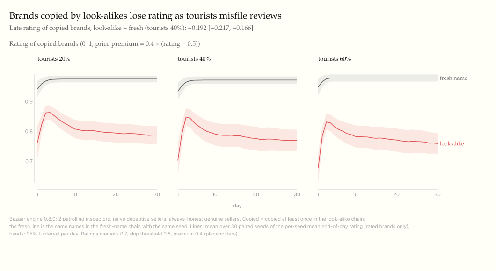
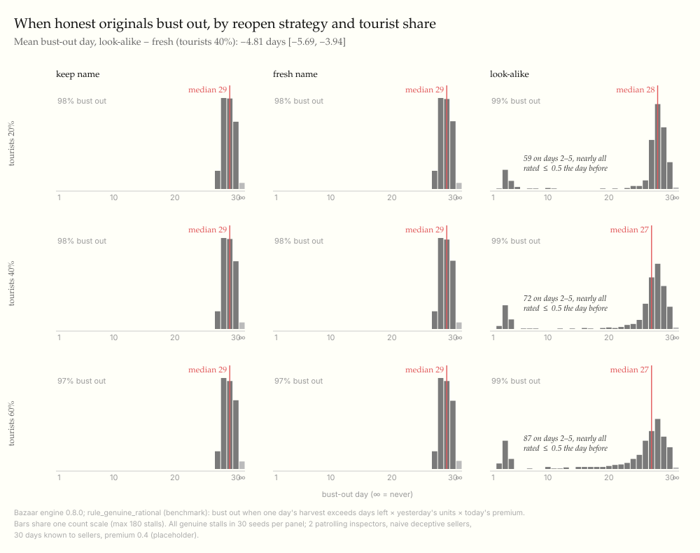

# Brands, look-alikes and bust-out

Run spec "brands, look-alikes and bust-out (rule-based only)", predictions written 2026-11-06 before any run.

Prespecified, confirmatory run (buyers' budgets at the default, 1.0 × base price per unit). A companion exploratory run with budgets at 1.25 × base is in `runs/brand_budget125_summary.md`.

## Run record

- Buyers' budget level: `at`
- Engine `0.8.0`; commit `0a22990a7537656fd0abf7aa3639a2b4ec7d7364`; uncommitted at run time: ['?? analysis/brands.py', '?? brand_run.log', '?? run_brands.sh', '?? runs/brand_day1_v070.json', '?? runs/brand_day1_v070_budget125.json']
- Script sha256 `a196f4a5cbb02cd9a26e41cf6a314cee20270fec4d812a18ef6805a56671495c`
- Command: `.venv/bin/python -m analysis.brands --budget at --ref070 runs/brand_day1_v070.json --out runs/brand.json`
- Day-1 reference: engine 0.7.0 (`856d6f518baaf3bbb4c005c109aace945a33bdc0`), file `runs/brand_day1_v070.json`
- Python 3.12.7, numpy 2.5.4, macOS-26.6.2-arm64-arm-64bit
- 540 chains x 30 days on 8 workers; wall clock 68.1 min; load average [8.58, 6.33, 8.17] at start, [27.4, 24.0, 28.27] at end
- Seeds 0-29, paired

## Design (prespecified)

- Ratings public (memory 0.7, skip threshold 0.5; locals and experts see them); 2 patrolling inspectors, not uniformed; naive deceptive sellers (`rule_deceptive`); 30 days, known to sellers; imitation off; brands on, premium pi = 0.4 (placeholder).
- Factorial: reopen strategy (keep / fresh / look-alike) x tourist share (0.2 / 0.4 / 0.6; locals and experts split the rest evenly, so 0.4 is not the default 0.4 / 0.4 / 0.2 mix) x genuine policy (`rule_genuine` = `rule_honest`, always honest; `rule_genuine_rational`): 18 conditions.
- Decided 2026-11-06 before the run: the rational seller's "future" is the premium its name earns (days left including today x yesterday's units x today's price above the neutral-rating price); day 1 has no yesterday, so day 2 is the first decision day. Look-alikes copy the highest-rated full-price brand (genuine or deceptive tier, never a look-alike) on another stall of the category; unrated = 0.5; ties at random. A busted-out stall keeps claiming its old quality on every channel, with no caution, and keeps its name if caught.
- Late = mean of days 26–30. Intervals 95% paired t over seeds, unadjusted. Confirmatory: PE1, PE2, PE3, PE4.

## Gate

- Calibration: median bust-out day >= 25 (rational, fresh, tourists 40%): **passed** (median 29 over 540 genuine stalls x seeds; never = 31; 97.6% bust out; 0.0% before day 25)
- Day-1 outcomes equal engine 0.7.0 for the same conditions: **passed** (540 of 540 chains (outcome minus the 0.8.0 brands block, byte for byte))

## Confirmatory

- **PE1**: late profit per deceptive stall, look-alike − fresh (tourists 40%, rule_genuine): $−83.00 [−89.19, −76.81] * per day. Prediction > 0. **Verdict: contradicted (interval on the opposite side of 0).**
- **PE2**: per-seed slope of that gap over tourist share: $−14.07 [−16.45, −11.68] * per +0.2 of tourist share. Prediction > 0. **Verdict: contradicted (interval on the opposite side of 0).**
- **PE3**: late rating of brands copied at least once, look-alike − fresh (same names and seeds; tourists 40%, rule_genuine): −0.192 [−0.217, −0.166] *. Prediction < 0. **Verdict: supported.**
- **PE4**: mean bust-out day of genuine stalls (never = 31), look-alike − fresh (tourists 40%, rule_genuine_rational): −4.81 [−5.69, −3.94] * days. Prediction < 0. **Verdict: supported.** Share that bust out: fresh 97.6 [96.5, 98.6]%, look-alike 99.4 [98.8, 100.1]%; difference +1.9 [+0.9, +2.8] * points.

## By tourist share (exploratory except the 40% cells above)

### Deceptive profit gap and copied-brand ratings

| Tourists | Genuine policy | Deceptive profit/stall/day, look-alike − fresh ($) | Copied brands' late rating: fresh | look-alike | look-alike − fresh | genuine originals only | Brands copied per seed |
|---|---|---|---|---|---|---|---|
| tourists 20% | rule_genuine | −64.68 [−68.61, −60.75] * | 0.976 [0.965, 0.987] | 0.801 [0.774, 0.829] | −0.174 [−0.196, −0.152] * | −0.179 [−0.202, −0.156] * | 21.2 [20.7, 21.7] |
| tourists 40% | rule_genuine | −83.00 [−89.19, −76.81] * | 0.972 [0.960, 0.984] | 0.781 [0.749, 0.813] | −0.192 [−0.217, −0.166] * | −0.198 [−0.226, −0.171] * | 21.1 [20.6, 21.5] |
| tourists 60% | rule_genuine | −92.81 [−97.93, −87.69] * | 0.979 [0.967, 0.991] | 0.774 [0.739, 0.808] | −0.206 [−0.237, −0.174] * | −0.210 [−0.243, −0.178] * | 21.0 [20.6, 21.4] |
| tourists 20% | rule_genuine_rational | −63.07 [−69.28, −56.86] * | 0.942 [0.930, 0.953] | 0.657 [0.617, 0.696] | −0.285 [−0.324, −0.246] * | −0.293 [−0.333, −0.253] * | 21.2 [20.7, 21.7] |
| tourists 40% | rule_genuine_rational | −77.69 [−84.29, −71.09] * | 0.919 [0.907, 0.931] | 0.561 [0.513, 0.609] | −0.358 [−0.404, −0.311] * | −0.370 [−0.419, −0.320] * | 21.1 [20.6, 21.5] |
| tourists 60% | rule_genuine_rational | −81.77 [−89.67, −73.87] * | 0.915 [0.902, 0.929] | 0.475 [0.414, 0.535] | −0.441 [−0.503, −0.378] * | −0.451 [−0.515, −0.386] * | 21.0 [20.6, 21.4] |

Slope of the profit gap with rule_genuine_rational: $−9.35 [−13.94, −4.76] * per +0.2 of tourist share.

Copied originals by type (count over seeds):

- tourists 20%, rule_genuine: {'genuine': 540, 'deceptive': 95}
- tourists 40%, rule_genuine: {'genuine': 540, 'deceptive': 92}
- tourists 60%, rule_genuine: {'genuine': 540, 'deceptive': 90}
- tourists 20%, rule_genuine_rational: {'genuine': 540, 'deceptive': 95}
- tourists 40%, rule_genuine_rational: {'genuine': 540, 'deceptive': 92}
- tourists 60%, rule_genuine_rational: {'genuine': 540, 'deceptive': 90}

### Bust-out timing (rule_genuine_rational)

| Tourists | Strategy | Mean bust-out day (never = 31) | Median (pooled) | Share bust out (%) |
|---|---|---|---|---|
| tourists 20% | keep name | 28.82 [28.76, 28.89] | 29 | 97.8 [96.7, 98.8] |
| tourists 20% | fresh name | 28.83 [28.76, 28.89] | 29 | 97.8 [96.7, 98.8] |
| tourists 20% | look-alike | 25.21 [24.40, 26.01] | 28 | 99.4 [98.8, 100.1] |
| tourists 40% | keep name | 28.83 [28.77, 28.89] | 29 | 97.6 [96.5, 98.6] |
| tourists 40% | fresh name | 28.84 [28.77, 28.90] | 29 | 97.6 [96.5, 98.6] |
| tourists 40% | look-alike | 24.02 [23.17, 24.87] | 27 | 99.4 [98.8, 100.1] |
| tourists 60% | keep name | 28.84 [28.78, 28.91] | 29 | 97.2 [96.0, 98.4] |
| tourists 60% | fresh name | 28.85 [28.78, 28.91] | 29 | 97.0 [95.9, 98.2] |
| tourists 60% | look-alike | 22.51 [21.41, 23.60] | 27 | 99.4 [98.8, 100.1] |

Paired contrasts in mean bust-out day (days):

| Tourists | look-alike − fresh | keep − fresh | share busting, look-alike − fresh (pts) |
|---|---|---|---|
| tourists 20% | −3.62 [−4.44, −2.80] * | −0.00 [−0.01, +0.00] | +1.7 [+0.7, +2.6] * |
| tourists 40% | −4.81 [−5.69, −3.94] * | −0.00 [−0.01, +0.00] | +1.9 [+0.9, +2.8] * |
| tourists 60% | −6.34 [−7.44, −5.24] * | −0.00 [−0.01, +0.00] | +2.4 [+1.4, +3.5] * |

Do bust-outs cluster on copied brands? Per seed, mean bust-out day of genuine stalls whose name was copied on or before their bust-out day (any day if they never busted) minus the other genuine stalls (look-alike chains):

| Tourists | Copied − not copied (days) | Copied stalls | Other stalls | Seeds with both |
|---|---|---|---|---|
| tourists 20% | – | 540 | 0 | 0 |
| tourists 40% | – | 540 | 0 | 0 |
| tourists 60% | – | 540 | 0 | 0 |

## Keep against fresh and look-alike (exploratory)

| Tourists | Genuine policy | Deceptive profit: fresh − keep ($) | look-alike − keep ($) | Shortfall: fresh − keep (pts) | look-alike − keep (pts) | look-alike − fresh (pts) |
|---|---|---|---|---|---|---|
| tourists 20% | rule_genuine | +44.96 [+41.27, +48.66] * | −19.71 [−22.18, −17.25] * | +14.3 [+13.6, +15.0] * | −20.9 [−22.4, −19.3] * | −35.2 [−36.4, −33.9] * |
| tourists 40% | rule_genuine | +42.00 [+38.26, +45.74] * | −41.00 [−46.31, −35.69] * | +4.2 [+3.4, +5.0] * | −34.3 [−36.5, −32.1] * | −38.5 [−40.4, −36.5] * |
| tourists 60% | rule_genuine | +30.15 [+25.03, +35.26] * | −62.66 [−68.36, −56.96] * | −2.0 [−2.9, −1.0] * | −41.8 [−44.4, −39.1] * | −39.8 [−42.2, −37.4] * |
| tourists 20% | rule_genuine_rational | +51.01 [+46.64, +55.37] * | −12.06 [−16.01, −8.12] * | +13.5 [+12.6, +14.3] * | +2.2 [−1.7, +6.1] | −11.3 [−15.0, −7.5] * |
| tourists 40% | rule_genuine_rational | +46.40 [+42.08, +50.72] * | −31.29 [−37.74, −24.84] * | +4.4 [+3.8, +5.1] * | +3.5 [−1.7, +8.7] | −0.9 [−6.0, +4.1] |
| tourists 60% | rule_genuine_rational | +39.57 [+34.66, +44.49] * | −42.20 [−50.53, −33.87] * | −0.5 [−1.1, +0.1] | +5.3 [−0.1, +10.6] | +5.7 [+0.7, +10.8] * |

Buyer surplus per arrived buyer, late ($), paired contrasts:

| Tourists | Genuine policy | fresh − keep | look-alike − keep | look-alike − fresh |
|---|---|---|---|---|
| tourists 20% | rule_genuine | −5.64 [−6.04, −5.23] * | +3.28 [+3.01, +3.55] * | +8.92 [+8.41, +9.43] * |
| tourists 40% | rule_genuine | −4.57 [−5.05, −4.08] * | +6.71 [+6.25, +7.18] * | +11.28 [+10.61, +11.96] * |
| tourists 60% | rule_genuine | −3.16 [−3.79, −2.53] * | +9.74 [+9.15, +10.33] * | +12.90 [+12.06, +13.74] * |
| tourists 20% | rule_genuine_rational | −6.58 [−7.00, −6.17] * | +0.34 [−0.18, +0.87] | +6.93 [+6.36, +7.50] * |
| tourists 40% | rule_genuine_rational | −5.59 [−6.04, −5.15] * | +1.42 [+0.45, +2.39] * | +7.01 [+6.05, +7.97] * |
| tourists 60% | rule_genuine_rational | −4.38 [−4.84, −3.92] * | +1.65 [+0.22, +3.07] * | +6.03 [+4.82, +7.24] * |

Rational − always-honest genuine sellers, late:

| Tourists | Strategy | Shortfall (pts) | Buyer surplus ($) | Genuine profit/stall ($) |
|---|---|---|---|---|
| tourists 20% | keep name | +13.2 [+11.7, +14.7] * | −1.33 [−1.51, −1.15] * | −145.09 [−152.38, −137.80] * |
| tourists 20% | fresh name | +12.4 [+11.3, +13.4] * | −2.27 [−2.61, −1.93] * | −144.02 [−151.31, −136.74] * |
| tourists 20% | look-alike | +36.3 [+33.7, +38.8] * | −4.27 [−4.75, −3.78] * | −209.89 [−224.86, −194.92] * |
| tourists 40% | keep name | +12.3 [+11.2, +13.4] * | −1.92 [−2.21, −1.62] * | −142.21 [−150.12, −134.30] * |
| tourists 40% | fresh name | +12.6 [+11.3, +13.8] * | −2.94 [−3.53, −2.35] * | −142.21 [−149.58, −134.83] * |
| tourists 40% | look-alike | +50.1 [+46.7, +53.4] * | −7.21 [−7.90, −6.53] * | −223.23 [−242.64, −203.82] * |
| tourists 60% | keep name | +11.6 [+10.7, +12.4] * | −2.72 [−3.16, −2.28] * | −138.04 [−145.84, −130.24] * |
| tourists 60% | fresh name | +13.1 [+11.8, +14.4] * | −3.94 [−4.74, −3.14] * | −140.10 [−147.51, −132.69] * |
| tourists 60% | look-alike | +58.6 [+55.1, +62.2] * | −10.81 [−12.07, −9.56] * | −228.04 [−249.38, −206.70] * |

## Late levels (days 26–30)

| Genuine policy | Tourists | Strategy | Deceptive profit ($) | Genuine profit ($) | Shortfall (%) | Buyer surplus ($) | Genuine premium (%) | Deceptive premium (%) | Rating, genuine originals | Rating, deceptive (current name) | Catches/day | Renames/day | Look-alike stalls | Busted stalls |
|---|---|---|---|---|---|---|---|---|---|---|---|---|---|---|
| rule_genuine | tourists 20% | keep name | −136.86 [−147.55, −126.17] | 41.66 [39.02, 44.30] | 28.3 [27.5, 29.2] | −2.76 [−3.02, −2.51] | 20.0 [20.0, 20.0] | −20.0 [−20.0, −20.0] | 1.000 [1.000, 1.000] | 0.000 [0.000, 0.000] | 27.7 [26.1, 29.4] | 0.00 [0.00, 0.00] | 0.0 [0.0, 0.0] | 0.0 [0.0, 0.0] |
| rule_genuine | tourists 20% | fresh name | −91.90 [−104.85, −78.94] | 39.76 [37.10, 42.43] | 42.6 [41.5, 43.8] | −8.40 [−8.99, −7.82] | 20.0 [20.0, 20.0] | −1.0 [−1.4, −0.7] | 1.000 [1.000, 1.000] | 0.000 [0.000, 0.000] | 27.8 [26.1, 29.6] | 27.81 [26.15, 29.47] | 0.0 [0.0, 0.0] | 0.0 [0.0, 0.0] |
| rule_genuine | tourists 20% | look-alike | −156.58 [−167.14, −146.01] | 37.75 [34.42, 41.08] | 7.5 [5.7, 9.2] | 0.52 [0.22, 0.81] | 12.9 [11.9, 13.8] | 18.0 [17.5, 18.5] | 0.821 [0.798, 0.844] | 0.000 [0.000, 0.000] | 27.8 [26.1, 29.4] | 27.76 [26.15, 29.37] | 15.0 [15.0, 15.0] | 0.0 [0.0, 0.0] |
| rule_genuine | tourists 40% | keep name | −132.27 [−144.09, −120.45] | 36.55 [33.47, 39.63] | 45.4 [44.5, 46.4] | −6.48 [−6.88, −6.08] | 20.0 [20.0, 20.0] | −20.0 [−20.0, −20.0] | 1.000 [1.000, 1.000] | 0.000 [0.000, 0.000] | 31.6 [29.8, 33.4] | 0.00 [0.00, 0.00] | 0.0 [0.0, 0.0] | 0.0 [0.0, 0.0] |
| rule_genuine | tourists 40% | fresh name | −90.27 [−103.15, −77.39] | 35.12 [31.95, 38.30] | 49.6 [48.1, 51.1] | −11.05 [−11.83, −10.28] | 20.0 [20.0, 20.0] | −0.7 [−0.9, −0.5] | 1.000 [1.000, 1.000] | 0.000 [0.000, 0.000] | 31.5 [29.8, 33.2] | 31.53 [29.86, 33.19] | 0.0 [0.0, 0.0] | 0.0 [0.0, 0.0] |
| rule_genuine | tourists 40% | look-alike | −173.27 [−185.00, −161.54] | 33.45 [29.42, 37.49] | 11.1 [8.6, 13.6] | 0.23 [−0.15, 0.62] | 12.1 [11.0, 13.2] | 16.6 [15.8, 17.4] | 0.802 [0.774, 0.829] | 0.000 [0.000, 0.000] | 31.6 [29.8, 33.4] | 31.49 [29.74, 33.25] | 15.0 [15.0, 15.0] | 0.0 [0.0, 0.0] |
| rule_genuine | tourists 60% | keep name | −137.47 [−147.97, −126.98] | 32.42 [29.14, 35.70] | 56.6 [55.6, 57.5] | −9.81 [−10.33, −9.29] | 20.0 [20.0, 20.0] | −20.0 [−20.0, −20.0] | 1.000 [1.000, 1.000] | 0.000 [0.000, 0.000] | 37.2 [35.5, 38.9] | 0.00 [0.00, 0.00] | 0.0 [0.0, 0.0] | 0.0 [0.0, 0.0] |
| rule_genuine | tourists 60% | fresh name | −107.33 [−119.84, −94.81] | 31.48 [28.05, 34.91] | 54.6 [52.8, 56.4] | −12.97 [−14.00, −11.94] | 20.0 [20.0, 20.0] | −0.4 [−0.6, −0.2] | 1.000 [1.000, 1.000] | 0.000 [0.000, 0.000] | 37.2 [35.4, 38.9] | 37.09 [35.38, 38.79] | 0.0 [0.0, 0.0] | 0.0 [0.0, 0.0] |
| rule_genuine | tourists 60% | look-alike | −200.14 [−210.98, −189.29] | 30.45 [25.91, 35.00] | 14.8 [11.6, 17.9] | −0.07 [−0.55, 0.41] | 11.6 [10.3, 13.0] | 15.8 [14.9, 16.8] | 0.790 [0.757, 0.822] | 0.000 [0.000, 0.000] | 37.1 [35.4, 38.8] | 37.10 [35.44, 38.76] | 15.0 [15.0, 15.0] | 0.0 [0.0, 0.0] |
| rule_genuine_rational | tourists 20% | keep name | −134.37 [−145.07, −123.67] | −103.43 [−111.08, −95.78] | 41.5 [39.7, 43.3] | −4.09 [−4.36, −3.82] | 19.3 [19.1, 19.4] | −20.0 [−20.0, −20.0] | 0.962 [0.954, 0.969] | 0.000 [0.000, 0.000] | 57.8 [56.2, 59.5] | 0.00 [0.00, 0.00] | 0.0 [0.0, 0.0] | 7.8 [7.6, 8.1] |
| rule_genuine_rational | tourists 20% | fresh name | −83.36 [−96.55, −70.18] | −104.26 [−111.71, −96.80] | 55.0 [53.7, 56.2] | −10.67 [−11.24, −10.11] | 19.3 [19.2, 19.5] | −1.1 [−1.5, −0.8] | 0.965 [0.960, 0.971] | 0.000 [0.000, 0.000] | 57.7 [56.0, 59.5] | 27.73 [25.97, 29.50] | 0.0 [0.0, 0.0] | 7.8 [7.6, 8.0] |
| rule_genuine_rational | tourists 20% | look-alike | −146.44 [−156.82, −136.05] | −172.14 [−188.77, −155.52] | 43.7 [39.8, 47.7] | −3.75 [−4.30, −3.19] | 8.5 [7.0, 10.1] | 16.3 [15.6, 17.0] | 0.672 [0.634, 0.711] | 0.000 [0.000, 0.000] | 70.8 [67.6, 74.0] | 27.57 [25.96, 29.17] | 15.0 [15.0, 15.0] | 11.2 [10.5, 11.8] |
| rule_genuine_rational | tourists 40% | keep name | −128.22 [−139.58, −116.86] | −105.66 [−114.25, −97.07] | 57.7 [56.4, 59.0] | −8.40 [−8.77, −8.03] | 18.9 [18.7, 19.1] | −20.0 [−20.0, −20.0] | 0.946 [0.938, 0.954] | 0.000 [0.000, 0.000] | 61.3 [59.6, 62.9] | 0.00 [0.00, 0.00] | 0.0 [0.0, 0.0] | 7.8 [7.6, 8.0] |
| rule_genuine_rational | tourists 40% | fresh name | −81.82 [−94.77, −68.87] | −107.08 [−114.98, −99.19] | 62.1 [61.0, 63.3] | −13.99 [−14.58, −13.41] | 18.9 [18.7, 19.1] | −0.8 [−1.1, −0.5] | 0.945 [0.938, 0.952] | 0.000 [0.000, 0.000] | 61.6 [60.0, 63.2] | 31.47 [29.75, 33.19] | 0.0 [0.0, 0.0] | 7.8 [7.6, 8.0] |
| rule_genuine_rational | tourists 40% | look-alike | −159.51 [−171.99, −147.03] | −189.78 [−212.12, −167.44] | 61.2 [56.0, 66.4] | −6.98 [−7.84, −6.12] | 5.4 [3.5, 7.3] | 13.7 [12.5, 14.9] | 0.576 [0.530, 0.622] | 0.000 [0.000, 0.000] | 80.5 [77.0, 84.1] | 31.73 [29.96, 33.49] | 15.0 [15.0, 15.0] | 12.6 [11.8, 13.5] |
| rule_genuine_rational | tourists 60% | keep name | −133.38 [−144.15, −122.61] | −105.62 [−113.65, −97.59] | 68.1 [67.3, 69.0] | −12.53 [−13.03, −12.03] | 18.7 [18.5, 18.9] | −20.0 [−20.0, −20.0] | 0.934 [0.927, 0.942] | 0.000 [0.000, 0.000] | 67.1 [65.3, 68.9] | 0.00 [0.00, 0.00] | 0.0 [0.0, 0.0] | 7.8 [7.5, 8.0] |
| rule_genuine_rational | tourists 60% | fresh name | −93.81 [−105.09, −82.52] | −108.62 [−116.31, −100.94] | 67.7 [66.6, 68.8] | −16.91 [−17.60, −16.22] | 18.7 [18.5, 18.9] | −0.5 [−0.7, −0.3] | 0.935 [0.927, 0.942] | 0.000 [0.000, 0.000] | 67.3 [65.7, 69.0] | 37.27 [35.71, 38.83] | 0.0 [0.0, 0.0] | 7.8 [7.5, 8.0] |
| rule_genuine_rational | tourists 60% | look-alike | −175.58 [−188.31, −162.85] | −197.59 [−222.43, −172.75] | 73.4 [67.7, 79.1] | −10.88 [−12.34, −9.43] | 1.8 [−0.7, 4.4] | 10.1 [7.7, 12.5] | 0.484 [0.423, 0.545] | 0.000 [0.000, 0.000] | 90.2 [86.1, 94.3] | 37.31 [35.58, 39.04] | 15.0 [15.0, 15.0] | 13.7 [12.7, 14.6] |

## Day 1 levels

| Genuine policy | Tourists | Strategy | Deceptive profit ($) | Shortfall (%) | Catches | Renames |
|---|---|---|---|---|---|---|
| rule_genuine | tourists 20% | keep name | −132.40 [−161.23, −103.56] | 17.3 [13.5, 21.0] | 27.5 [23.4, 31.7] | 0.00 [0.00, 0.00] |
| rule_genuine | tourists 20% | fresh name | −132.40 [−161.23, −103.56] | 17.3 [13.5, 21.0] | 27.5 [23.4, 31.7] | 26.43 [22.57, 30.30] |
| rule_genuine | tourists 20% | look-alike | −132.40 [−161.23, −103.56] | 17.3 [13.5, 21.0] | 27.5 [23.4, 31.7] | 26.43 [22.57, 30.30] |
| rule_genuine | tourists 40% | keep name | −142.62 [−173.84, −111.40] | 20.9 [16.3, 25.6] | 31.7 [27.8, 35.5] | 0.00 [0.00, 0.00] |
| rule_genuine | tourists 40% | fresh name | −142.62 [−173.84, −111.40] | 20.9 [16.3, 25.6] | 31.7 [27.8, 35.5] | 30.03 [26.58, 33.48] |
| rule_genuine | tourists 40% | look-alike | −142.62 [−173.84, −111.40] | 20.9 [16.3, 25.6] | 31.7 [27.8, 35.5] | 30.03 [26.58, 33.48] |
| rule_genuine | tourists 60% | keep name | −167.10 [−193.09, −141.10] | 20.6 [16.1, 25.0] | 38.8 [35.1, 42.4] | 0.00 [0.00, 0.00] |
| rule_genuine | tourists 60% | fresh name | −167.10 [−193.09, −141.10] | 20.6 [16.1, 25.0] | 38.8 [35.1, 42.4] | 36.27 [32.92, 39.61] |
| rule_genuine | tourists 60% | look-alike | −167.10 [−193.09, −141.10] | 20.6 [16.1, 25.0] | 38.8 [35.1, 42.4] | 36.27 [32.92, 39.61] |
| rule_genuine_rational | tourists 20% | keep name | −132.40 [−161.23, −103.56] | 17.3 [13.5, 21.0] | 27.5 [23.4, 31.7] | 0.00 [0.00, 0.00] |
| rule_genuine_rational | tourists 20% | fresh name | −132.40 [−161.23, −103.56] | 17.3 [13.5, 21.0] | 27.5 [23.4, 31.7] | 26.43 [22.57, 30.30] |
| rule_genuine_rational | tourists 20% | look-alike | −132.40 [−161.23, −103.56] | 17.3 [13.5, 21.0] | 27.5 [23.4, 31.7] | 26.43 [22.57, 30.30] |
| rule_genuine_rational | tourists 40% | keep name | −142.62 [−173.84, −111.40] | 20.9 [16.3, 25.6] | 31.7 [27.8, 35.5] | 0.00 [0.00, 0.00] |
| rule_genuine_rational | tourists 40% | fresh name | −142.62 [−173.84, −111.40] | 20.9 [16.3, 25.6] | 31.7 [27.8, 35.5] | 30.03 [26.58, 33.48] |
| rule_genuine_rational | tourists 40% | look-alike | −142.62 [−173.84, −111.40] | 20.9 [16.3, 25.6] | 31.7 [27.8, 35.5] | 30.03 [26.58, 33.48] |
| rule_genuine_rational | tourists 60% | keep name | −167.10 [−193.09, −141.10] | 20.6 [16.1, 25.0] | 38.8 [35.1, 42.4] | 0.00 [0.00, 0.00] |
| rule_genuine_rational | tourists 60% | fresh name | −167.10 [−193.09, −141.10] | 20.6 [16.1, 25.0] | 38.8 [35.1, 42.4] | 36.27 [32.92, 39.61] |
| rule_genuine_rational | tourists 60% | look-alike | −167.10 [−193.09, −141.10] | 20.6 [16.1, 25.0] | 38.8 [35.1, 42.4] | 36.27 [32.92, 39.61] |

## Floors and ceilings

- keep|t20|honest rating_genuine: late mean 1.000
- keep|t20|honest rating_deceptive_current: late mean 0.000
- keep|t20|honest task_complete: late mean 0.000
- fresh|t20|honest rating_genuine: late mean 1.000
- fresh|t20|honest rating_deceptive_current: late mean 0.000
- fresh|t20|honest task_complete: late mean 0.000
- lookalike|t20|honest rating_deceptive_current: late mean 0.000
- lookalike|t20|honest task_complete: late mean 0.000
- keep|t40|honest rating_genuine: late mean 1.000
- keep|t40|honest rating_deceptive_current: late mean 0.000
- keep|t40|honest task_complete: late mean 0.000
- fresh|t40|honest rating_genuine: late mean 1.000
- fresh|t40|honest rating_deceptive_current: late mean 0.000
- fresh|t40|honest task_complete: late mean 0.000
- lookalike|t40|honest rating_deceptive_current: late mean 0.000
- lookalike|t40|honest task_complete: late mean 0.001
- keep|t60|honest rating_genuine: late mean 1.000
- keep|t60|honest rating_deceptive_current: late mean 0.000
- keep|t60|honest task_complete: late mean 0.000
- fresh|t60|honest rating_genuine: late mean 1.000
- fresh|t60|honest rating_deceptive_current: late mean 0.000
- fresh|t60|honest task_complete: late mean 0.000
- lookalike|t60|honest rating_deceptive_current: late mean 0.000
- lookalike|t60|honest task_complete: late mean 0.004
- keep|t20|rational rating_deceptive_current: late mean 0.000
- keep|t20|rational task_complete: late mean 0.000
- fresh|t20|rational rating_deceptive_current: late mean 0.000
- fresh|t20|rational task_complete: late mean 0.000
- lookalike|t20|rational rating_deceptive_current: late mean 0.000
- lookalike|t20|rational task_complete: late mean 0.000
- lookalike|t20|rational share of genuine stalls that bust out: 0.994
- keep|t40|rational rating_deceptive_current: late mean 0.000
- keep|t40|rational task_complete: late mean 0.000
- fresh|t40|rational rating_deceptive_current: late mean 0.000
- fresh|t40|rational task_complete: late mean 0.000
- lookalike|t40|rational rating_deceptive_current: late mean 0.000
- lookalike|t40|rational task_complete: late mean 0.000
- lookalike|t40|rational share of genuine stalls that bust out: 0.994
- keep|t60|rational rating_deceptive_current: late mean 0.000
- keep|t60|rational task_complete: late mean 0.000
- fresh|t60|rational rating_deceptive_current: late mean 0.000
- fresh|t60|rational task_complete: late mean 0.000
- lookalike|t60|rational rating_deceptive_current: late mean 0.000
- lookalike|t60|rational task_complete: late mean 0.000
- lookalike|t60|rational share of genuine stalls that bust out: 0.994

## Verdicts

Confirmatory family: PE1–PE4, in the prespecified run with budgets at 1.0 × base. Intervals are unadjusted 95% paired t-intervals over 30 seeds.

- **PE1 — contradicted.** Look-alike reopeners earned $83.00 a day less per deceptive stall than fresh-name reopeners [−89.19, −76.81].
- **PE2 — contradicted.** The gap shrank as the tourist share rose: −$14.07 per +0.2 of tourist share [−16.45, −11.68].
- **PE3 — supported.** Copied brands ended 0.192 lower in rating than the same brands in fresh-name chains [−0.217, −0.166].
- **PE4 — supported.** Rational originals busted out 4.81 days earlier under look-alikes [−5.69, −3.94]. The share that busted out rose by 1.9 points [+0.9, +2.8].

Two of the four predictions are supported. Both predictions about look-alike profit are contradicted.

## Reading (written after the results)

*Written on 2026-11-06, after the results.*

1. **Look-alikes damage the original brand.** Tourists file their reviews of a look-alike's low quality under the original's name. Copied brands end 0.17–0.21 lower in rating than the same brands in fresh-name chains when originals are always honest. When originals follow the rational rule, they end 0.29–0.44 lower. The damage grows with the tourist share in both cases. The gap opens on day 1 and does not close (plot).
2. **Look-alikes do not profit here, and the cause looks like price, not deception.** A look-alike posts the original's price, about 1.2 × base for a top-rated original: its deceptive stalls' premium is +16 to +18%, against about −1% for fresh names. With budgets at 1.0 × base, many buyers cannot afford that price. With always-honest originals, look-alike chains have 35–40 points less shortfall than fresh-name chains and $9–13 more surplus per buyer: the look-alikes deceive fewer people because they price themselves out. With rational originals the shortfall gap is −11 to +6 points. Fresh names beat keeping the old name by $30–51 a day, because a fresh name escapes the 20% discount that a rating of 0 brings.
3. **With budgets at 1.25 × base the look-alike penalty mostly goes away** (exploratory; `runs/brand_budget125_summary.md`).
   - With always-honest originals, the PE1 gap shrinks to −$8.25 [−17.70, +1.19].
   - With rational originals, it turns positive, +$14 to +$20.
   - So whether look-alikes pay depends at least partly on whether buyers can afford the copied premium.
   - The tourist slope stays negative with always-honest originals: −$6.40 [−9.31, −3.48]. The runs do not show why more tourists hurt look-alikes relative to fresh names. One untested candidate: catches per day rise with the tourist share under every strategy.
4. **Bust-out timing.** Under the premium-only rule, rational originals bust out at the very end (median day 29 of 30) unless a look-alike drags their rating to 0.5 or below. At that point the premium is gone and the rule busts out at once.
   - This makes an early cluster: 59–87 of 540 stalls bust out on days 2–5, nearly all rated 0.5 or below the day before.
   - It moves the mean bust-out day 3.6–6.3 days earlier, more so with more tourists.
   - At 1.25 × base the shift is only 0.9–2.7 days and the early cluster nearly vanishes (2–11 stalls).
5. **The rational benchmark loses money in this market.** In the late days, rational sellers make $138–228 a day less per genuine stall than always-honest sellers. Catches per day roughly double: at tourists 40% with names kept, they go from 31.6 to 61.3. The rule's harvest term counts no expected penalty. With 2 patrolling inspectors, busted stalls that keep making their old claims get caught. PE4 therefore describes when this rule fires, not whether busting out pays.
6. **Whether bust-outs cluster on copied brands could not be tested.** In every look-alike chain, every genuine brand was copied at least once. Honest originals all tie at a rating of 1.0, and the random tie-break spreads the copies across all of them.

## Caveats

- `rule_genuine` is implemented as `rule_honest`, which is always honest.
- The tourist-share levels split the other buyers evenly between locals and experts. Tourists 0.4 is therefore 0.4 / 0.3 / 0.3, not the default mix of 0.4 / 0.4 / 0.2.
- **Budgets.** At 1.0 × base the 20% premium prices single-unit buyers out.
  - Task completion is near 0 in every cell of the prespecified run, a floor.
  - The 1.25 × run is the check. It was added after the 2-seed smoke test and before either full run.
- **Unrated stalls at 1.25 × base.** In the 1.25 × run, roughly half of genuine stalls are never rated and sell nothing.
  - Checked on 4 seeds of keep / tourists 40% / `rule_genuine` at day 8: 39–56% of genuine stalls were rated. Rated stalls sold about 15 units a day; unrated stalls sold none.
  - Rating columns average rated brands only. So a genuine rating of 1.000 there sits beside a genuine premium of 8.5%.
  - At 1.0 × base, every genuine stall in the chain checked was rated by day 6.
- **The day-1 gate passes partly by construction.** On day 1 every brand is unrated, and deceptive stalls price like genuine ones (`deceptive_price_factor` 1.0). A look-alike's copied price therefore equals its own, and rule-based buyers do not read names. The gate shows that 0.8.0 changes nothing else on day 1. It does not test the look-alike path.
- Premium pi = 0.4, ratings memory 0.7 and the skip threshold of 0.5 are placeholders.
- The rational rule ignores penalties (see point 5 of the reading).
- **Plots redrawn after the run.** The changes were label placement, footnote wrapping and an annotation of the early bust-outs. The exploratory summary's section headings were also relabelled. Only plotting and report code changed, so the script's sha256 now differs from the one in the run record. All numbers come from the run as recorded.
- The "Mean of empty slice" warnings in the run log (`runs/brand_run.log`) come from series that have no value on any late day for some seeds, such as the ratings of a stall type that is never rated.
