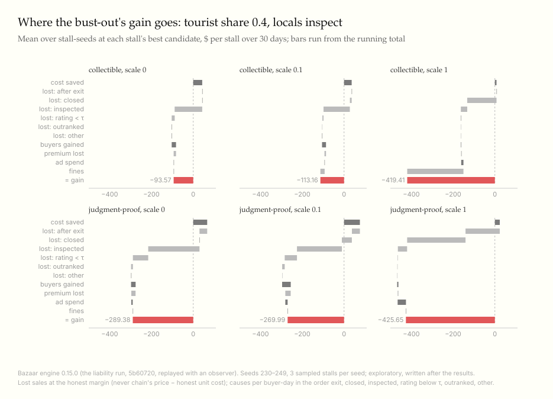
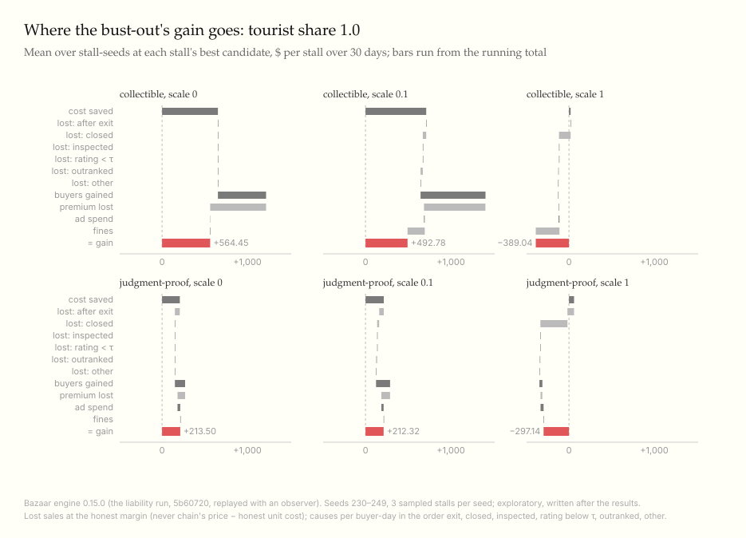

# Bust-out decomposition (exploratory)

Spec "Part 1: bust-out decomposition" (2026-11-11). **Exploratory, written after the results** of the liability run (`runs/liability_summary.md`, 5b60720). Analysis only: no engine change.

## Method

- Every condition of the liability run (2 liability arms × 2 verification levels × detect_scale {0, 0.1, 1}), every sampled stall-seed (seeds 230–249, 3 stalls): the never chain and the chain of the stall's best candidate (from `runs/liability.csv`) were replayed at engine 0.15.0 with an observer that wraps `purchase`, `decide` (buyers) and `search_decide` and changes nothing (`analysis/bustout_decomp.py`).
- Gain = profit(best) − profit(never), split exactly (decided 2026-11-11):
  - a. cost saved: for each unit sold in the best chain, honest unit cost − its unit cost;
  - b. sales lost or gained, valued at the honest margin (the never chain's price that day − honest unit cost), per buyer-day: a buyer who bought fewer units from the stall than in the never chain is lost, its cause the first that applies of: the stall had exited; the buyer met it closed after a catch; inspected it and found it below its Q_req; saw its rating below τ = 0.5; it was among the buyer's candidates and another stall was chosen; other. A buyer who bought more is gained;
  - c. reputation premium lost: for each unit sold, its price − the never chain's price that day;
  - ad spend difference, and d. fines charged; e. anything left over (0 by construction: reported).
- Kept share = units sold in the best chain from the bust-out day to day 30 ÷ units in the never chain over the same days (judgment-proof: also over the days before the exit). Break-even = honest margin ÷ busted margin from the actual prices and costs (units-weighted, same window): a bust-out pays before fines only if the kept share exceeds it.
- Per condition: per seed the mean over its 3 stalls; mean and 95% t-interval over the 20 seeds, unadjusted.

## Run record and checks

- Replay: 960 chains (one never chain and the best-candidate chain per stall-seed, every condition), engine 0.15.0 at 5b60720, 4 workers at nice 19, wall clock 2.12 h; log `runs/bustout_run.log`.
- The stall's 30-day total in the replayed best chain equals the saved run in 720 of 720 stall-seeds; the never total in 720 of 720.
- Buyer records before the bust-out day that differ between the two chains: 0 (should be 0: the chains are identical until the bust-out).
- Largest |e| (left over) in any stall-seed: 0 cents.

## Decomposition by condition ($ per stall over 30 days)

**tourist share 0.4, locals inspect**

| Component | collectible, 0 | collectible, 0.1 | collectible, 1 | judgment-proof, 0 | judgment-proof, 0.1 | judgment-proof, 1 |
|---|---|---|---|---|---|---|
| a. cost saved on units sold after the bust-out | +43.17 [+16.78, +69.56] * | +36.51 [+20.04, +52.98] * | +7.84 [+3.82, +11.86] * | +66.78 [+44.04, +89.52] * | +75.86 [+48.99, +102.73] * | +23.38 [+11.71, +35.04] * |
| b. lost: after exit | +0.00 [+0.00, +0.00] | +0.00 [+0.00, +0.00] | +0.00 [+0.00, +0.00] | −36.74 [−64.85, −8.62] * | −38.21 [−66.48, −9.94] * | −163.86 [−234.98, −92.75] * |
| b. lost: closed after a catch | +0.00 [+0.00, +0.00] | −8.57 [−17.23, +0.08] | −140.06 [−182.44, −97.67] * | +0.00 [+0.00, +0.00] | −47.96 [−66.99, −28.93] * | −279.41 [−366.07, −192.75] * |
| b. lost: inspected and walked away | −131.93 [−165.81, −98.04] * | −126.05 [−160.80, −91.31] * | −30.64 [−47.89, −13.38] * | −245.32 [−324.51, −166.14] * | −215.08 [−286.78, −143.38] * | −44.30 [−63.88, −24.72] * |
| b. lost: rating below threshold | −14.35 [−42.50, +13.79] | −5.44 [−15.05, +4.17] | +0.00 [+0.00, +0.00] | −73.42 [−108.58, −38.27] * | −58.63 [−87.96, −29.31] * | −2.00 [−4.50, +0.50] |
| b. lost: outranked by another stall | +0.00 [+0.00, +0.00] | −1.77 [−4.13, +0.58] | −0.13 [−0.40, +0.14] | −8.83 [−16.83, −0.83] * | −12.14 [−19.89, −4.40] * | −0.96 [−2.28, +0.36] |
| b. lost: other (no recorded cause) | +0.00 [+0.00, +0.00] | +0.00 [+0.00, +0.00] | −0.06 [−0.18, +0.06] | +0.00 [+0.00, +0.00] | −0.33 [−1.03, +0.36] | −0.42 [−1.18, +0.34] |
| b. buyers gained | +20.79 [−5.05, +46.63] | +19.01 [−0.55, +38.57] | +1.98 [−0.28, +4.25] | +21.81 [+5.52, +38.11] * | +41.19 [+14.69, +67.70] * | +5.94 [+1.29, +10.59] * |
| c. reputation premium lost (price) | −11.26 [−27.58, +5.06] | −7.31 [−15.96, +1.34] | +0.00 [+0.00, +0.00] | −20.50 [−30.14, −10.85] * | −25.86 [−39.10, −12.63] * | −3.81 [−7.32, −0.31] * |
| ad spend (yells, whispers) | +0.02 [−0.01, +0.04] | +0.86 [+0.28, +1.44] * | +10.85 [+8.56, +13.13] * | +6.84 [+2.32, +11.35] * | +11.18 [+6.59, +15.77] * | +39.80 [+31.34, +48.25] * |
| d. fines charged | +0.00 [+0.00, +0.00] | −20.40 [−32.85, −7.95] * | −269.20 [−335.88, −202.52] * | +0.00 [+0.00, +0.00] | +0.00 [+0.00, +0.00] | +0.00 [+0.00, +0.00] |
| **= gain** | **−93.57 [−122.56, −64.59] *** | **−113.16 [−150.68, −75.64] *** | **−419.41 [−524.03, −314.80] *** | **−289.38 [−368.37, −210.39] *** | **−269.99 [−347.79, −192.19] *** | **−425.65 [−538.33, −312.98] *** |
| e. left over (largest, cents) | 0 | 0 | 0 | 0 | 0 | 0 |
| memo: fines escaped (uncollectible) | 0.00 [0.00, 0.00] | 0.00 [0.00, 0.00] | 0.00 [0.00, 0.00] | 0.00 [0.00, 0.00] | 89.40 [62.06, 116.74] | 529.60 [393.37, 665.83] |

**tourist share 1.0**

| Component | collectible, 0 | collectible, 0.1 | collectible, 1 | judgment-proof, 0 | judgment-proof, 0.1 | judgment-proof, 1 |
|---|---|---|---|---|---|---|
| a. cost saved on units sold after the bust-out | +655.18 [+511.93, +798.44] * | +712.33 [+491.84, +932.83] * | +19.68 [+10.29, +29.06] * | +208.26 [+158.10, +258.41] * | +213.94 [+159.70, +268.18] * | +59.78 [+39.04, +80.51] * |
| b. lost: after exit | +0.00 [+0.00, +0.00] | +0.00 [+0.00, +0.00] | +0.00 [+0.00, +0.00] | −57.52 [−86.35, −28.68] * | −53.22 [−83.45, −22.99] * | −77.79 [−123.55, −32.04] * |
| b. lost: closed after a catch | +0.00 [+0.00, +0.00] | −40.23 [−61.50, −18.96] * | −136.46 [−178.80, −94.12] * | +0.00 [+0.00, +0.00] | −23.75 [−39.06, −8.43] * | −316.90 [−408.17, −225.63] * |
| b. lost: inspected and walked away | +0.00 [+0.00, +0.00] | +0.00 [+0.00, +0.00] | +0.00 [+0.00, +0.00] | +0.00 [+0.00, +0.00] | +0.00 [+0.00, +0.00] | +0.00 [+0.00, +0.00] |
| b. lost: rating below threshold | +0.00 [+0.00, +0.00] | +0.00 [+0.00, +0.00] | +0.00 [+0.00, +0.00] | +0.00 [+0.00, +0.00] | +0.00 [+0.00, +0.00] | +0.00 [+0.00, +0.00] |
| b. lost: outranked by another stall | +0.00 [+0.00, +0.00] | −26.32 [−38.91, −13.73] * | −10.61 [−20.19, −1.04] * | +0.00 [+0.00, +0.00] | −13.53 [−22.69, −4.36] * | −11.33 [−17.45, −5.20] * |
| b. lost: other (no recorded cause) | +0.00 [+0.00, +0.00] | +0.00 [+0.00, +0.00] | +0.00 [+0.00, +0.00] | +0.00 [+0.00, +0.00] | +0.00 [+0.00, +0.00] | +0.00 [+0.00, +0.00] |
| b. buyers gained | +565.24 [+413.60, +716.89] * | +761.09 [+503.74, +1,018.43] * | +5.55 [+0.62, +10.49] * | +119.87 [+81.78, +157.97] * | +165.05 [+113.28, +216.82] * | +34.23 [+15.05, +53.41] * |
| c. reputation premium lost (price) | −655.98 [−807.76, −504.19] * | −720.69 [−989.65, −451.73] * | +0.00 [+0.00, +0.00] | −88.70 [−112.12, −65.27] * | −101.95 [−132.23, −71.68] * | −20.97 [−32.31, −9.62] * |
| ad spend (yells, whispers) | −0.00 [−0.03, +0.03] | +8.40 [+5.45, +11.36] * | +10.61 [+8.14, +13.08] * | +31.58 [+17.67, +45.50] * | +25.77 [+15.59, +35.95] * | +35.85 [+29.43, +42.26] * |
| d. fines charged | +0.00 [+0.00, +0.00] | −201.80 [−264.40, −139.20] * | −277.80 [−343.42, −212.18] * | +0.00 [+0.00, +0.00] | +0.00 [+0.00, +0.00] | +0.00 [+0.00, +0.00] |
| **= gain** | **+564.45 [+434.09, +694.81] *** | **+492.78 [+326.44, +659.13] *** | **−389.04 [−492.70, −285.38] *** | **+213.50 [+163.94, +263.06] *** | **+212.32 [+145.47, +279.17] *** | **−297.14 [−389.92, −204.36] *** |
| e. left over (largest, cents) | 0 | 0 | 0 | 0 | 0 | 0 |
| memo: fines escaped (uncollectible) | 0.00 [0.00, 0.00] | 0.00 [0.00, 0.00] | 0.00 [0.00, 0.00] | 0.00 [0.00, 0.00] | 77.20 [52.81, 101.59] | 671.60 [532.97, 810.23] |

## Units lost by cause (mean per stall-seed)

| Condition | Units, never (window) | Units, best (window) | after exit | closed after a catch | inspected and walked away | rating below threshold | outranked by another stall | other (no recorded cause) | gained |
|---|---|---|---|---|---|---|---|---|---|
| collectible, t40, 0 | 8.4 | 2.8 | 0.0 | 0.0 | 5.9 | 0.3 | 0.0 | 0.0 | 0.6 |
| collectible, t40, 0.1 | 8.1 | 2.4 | 0.0 | 0.6 | 5.5 | 0.1 | 0.1 | 0.0 | 0.6 |
| collectible, t40, 1 | 8.0 | 0.5 | 0.0 | 6.3 | 1.2 | 0.0 | 0.0 | 0.0 | 0.1 |
| collectible, t100, 0 | 23.4 | 45.0 | 0.0 | 0.0 | 0.0 | 0.0 | 0.0 | 0.0 | 21.6 |
| collectible, t100, 0.1 | 21.7 | 46.2 | 0.0 | 1.7 | 0.0 | 0.0 | 1.1 | 0.0 | 27.3 |
| collectible, t100, 1 | 7.3 | 1.7 | 0.0 | 5.6 | 0.0 | 0.0 | 0.4 | 0.0 | 0.3 |
| judgment-proof, t40, 0 | 20.2 | 5.5 | 1.6 | 0.0 | 10.3 | 3.5 | 0.3 | 0.0 | 1.1 |
| judgment-proof, t40, 0.1 | 20.4 | 5.8 | 1.8 | 2.1 | 9.3 | 2.5 | 0.4 | 0.0 | 1.6 |
| judgment-proof, t40, 1 | 22.6 | 2.0 | 6.6 | 11.8 | 2.3 | 0.1 | 0.1 | 0.0 | 0.4 |
| judgment-proof, t100, 0 | 13.2 | 15.7 | 2.3 | 0.0 | 0.0 | 0.0 | 0.0 | 0.0 | 4.8 |
| judgment-proof, t100, 0.1 | 13.1 | 16.8 | 2.2 | 0.8 | 0.0 | 0.0 | 0.6 | 0.0 | 7.3 |
| judgment-proof, t100, 1 | 21.0 | 5.8 | 3.0 | 13.9 | 0.0 | 0.0 | 0.4 | 0.0 | 2.1 |

## Kept share against break-even

The back-of-envelope said: honest margin ≈ 0.29 × base, busted margin ≈ 0.55 × base, so a bust-out pays only if it keeps more than ≈ 52% of its sales, before fines. Margins below are in units of the base price.

| Condition | Honest margin (× base) | Busted margin (× base) | Break-even share | Kept share | Kept share, trading days | Stall-seeds above break-even | Stall-seeds with gain before fines > 0 |
|---|---|---|---|---|---|---|---|
| collectible, t40, 0 | 0.486 [0.477, 0.496] | 0.730 [0.709, 0.750] | 0.663 [0.641, 0.685] | 0.279 [0.212, 0.345] | 0.279 [0.212, 0.345] | 5 of 60 | 5 of 60 |
| collectible, t40, 0.1 | 0.486 [0.477, 0.496] | 0.733 [0.712, 0.754] | 0.663 [0.641, 0.684] | 0.267 [0.197, 0.336] | 0.267 [0.197, 0.336] | 5 of 60 | 6 of 60 |
| collectible, t40, 1 | 0.485 [0.476, 0.495] | 0.746 [0.721, 0.771] | 0.646 [0.616, 0.677] | 0.134 [0.045, 0.224] | 0.134 [0.045, 0.224] | 2 of 60 | 4 of 60 |
| collectible, t100, 0 | 0.486 [0.477, 0.496] | 0.516 [0.491, 0.541] | 0.970 [0.931, 1.009] | 2.228 [1.924, 2.531] | 2.228 [1.924, 2.531] | 60 of 60 | 60 of 60 |
| collectible, t100, 0.1 | 0.486 [0.477, 0.496] | 0.540 [0.511, 0.569] | 0.931 [0.883, 0.978] | 2.279 [2.029, 2.529] | 2.279 [2.029, 2.529] | 59 of 60 | 59 of 60 |
| collectible, t100, 1 | 0.486 [0.477, 0.496] | 0.747 [0.730, 0.765] | 0.648 [0.623, 0.674] | 0.268 [0.135, 0.401] | 0.268 [0.135, 0.401] | 6 of 60 | 7 of 60 |
| judgment-proof, t40, 0 | 0.486 [0.477, 0.496] | 0.675 [0.657, 0.692] | 0.733 [0.707, 0.760] | 0.288 [0.233, 0.344] | 0.309 [0.252, 0.367] | 3 of 60 | 3 of 60 |
| judgment-proof, t40, 0.1 | 0.486 [0.477, 0.496] | 0.674 [0.655, 0.692] | 0.726 [0.698, 0.754] | 0.306 [0.247, 0.365] | 0.333 [0.271, 0.395] | 3 of 60 | 3 of 60 |
| judgment-proof, t40, 1 | 0.486 [0.477, 0.496] | 0.708 [0.681, 0.734] | 0.695 [0.653, 0.736] | 0.093 [0.059, 0.128] | 0.119 [0.076, 0.161] | 0 of 60 | 0 of 60 |
| judgment-proof, t100, 0 | 0.486 [0.477, 0.496] | 0.636 [0.622, 0.649] | 0.769 [0.747, 0.792] | 1.496 [1.258, 1.733] | 1.897 [1.662, 2.133] | 58 of 60 | 60 of 60 |
| judgment-proof, t100, 0.1 | 0.486 [0.477, 0.496] | 0.623 [0.610, 0.636] | 0.785 [0.763, 0.808] | 1.526 [1.364, 1.688] | 2.005 [1.681, 2.330] | 55 of 60 | 57 of 60 |
| judgment-proof, t100, 1 | 0.486 [0.477, 0.496] | 0.682 [0.657, 0.707] | 0.725 [0.687, 0.763] | 0.285 [0.206, 0.364] | 0.351 [0.250, 0.452] | 2 of 60 | 3 of 60 |

## Reading (written after the results)

**Under enforcement, a bust-out loses because it is closed and fined, not because buyers spot it.** At full
enforcement (detect_scale 1) the busted stall keeps 9–29% of its never-chain sales over its harvest
window. Break-even is about 65%.

- **The back-of-envelope, checked.** The honest margin is 0.49 × base, not 0.29. A stall whose rating is
  1.0 posts 1.2 × base, so the 0.29 figure is the unrated price. A short harvest at full price earns
  0.73–0.75 × base per unit, so break-even is about 65% kept, not 52%. In a long harvest the busted
  margin falls with the price (to 0.52–0.54 × base, tourists only, detect_scale 0 and 0.1), and
  break-even rises to 93–97%.
- **Tourists only, collectible, detect_scale 1 (day-30 bust-outs).**
  - The stall loses 5.6 of its 7.3 window units, mostly while closed after a catch (−$136).
  - Fines take $278 per stall-seed; the cost saved is $20.
  - Even with no fine at all, the units lost while closed would outweigh the cost saved several times
    over.
- **Judgment-proof arm, same market.**
  - Fines are escaped ($672, not in profit).
  - Closures cost $317, units lost after the exit $78, and the cost saved is $60.
  - So the −$297 is closure plus exit. This is the decomposition behind PL3 being contradicted.
- **Inspecting buyers stop the bust-out without enforcement.** With tourist share 0.4, locals
  inspecting and detect_scale 0, the busted stall loses 5.9 of 8.4 window units to buyers who
  inspected and walked away (−$132). It keeps 28% against a 66% break-even. Ratings below the
  threshold add little (−$14). Once inspectors catch it, closures replace inspection as the main
  cause, because a closed stall is not inspected.
- **Tourists without enforcement: a falling rating works as a discount.**
  - The busted stall's rating falls, so its premium price falls (premium lost −$656).
  - Tourists see no ratings and choose the cheapest candidate that claims enough quality.
  - So the stall wins buyers (+$565 gained) and sells 2.2 times its never-chain units in the window.
  - Its gain (+$564) is the cost saved on that larger volume (+$655) net of the price cut. The units
    gained are sales other stalls lose, which this decomposition does not measure.
- **The causes cover the losses.** "Other" is at most $0.42 per stall-seed in any condition. The
  identity holds to the cent in all 720 stall-seeds, and the two chains are identical before the
  bust-out.

Caveats:
- The cause attribution uses a priority order (exit, closed, inspected, rating, outranked, other).
  A buyer who met the stall closed and also saw a low rating counts as closed.
- "Met it closed" means the stall was in the buyer's reach while closed and the buyer still
  needed units.
- Lost units are valued at the honest margin, by the decision of 2026-11-11. At revenue
  value the "lost" lines would be larger, offset by a cost-avoided line.
- Means are over each stall's own best candidate, so conditions mix bust-out days.
