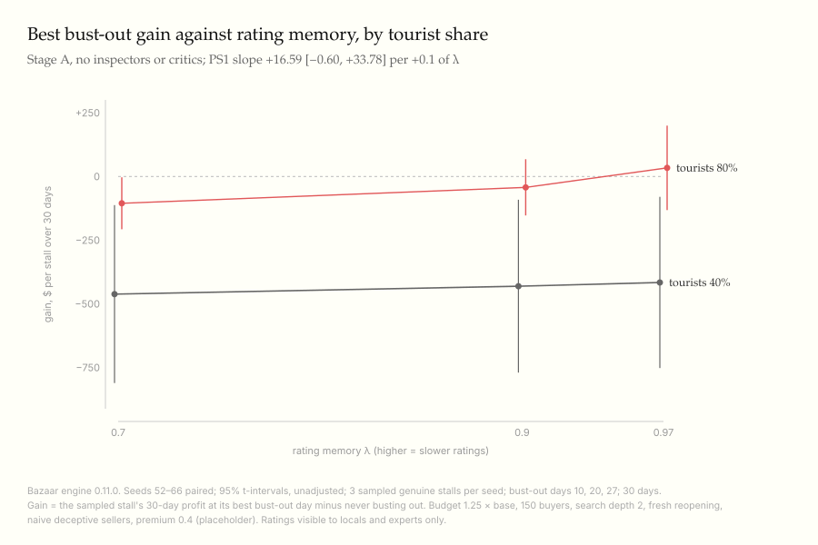
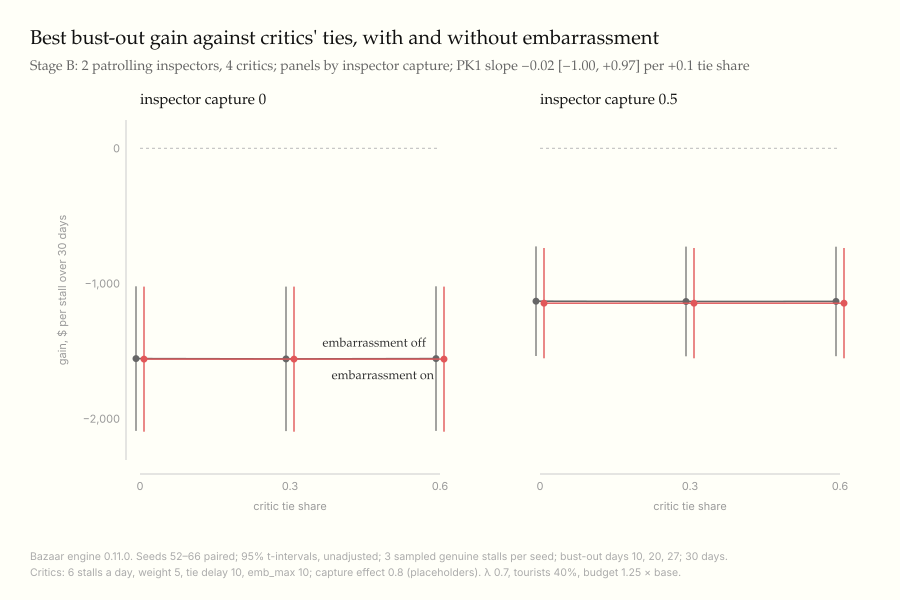
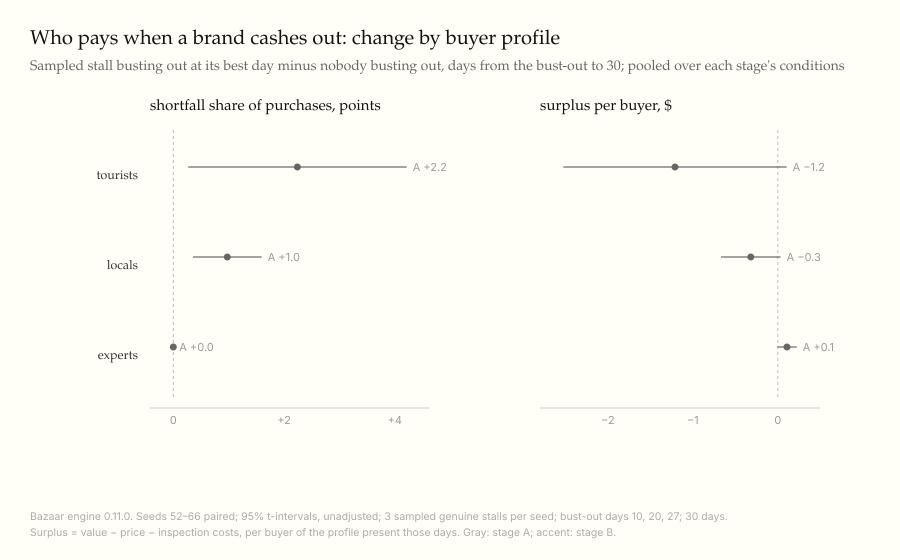

# Reputation speed and capture: the brand dilemma's boundary

> **Provisional: demand design flaw (most stalls unreachable) and an unexplained bust-out loss size; see the redesign run.** (Note added 2026-11-08.)

Run spec "reputation speed and capture, the brand dilemma's real boundary (rule-based only)"; predictions written 2026-11-07, before any run.

## Design (prespecified)

- Common: D = 30 known to sellers; ratings public (locals and experts see them); brands on, premium 0.4 (placeholder); budget 1.25 × base; search depth 2; 150 buyers; fresh reopening; naive deceptive sellers; genuine stalls always honest except the sampled stall in a bust chain.
- Stage A (speed): no inspectors or critics; rating memory λ ∈ {0.7, 0.9, 0.97} × tourist share ∈ {0.4, 0.8}.
- Stage B (capture): 2 patrolling inspectors (not uniformed), 4 critics (6 stalls a day, weight 5, tie delay 10, emb_max 10: placeholders), λ 0.7, tourists 0.4; tie share ∈ {0, 0.3, 0.6} × embarrassment ∈ {off, on} × inspector capture ∈ {0, 0.5} (capture effect 0.8, placeholder).
- Benchmark (engine/benchmark.py): per seed, 3 genuine stalls from `default_rng([seed, 17])`, the same in every condition; each busts out on day 10, 20 or 27 (rule_genuine_bust_at, on its first decision of the day), all other genuine stalls honest; one shared never chain. Gain = the stall's 30-day profit at the best bust-out day minus never (**unfloored, primary**, decided 2026-11-07) and the spec's floored version (best of never and the three days, never below 0).
- Decided 2026-11-07 before any run: engine 0.11.0 on 0.10.0 (the spec said 0.12.0 on 0.11.0, which did not exist); tourists keep not seeing ratings, and their learning is proxied by the stall's tourist sales; a critic review is positive when true Q meets the posted claim.
- Paired by seed; 95% t-intervals, unadjusted. Confirmatory: PS1, PS2 (stage A), PK1–PK3 (stage B). Everything else exploratory.

## Stage A: speed

### Run record

- Engine `0.11.0`; commit `690f58cd51dd2f6387f823b5d150a4b5774dd824`; uncommitted at run time: ['?? analysis/capture.py', '?? runs/capture_A_run.log', '?? runs/capture_A_stdout.log']
- Script sha256 `9336648238a64ed76069888d167f68b508559d3dc32eaffa010cf04caea24d5e`
- Command: `.venv/bin/python -m analysis.capture --stage A --tests full suite at 690f58c: 500 passed (13.8 min), including 58 reference cells from engine 0.10.0 (e5d7818)`
- Tests: full suite at 690f58c: 500 passed (13.8 min), including 58 reference cells from engine 0.10.0 (e5d7818)
- Python 3.12.7, numpy 2.5.4, macOS-26.6.2-arm64-arm-64bit
- 900 chains × 30 days on 4 workers (nice 19); wall clock 1.84 h; load average [6.65, 13.22, 15.35] at start, [5.16, 5.68, 5.78] at end; memory at start {'free_pct': 82, 'swap_free_mb': 1407.81}, at end {'free_pct': 82, 'swap_free_mb': 1575.81}; memory-guard pauses: 0
- Seeds 52–66 (15), paired; sampled stalls per seed: 52: s10, s38, s08; 53: s29, s03, s01; 54: s01, s28, s29; 55: s38, s42, s04; 56: s10, s30, s42; 57: s18, s08, s23; 58: s32, s22, s03; 59: s26, s06, s04; 60: s13, s33, s47; 61: s12, s27, s09; 62: s09, s22, s14; 63: s11, s07, s35; 64: s10, s11, s36; 65: s31, s47, s19; 66: s24, s04, s17

### Gate

- lambda 0.7 / tourists 0.4: mean unfloored gain <= 0 (sign of the e5d7818 result): **passed** (mean −461.70)

### Confirmatory

Prediction > 0 for each. Gain in $ per sampled stall over 30 days.

| Prediction | Unfloored gain (primary) | Verdict | Floored gain (spec) | Verdict |
|---|---|---|---|---|
| **PS1**: at tourists 0.4, slope of the gain over λ (per +0.1) | +16.59 [−0.60, +33.78] | not supported (interval includes 0) | +0.00 [+0.00, +0.00] | not supported (interval includes 0) |
| **PS2**: at λ 0.9, tourists 0.8 − 0.4 | +387.95 [+105.60, +670.30] * | supported | +45.58 [−3.73, +94.89] | not supported (interval includes 0) |

### Gain by condition

| Condition | Unfloored gain ($) | Floored gain ($) | Stall-seeds with a positive gain (%) | Never-bust total ($) | Best day 10 / 20 / 27 (count) |
|---|---|---|---|---|---|
| A|lam0.7|t40 | −461.70 [−810.88, −112.53] * | 0.00 [0.00, 0.00] | 0 | 4,264.13 [892.59, 7,635.67] | 29 / 0 / 16 |
| A|lam0.9|t40 | −430.71 [−770.00, −91.43] * | 0.00 [0.00, 0.00] | 0 | 4,264.13 [892.59, 7,635.67] | 29 / 0 / 16 |
| A|lam0.97|t40 | −416.07 [−752.27, −79.87] * | 0.00 [0.00, 0.00] | 0 | 4,264.13 [892.59, 7,635.67] | 29 / 0 / 16 |
| A|lam0.7|t80 | −105.22 [−207.11, −3.32] * | 9.20 [−6.62, 25.03] | 7 | 2,926.53 [−41.08, 5,894.14] | 29 / 0 / 16 |
| A|lam0.9|t80 | −42.76 [−153.17, +67.64] | 45.58 [−3.73, 94.89] | 11 | 2,926.53 [−41.08, 5,894.14] | 29 / 1 / 15 |
| A|lam0.97|t80 | +33.70 [−132.14, +199.55] | 117.00 [−13.33, 247.34] | 11 | 2,926.53 [−41.08, 5,894.14] | 31 / 1 / 13 |

### Harm by buyer profile at the best bust-out day (exploratory)

Bust chain at the stall's best day minus the never chain, days from the bust-out to 30; per seed the mean over the 3 stalls. Shortfall in points of purchases; surplus in $ per buyer of the profile.

| Condition | tourist: shortfall (pts) | local: shortfall (pts) | expert: shortfall (pts) | tourist: surplus ($) | local: surplus ($) | expert: surplus ($) |
|---|---|---|---|---|---|---|
| A|lam0.7|t40 | +2.3 [+0.3, +4.2] * | +0.6 [+0.2, +0.9] * | +0.0 [+0.0, +0.0] | −1.17 [−2.44, +0.11] | −0.08 [−0.25, +0.08] | +0.12 [−0.00, +0.25] |
| A|lam0.9|t40 | +2.3 [+0.3, +4.2] * | +0.7 [+0.3, +1.1] * | +0.0 [+0.0, +0.0] | −1.29 [−2.69, +0.12] | −0.11 [−0.28, +0.06] | +0.12 [−0.01, +0.24] |
| A|lam0.97|t40 | +2.3 [+0.3, +4.2] * | +0.9 [+0.3, +1.5] * | +0.0 [+0.0, +0.0] | −1.34 [−2.80, +0.12] | −0.12 [−0.30, +0.05] | +0.12 [−0.01, +0.24] |
| A|lam0.7|t80 | +2.2 [+0.2, +4.1] * | +1.0 [+0.1, +1.8] * | +0.0 [+0.0, +0.0] | −1.07 [−2.22, +0.09] | −0.45 [−1.14, +0.24] | +0.09 [−0.01, +0.20] |
| A|lam0.9|t80 | +2.2 [+0.3, +4.2] * | +1.3 [+0.3, +2.4] * | +0.0 [+0.0, +0.0] | −1.18 [−2.45, +0.09] | −0.54 [−1.28, +0.21] | +0.10 [−0.00, +0.21] |
| A|lam0.97|t80 | +2.3 [+0.3, +4.3] * | +1.4 [+0.3, +2.6] * | +0.0 [+0.0, +0.0] | −1.23 [−2.55, +0.10] | −0.60 [−1.42, +0.22] | +0.10 [−0.00, +0.20] |
| pooled | +2.2 [+0.3, +4.2] * | +1.0 [+0.4, +1.6] * | +0.0 [+0.0, +0.0] | −1.21 [−2.52, +0.10] | −0.32 [−0.67, +0.03] | +0.11 [−0.00, +0.22] |

### How long bad news stays semi-private (exploratory)

Days from the bust-out (at the best day) to each event; reached = stall-seeds where it happened by day 30, of 45.

| Condition | first negative critic review written: median (reached) | … filed: median (reached) | rating below τ = 0.5: median (reached) | tourist units below half the pre-bust mean: median (reached) |
|---|---|---|---|---|
| A|lam0.7|t40 | – (0) | – (0) | 1 (6) | 1 (1) |
| A|lam0.9|t40 | – (0) | – (0) | – (0) | 1 (1) |
| A|lam0.97|t40 | – (0) | – (0) | – (0) | 1 (1) |
| A|lam0.7|t80 | – (0) | – (0) | 1 (6) | – (0) |
| A|lam0.9|t80 | – (0) | – (0) | 6 (1) | – (0) |
| A|lam0.97|t80 | – (0) | – (0) | – (0) | – (0) |

### Floors, invalid actions and schedule checks

- A|lam0.7|t40: units sold by seconds stalls is 0 in every seed (15) over days 26–30; also 0 on every day
- A|lam0.9|t40: units sold by seconds stalls is 0 in every seed (15) over days 26–30; also 0 on every day
- A|lam0.97|t40: units sold by seconds stalls is 0 in every seed (15) over days 26–30; also 0 on every day
- A|lam0.7|t80: units sold by seconds stalls is 0 in every seed (15) over days 26–30; also 0 on every day
- A|lam0.9|t80: units sold by seconds stalls is 0 in every seed (15) over days 26–30; also 0 on every day
- A|lam0.97|t80: units sold by seconds stalls is 0 in every seed (15) over days 26–30; also 0 on every day

## Stage B: capture

### Run record

- Engine `0.11.0`; commit `6b286fd94cd1cfd344ef567f1aacdfe4e206fdaa`; uncommitted at run time: ['?? runs/capture_B_run.log', '?? runs/capture_B_stdout.log']
- Script sha256 `9336648238a64ed76069888d167f68b508559d3dc32eaffa010cf04caea24d5e`
- Command: `.venv/bin/python -m analysis.capture --stage B --tests full suite at 690f58c: 500 passed (13.8 min), including 58 reference cells from engine 0.10.0 (e5d7818)`
- Tests: full suite at 690f58c: 500 passed (13.8 min), including 58 reference cells from engine 0.10.0 (e5d7818)
- Python 3.12.7, numpy 2.5.4, macOS-26.6.2-arm64-arm-64bit
- 1800 chains × 30 days on 4 workers (nice 19); wall clock 9.34 h; load average [1.93, 4.08, 5.1] at start, [5.29, 5.52, 5.55] at end; memory at start {'free_pct': 82, 'swap_free_mb': 1575.81}, at end {'free_pct': 82, 'swap_free_mb': 1044.56}; memory-guard pauses: 341
- Seeds 52–66 (15), paired; sampled stalls per seed: 52: s10, s38, s08; 53: s29, s03, s01; 54: s01, s28, s29; 55: s38, s42, s04; 56: s10, s30, s42; 57: s18, s08, s23; 58: s32, s22, s03; 59: s26, s06, s04; 60: s13, s33, s47; 61: s12, s27, s09; 62: s09, s22, s14; 63: s11, s07, s35; 64: s10, s11, s36; 65: s31, s47, s19; 66: s24, s04, s17

### Gate

- tie share 0, embarrassment off, capture 0: no critic review is ever held: **passed** (held reviews: 0 over 150 chains; seed 52 never chain: 0)

### Confirmatory

Prediction > 0 for each. Gain in $ per sampled stall over 30 days.

| Prediction | Unfloored gain (primary) | Verdict | Floored gain (spec) | Verdict |
|---|---|---|---|---|
| **PK1**: embarrassment off, capture 0: slope over tie share (per +0.1) | −0.02 [−1.00, +0.97] | not supported (interval includes 0) | +0.00 [+0.00, +0.00] | not supported (interval includes 0) |
| **PK2**: tie share 0.6, embarrassment off, capture 0: gain | −1,555.51 [−2,090.22, −1,020.80] * | contradicted (interval on the opposite side of 0) | +0.00 [+0.00, +0.00] | not supported (interval includes 0) |
| **PK3**: tie share 0.3, embarrassment off: capture 0.5 − 0 | +424.46 [+181.79, +667.14] * | supported | +0.00 [+0.00, +0.00] | not supported (interval includes 0) |

### Gain by condition

| Condition | Unfloored gain ($) | Floored gain ($) | Stall-seeds with a positive gain (%) | Never-bust total ($) | Best day 10 / 20 / 27 (count) |
|---|---|---|---|---|---|
| B|tie0|emb0|cap0 | −1,555.40 [−2,090.09, −1,020.71] * | 0.00 [0.00, 0.00] | 0 | 4,432.19 [1,405.32, 7,459.07] | 0 / 0 / 45 |
| B|tie0.3|emb0|cap0 | −1,557.38 [−2,092.17, −1,022.59] * | 0.00 [0.00, 0.00] | 0 | 4,432.19 [1,405.32, 7,459.07] | 0 / 0 / 45 |
| B|tie0.6|emb0|cap0 | −1,555.51 [−2,090.22, −1,020.80] * | 0.00 [0.00, 0.00] | 0 | 4,432.19 [1,405.32, 7,459.07] | 0 / 0 / 45 |
| B|tie0|emb1|cap0 | −1,559.33 [−2,096.01, −1,022.66] * | 0.00 [0.00, 0.00] | 0 | 4,432.19 [1,405.32, 7,459.07] | 0 / 0 / 45 |
| B|tie0.3|emb1|cap0 | −1,559.33 [−2,096.01, −1,022.66] * | 0.00 [0.00, 0.00] | 0 | 4,432.19 [1,405.32, 7,459.07] | 0 / 0 / 45 |
| B|tie0.6|emb1|cap0 | −1,559.33 [−2,096.01, −1,022.66] * | 0.00 [0.00, 0.00] | 0 | 4,432.19 [1,405.32, 7,459.07] | 0 / 0 / 45 |
| B|tie0|emb0|cap0.5 | −1,130.94 [−1,536.30, −725.58] * | 0.00 [0.00, 0.00] | 0 | 4,432.19 [1,405.32, 7,459.07] | 0 / 0 / 45 |
| B|tie0.3|emb0|cap0.5 | −1,132.92 [−1,538.72, −727.11] * | 0.00 [0.00, 0.00] | 0 | 4,432.19 [1,405.32, 7,459.07] | 0 / 0 / 45 |
| B|tie0.6|emb0|cap0.5 | −1,132.65 [−1,537.76, −727.53] * | 0.00 [0.00, 0.00] | 0 | 4,432.19 [1,405.32, 7,459.07] | 0 / 0 / 45 |
| B|tie0|emb1|cap0.5 | −1,145.30 [−1,553.15, −737.45] * | 0.00 [0.00, 0.00] | 0 | 4,432.19 [1,405.32, 7,459.07] | 0 / 0 / 45 |
| B|tie0.3|emb1|cap0.5 | −1,145.30 [−1,553.15, −737.45] * | 0.00 [0.00, 0.00] | 0 | 4,432.19 [1,405.32, 7,459.07] | 0 / 0 / 45 |
| B|tie0.6|emb1|cap0.5 | −1,145.30 [−1,553.15, −737.45] * | 0.00 [0.00, 0.00] | 0 | 4,432.19 [1,405.32, 7,459.07] | 0 / 0 / 45 |

Embarrassment's added effect (exploratory), on − off, unfloored gain ($):

| Tie share | Capture 0 | Capture 0.5 |
|---|---|---|
| 0 | −3.93 [−10.00, +2.14] | −14.36 [−31.14, +2.41] |
| 0.3 | −1.95 [−7.23, +3.32] | −12.39 [−29.29, +4.52] |
| 0.6 | −3.83 [−9.38, +1.73] | −12.65 [−29.62, +4.31] |

### Harm by buyer profile at the best bust-out day (exploratory)

Bust chain at the stall's best day minus the never chain, days from the bust-out to 30; per seed the mean over the 3 stalls. Shortfall in points of purchases; surplus in $ per buyer of the profile.

| Condition | tourist: shortfall (pts) | local: shortfall (pts) | expert: shortfall (pts) | tourist: surplus ($) | local: surplus ($) | expert: surplus ($) |
|---|---|---|---|---|---|---|
| B|tie0|emb0|cap0 | +1.5 [−0.1, +3.1] | +2.1 [+1.1, +3.2] * | +0.0 [+0.0, +0.0] | −0.63 [−1.57, +0.31] | −0.87 [−1.52, −0.22] * | −0.13 [−0.19, −0.07] * |
| B|tie0.3|emb0|cap0 | +1.5 [−0.1, +3.1] | +2.1 [+1.1, +3.2] * | +0.0 [+0.0, +0.0] | −0.63 [−1.57, +0.31] | −0.85 [−1.51, −0.20] * | −0.13 [−0.19, −0.07] * |
| B|tie0.6|emb0|cap0 | +1.5 [−0.1, +3.1] | +2.2 [+1.2, +3.2] * | +0.0 [+0.0, +0.0] | −0.64 [−1.57, +0.30] | −0.86 [−1.52, −0.21] * | −0.13 [−0.19, −0.07] * |
| B|tie0|emb1|cap0 | +1.5 [−0.1, +3.1] | +2.1 [+1.0, +3.2] * | +0.0 [+0.0, +0.0] | −0.62 [−1.54, +0.30] | −0.86 [−1.52, −0.20] * | −0.13 [−0.19, −0.07] * |
| B|tie0.3|emb1|cap0 | +1.5 [−0.1, +3.1] | +2.1 [+1.0, +3.2] * | +0.0 [+0.0, +0.0] | −0.62 [−1.54, +0.30] | −0.86 [−1.52, −0.20] * | −0.13 [−0.19, −0.07] * |
| B|tie0.6|emb1|cap0 | +1.5 [−0.1, +3.1] | +2.1 [+1.0, +3.2] * | +0.0 [+0.0, +0.0] | −0.62 [−1.54, +0.30] | −0.86 [−1.52, −0.20] * | −0.13 [−0.19, −0.07] * |
| B|tie0|emb0|cap0.5 | +1.9 [+0.8, +3.1] * | +2.2 [+1.0, +3.3] * | +0.0 [+0.0, +0.0] | −0.86 [−1.99, +0.26] | −0.97 [−1.63, −0.31] * | −0.13 [−0.18, −0.07] * |
| B|tie0.3|emb0|cap0.5 | +1.9 [+0.8, +3.1] * | +2.2 [+1.0, +3.3] * | +0.0 [+0.0, +0.0] | −0.86 [−1.99, +0.26] | −0.96 [−1.63, −0.29] * | −0.13 [−0.18, −0.07] * |
| B|tie0.6|emb0|cap0.5 | +1.9 [+0.8, +3.1] * | +2.2 [+1.0, +3.3] * | +0.0 [+0.0, +0.0] | −0.86 [−1.99, +0.26] | −0.98 [−1.66, −0.31] * | −0.13 [−0.19, −0.07] * |
| B|tie0|emb1|cap0.5 | +1.9 [+0.8, +3.0] * | +2.0 [+0.8, +3.2] * | +0.0 [+0.0, +0.0] | −0.88 [−1.95, +0.19] | −0.96 [−1.64, −0.27] * | −0.14 [−0.19, −0.08] * |
| B|tie0.3|emb1|cap0.5 | +1.9 [+0.8, +3.0] * | +2.0 [+0.8, +3.2] * | +0.0 [+0.0, +0.0] | −0.88 [−1.95, +0.19] | −0.96 [−1.64, −0.27] * | −0.14 [−0.19, −0.08] * |
| B|tie0.6|emb1|cap0.5 | +1.9 [+0.8, +3.0] * | +2.0 [+0.8, +3.2] * | +0.0 [+0.0, +0.0] | −0.88 [−1.95, +0.19] | −0.96 [−1.64, −0.27] * | −0.14 [−0.19, −0.08] * |
| pooled | +1.7 [+0.5, +3.0] * | +2.1 [+1.0, +3.2] * | +0.0 [+0.0, +0.0] | −0.75 [−1.70, +0.20] | −0.91 [−1.58, −0.25] * | −0.13 [−0.19, −0.07] * |

### How long bad news stays semi-private (exploratory)

Days from the bust-out (at the best day) to each event; reached = stall-seeds where it happened by day 30, of 45.

| Condition | first negative critic review written: median (reached) | … filed: median (reached) | rating below τ = 0.5: median (reached) | tourist units below half the pre-bust mean: median (reached) |
|---|---|---|---|---|
| B|tie0|emb0|cap0 | 1 (36) | 1 (36) | 2 (31) | 0 (17) |
| B|tie0.3|emb0|cap0 | 1 (36) | 1 (34) | 2 (24) | 0 (17) |
| B|tie0.6|emb0|cap0 | 1 (36) | 1 (21) | 2 (17) | 0 (17) |
| B|tie0|emb1|cap0 | 1 (36) | 0.5 (2) | 1 (8) | 0 (17) |
| B|tie0.3|emb1|cap0 | 1 (36) | 0 (1) | 1 (8) | 0 (17) |
| B|tie0.6|emb1|cap0 | 1 (36) | 0 (1) | 1 (8) | 0 (17) |
| B|tie0|emb0|cap0.5 | 1 (36) | 1 (36) | 1 (35) | 0 (16) |
| B|tie0.3|emb0|cap0.5 | 1 (36) | 1 (34) | 1.5 (28) | 0 (16) |
| B|tie0.6|emb0|cap0.5 | 1 (36) | 1 (21) | 1.5 (22) | 0 (16) |
| B|tie0|emb1|cap0.5 | 1 (36) | 0.5 (2) | 1 (14) | 0 (16) |
| B|tie0.3|emb1|cap0.5 | 1 (36) | 0 (1) | 1 (14) | 0 (16) |
| B|tie0.6|emb1|cap0.5 | 1 (36) | 0 (1) | 1 (14) | 0 (16) |

### Floors, invalid actions and schedule checks

- B|tie0|emb0|cap0: units sold by seconds stalls is 0 in every seed (15) over days 26–30; also 0 on every day
- B|tie0.3|emb0|cap0: units sold by seconds stalls is 0 in every seed (15) over days 26–30; also 0 on every day
- B|tie0.6|emb0|cap0: units sold by seconds stalls is 0 in every seed (15) over days 26–30; also 0 on every day
- B|tie0|emb1|cap0: units sold by seconds stalls is 0 in every seed (15) over days 26–30; also 0 on every day
- B|tie0.3|emb1|cap0: units sold by seconds stalls is 0 in every seed (15) over days 26–30; also 0 on every day
- B|tie0.6|emb1|cap0: units sold by seconds stalls is 0 in every seed (15) over days 26–30; also 0 on every day
- B|tie0|emb0|cap0.5: units sold by seconds stalls is 0 in every seed (15) over days 26–30; also 0 on every day
- B|tie0.3|emb0|cap0.5: units sold by seconds stalls is 0 in every seed (15) over days 26–30; also 0 on every day
- B|tie0.6|emb0|cap0.5: units sold by seconds stalls is 0 in every seed (15) over days 26–30; also 0 on every day
- B|tie0|emb1|cap0.5: units sold by seconds stalls is 0 in every seed (15) over days 26–30; also 0 on every day
- B|tie0.3|emb1|cap0.5: units sold by seconds stalls is 0 in every seed (15) over days 26–30; also 0 on every day
- B|tie0.6|emb1|cap0.5: units sold by seconds stalls is 0 in every seed (15) over days 26–30; also 0 on every day

## Reading (written after the results)

### Stage A (written 2026-11-07 after the Stage A results; Stage B not yet run)

- **Gate passed.** At λ 0.7 with 40% tourists, busting out at the best of days 10, 20 and 27 leaves a sampled stall $462 worse off over 30 days than staying honest [−811, −113]. This matches the sign of the e5d7818 dilemma-boundary result.
- **PS1 (faster ratings make bust-out less profitable) is not supported.** With 40% tourists the gain rises by $16.59 for each +0.1 of λ [−0.60, +33.78]. The direction is the predicted one, but the interval just includes 0. With 40% tourists, busting out never paid for any stall-seed at any λ: the floored gain is 0 in all 45.
- **PS2 (more tourists make bust-out more profitable) is supported for the unfloored gain:** +$388 at λ 0.9 [+106, +670]. The floored version is +$46 [−4, +95], which is not supported. Tourists do not see ratings, so busting out loses fewer of their sales. With 80% tourists the mean gain climbs with λ (−$105, −$43, +$34) and becomes positive at λ 0.97, but that interval includes 0. Even there only 5 of 45 stall-seeds gain.
- **Tourist share matters far more than rating memory.** Going from 40% to 80% tourists moves the gain by about $390. Going from λ 0.7 to λ 0.97 moves it by about $45 at 40% tourists and $140 at 80%.
- **Bust-out day and harm (exploratory).** Among stalls that sell, the best bust-out day at 40% tourists is always day 27, the latest candidate. Every "best day 10" in the tables is a tie among stalls that never sell (see caveats). Harm falls on tourists, +2.2 points of shortfall purchases [+0.3, +4.2], and on locals, +1.0 [+0.4, +1.6]. Experts are unaffected. The tourist surplus loss of −$1.21 per buyer has an interval that just includes 0.
- **Timing (exploratory).** Stage A has no critics. A busted brand's rating fell below τ = 0.5 in 6 of 45 stall-seeds at λ 0.7, within 1 day. At slower memory it fell below τ at most once by day 30.

**Not a reading of the confirmatory numbers but a fact about them (post-hoc):** 29 of the 45 sampled stall-seeds (64%) have the same 30-day total, to the cent, in every chain, so they sold nothing on or after day 10 under any condition. Their gain is exactly 0 in every condition, and every mean above is diluted by them. Restricted to the 16 stall-seeds that sell, the 40%-tourist gain is about −$1,170 to −$1,300 and positive for none. With 80% tourists it is −$296, −$120 and +$95 by λ, positive for 3, 5 and 5 of 16. This split is post-hoc and has no interval. The prespecified sampling is unchanged, and Stage B uses the same stalls.

### Stage B (written 2026-11-08 after the Stage B results)

- **Gate passed.** With tie share 0, embarrassment off and capture 0, no critic review was held in any of the 150 chains.
- **Busting out loses money in every Stage B condition.** All 45 stall-seeds lose by busting out in all 12 conditions. The best of the three candidate days is always day 27, the latest. The loss is about $1,555 per stall over 30 days with capture 0, and $1,131–1,145 with capture 0.5. These are the costs of busting out once 2 patrolling inspectors and 4 critics are in the market.
- **PK1 (ties make busting out more profitable) is not supported.** The slope is −$0.02 per +0.1 of tie share [−1.00, +0.97].
- **PK2 (busting out pays at tie share 0.6) is contradicted.** The gain is −$1,556 [−2,090, −1,021].
- **Ties work on the information but not on profit.** At tie share 0.6, a negative critic review reached the brand's rating in 21 of 45 stall-seeds, against 36 with no ties. The rating fell below τ in 17, against 31. Yet the gain moved by less than $3. The critic channel does not carry the cost of busting out here.
- **PK3 (capture makes busting out more profitable) is supported:** +$424 at tie share 0.3 [+182, +667]. Inspectors are the channel that matters. Capturing half the inspector–brand pairs cuts the loss by about a quarter, but busting out still loses $1,133.
- **Embarrassment (exploratory) almost silences critics without changing profit.** A critic whose earlier reviews of a brand were all positive holds a negative one for emb_max = 10 days. Bust-outs happen on day 27 at the latest, so held reviews filed in only 1–2 of 36 stall-seeds, and the rating fell below τ in 8–14 rather than 17–35. Its effect on the gain is −$2 to −$14, with every interval including 0.
- **Harm (exploratory).** With inspectors present, locals bear about as much as tourists: shortfall +2.1 points [+1.0, +3.2] against +1.7 [+0.5, +3.0]. Locals lose $0.91 of surplus per buyer [−1.58, −0.25]. Experts lose $0.13 [−0.19, −0.07].

### Across both stages

Busting out did not pay on average in any of the 18 conditions. The only places near break-even are markets with 80% tourists and slow ratings and no inspectors (Stage A, λ 0.97: +$34 [−132, +200]). By size of effect, the boundary of the brand dilemma is set first by how many buyers cannot see reputation (tourists), then by inspectors and their capture. Rating speed and critics' ties come last. The Stage A and Stage B levels are not directly comparable. In Stage B every sampled stall sells, while in Stage A 29 of 45 sell nothing (see caveats), so the larger Stage B loss is partly a different set of stalls that matter.

## Caveats

### Stage A

- **Stalls that never sell.** The benchmark samples 3 genuine stalls per seed uniformly, and 29 of the 45 stall-seeds sold nothing from day 10 on. They pull every gain toward 0 and produce the "best day 10" counts through the earliest-day tie rule. The effective sample for the gain is 16 stall-seeds, from 12 of the 15 seeds; 3 seeds (55, 61, 64) contribute no selling stall. Sampling only from stalls that sell would have been the better design. It was not prespecified, so it is not applied here.
- **Seconds stalls never sell** in this design. The floor check flags this in all 6 cells, as it did in earlier brand runs.
- **The never-bust total is the same at every λ.** Within each tourist share it does not change with λ. With everyone honest, genuine brands' ratings presumably never move, so λ only acts once a stall busts out.
- **Floored gain (the spec's definition)** is 0 with a zero-width interval at 40% tourists, so PS1 cannot be tested on it.
- **Placeholders:** premium 0.4 and budget 1.25 × base, plus Stage B's critic and capture settings (see the design section). Tourists never see ratings, and their learning is proxied by tourist sales.
- **Checks before the run.** Pipeline checks ran on seeds 400–401 before the run, and their outputs were discarded. After the check only plot layout changed. The script was frozen at launch (sha256 above) and is the same file for Stage B.
- **Tests:** full suite at 690f58c, 500 passed.
- **Machine:** 4 workers at nice 19 with a memory guard (pause if free swap < 1 GB or memory-pressure free < 15%). It never paused.
- **Intervals** are 95% t-intervals over 15 seeds, unadjusted. Everything outside PS1/PS2 (and PK1–PK3 in Stage B) is exploratory.

### Stage B

- **Every sampled stall sells in Stage B.** None of the 45 stall-seeds has identical totals across chains, so the Stage A dilution does not apply here. The never-bust totals differ from Stage A's because inspectors change the market.
- **Best day 27 is the latest candidate in all 45 stall-seeds and all 12 conditions.** A later bust-out (day 28–30) might lose less. The benchmark only bounds the best response from below.
- **The tie-delay and embarrassment settings are placeholders.** tie_delay 10 and emb_max 10 against bust-outs on day 27 mean held reviews mostly never file before day 30. The embarrassment result is in large part a horizon effect.
- **The other critic and capture settings are placeholders too:** 6 stalls a day, weight 5, and capture effect 0.8.
- **Run time.** Stage B took 9.34 h, not the expected ~4 h. Free swap fell to about 1.04 GB, and the memory guard paused 341 times. The pauses only delay chains, and every chain is deterministic and paired, so results are unaffected.
- The same pipeline check, frozen script (same sha256 as Stage A), test suite and interval conventions as Stage A apply.
