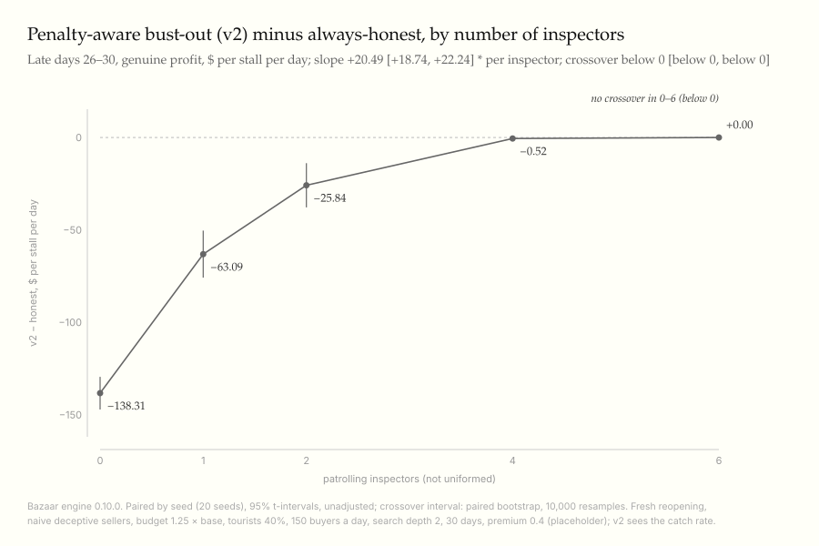

# Where does the brand dilemma appear?

> **Provisional: demand design flaw (most stalls unreachable) and an unexplained bust-out loss size; see the redesign run.** (Note added 2026-11-08.)

Run spec "where does the brand dilemma appear? (no engine change; rule-based)"; predictions written 2026-11-07, before any run.

## Run record

- Engine `0.10.0`; commit `9dd42d0327036c7f8787fbfe2b992256e08d2c15`; uncommitted at run time: ['?? analysis/dilemma_boundary.py', '?? runs/dilemma_boundary_run.log', '?? tests/test_dilemma_boundary.py']
- Script sha256 `01f1e62d81bbf403ed6692a42020f9e5a5d7d216342989dbeb47b041602141d9`
- Command: `.venv/bin/python -m analysis.dilemma_boundary --tests engine unchanged since 063aee5 (full suite there: 418 passed, 32.2 min, including every 0.9.0 reference cell at depth 1); at 9dd42d0 plus this script: tests/test_floors.py and tests/test_dilemma_boundary.py, 8 passed --out runs/dilemma_boundary.json`
- Tests: engine unchanged since 063aee5 (full suite there: 418 passed, 32.2 min, including every 0.9.0 reference cell at depth 1); at 9dd42d0 plus this script: tests/test_floors.py and tests/test_dilemma_boundary.py, 8 passed
- Python 3.12.7, numpy 2.5.4, macOS-26.6.2-arm64-arm-64bit
- 200 chains × 30 days on 8 workers; wall clock 17.8 min; load average [4.26, 4.26, 16.06] at start, [10.09, 10.5, 12.28] at end
- Seeds 32–51 (20), paired

## Design (prespecified)

- As the always-honest and v2 cells of the 2026-11-06 search-depth run: ratings public; fresh reopening; naive deceptive sellers; D = 30 known to sellers; budget 1.25 × base; tourists 40% (0.4 / 0.3 / 0.3); search depth 2 for all profiles; 150 buyers; brands on, premium 0.4 (placeholder); inspectors patrolling, not uniformed.
- Grid: original policy {always-honest, rational v2} × inspector count {0, 1, 2, 4, 6}.
- Late = days 26–30. Paired by seed; 95% t-intervals, unadjusted. Confirmatory: PG1, PG2. Crossover, bust-out distributions and shortfall are descriptive.
- Crossover: where the mean v2 − honest curve first goes from > 0 to ≤ 0, interpolated linearly between adjacent counts. 95% interval from a paired bootstrap over seeds (10,000 resamples, numpy default_rng(20261107), inverted-CDF percentiles; a resample with no crossing counts as below 0 or above 6).

## Confirmatory

- **PG1**: at 0 inspectors, late genuine profit per stall, v2 − always-honest: $−138.31 [−147.16, −129.47] * per day. Prediction > 0. **Verdict: contradicted (interval on the opposite side of 0).**
- **PG2**: per-seed slope of v2 − always-honest over 0, 1, 2, 4, 6 inspectors: $+20.49 [+18.74, +22.24] * per inspector. Prediction < 0. **Verdict: contradicted (interval on the opposite side of 0).**

## v2 − always-honest by inspector count

| Inspectors | Genuine profit ($) | Deceptive profit ($) | Shortfall (pts) | Surplus ($) | Catches/day |
|---|---|---|---|---|---|
| 0 | −138.31 [−147.16, −129.47] * | −0.02 [−0.05, +0.01] | +75.6 [+72.0, +79.1] * | −8.38 [−9.99, −6.77] * | +0.0 [+0.0, +0.0] |
| 1 | −63.09 [−75.80, −50.37] * | +6.33 [−3.47, +16.13] | +18.3 [+15.6, +21.1] * | −6.91 [−8.91, −4.91] * | +11.5 [+10.4, +12.6] * |
| 2 | −25.84 [−37.81, −13.87] * | +9.48 [+3.51, +15.46] * | +3.0 [+1.1, +4.8] * | −1.34 [−2.19, −0.49] * | +4.0 [+2.1, +5.9] * |
| 4 | −0.52 [−1.60, +0.57] | +0.24 [−0.26, +0.74] | +0.1 [−0.1, +0.3] | −0.04 [−0.11, +0.04] | +0.1 [−0.1, +0.4] |
| 6 | +0.00 [+0.00, +0.00] | +0.00 [+0.00, +0.00] | +0.0 [+0.0, +0.0] | +0.00 [+0.00, +0.00] | +0.0 [+0.0, +0.0] |

**Crossover** (descriptive): below 0 inspectors; 95% bootstrap interval [below 0, below 0]; bootstrap median below 0. Share of resamples with no crossing: below 0 100.0%, above 6 0.0%.

## Bust-outs under v2 by inspector count

| Inspectors | Share busting out (%) | Mean bust-out day (never = 31) | Median (pooled) | Day 1–20 | Day 21–25 | Day 26 | Day 27 | Day 28 | Day 29 | Day 30 | Never |
|---|---|---|---|---|---|---|---|---|---|---|---|
| 0 | 100.0 [100.0, 100.0] | 3.58 [3.14, 4.02] | 3 | 353 | 0 | 0 | 3 | 4 | 0 | 0 | 0 |
| 1 | 44.4 [38.8, 50.1] | 25.68 [24.24, 27.12] | 31 | 59 | 16 | 3 | 14 | 17 | 13 | 38 | 200 |
| 2 | 10.3 [4.4, 16.1] | 30.31 [29.79, 30.83] | 31 | 7 | 1 | 1 | 3 | 9 | 10 | 6 | 323 |
| 4 | 0.3 [−0.3, 0.9] | 30.99 [30.98, 31.01] | 31 | 0 | 0 | 0 | 0 | 0 | 1 | 0 | 359 |
| 6 | 0.0 [0.0, 0.0] | 31.00 [31.00, 31.00] | 31 | 0 | 0 | 0 | 0 | 0 | 0 | 0 | 360 |

Day columns count genuine stalls pooled over seeds (360 per count).

## Late levels (days 26–30)

| Policy | Inspectors | Genuine profit ($) | Deceptive profit ($) | Shortfall (%) | Surplus ($) | Task complete (%) | Catches/day | Busted stalls |
|---|---|---|---|---|---|---|---|---|
| always-honest | 0 | 145.08 [132.74, 157.43] | 27.20 [18.35, 36.04] | 21.0 [17.4, 24.6] | −2.79 [−4.31, −1.28] | 52.8 [50.2, 55.3] | 0.0 [0.0, 0.0] | 0.0 [0.0, 0.0] |
| always-honest | 1 | 144.01 [130.87, 157.14] | −40.38 [−52.68, −28.08] | 20.7 [17.0, 24.4] | −4.23 [−6.08, −2.39] | 50.6 [47.4, 53.9] | 15.4 [14.2, 16.6] | 0.0 [0.0, 0.0] |
| always-honest | 2 | 153.44 [142.37, 164.51] | −143.08 [−158.86, −127.31] | 16.7 [13.6, 19.7] | −2.91 [−4.41, −1.42] | 53.3 [50.6, 56.0] | 32.1 [29.8, 34.5] | 0.0 [0.0, 0.0] |
| always-honest | 4 | 168.67 [159.44, 177.90] | −302.56 [−324.05, −281.07] | 10.5 [7.9, 13.1] | −0.18 [−1.35, 0.98] | 58.2 [55.9, 60.5] | 58.4 [55.2, 61.5] | 0.0 [0.0, 0.0] |
| always-honest | 6 | 177.17 [169.48, 184.85] | −392.28 [−405.65, −378.91] | 7.0 [5.3, 8.6] | 1.38 [0.51, 2.24] | 60.9 [59.3, 62.5] | 73.0 [71.1, 74.9] | 0.0 [0.0, 0.0] |
| rational v2 | 0 | 6.77 [−2.09, 15.63] | 27.17 [18.33, 36.02] | 96.5 [93.7, 99.4] | −11.18 [−11.96, −10.39] | 1.2 [0.1, 2.3] | 0.0 [0.0, 0.0] | 17.9 [17.8, 18.0] |
| rational v2 | 1 | 80.92 [67.12, 94.71] | −34.05 [−46.10, −22.00] | 39.1 [35.9, 42.3] | −11.14 [−12.45, −9.84] | 35.3 [32.3, 38.2] | 26.9 [25.1, 28.6] | 5.6 [5.0, 6.2] |
| rational v2 | 2 | 127.60 [110.86, 144.34] | −133.60 [−151.38, −115.82] | 19.7 [16.7, 22.6] | −4.25 [−5.80, −2.69] | 51.1 [48.5, 53.7] | 36.2 [33.9, 38.5] | 1.1 [0.6, 1.6] |
| rational v2 | 4 | 168.15 [158.41, 177.90] | −302.32 [−324.08, −280.57] | 10.6 [7.9, 13.3] | −0.22 [−1.43, 0.98] | 58.1 [55.8, 60.5] | 58.5 [55.5, 61.6] | 0.0 [−0.0, 0.1] |
| rational v2 | 6 | 177.17 [169.48, 184.85] | −392.28 [−405.65, −378.91] | 7.0 [5.3, 8.6] | 1.38 [0.51, 2.24] | 60.9 [59.3, 62.5] | 73.0 [71.1, 74.9] | 0.0 [0.0, 0.0] |

## Floors and invalid actions

- honest|0: units sold by seconds stalls is 0 in every seed (20) over days 26–30; also 0 on every day
- honest|1: units sold by seconds stalls is 0 in every seed (20) over days 26–30; also 0 on every day
- honest|2: units sold by seconds stalls is 0 in every seed (20) over days 26–30; also 0 on every day
- honest|4: units sold by seconds stalls is 0 in every seed (20) over days 26–30; also 0 on every day
- honest|6: units sold by seconds stalls is 0 in every seed (20) over days 26–30; also 0 on every day
- v2|0: units sold by seconds stalls is 0 in every seed (20) over days 26–30; also 0 on every day
- v2|1: units sold by seconds stalls is 0 in every seed (20) over days 26–30; also 0 on every day
- v2|2: units sold by seconds stalls is 0 in every seed (20) over days 26–30; also 0 on every day
- v2|4: units sold by seconds stalls is 0 in every seed (20) over days 26–30; also 0 on every day
- v2|6: units sold by seconds stalls is 0 in every seed (20) over days 26–30; also 0 on every day

## Reading (written after the results)

*Written on 2026-11-07, after all results were seen. Nothing below was prespecified, including the whole-horizon totals.*

1. **Enforcement is not what makes honesty pay here; the answer runs the other way.** With no inspectors, v2 earns $138 a stall per day less than staying honest late in the run (PG1 contradicted). As inspectors are added the gap shrinks, by about $20 per inspector (PG2 contradicted): −$63 at 1, −$26 at 2, and essentially 0 at 4 and 6. There is no enforcement level in 0–6 below which bust-out beats honesty, so the crossover is "below 0" in every bootstrap resample.

2. **Enforcement brings v2's gap to zero by stopping it from busting out, not by making it beat honesty.** At 0 inspectors every genuine stall under v2 busts out, at a mean of day 3.6. At 1 inspector 44% bust out, at 2 inspectors 10%, at 4 inspectors 1 stall in 360, and at 6 none. Where v2 never busts out it is the honest policy, so the difference is exactly 0. v2 reads the market-wide catch rate as a privileged input. With no inspectors that rate is 0, so v2 expects no penalty, and it harvests from day 3.

3. **The late window does not hide a win.** Days 26–30 could miss the payoff of a day-3 bust-out, so I also summed genuine profit over all 30 days, post hoc. v2 − honest is −$3,396 [−3,787, −3,006] a stall at 0 inspectors, where honest earns $4,271. It is −$1,135 [−1,492, −778] at 1 inspector, −$295 [−513, −78] at 2 and about 0 at 4–6. Days 1–25 alone give the same sign. These totals are exploratory and were not prespecified.

4. **Ratings, not inspectors, are what punish the harvest.** With no inspectors and v2, late shortfall is 96.5% and task completion 1.2%, against 21% and 53% for honest originals. Buyers who see ratings stop buying from the busted brands, and deceptive profit is unchanged ($27 in both). v2's forecast of the harvest (yesterday's units, a decaying rating) evidently overstates how long buyers keep coming. So these results show that this benchmark busts out when it should not. They do not show that no bust-out rule could beat honesty. A rule that forecast demand loss correctly might bust out late or never.

5. **Inspectors cost deceptive sellers, as before.** With honest originals, deceptive profit falls from +$27 a stall per day at 0 inspectors to −$392 at 6. Shortfall falls from 21% to 7%, and genuine profit rises from $145 to $177.

## Caveats

- **Pipeline-check seeds.** Seeds 300–301 were run once with this script before launch. Their 2-seed results pointed the same way as the main run. The outputs were discarded (kept outside `runs/`). After that check I changed only the plot layout: the footnote wrap and the position of the "no crossover" note. No design, estimator or prediction changed. Seeds 32–51 had not been used before.
- **Script hash.** The sha256 above is the hash recorded at launch, and the committed file matches it.
- **Seconds stalls never sell.** In every cell, the 15 seconds stalls (of 48) sell nothing on any day. The new floor check found this (see Floors). It is a property of the market design shared with earlier brand runs, and the old check could not see it. It does not enter the genuine-profit contrasts, but it means about a third of the stalls play no part.
- **Crossover.** The prespecified crossover is undefined inside 0–6, because the curve is ≤ 0 at every count. It reaches 0 at 4–6 inspectors because v2 stops busting out there, not because it overtakes honesty.
- **One benchmark.** Every contrast is v2 against always-honest. v2's bust-out decision depends on its own forecasting rule (decided 2026-11-06). See Reading 4.
- **Tests.** The engine is unchanged since `063aee5`, where the full suite passed (418). The full suite was not rerun at `9dd42d0`. The new tests for the floor check and the crossover estimator (8) passed before launch.
- **Machine load.** Load was 4–11 throughout, normal for this machine. It affects wall-clock time only.
