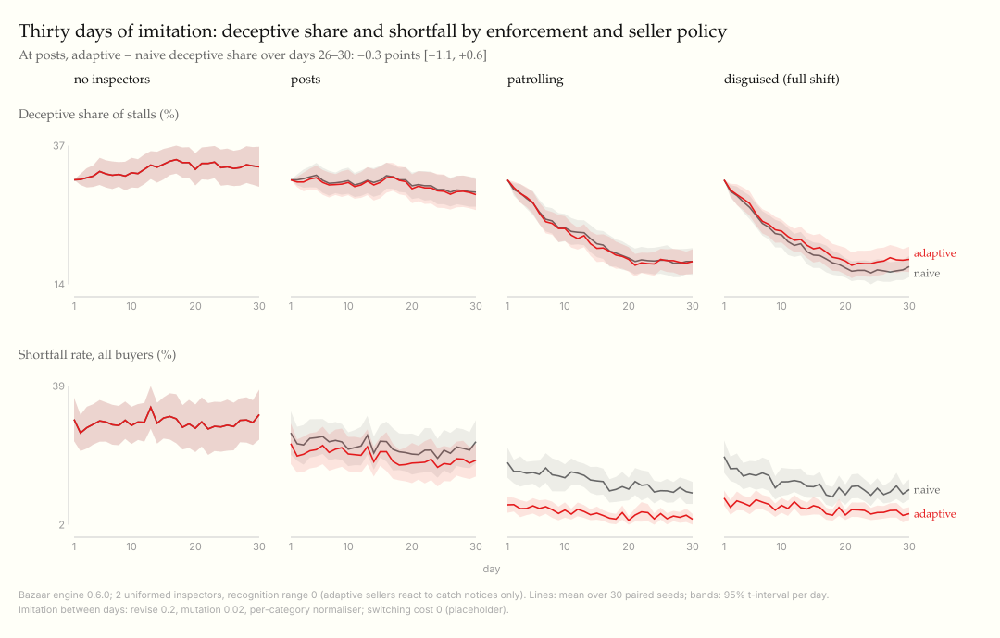

# Multi-day entry and exit

Part C of the decomposition / grid-refinement / entry-exit spec (2026-11-05).

## Run record

- Engine `0.6.0`; commit `e755591ce1d6e307e7e8c1bd59911ed466ac41a6`; uncommitted at run time: ['?? analysis/entry_exit.py']
- Script sha256 `d401be0027cb841480ce129c9f950caab3049c62a3088f414bce8787e3524617`
- Command: `.venv/bin/python -m analysis.entry_exit --out runs/entry_exit.json`
- Python 3.12.7, numpy 2.5.4, macOS-26.6.2-arm64-arm-64bit
- 240 chains x 30 days on 8 workers (plus one single-day run per chain for the gate); wall clock 49.6 min; load average [270.04, 248.1, 214.11] at start, [28.73, 38.72, 54.22] at end
- Seeds 0-29, paired

## Design (prespecified)

- Deceptive-stall policy naive (`rule_deceptive`) or adaptive (`rule_deceptive_adaptive`) x 2 uniformed inspectors on posts, patrolling or disguised full-shift, plus a no-inspector control per policy: 8 conditions. Recognition range 0, so adaptive sellers react to public catch notices and their own reopening only.
- 30 days. Each day is a full bazaar run with a fresh buyer population (streams `[seed, 9, day]` for days ≥ 2, identical across conditions). Stall locations and categories persist; closures and catch notices reset.
- Between days: each genuine or deceptive stall revises with probability 0.2, comparing its profit with a random other genuine/deceptive stall of its category; if that stall's type differs and earned more, it switches with probability Δprofit / (largest profit difference among genuine/deceptive stalls of the category that day). Then mutation 0.02. Seconds never switch. Switching cost 0 (PLACEHOLDER). Normaliser and partner pool decided 2026-11-05.
- Late = mean of days 26–30. Intervals 95% paired t over 30 seeds, unadjusted; confirmatory: PC1, PC2.

## Gate

- Day-1 outcome equals the single-day engine, byte for byte, in every chain: **passed** (240 of 240 chains)

## Confirmatory

- **PC1** (posts): late deceptive share, adaptive − naive = −0.3 [−1.1, +0.6] points. Prediction > 0. **Verdict: not supported (interval includes 0).**
- **PC2** (posts): shortfall gap adaptive − naive was −2.9 [−4.3, −1.4] * points on day 1 and −3.5 [−5.0, −1.9] * over days 26–30; change −0.6 [−2.5, +1.2]. Prediction > 0 (the honesty gain shrinks). **Verdict: not supported (interval includes 0).**

## PC3 (exploratory): every placement

| Placement | Late deceptive share, naive | adaptive | adaptive − naive | Shortfall gap day 1 | Gap days 26–30 | Change |
|---|---|---|---|---|---|---|
| no inspectors | 33.4 [30.4, 36.4] | 33.4 [30.4, 36.4] | +0.0 [+0.0, +0.0] | +0.0 [+0.0, +0.0] | +0.0 [+0.0, +0.0] | +0.0 [+0.0, +0.0] |
| posts | 29.4 [27.1, 31.7] | 29.1 [26.7, 31.6] | −0.3 [−1.1, +0.6] | −2.9 [−4.3, −1.4] * | −3.5 [−5.0, −1.9] * | −0.6 [−2.5, +1.2] |
| patrolling | 17.8 [15.6, 19.9] | 17.8 [16.0, 19.6] | +0.0 [−1.5, +1.6] | −11.3 [−14.0, −8.5] * | −7.0 [−9.3, −4.7] * | +4.3 [+1.4, +7.2] * |
| disguised (full shift) | 16.4 [14.9, 17.9] | 18.2 [16.2, 20.1] | +1.7 [+0.4, +3.1] * | −11.0 [−14.1, −7.9] * | −5.7 [−7.5, −3.8] * | +5.4 [+1.7, +9.1] * |

Which placement holds the late deceptive share lowest:

- rule_deceptive: **disguised (full shift)** (16.4%); others: patrolling 17.8% (vs best −1.3 [−2.8, +0.2]); posts 29.4% (vs best −12.9 [−15.5, −10.3] *); no inspectors 33.4% (vs best −17.0 [−20.4, −13.6] *). Day 30 alone: disguised (full shift) 17.0%, patrolling 17.8%, posts 29.2%, no inspectors 33.4%
- rule_deceptive_adaptive: **patrolling** (17.8%); others: disguised (full shift) 18.2% (vs best −0.3 [−1.8, +1.1]); posts 29.1% (vs best −11.3 [−14.3, −8.3] *); no inspectors 33.4% (vs best −15.6 [−19.1, −12.1] *). Day 30 alone: patrolling 17.8%, disguised (full shift) 18.2%, posts 28.8%, no inspectors 33.4%

## Late levels (days 26–30)

| Policy | Placement | Deceptive share (%) | Shortfall (%) | Catches/day | Genuine profit/stall ($) | Deceptive profit/stall ($) | Switches/day |
|---|---|---|---|---|---|---|---|
| rule_deceptive | no inspectors | 33.4 [30.4, 36.4] | 29.9 [24.0, 35.8] | 0.0 | 44 [39, 50] | 40 [27, 54] | 0.89 |
| rule_deceptive | posts | 29.4 [27.1, 31.7] | 22.6 [17.7, 27.5] | 7.8 | 43 [37, 48] | 13 [0, 26] | 0.85 |
| rule_deceptive | patrolling | 17.8 [15.6, 19.9] | 11.2 [8.6, 13.7] | 21.4 | 37 [33, 40] | −166 [−194, −137] | 0.99 |
| rule_deceptive | disguised (full shift) | 16.4 [14.9, 17.9] | 11.1 [9.0, 13.3] | 21.5 | 36 [32, 40] | −180 [−206, −153] | 0.93 |
| rule_deceptive_adaptive | no inspectors | 33.4 [30.4, 36.4] | 29.9 [24.0, 35.8] | 0.0 | 44 [39, 50] | 40 [27, 54] | 0.89 |
| rule_deceptive_adaptive | posts | 29.1 [26.7, 31.6] | 19.2 [15.0, 23.3] | 4.6 | 47 [41, 52] | 16 [4, 28] | 0.89 |
| rule_deceptive_adaptive | patrolling | 17.8 [16.0, 19.6] | 4.2 [3.2, 5.2] | 13.5 | 42 [38, 45] | −119 [−133, −104] | 0.96 |
| rule_deceptive_adaptive | disguised (full shift) | 18.2 [16.2, 20.1] | 5.5 [4.2, 6.8] | 13.3 | 42 [38, 46] | −111 [−126, −96] | 0.91 |

## Day 1 levels

| Policy | Placement | Deceptive share (%) | Shortfall (%) | Genuine profit/stall ($) | Deceptive profit/stall ($) |
|---|---|---|---|---|---|
| rule_deceptive | no inspectors | 31.2 [31.2, 31.2] | 30.2 [24.4, 36.0] | 42 [34, 49] | 49 [30, 68] |
| rule_deceptive | posts | 31.2 [31.2, 31.2] | 26.7 [20.8, 32.5] | 44 [36, 51] | 9 [−12, 30] |
| rule_deceptive | patrolling | 31.2 [31.2, 31.2] | 18.8 [14.7, 22.8] | 50 [43, 58] | −173 [−198, −148] |
| rule_deceptive | disguised (full shift) | 31.2 [31.2, 31.2] | 20.4 [16.0, 24.7] | 49 [42, 56] | −198 [−222, −174] |
| rule_deceptive_adaptive | no inspectors | 31.2 [31.2, 31.2] | 30.2 [24.4, 36.0] | 42 [34, 49] | 49 [30, 68] |
| rule_deceptive_adaptive | posts | 31.2 [31.2, 31.2] | 23.8 [18.4, 29.2] | 46 [40, 53] | 20 [3, 37] |
| rule_deceptive_adaptive | patrolling | 31.2 [31.2, 31.2] | 7.5 [5.4, 9.6] | 63 [57, 69] | −111 [−123, −99] |
| rule_deceptive_adaptive | disguised (full shift) | 31.2 [31.2, 31.2] | 9.3 [7.3, 11.3] | 61 [55, 67] | −100 [−109, −91] |

## Switching totals over 29 revisions (mean per chain)

| Policy | Placement | to deceptive | to genuine | of which mutations |
|---|---|---|---|---|
| rule_deceptive | no inspectors | 16.7 | 15.7 | 19.4 |
| rule_deceptive | posts | 15.5 | 16.5 | 19.4 |
| rule_deceptive | patrolling | 15.2 | 21.7 | 19.3 |
| rule_deceptive | disguised (full shift) | 15.0 | 21.8 | 19.3 |
| rule_deceptive_adaptive | no inspectors | 16.7 | 15.7 | 19.4 |
| rule_deceptive_adaptive | posts | 15.5 | 16.6 | 19.5 |
| rule_deceptive_adaptive | patrolling | 14.2 | 20.7 | 19.4 |
| rule_deceptive_adaptive | disguised (full shift) | 14.3 | 20.6 | 19.5 |

## Stability (change over days 21–30, per-seed OLS slope × 9)

| Policy | Placement | Deceptive share (pts) | Shortfall (pts) |
|---|---|---|---|
| rule_deceptive | no inspectors | −0.6 [−2.7, +1.6] | +2.3 [−2.4, +7.0] |
| rule_deceptive | posts | −1.2 [−3.4, +0.9] | +2.3 [−1.9, +6.4] |
| rule_deceptive | patrolling | −0.3 [−2.3, +1.8] | −2.4 [−5.9, +1.2] |
| rule_deceptive | disguised (full shift) | +0.4 [−1.4, +2.1] | −0.9 [−4.4, +2.6] |
| rule_deceptive_adaptive | no inspectors | −0.6 [−2.7, +1.6] | +2.3 [−2.4, +7.0] |
| rule_deceptive_adaptive | posts | −1.2 [−3.3, +1.0] | +0.6 [−3.2, +4.5] |
| rule_deceptive_adaptive | patrolling | +0.4 [−1.2, +2.1] | −1.2 [−3.1, +0.7] |
| rule_deceptive_adaptive | disguised (full shift) | +1.0 [−0.9, +2.9] | −0.9 [−3.2, +1.3] |

Not stabilized by day 30 (interval excludes 0):

- none

## Verdicts

- **PC1 (confirmatory): not supported.** At posts, the late deceptive share is 29.1% with adaptive sellers and 29.4% with naive ones: −0.3 [−1.1, +0.6] points.
- **PC2 (confirmatory): not supported.** At posts, adaptive sellers' shortfall advantage is −2.9 points on day 1 and −3.5 over days 26–30; it does not shrink (change −0.6 [−2.5, +1.2]).
- **PC3 (exploratory).** At patrolling and disguised, the shortfall advantage of adaptive sellers does shrink (+4.3 [+1.4, +7.2] and +5.4 [+1.7, +9.1] points), but mostly because naive markets improve, not because adaptive markets fill with deceivers. Only at disguised do adaptive sellers end with a higher deceptive share (+1.7 [+0.4, +3.1] points). The lowest late deceptive share is disguised for naive sellers (16.4%) and patrolling for adaptive ones (17.8%); in both cases the other mobile placement is within 1.3 points (intervals include 0), and both are about 12 points below posts and 16 below no inspectors.
- No condition is still trending over days 21–30.

## Reading (written after the results)

*Written after the results.*

Catch notices did not pull stalls into deception, because the question that drives imitation is not "does an adaptive deceiver earn more than a naive one?" but "does a deceiver earn more than the genuine stall next to it?". At posts the answer is no under both policies: on day 1 a deceptive stall makes $9 (naive) or $20 (adaptive) against $44–46 for a genuine stall. Part A's extra profit from avoided penalties is real, but it narrows a gap that still favours honesty, so imitation flows the same way under both policies and the deceptive share drifts from 31% to 29% in both. With no inspectors the gap closes ($40 against $44) and the share drifts up toward the mutation balance (33%). Where enforcement makes deception lose money (patrolling, disguised: −$100 to −$200 per deceptive stall), the share falls by about 13 points in three weeks and then levels off near 17%.

The adaptive policy's honesty advantage for buyers persists at posts. At patrolling and disguised it shrinks over time because naive markets catch up: naive deceivers lose more ($166–180 a day against $111–119), so they leave faster early on, and naive shortfall falls from 19–20% to 11%. Adaptive markets start lower (7.5–9.3%) and fall less in points (to 4–5.5%). Day-1 comparisons therefore overstate the long-run buyer benefit of strategic avoidance under strong enforcement: the gap shrinks by 38% (patrolling) and 48% (disguised).

This is a weak selection regime. Of about 32 type switches per chain over 29 revisions, about 19 are mutations; imitation moves the population only where profit gaps are large. The levels it settles at (about 17% deceptive with mobile inspectors, 29% at posts, 33% with none) are mutation-selection balances, and would move with the mutation rate and the 0.2 revision rate.

## Caveats

- Mutation (0.02 per stall per day) accounts for about 60% of all switches and sets a floor under the deceptive share; the late levels depend on it. Revision 0.2, the per-category normaliser and the genuine/deceptive partner pool are design choices (the last two decided 2026-11-05).
- Switching cost is 0 (placeholder). Part D varies it.
- Recognition range 0: adaptive sellers react only to catch notices and their own reopening. With uniforms recognized at a distance (Part B), adaptive deceivers would earn more and the imitation picture could change.
- Sellers are memoryless across days (a fresh agent per stall per day), and buyers are new each day, so nothing like reputation operates here; Part D adds ratings.
- Plot: the first rendering clipped the direct labels and the footnote. The SVG was redrawn from `runs/entry_exit.json` with `--replot` after fixing the canvas size and the footnote's engine version. The run itself used script sha256 `d401be00…` (recorded above); the committed script differs only in its plotting code. No numbers changed; the simulation was not re-run.
- Machine load fell from about 270 to about 30 during the run (memory freed partway through); it affects wall clock only.
