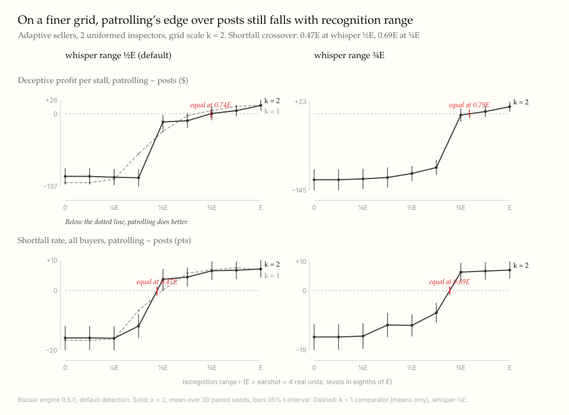

# Grid refinement and the warning-margin test

Part B of the decomposition / grid-refinement / entry-exit spec (2026-11-05).

## Run record

- Engine `0.5.0`; commit `43964e6d982080fee88653dd21cfc274376c4f0a`; uncommitted at run time: ['?? analysis/grid_refinement.py']
- Script sha256 `be7324db3a4cea518c10ef26ef026377f96635b3751bdb566c768deff08b6aad`
- Command: `.venv/bin/python -m analysis.grid_refinement --out runs/grid_refinement.json`
- Python 3.12.7, numpy 2.5.4, macOS-26.6.2-arm64-arm-64bit
- 1680 runs on 8 workers; wall clock 73.1 min; load average [221.22, 218.55, 218.03] at start, [317.31, 338.68, 341.39] at end
- Seeds 0-29, paired; bootstrap 10,000 resamples, `default_rng(20261105)`

## Design (prespecified)

- Grid scale k = 2 (`market.scale=2`): cells and ticks half as large, real speeds unchanged; every distance and time parameter scaled (list in `docs/config_reference.md`). Buyer actions hold a buyer k ticks and rule sellers' yell and whisper cooldowns scale with k (decided 2026-11-05).
- Adaptive sellers (`rule_deceptive_adaptive`), 2 uniformed inspectors on posts or patrolling, recognition range r/E in eighths 0 … 1, whisper range ½E (default, 2 units) or ¾E (3 units): 36 conditions.
- PB1 cells: naive sellers (`rule_deceptive`), posts vs patrolling, 2 inspectors, k = 2: 2 conditions.
- k = 1 comparator (exploratory, for PB3): the adaptive dose cells at whisper ½E: 18 conditions.
- Crossover: the interpolated r/E at which patrolling − posts first stops favouring patrolling. Intervals: 95% paired t over seeds unless marked bootstrap; unadjusted. Confirmatory: PB1 (two outcomes), PB2 (one test).

## Gate

- Equal effort: **passed**: dedicated inspector-active ticks = 960 in every k = 2 run and 480 in every k = 1 run
- No uniform at r = 0: **passed**: 0 of 483,882 seller passer-by rows show a uniform (seed 0, k = 2, both placements and whisper ranges; 35,753 rows were uniformed inspectors)
- k = 1 comparator equals the committed recognition sweep at the five shared levels: **passed** (2,700 values, 0 mismatches)

## PB1 (confirmatory): the placement result at k = 2

Naive sellers, 2 inspectors, k = 2. Patrolling − posts; prediction: below 0 for both outcomes.

| Outcome | Posts | Patrolling | Patrolling − posts | Verdict |
|---|---|---|---|---|
| profit_per_stall.deceptive | 5 [−16, 26] | −158 [−181, −134] | −162 [−186, −139] * | supported |
| shortfall_rate | 26.8 [20.8, 32.8] | 19.8 [15.8, 23.8] | −7.0 [−10.2, −3.8] * | supported |
| catches | 10.23 [8.31, 12.15] | 35.47 [32.06, 38.87] | +25.23 [+21.77, +28.70] * | (secondary) |
| reachable.task_complete_share | 38.2 [33.2, 43.2] | 44.3 [41.0, 47.6] | +6.1 [+3.1, +9.1] * | (secondary) |

## PB2 (confirmatory): does the crossover move with the whisper range?

- Shortfall crossover at whisper ½E: **0.470E**
- Shortfall crossover at whisper ¾E: **0.693E**
- Difference (¾E − ½E): **+0.223**, 95% bootstrap [+0.197, +0.241] (both curves cross in 10,000 of 10,000 resamples)
- Prediction: interval excludes 0 and contains +0.25. **Verdict: partly supported (interval excludes 0 but not +0.25).**
- Exploratory, same difference on deceptive profit: +0.050

### Crossovers (r/E), all curves

| Curve (k | whisper | outcome) | Kind | Crossover | 95% bootstrap | Share of resamples crossing |
|---|---|---|---|---|
| k1|w50|catches | cross | 1.000 | [1.000, 1.000] | 1.000 |
| k1|w50|profit_per_stall.deceptive | cross | 0.671 | [0.595, 0.810] | 1.000 |
| k1|w50|shortfall_rate | cross | 0.496 | [0.448, 0.554] | 1.000 |
| k2|w50|catches | cross | 1.000 | [1.000, 1.000] | 1.000 |
| k2|w50|profit_per_stall.deceptive | cross | 0.744 | [0.612, 0.914] | 1.000 |
| k2|w50|shortfall_rate | cross | 0.470 | [0.448, 0.497] | 1.000 |
| k2|w75|catches | cross | 1.000 | [1.000, 1.000] | 1.000 |
| k2|w75|profit_per_stall.deceptive | cross | 0.794 | [0.738, 0.935] | 1.000 |
| k2|w75|shortfall_rate | cross | 0.693 | [0.669, 0.717] | 1.000 |

## PB3 (exploratory): smoother dose curves on the finer grid

- Distinct inspector-stall distances within earshot (real units, every cell an inspector can stand on): **8 at k = 1, 15 at k = 2**. Posts stand at the same 4 distances at both scales (1.41, 2.24, 3.16, 3.61): refinement adds positions only for moving inspectors and buyers.
- Roughness = largest step between adjacent levels / total variation of the mean curve (1 = all change in one step; 1/8 = evenly spread).

| Outcome (whisper ½E) | k = 1 | k = 2 | k = 2 − k = 1 (95% bootstrap) |
|---|---|---|---|
| profit_per_stall.deceptive | 0.330 | 0.757 | +0.427 [+0.288, +0.462] |
| shortfall_rate | 0.387 | 0.673 | +0.287 [+0.125, +0.374] |

## Dose tables (patrolling − posts, mean [95% CI])

### k = 2, whisper ½E

| r/E | profit_per_stall.deceptive | shortfall_rate | catches |
|---|---|---|---|
| 0 | −119 [−134, −103] * | −15.5 [−19.5, −11.6] * | +15.97 [+14.53, +17.40] * |
| ⅛ | −119 [−134, −103] * | −15.5 [−19.5, −11.6] * | +15.97 [+14.53, +17.40] * |
| ¼ | −120 [−136, −105] * | −15.6 [−19.6, −11.6] * | +15.90 [+14.48, +17.32] * |
| ⅜ | −121 [−137, −105] * | −11.7 [−15.6, −7.7] * | +18.93 [+17.68, +20.18] * |
| ½ | −16 [−29, −2] * | +3.7 [+0.2, +7.2] * | +4.70 [+3.46, +5.94] * |
| ⅝ | −13 [−27, +1] | +4.5 [+1.4, +7.6] * | +4.20 [+3.26, +5.14] * |
| ¾ | +1 [−12, +14] | +6.5 [+3.4, +9.6] * | +2.00 [+1.25, +2.75] * |
| ⅞ | +6 [−5, +17] | +6.7 [+3.8, +9.6] * | +1.53 [+1.12, +1.95] * |
| 1 | +16 [+6, +26] * | +7.1 [+4.3, +10.0] * | +0.00 [+0.00, +0.00] |

### k = 2, whisper ¾E

| r/E | profit_per_stall.deceptive | shortfall_rate | catches |
|---|---|---|---|
| 0 | −125 [−145, −105] * | −15.2 [−19.5, −11.0] * | +16.37 [+14.73, +18.00] * |
| ⅛ | −125 [−145, −105] * | −15.2 [−19.5, −11.0] * | +16.37 [+14.73, +18.00] * |
| ¼ | −123 [−142, −104] * | −14.9 [−19.1, −10.8] * | +16.07 [+14.54, +17.59] * |
| ⅜ | −121 [−140, −102] * | −11.3 [−15.3, −7.3] * | +19.27 [+17.78, +20.75] * |
| ½ | −113 [−127, −99] * | −11.4 [−15.0, −7.8] * | +18.50 [+17.18, +19.82] * |
| ⅝ | −102 [−116, −88] * | −7.3 [−10.6, −4.0] * | +17.10 [+15.94, +18.26] * |
| ¾ | −2 [−15, +10] | +6.1 [+3.0, +9.1] * | +2.00 [+1.25, +2.75] * |
| ⅞ | +4 [−6, +15] | +6.4 [+3.5, +9.3] * | +1.53 [+1.12, +1.95] * |
| 1 | +13 [+4, +23] * | +6.8 [+3.9, +9.6] * | +0.00 [+0.00, +0.00] |

### k = 1, whisper ½E

| r/E | profit_per_stall.deceptive | shortfall_rate | catches |
|---|---|---|---|
| 0 | −131 [−148, −113] * | −16.3 [−20.6, −12.0] * | +16.33 [+14.93, +17.74] * |
| ⅛ | −131 [−148, −113] * | −16.3 [−20.6, −12.0] * | +16.33 [+14.93, +17.74] * |
| ¼ | −124 [−140, −108] * | −15.9 [−20.0, −11.9] * | +15.87 [+14.54, +17.19] * |
| ⅜ | −76 [−88, −63] * | −6.5 [−9.9, −3.1] * | +12.70 [+11.69, +13.71] * |
| ½ | −33 [−48, −18] * | +0.2 [−2.8, +3.2] | +5.77 [+4.65, +6.89] * |
| ⅝ | −4 [−16, +9] | +5.7 [+2.5, +8.9] * | +3.07 [+2.23, +3.90] * |
| ¾ | +6 [−7, +19] | +6.8 [+4.1, +9.6] * | +1.77 [+1.07, +2.46] * |
| ⅞ | +14 [+4, +24] * | +7.5 [+4.7, +10.3] * | +0.63 [+0.32, +0.95] * |
| 1 | +16 [+6, +26] * | +6.9 [+4.1, +9.7] * | +0.00 [+0.00, +0.00] |

### Levels by placement (k = 2)

| r/E (w50) | posts profit | patrol profit | posts shortfall | patrol shortfall | posts catches | patrol catches |
|---|---|---|---|---|---|---|
| 0 | 18 [2, 34] | −101 [−112, −89] | 23.5 [18.2, 28.8] | 8.0 [5.8, 10.1] | 5.63 [4.86, 6.40] | 21.60 [20.15, 23.05] |
| ⅛ | 18 [2, 34] | −101 [−112, −89] | 23.5 [18.2, 28.8] | 8.0 [5.8, 10.1] | 5.63 [4.86, 6.40] | 21.60 [20.15, 23.05] |
| ¼ | 18 [2, 34] | −102 [−114, −91] | 23.5 [18.2, 28.8] | 7.9 [5.7, 10.0] | 5.63 [4.86, 6.40] | 21.53 [20.11, 22.96] |
| ⅜ | 24 [6, 42] | −97 [−107, −87] | 20.6 [15.5, 25.7] | 8.9 [6.8, 11.1] | 1.70 [1.13, 2.27] | 20.63 [19.38, 21.89] |
| ½ | 24 [6, 42] | 8 [−12, 29] | 20.6 [15.5, 25.7] | 24.3 [18.7, 29.9] | 1.70 [1.13, 2.27] | 6.40 [5.32, 7.48] |
| ⅝ | 28 [12, 44] | 15 [−4, 34] | 19.4 [14.6, 24.3] | 23.9 [18.8, 29.0] | 0.90 [0.48, 1.32] | 5.10 [4.30, 5.90] |
| ¾ | 28 [12, 44] | 29 [10, 47] | 19.4 [14.6, 24.3] | 26.0 [20.5, 31.4] | 0.90 [0.48, 1.32] | 2.90 [2.33, 3.47] |
| ⅞ | 29 [14, 44] | 35 [18, 52] | 19.1 [14.6, 23.6] | 25.8 [20.6, 31.0] | 0.10 [−0.01, 0.21] | 1.63 [1.24, 2.03] |
| 1 | 31 [17, 45] | 47 [29, 64] | 19.1 [14.6, 23.6] | 26.2 [21.2, 31.2] | 0.00 [0.00, 0.00] | 0.00 [0.00, 0.00] |

| r/E (w75) | posts profit | patrol profit | posts shortfall | patrol shortfall | posts catches | patrol catches |
|---|---|---|---|---|---|---|
| 0 | 10 [−7, 28] | −115 [−127, −102] | 22.8 [17.6, 28.0] | 7.6 [5.3, 9.9] | 6.43 [5.51, 7.36] | 22.80 [21.18, 24.42] |
| ⅛ | 10 [−7, 28] | −115 [−127, −102] | 22.8 [17.6, 28.0] | 7.6 [5.3, 9.9] | 6.43 [5.51, 7.36] | 22.80 [21.18, 24.42] |
| ¼ | 10 [−7, 28] | −113 [−125, −101] | 22.8 [17.6, 28.0] | 7.9 [5.6, 10.2] | 6.43 [5.51, 7.36] | 22.50 [20.95, 24.05] |
| ⅜ | 18 [0, 36] | −103 [−114, −91] | 20.3 [15.3, 25.4] | 9.0 [6.7, 11.4] | 2.00 [1.36, 2.64] | 21.27 [19.88, 22.66] |
| ½ | 18 [0, 36] | −95 [−106, −83] | 20.3 [15.3, 25.4] | 8.9 [6.6, 11.2] | 2.00 [1.36, 2.64] | 20.50 [19.24, 21.76] |
| ⅝ | 27 [11, 43] | −75 [−86, −63] | 19.4 [14.6, 24.3] | 12.2 [9.4, 14.9] | 0.90 [0.48, 1.32] | 18.00 [16.86, 19.14] |
| ¾ | 27 [11, 43] | 25 [7, 42] | 19.4 [14.6, 24.3] | 25.5 [20.2, 30.8] | 0.90 [0.48, 1.32] | 2.90 [2.33, 3.47] |
| ⅞ | 28 [13, 43] | 33 [16, 50] | 19.1 [14.6, 23.6] | 25.5 [20.3, 30.7] | 0.10 [−0.01, 0.21] | 1.63 [1.24, 2.03] |
| 1 | 30 [16, 44] | 44 [26, 61] | 19.1 [14.6, 23.6] | 25.8 [20.8, 30.8] | 0.00 [0.00, 0.00] | 0.00 [0.00, 0.00] |

## Flags

- k2_posts_w50_r8of8: catches = 0 in every seed
- k2_patrolling_w50_r8of8: catches = 0 in every seed
- k2_posts_w75_r8of8: catches = 0 in every seed
- k2_patrolling_w75_r8of8: catches = 0 in every seed
- k1_posts_w50_r8of8: catches = 0 in every seed
- k1_patrolling_w50_r8of8: catches = 0 in every seed

## Verdicts

- **PB1 (confirmatory): supported.** At k = 2, with naive sellers, patrolling − posts is −$162 [−186, −139] per deceptive stall in profit and −7.0 [−10.2, −3.8] points in shortfall. The placement result survives refinement.
- **PB2 (confirmatory): partly supported.** Widening the whisper range from ½E to ¾E moves the shortfall crossover from 0.470E to 0.693E: +0.223, 95% bootstrap [+0.197, +0.241]. The interval excludes 0, as predicted, but sits just below +0.25, so the second half of the prediction fails.
- **PB3 (exploratory): not borne out.** There are more distinct inspector-stall distances at k = 2 (15 against 8), but the dose curves are *less* smooth: the largest single step is 0.76 of the profit curve's total change at k = 2 against 0.33 at k = 1 (difference +0.43 [+0.29, +0.46]), and 0.67 against 0.39 for shortfall.

## Reading (written after the results)

*Written after the results.*

The finer grid did not smooth the staircase into a slope. It sharpened it into a single step, and the step sits where the warning-margin idea says it should: where recognition range reaches the whisper range. At whisper ½E, patrolling's advantage holds from r = 0 to ⅜E and is gone at ½E (patrolling profit −$97 → +$8 per deceptive stall; catches by patrols 20.6 → 6.4). At whisper ¾E the same collapse moves to between ⅝E and ¾E (−$75 → +$25; catches 18.0 → 2.9). Recognition range = whisper range is the point at which a seller always sees the uniform before it can whisper to it, and a whisper is the most detectable false claim an inspector can receive (private channel: weight 1, no distance decay, against 0.6 and 0.4 with linear decay for yells and signs). This run did not log catches by channel, so that mechanism is inferred, not measured. Below that point extra recognition buys little; at that point it buys almost everything.

So the warning margin (recognition range minus whisper range) is the controlling variable, and the crossover's position is not a grid artifact. The +0.223 estimate falls short of +0.25 because the crossover is interpolated linearly between eighth-steps that straddle a step function: the true step lies in (⅜E, ½E] at whisper ½E and in (⅝E, ¾E] at ¾E, at exactly r = w in both, and how far the interpolated zero sits inside each interval depends on the size of the residual gaps on either side, which differ between the two whisper ranges. A shift of exactly 0.25 in the step's location is consistent with the data; the prespecified statistic, read literally, does not contain it.

Why k = 1 looked smoother: at k = 1 a patroller passes stalls only at 1, 1.41, 2, 2.24, … real units, so recognizing at 1.5 already hides from the 1 and 1.41 positions, which spreads the drop over ⅜E to ⅝E. At k = 2 the patroller also passes at 1.12, 1.80, 2.06, …, so recognition just below 2 still leaves the many positions between 1.8 and 2 exposed to whispers, and the drop concentrates at r = 2. Posts are the same at both scales (fixed at 1.41, 2.24, 3.16 and 3.61), and their curve is close to flat throughout, as before.

## Caveats

- Changing the whisper range also changes whom sellers can whisper to (buyers as well as inspectors), not only how close an inspector must be to receive a whisper. The PB2 shift mixes both.
- At k = 2 sellers decide on twice as many ticks per real time. Cooldowns hold yell and whisper rates fixed, but the adaptive seller's hiding check runs twice as often, so it reacts to a uniform half a real tick sooner. This is part of what refinement means here.
- Recognition is perfect within r and absent beyond it. Noisy recognition would turn the step into a ramp; the step's sharpness here is partly a property of that assumption.
- Erratum to `runs/recognition_sweep_summary.md` (463af5d): it says nine inspector-to-stall distances exist within earshot at k = 1, including 3. The geometry count here finds eight (1, 1.41, 2, 2.24, 2.83, 3.16, 3.61, 4); 3 cannot occur on the default layout. The conclusions there do not depend on it.
- Plot: in the bottom-left panel the "equal at 0.47E" label overlaps a point marker. Left as is so the recorded script hash stays valid.
- Machine load: other processes kept the load average at 220-430 (memory pressure) throughout; the run took 73 minutes. Results are deterministic and unaffected.
