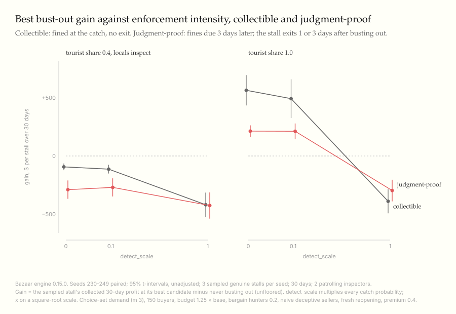
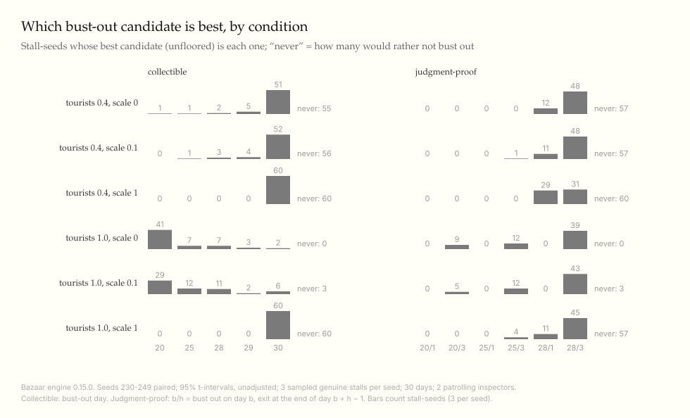

# Enforcement intensity and limited liability

Run spec "Core model: enforcement intensity and limited liability (rule-based only)"; predictions written 2026-11-10, before any run. Pilot gate: `runs/pilot_liability.md`.

## Design (prespecified)

- Engine 0.15.0. Market as the verification run: choice-set demand (m 3, gamma 0), 150 buyers, budget 1.25 × base, bargain hunters 0.2 (Q_req 0.15–0.40); D = 30 known; ratings public (memory 0.7); brands on (premium 0.4, placeholder); naive deceptive sellers, fresh reopening; 2 patrolling inspectors, not uniformed; every genuine stall honest except the stall under test.
- Conditions: verification {tourist share 0.4 with locals inspecting; tourist share 1.0} × detect_scale {0, 0.1, 1} × liability {collectible: fined at the catch, no exit; judgment-proof: fines due 3 days after the catch, exit candidates}}. A catch closes the stall at once in both arms.
- Benchmark: per seed 3 genuine stalls from `default_rng([seed, 17])` (the verification sample), one shared never chain per seed and condition. Collectible candidates: bust out on day 20, 25, 28, 29 or 30. Judgment-proof candidates: bust out on day b ∈ {20, 25, 28} and exit at the end of day b + h − 1, h ∈ {1, 3}. Gain = the stall's collected 30-day profit at its best candidate minus never (**unfloored, primary**, decided 2026-11-10); floored also reported.
- Fines falling due after the stall has exited are uncollectible; fines falling due after day 30 at a stall still in the market are outstanding at close (decided 2026-11-10). Neither is in 30-day profit.
- Paired by seed; 95% t-intervals, unadjusted. Confirmatory: PL1–PL3. Everything else exploratory.

## Run record

- Engine `0.15.0`; commit `32fb8329efd715b3e81b161cccfd033759066074`; uncommitted at run time: ['?? runs/liability_run.log', '?? runs/liability_stdout.log']
- Script sha256 `269bf4ae83e34399b4b1cab71bf2902531b62948de17eb2b6b5fe61a91b0c6b5`
- Command: `python -m analysis.liability --seeds 230-249 --levels 0,0.1,1.0 --tests 858 passed, 17 skipped at 9dfd2f0 (runs/tests_0150.log)`
- Tests: 858 passed, 17 skipped at 9dfd2f0 (runs/tests_0150.log)
- Python 3.12.7, numpy 2.5.4, macOS-26.6.2-arm64-arm-64bit
- 4200 chains × 30 days on 4 workers (nice 19); wall clock 8.55 h; load average [3.92, 5.52, 5.74] at start, [5.36, 5.74, 5.92] at end; memory at start {'swap_free_mb': 1590.56, 'free_pct': 75}, at end {'swap_free_mb': 1598.56, 'free_pct': 72}; memory-guard pauses: 0
- Seeds 230-249 (20), paired, fresh
- Sampled stalls per seed: 230: s08, s17, s42; 231: s33, s08, s12; 232: s31, s09, s12; 233: s19, s28, s02; 234: s34, s41, s04; 235: s43, s04, s41; 236: s27, s42, s40; 237: s22, s25, s24; 238: s39, s05, s01; 239: s44, s39, s19; 240: s38, s18, s06; 241: s26, s02, s39; 242: s07, s27, s04; 243: s00, s14, s28; 244: s19, s21, s41; 245: s02, s28, s12; 246: s45, s16, s11; 247: s15, s21, s33; 248: s20, s09, s27; 249: s17, s23, s28

## Gain by condition

| Liability | Verification | detect_scale | Unfloored gain ($) | Floored gain ($) | Stall-seeds with a positive gain | Never-bust total ($) |
|---|---|---|---|---|---|---|
| collectible | tourist share 0.4, locals inspect | 0 | −93.57 [−122.56, −64.59] * | +4.32 [+0.52, +8.13] * | 8% | 4,196.47 [3,084.43, 5,308.50] |
| collectible | tourist share 0.4, locals inspect | 0.1 | −113.16 [−150.68, −75.64] * | +5.30 [−1.01, +11.62] | 7% | 4,194.27 [3,079.87, 5,308.67] |
| collectible | tourist share 0.4, locals inspect | 1 | −419.41 [−524.03, −314.80] * | +0.00 [+0.00, +0.00] | 0% | 4,608.83 [3,432.75, 5,784.91] |
| collectible | tourist share 1.0 | 0 | +564.45 [+434.09, +694.81] * | +564.45 [+434.09, +694.81] * | 100% | 1,680.92 [1,151.22, 2,210.63] |
| collectible | tourist share 1.0 | 0.1 | +492.78 [+326.44, +659.13] * | +495.58 [+330.77, +660.38] * | 95% | 1,933.46 [1,352.89, 2,514.03] |
| collectible | tourist share 1.0 | 1 | −389.04 [−492.70, −285.38] * | +0.00 [+0.00, +0.00] | 0% | 4,229.02 [3,139.81, 5,318.23] |
| judgment-proof | tourist share 0.4, locals inspect | 0 | −289.38 [−368.37, −210.39] * | +1.35 [−0.25, +2.96] | 5% | 4,196.47 [3,084.43, 5,308.50] |
| judgment-proof | tourist share 0.4, locals inspect | 0.1 | −269.99 [−347.79, −192.19] * | +3.51 [−1.81, +8.83] | 5% | 4,194.27 [3,079.87, 5,308.67] |
| judgment-proof | tourist share 0.4, locals inspect | 1 | −425.65 [−538.33, −312.98] * | +0.00 [+0.00, +0.00] | 0% | 4,608.83 [3,432.75, 5,784.91] |
| judgment-proof | tourist share 1.0 | 0 | +213.50 [+163.94, +263.06] * | +213.50 [+163.94, +263.06] * | 100% | 1,680.92 [1,151.22, 2,210.63] |
| judgment-proof | tourist share 1.0 | 0.1 | +212.32 [+145.47, +279.17] * | +215.09 [+148.85, +281.33] * | 95% | 1,933.46 [1,352.89, 2,514.03] |
| judgment-proof | tourist share 1.0 | 1 | −297.14 [−389.92, −204.36] * | +5.39 [−4.31, +15.09] | 5% | 4,229.02 [3,139.81, 5,318.23] |

## Predictions

Gain in $ per sampled stall over 30 days (per-seed mean of 3 stalls). PL1–PL3 are confirmatory; the rows marked exploratory are the same questions at tourist share 0.4, and the judgment-proof slopes.

| Prediction | Unfloored gain (primary) | Verdict | Floored gain | Verdict |
|---|---|---|---|---|
| **PL1**: collectible, tourist share 1.0: slope of the gain over detect_scale (per 1.0 of detect_scale) | −963.90 [−1,189.56, −738.24] * | supported | −558.99 [−697.65, −420.32] * | supported |
| **PL2**: tourist share 1.0, detect_scale 1.0: judgment-proof − collectible | +91.90 [+45.92, +137.88] * | supported | +5.39 [−4.31, +15.09] | not supported (interval includes 0) |
| **PL3**: judgment-proof, tourist share 1.0, detect_scale 1.0: gain | −297.14 [−389.92, −204.36] * | contradicted (interval on the opposite side of 0) | +5.39 [−4.31, +15.09] | not supported (interval includes 0) |
| **PL1-jp**: judgment-proof, tourist share 1.0: slope of the gain over detect_scale (exploratory) (per 1.0 of detect_scale) | −532.56 [−676.97, −388.15] * | supported | −217.96 [−274.27, −161.64] * | supported |
| **PL1b**: collectible, tourist share 0.4, locals inspect: slope of the gain over detect_scale (exploratory) (per 1.0 of detect_scale) | −331.55 [−424.31, −238.79] * | supported | −4.94 [−9.59, −0.29] * | supported |
| **PL2b**: tourist share 0.4, locals inspect, detect_scale 1.0: judgment-proof − collectible (exploratory) | −6.24 [−57.45, +44.96] | not supported (interval includes 0) | +0.00 [+0.00, +0.00] | not supported (interval includes 0) |
| **PL3b**: judgment-proof, tourist share 0.4, locals inspect, detect_scale 1.0: gain (exploratory) | −425.65 [−538.33, −312.98] * | contradicted (interval on the opposite side of 0) | +0.00 [+0.00, +0.00] | not supported (interval includes 0) |
| **PL1b-jp**: judgment-proof, tourist share 0.4, locals inspect: slope of the gain over detect_scale (exploratory) (per 1.0 of detect_scale) | −150.79 [−193.49, −108.09] * | supported | −2.36 [−5.01, +0.29] | not supported (interval includes 0) |

## Where the gain crosses 0 (exploratory)

- collectible, tourist share 0.4, locals inspect: no sign change (0: −93.57, 0.1: −113.16, 1: −419.41).
- collectible, tourist share 1.0: the mean unfloored gain crosses 0 at detect_scale ≈ 0.60 (linear interpolation between 0.1 and 1).
- judgment-proof, tourist share 0.4, locals inspect: no sign change (0: −289.38, 0.1: −269.99, 1: −425.65).
- judgment-proof, tourist share 1.0: the mean unfloored gain crosses 0 at detect_scale ≈ 0.48 (linear interpolation between 0.1 and 1).

## Enforcement intensity: catches per deceptive stall-day (exploratory, calibration anchor)

From the never chains (every genuine stall honest): catches at deceptive-type stalls divided by deceptive stall-days over the 30 days, per seed; and all catches per market day.

| Liability | Verification | detect_scale | Catches per deceptive stall-day | Catches per market day |
|---|---|---|---|---|
| collectible | tourist share 0.4, locals inspect | 0 | 0.000 [0.000, 0.000] | 0.0 [0.0, 0.0] |
| collectible | tourist share 0.4, locals inspect | 0.1 | 0.220 [0.205, 0.234] | 3.3 [3.1, 3.5] |
| collectible | tourist share 0.4, locals inspect | 1 | 2.117 [2.039, 2.196] | 31.8 [30.6, 32.9] |
| collectible | tourist share 1.0 | 0 | 0.000 [0.000, 0.000] | 0.0 [0.0, 0.0] |
| collectible | tourist share 1.0 | 0.1 | 0.359 [0.349, 0.370] | 5.4 [5.2, 5.5] |
| collectible | tourist share 1.0 | 1 | 3.195 [3.166, 3.223] | 47.9 [47.5, 48.4] |
| judgment-proof | tourist share 0.4, locals inspect | 0 | 0.000 [0.000, 0.000] | 0.0 [0.0, 0.0] |
| judgment-proof | tourist share 0.4, locals inspect | 0.1 | 0.220 [0.205, 0.234] | 3.3 [3.1, 3.5] |
| judgment-proof | tourist share 0.4, locals inspect | 1 | 2.117 [2.039, 2.196] | 31.8 [30.6, 32.9] |
| judgment-proof | tourist share 1.0 | 0 | 0.000 [0.000, 0.000] | 0.0 [0.0, 0.0] |
| judgment-proof | tourist share 1.0 | 0.1 | 0.359 [0.349, 0.370] | 5.4 [5.2, 5.5] |
| judgment-proof | tourist share 1.0 | 1 | 3.195 [3.166, 3.223] | 47.9 [47.5, 48.4] |

## Fines: charged, uncollectible, outstanding (exploratory)

Market: never chains, all seeds, all stalls. Tested stall: the sampled stall in the chain of its best candidate, all stall-seeds. Shares are of all fines from catches in the 30 days.

| Liability | Verification | detect_scale | Market charged ($) | Market outstanding at close | Tested stall: charged ($) | Tested stall: uncollectible ($) | Tested stall: uncollectible share |
|---|---|---|---|---|---|---|---|
| collectible | tourist share 0.4, locals inspect | 0 | 0.00 | – | 0.00 | 0.00 | – |
| collectible | tourist share 0.4, locals inspect | 0.1 | 163,836.00 | 0.0% | 1,224.00 | 0.00 | 0.0% |
| collectible | tourist share 0.4, locals inspect | 1 | 1,600,452.00 | 0.0% | 16,152.00 | 0.00 | 0.0% |
| collectible | tourist share 1.0 | 0 | 0.00 | – | 0.00 | 0.00 | – |
| collectible | tourist share 1.0 | 0.1 | 266,580.00 | 0.0% | 12,108.00 | 0.00 | 0.0% |
| collectible | tourist share 1.0 | 1 | 2,402,472.00 | 0.0% | 16,668.00 | 0.00 | 0.0% |
| judgment-proof | tourist share 0.4, locals inspect | 0 | 0.00 | – | 0.00 | 0.00 | – |
| judgment-proof | tourist share 0.4, locals inspect | 0.1 | 147,960.00 | 9.7% | 0.00 | 5,364.00 | 100.0% |
| judgment-proof | tourist share 0.4, locals inspect | 1 | 1,449,264.00 | 9.4% | 0.00 | 31,776.00 | 100.0% |
| judgment-proof | tourist share 1.0 | 0 | 0.00 | – | 0.00 | 0.00 | – |
| judgment-proof | tourist share 1.0 | 0.1 | 240,336.00 | 9.8% | 0.00 | 4,632.00 | 100.0% |
| judgment-proof | tourist share 1.0 | 1 | 2,154,984.00 | 10.3% | 0.00 | 40,296.00 | 100.0% |

## Best candidate (exploratory)

| Condition | Counts by candidate | never best (floored) |
|---|---|---|
| collectible, t40, 0 | 20: 1, 25: 1, 28: 2, 29: 5, 30: 51 | 55 |
| collectible, t40, 0.1 | 20: 0, 25: 1, 28: 3, 29: 4, 30: 52 | 56 |
| collectible, t40, 1 | 20: 0, 25: 0, 28: 0, 29: 0, 30: 60 | 60 |
| collectible, t100, 0 | 20: 41, 25: 7, 28: 7, 29: 3, 30: 2 | 0 |
| collectible, t100, 0.1 | 20: 29, 25: 12, 28: 11, 29: 2, 30: 6 | 3 |
| collectible, t100, 1 | 20: 0, 25: 0, 28: 0, 29: 0, 30: 60 | 60 |
| judgment-proof, t40, 0 | 20/1: 0, 20/3: 0, 25/1: 0, 25/3: 0, 28/1: 12, 28/3: 48 | 57 |
| judgment-proof, t40, 0.1 | 20/1: 0, 20/3: 0, 25/1: 0, 25/3: 1, 28/1: 11, 28/3: 48 | 57 |
| judgment-proof, t40, 1 | 20/1: 0, 20/3: 0, 25/1: 0, 25/3: 0, 28/1: 29, 28/3: 31 | 60 |
| judgment-proof, t100, 0 | 20/1: 0, 20/3: 9, 25/1: 0, 25/3: 12, 28/1: 0, 28/3: 39 | 0 |
| judgment-proof, t100, 0.1 | 20/1: 0, 20/3: 5, 25/1: 0, 25/3: 12, 28/1: 0, 28/3: 43 | 3 |
| judgment-proof, t100, 1 | 20/1: 0, 20/3: 0, 25/1: 0, 25/3: 4, 28/1: 11, 28/3: 45 | 57 |

## Harm by buyer profile at the best candidate (exploratory)

Bust chain at the stall's best candidate minus the never chain, days from the bust-out to 30; per seed the mean over the 3 stalls. Shortfall in points of purchases; surplus in $ per buyer of the profile.

| Condition | tourist: shortfall (pts) | local: shortfall (pts) | expert: shortfall (pts) | tourist: surplus ($) | local: surplus ($) | expert: surplus ($) |
|---|---|---|---|---|---|---|
| collectible, t40, 0 | +1.1 [+0.7, +1.5] * | +0.7 [+0.3, +1.0] * | +0.0 [+0.0, +0.0] | −0.77 [−1.14, −0.40] * | −0.36 [−0.58, −0.15] * | −0.16 [−0.23, −0.09] * |
| collectible, t40, 0.1 | +0.9 [+0.2, +1.6] * | +0.6 [+0.1, +1.2] * | +0.0 [+0.0, +0.0] | −1.11 [−1.76, −0.46] * | −0.46 [−0.80, −0.13] * | −0.16 [−0.26, −0.06] * |
| collectible, t40, 1 | +2.0 [+0.2, +3.8] * | +0.9 [+0.2, +1.5] * | +0.0 [+0.0, +0.0] | −0.84 [−2.38, +0.71] | −0.30 [−0.52, −0.08] * | −0.13 [−0.26, −0.00] * |
| collectible, t100, 0 | +2.2 [+2.1, +2.4] * | – | – | −1.16 [−1.43, −0.89] * | – | – |
| collectible, t100, 0.1 | +2.1 [+1.6, +2.6] * | – | – | −1.08 [−1.40, −0.76] * | – | – |
| collectible, t100, 1 | +2.5 [+1.0, +4.0] * | – | – | −1.63 [−2.88, −0.38] * | – | – |
| judgment-proof, t40, 0 | +1.6 [+1.3, +1.9] * | +0.2 [+0.1, +0.3] * | +0.0 [+0.0, +0.0] | −0.82 [−1.14, −0.51] * | −0.27 [−0.38, −0.16] * | −0.17 [−0.24, −0.10] * |
| judgment-proof, t40, 0.1 | +1.5 [+0.8, +2.2] * | +0.4 [+0.1, +0.7] * | +0.0 [+0.0, +0.0] | −0.98 [−1.61, −0.35] * | −0.41 [−0.67, −0.15] * | −0.15 [−0.25, −0.05] * |
| judgment-proof, t40, 1 | +2.1 [+1.3, +2.8] * | +0.5 [+0.1, +0.8] * | +0.0 [+0.0, +0.0] | −1.18 [−2.06, −0.30] * | −0.15 [−0.36, +0.05] | −0.23 [−0.38, −0.09] * |
| judgment-proof, t100, 0 | +1.8 [+1.6, +2.0] * | – | – | −1.09 [−1.39, −0.79] * | – | – |
| judgment-proof, t100, 0.1 | +1.8 [+1.3, +2.2] * | – | – | −0.97 [−1.25, −0.69] * | – | – |
| judgment-proof, t100, 1 | +1.8 [+1.0, +2.6] * | – | – | −1.15 [−1.80, −0.51] * | – | – |

## Stuck and parked buyers by condition

Every chain of the condition: the engine's end-of-day guard (stuck_buyers, idle_choosers) and the parked-buyer observer (a buyer still in the market needing units, within reach of the stall it chose).

| Condition | Chains | Buyer-days | Stuck | Parked | Idle choosers |
|---|---|---|---|---|---|
| collectible, t40, 0 | 320 | 1,440,000 | 0 | 0 | 0 |
| collectible, t40, 0.1 | 320 | 1,440,000 | 0 | 0 | 0 |
| collectible, t40, 1 | 320 | 1,440,000 | 0 | 0 | 0 |
| collectible, t100, 0 | 320 | 1,440,000 | 0 | 0 | 0 |
| collectible, t100, 0.1 | 320 | 1,440,000 | 0 | 0 | 0 |
| collectible, t100, 1 | 320 | 1,440,000 | 0 | 0 | 0 |
| judgment-proof, t40, 0 | 380 | 1,710,000 | 0 | 0 | 0 |
| judgment-proof, t40, 0.1 | 380 | 1,710,000 | 0 | 0 | 0 |
| judgment-proof, t40, 1 | 380 | 1,710,000 | 0 | 0 | 0 |
| judgment-proof, t100, 0 | 380 | 1,710,000 | 0 | 0 | 0 |
| judgment-proof, t100, 0.1 | 380 | 1,710,000 | 0 | 0 | 0 |
| judgment-proof, t100, 1 | 380 | 1,710,000 | 0 | 0 | 0 |

## Floors, invalid actions, schedules and guard

- none

## Reading (written after the results)

**PL1 is supported. PL2 is supported on the primary (unfloored) gain. PL3 is contradicted.**

- **Enforcement intensity deters (PL1).** In the tourist-only market the collectible gain falls from
  +$564 at detect_scale 0 to +$493 at 0.1 and −$389 at 1. The slope is −$964 per unit of
  detect_scale [−1,190, −738]. At 0.1 (0.36 catches per deceptive stall-day) 57 of 60 stall-seeds
  still bust out. At 1 (3.2 per stall-day) none do. The mean gain crosses 0 between 0.1 and 1. The
  linear interpolation puts it near 0.6, but with 0.3 dropped there is no level in between, so the
  crossing is not located.
- **Judgment-proofness helps the cheater at full enforcement, but not enough (PL2, PL3).** At
  detect_scale 1 the judgment-proof gain beats the collectible gain by +$92 [+46, +138]. Both are
  negative, and the judgment-proof gain is −$297 [−390, −204]. Only 3 of 60 stall-seeds would bust
  out, so the floored PL2 and PL3 are null.
- **Why limited liability does not rescue the bust-out (exploratory, from `liability.csv`, computed
  after the results).** Trading does not depend on the lag. So busting out on day 28 and exiting at
  the end of day 30 (28/3) differs from the collectible day-28 bust-out only in the fines that fall
  due after day 30, which become uncollectible. That difference is +$832 per stall-seed at
  tourist-only detect_scale 1, and +$94 at 0.1. Escaping the fines is worth a lot. Even so, a stall
  that pays no fine at all loses $297 by busting out. The losses come from the rest of the
  enforcement:
  - a catch closes the stall at once in both arms, and limited liability does nothing about that;
  - the honest sales the stall forgoes;
  - its rating.

  In the collectible arm at detect_scale 1, the best candidate's fines are $278 per stall-seed of a
  $389 loss. Without them the day-30 bust-out would still lose $111.

| Tourist-only (t100) | Collectible gain | Fines charged at best | Judgment-proof gain | Uncollectible at best | JP 28/3 − collectible 28 |
|---|---:|---:|---:|---:|---:|
| detect_scale 0 | +564 | 0 | +214 | 0 | 0 |
| detect_scale 0.1 | +493 | 202 | +212 | 77 | +94 |
| detect_scale 1 | −389 | 278 | −297 | 672 | +832 |

  Means in $ per stall-seed (60), no intervals.
- **The judgment-proof arm is a bundle.** It combines the lag with mandatory exit. Where fines are
  small, the forced exit costs more than the escaped fines are worth. At detect_scale 0 the
  judgment-proof gain is $351 below the collectible one, because the collectible stall's best
  bust-out (mostly day 20) keeps selling to day 30 and the judgment-proof stall must leave within 3
  days. Its best candidate is the latest one, 28/3, in 39–48 of 60 stall-seeds in every condition
  except t40 at scale 1 (31). The ordering of the arms flips between 0.1 and 1.
- **Verification makes the bust-out a loss everywhere.** With tourist share 0.4 and locals
  inspecting, the gain is negative at every intensity in both arms. The intensity slope is −$332
  [−424, −239] in the collectible arm. At detect_scale 1 the two arms are indistinguishable
  (−$6 [−57, +45]).
- **Enforcement raises the honest baseline.** As in the Stage B rerun, the never-bust total rises
  with intensity (tourist-only: $1,681 at 0, $1,933 at 0.1, $4,229 at 1). Part of the fall in the
  gain is a richer honest alternative, not only a costlier bust-out. This is not decomposed.
- **Consistency checks.** Collectible t100 at detect_scale 1 is the Stage B design. Its gain of
  −$389 here (seeds 230–249) sits within the interval of Stage B's −$436 [−537, −335] (seeds
  200–219). The never chains are identical across the two arms, as they should be: the lag does not
  change trading and the deceptive sellers never exit. About 10% of the market's fines are
  outstanding at close in the judgment-proof arm. These are the last 3 days' fines.
- **Harm.** Tourists bear it. At their best candidate, bust-outs cut tourists' purchases by 0.9–2.5
  points and their surplus by $0.77–1.63 per tourist. The figures are similar across the arms.

## Caveats

- **Only three intensity levels.** detect_scale 0.3 was dropped at the pilot gate: G3 projected
  11.7 h against a 10 h limit (`runs/pilot_liability.md`). G3 was timed at detect_scale 0.1. The
  PL1 slopes are least-squares lines over {0, 0.1, 1}, dominated by the 0-versus-1 contrast. The
  crossing points interpolate across the 0.1–1 gap and are rough.
- **The two arms are bundles.** The judgment-proof arm is lag 3 together with mandatory exit. There
  is no arm with lag 3 and no exit, and none with lag 0 and exit. So PL2 compares bundles. The
  28/3 versus day-28 contrast isolates the fines escaped, but only at that timing, where the exit
  at the end of day 30 changes nothing.
- **Closure at the catch applies in both arms.** Results describe limited liability for fines
  only, under a rule where a catch also closes the stall at once.
- **Fines after day 30.** At a stall still in the market they count as outstanding at close and
  are not in 30-day profit (decided 2026-11-10). This matters only in the judgment-proof arm, and
  mostly for deceptive stalls, whose profit is not an outcome here.
- **Candidate grids.** The bust-out candidates are fixed grids: collectible days 20, 25, 28, 29,
  30; judgment-proof b ∈ {20, 25, 28}, h ∈ {1, 3}. A stall's true best may lie off the grid, so
  the gains are lower bounds of its optimum. Sellers are rule-based, and the deceptive sellers are
  naive.
- **Scope of the evidence.** 20 seeds; 95% t-intervals across seeds, unadjusted; many exploratory
  rows. The decomposition table in the Reading was computed after the results.
- **Calibration anchor.** detect_scale 1 is the 0.14.0 enforcement; G1 showed byte-identical
  reproduction. The catches-per-deceptive-stall-day anchor comes from the never chains.
