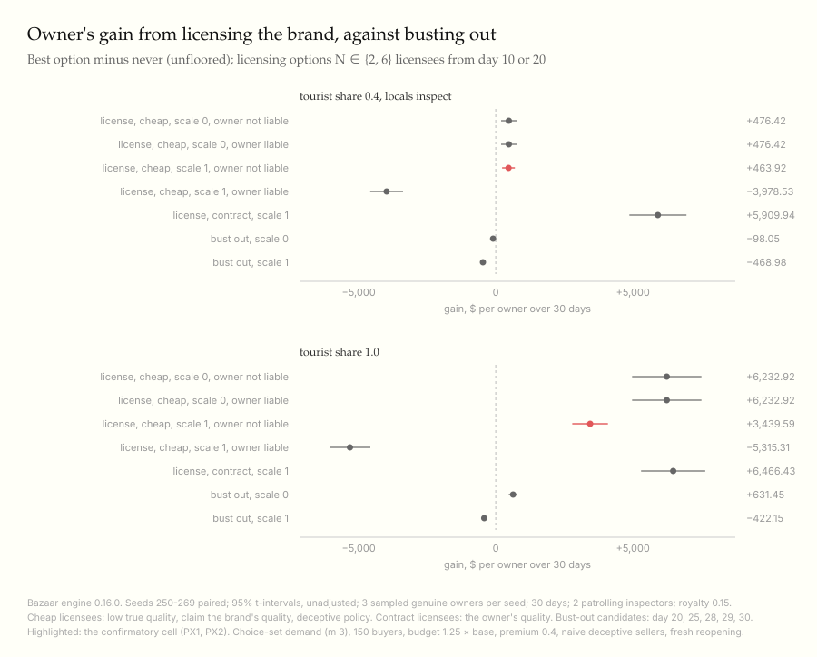
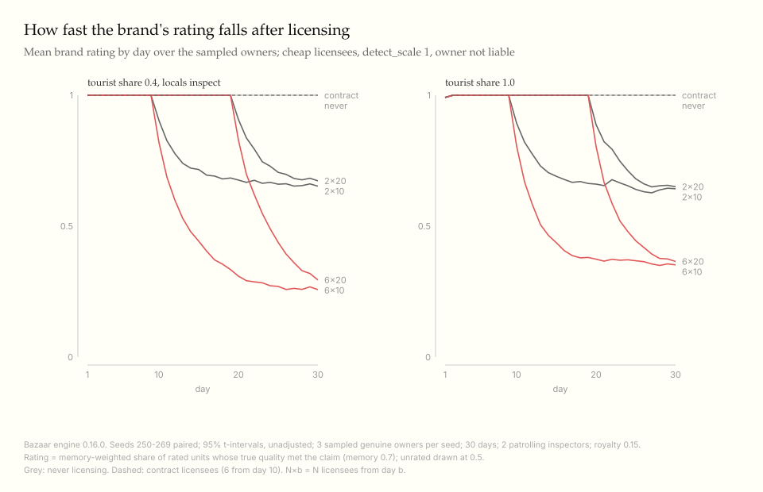

# Licensing: harvesting brand equity through licensees

Spec "Part 2: licensing" (2026-11-11); predictions written 2026-11-11, before any run. Pilot gate: `runs/pilot_licensing.md`.

## Design (prespecified)

- Engine 0.16.0. Market as the liability run: choice-set demand (m 3, gamma 0), 150 buyers, budget 1.25 × base, bargain hunters 0.2 (Q_req 0.15–0.40); D = 30 known; ratings public (memory 0.7); brands on (premium 0.4, placeholder); naive deceptive sellers, fresh reopening; 2 patrolling inspectors, not uniformed; collectible fines; every genuine stall honest, the owner under test included.
- Licensing (decided 2026-11-11): from the start of day b the owner's brand is borne by N non-genuine stalls of its category (dedicated stream); they post its price, claim its quality, never rename, and pay a royalty of 0.15 × price per unit (placeholder). Cheap licensees: true quality drawn from the low range, deceptive policy; contract licensees: the owner's quality, honest policy. Reviews of licensee sales go to the brand. Owner liable: fines from catches at licensees are charged to the owner.
- Conditions: cheap licensees × verification {tourist share 0.4 with locals inspecting; 1.0} × detect_scale {0, 1} × owner liable {no, yes}; contract licensees × verification, detect_scale 1, owner not liable.
- Benchmark: per seed 3 genuine owners from `default_rng([seed, 17])`; one never chain per seed, verification level and detect_scale. Options: N ∈ {2, 6} from day b ∈ {10, 20}. Gain = owner's 30-day profit (own sales + royalties − fines charged to it) at its best option minus never (**unfloored, primary**); floored also reported. Bust-out gain in the same markets: candidates day 20, 25, 28, 29, 30.
- Paired by seed; 95% t-intervals, unadjusted. Confirmatory: PX1–PX3. Everything else exploratory.

## Run record

- Engine `0.16.0`; commit `ddd6fc2fecb1d99b971f41201020074bca806abe`; uncommitted at run time: ['?? runs/licensing_run.log', '?? runs/licensing_stdout.log']
- Script sha256 `117ae5f8c3b93aec7ff38ef2d36978aaafa88667f7ac75361f9cc647e721ff08`
- Command: `python -m analysis.licensing --seeds 250-269 --tests 975 passed, 17 skipped at 63c21bc (runs/tests_0160.log)`
- Tests: 975 passed, 17 skipped at 63c21bc (runs/tests_0160.log)
- Python 3.12.7, numpy 2.5.4, macOS-26.6.2-arm64-arm-64bit
- 3680 chains × 30 days on 4 workers (nice 19); wall clock 7.23 h; load average [3.54, 2.94, 2.59] at start, [6.19, 6.58, 6.29] at end; memory at start {'swap_free_mb': 1614.56, 'free_pct': 62}, at end {'swap_free_mb': 1622.56, 'free_pct': 63}; memory-guard pauses: 0
- Seeds 250-269 (20), paired, fresh
- Sampled owners per seed: 250: s28, s20, s11; 251: s11, s40, s06; 252: s23, s14, s35; 253: s41, s27, s23; 254: s19, s35, s14; 255: s41, s21, s26; 256: s20, s37, s25; 257: s40, s18, s31; 258: s11, s00, s27; 259: s36, s46, s07; 260: s41, s38, s24; 261: s19, s35, s15; 262: s45, s43, s09; 263: s30, s42, s32; 264: s41, s08, s19; 265: s21, s36, s05; 266: s28, s16, s07; 267: s41, s11, s25; 268: s23, s37, s02; 269: s00, s37, s31

## Owner's gain by condition

| Condition | Unfloored gain ($) | Floored gain ($) | Owners with a positive gain | Never total ($) | Best option (counts) |
|---|---|---|---|---|---|
| cheap, t40, 0, owner not liable | +476.42 [+194.10, +758.75] * | +572.94 [+324.08, +821.81] * | 75% | 5,011.26 [4,181.64, 5,840.89] | 2×10: 3, 2×20: 6, 6×10: 13, 6×20: 38, never (floored): 15 |
| cheap, t40, 0, owner liable | +476.42 [+194.10, +758.75] * | +572.94 [+324.08, +821.81] * | 75% | 5,011.26 [4,181.64, 5,840.89] | 2×10: 3, 2×20: 6, 6×10: 13, 6×20: 38, never (floored): 15 |
| cheap, t40, 1, owner not liable | +463.92 [+231.46, +696.38] * | +536.64 [+312.53, +760.75] * | 77% | 5,505.73 [4,600.97, 6,410.49] | 2×10: 18, 2×20: 9, 6×10: 6, 6×20: 27, never (floored): 14 |
| cheap, t40, 1, owner liable | −3,978.53 [−4,577.26, −3,379.80] * | +0.00 [+0.00, +0.00] | 0% | 5,505.73 [4,600.97, 6,410.49] | 2×10: 0, 2×20: 60, 6×10: 0, 6×20: 0, never (floored): 60 |
| cheap, t100, 0, owner not liable | +6,232.92 [+4,967.72, +7,498.13] * | +6,232.92 [+4,967.72, +7,498.13] * | 100% | 2,072.11 [1,695.70, 2,448.52] | 2×10: 0, 2×20: 0, 6×10: 60, 6×20: 0, never (floored): 0 |
| cheap, t100, 0, owner liable | +6,232.92 [+4,967.72, +7,498.13] * | +6,232.92 [+4,967.72, +7,498.13] * | 100% | 2,072.11 [1,695.70, 2,448.52] | 2×10: 0, 2×20: 0, 6×10: 60, 6×20: 0, never (floored): 0 |
| cheap, t100, 1, owner not liable | +3,439.59 [+2,789.73, +4,089.46] * | +3,439.59 [+2,789.73, +4,089.46] * | 100% | 5,016.82 [4,204.45, 5,829.20] | 2×10: 0, 2×20: 0, 6×10: 60, 6×20: 0, never (floored): 0 |
| cheap, t100, 1, owner liable | −5,315.31 [−6,057.57, −4,573.05] * | +0.00 [+0.00, +0.00] | 0% | 5,016.82 [4,204.45, 5,829.20] | 2×10: 0, 2×20: 60, 6×10: 0, 6×20: 0, never (floored): 60 |
| contract, t40, 1, owner not liable | +5,909.94 [+4,868.62, +6,951.27] * | +5,909.94 [+4,868.62, +6,951.27] * | 100% | 5,505.73 [4,600.97, 6,410.49] | 2×10: 0, 2×20: 0, 6×10: 60, 6×20: 0, never (floored): 0 |
| contract, t100, 1, owner not liable | +6,466.43 [+5,296.70, +7,636.16] * | +6,466.43 [+5,296.70, +7,636.16] * | 100% | 5,016.82 [4,204.45, 5,829.20] | 2×10: 0, 2×20: 0, 6×10: 60, 6×20: 0, never (floored): 0 |

Bust-out in the same markets (no licence):

| Verification, detect_scale | Unfloored gain ($) | Floored gain ($) | Owners with a positive gain | Best candidate (counts) |
|---|---|---|---|---|
| tourist share 1.0, 0 | +631.45 [+472.59, +790.30] * | +631.45 [+472.59, +790.30] * | 100% | 20: 42, 25: 11, 28: 3, 29: 4, 30: 0, never (floored): 0 |
| tourist share 1.0, 1 | −422.15 [−500.51, −343.79] * | +0.00 [+0.00, +0.00] | 0% | 20: 0, 25: 0, 28: 0, 29: 0, 30: 60, never (floored): 60 |
| tourist share 0.4, locals inspect, 0 | −98.05 [−133.41, −62.69] * | +10.69 [−0.88, +22.25] | 15% | 20: 0, 25: 4, 28: 2, 29: 6, 30: 48, never (floored): 51 |
| tourist share 0.4, locals inspect, 1 | −468.98 [−548.12, −389.84] * | +0.00 [+0.00, +0.00] | 0% | 20: 0, 25: 0, 28: 0, 29: 0, 30: 60, never (floored): 60 |

## Predictions

Gain in $ per sampled owner over 30 days (per-seed mean of 3 owners). PX1–PX3 are confirmatory; every row marked exploratory is not.

| Prediction | Unfloored gain (primary) | Verdict | Floored gain | Verdict |
|---|---|---|---|---|
| **PX1**: cheap, tourist share 1.0, detect_scale 1, owner not liable: licensing gain | +3,439.59 [+2,789.73, +4,089.46] * | supported | +3,439.59 [+2,789.73, +4,089.46] * | supported |
| **PX2**: same cell: licensing gain − best bust-out gain | +3,861.74 [+3,153.24, +4,570.24] * | supported | +3,439.59 [+2,789.73, +4,089.46] * | supported |
| **PX3**: cheap, tourist share 1.0, detect_scale 1: liable − not liable | −8,754.90 [−10,063.08, −7,446.71] * | supported | −3,439.59 [−4,089.46, −2,789.73] * | supported |
| **PX1-ds0**: cheap, tourist share 1.0, detect_scale 0, owner not liable: licensing gain (exploratory) | +6,232.92 [+4,967.72, +7,498.13] * | supported | +6,232.92 [+4,967.72, +7,498.13] * | supported |
| **PX2-ds0**: same cell: licensing gain − best bust-out gain (exploratory) | +5,601.48 [+4,456.30, +6,746.65] * | supported | +5,601.48 [+4,456.30, +6,746.65] * | supported |
| **PX3-ds0**: cheap, tourist share 1.0, detect_scale 0: liable − not liable (exploratory) | +0.00 [+0.00, +0.00] | not supported (interval includes 0) | +0.00 [+0.00, +0.00] | not supported (interval includes 0) |
| **PC**: contract, tourist share 1.0, detect_scale 1, owner not liable: licensing gain (exploratory) | +6,466.43 [+5,296.70, +7,636.16] * | supported | +6,466.43 [+5,296.70, +7,636.16] * | supported |
| **PC-cheap**: tourist share 1.0, detect_scale 1: cheap − contract (exploratory) | −3,026.84 [−3,744.98, −2,308.69] * | contradicted (interval on the opposite side of 0) | −3,026.84 [−3,744.98, −2,308.69] * | contradicted (interval on the opposite side of 0) |
| **PX1b**: cheap, tourist share 0.4, locals inspect, detect_scale 1, owner not liable: licensing gain (exploratory) | +463.92 [+231.46, +696.38] * | supported | +536.64 [+312.53, +760.75] * | supported |
| **PX2b**: same cell: licensing gain − best bust-out gain (exploratory) | +932.90 [+664.65, +1,201.15] * | supported | +536.64 [+312.53, +760.75] * | supported |
| **PX3b**: cheap, tourist share 0.4, locals inspect, detect_scale 1: liable − not liable (exploratory) | −4,442.44 [−5,115.34, −3,769.55] * | supported | −536.64 [−760.75, −312.53] * | supported |
| **PX1b-ds0**: cheap, tourist share 0.4, locals inspect, detect_scale 0, owner not liable: licensing gain (exploratory) | +476.42 [+194.10, +758.75] * | supported | +572.94 [+324.08, +821.81] * | supported |
| **PX2b-ds0**: same cell: licensing gain − best bust-out gain (exploratory) | +574.47 [+289.07, +859.88] * | supported | +562.26 [+322.32, +802.20] * | supported |
| **PX3b-ds0**: cheap, tourist share 0.4, locals inspect, detect_scale 0: liable − not liable (exploratory) | +0.00 [+0.00, +0.00] | not supported (interval includes 0) | +0.00 [+0.00, +0.00] | not supported (interval includes 0) |
| **PCb**: contract, tourist share 0.4, locals inspect, detect_scale 1, owner not liable: licensing gain (exploratory) | +5,909.94 [+4,868.62, +6,951.27] * | supported | +5,909.94 [+4,868.62, +6,951.27] * | supported |
| **PCb-cheap**: tourist share 0.4, locals inspect, detect_scale 1: cheap − contract (exploratory) | −5,446.03 [−6,402.37, −4,489.68] * | contradicted (interval on the opposite side of 0) | −5,373.30 [−6,310.89, −4,435.72] * | contradicted (interval on the opposite side of 0) |

## Brand rating by day (exploratory)

Mean brand rating over the sampled owners (unrated = 0.5), at days 1, 10, 15, 20, 25 and 30.

| Condition | Option | Day 1 | 10 | 15 | 20 | 25 | 30 |
|---|---|---|---|---|---|---|---|
| cheap, t40, 0, owner not liable | never | 0.992 | 1.000 | 1.000 | 1.000 | 1.000 | 1.000 |
| cheap, t40, 0, owner not liable | 2×10 | 0.992 | 0.884 | 0.576 | 0.473 | 0.405 | 0.385 |
| cheap, t40, 0, owner not liable | 2×20 | 0.992 | 1.000 | 1.000 | 0.880 | 0.571 | 0.478 |
| cheap, t40, 0, owner not liable | 6×10 | 0.992 | 0.792 | 0.282 | 0.168 | 0.143 | 0.136 |
| cheap, t40, 0, owner not liable | 6×20 | 0.992 | 1.000 | 1.000 | 0.791 | 0.293 | 0.161 |
| cheap, t40, 0, owner liable | never | 0.992 | 1.000 | 1.000 | 1.000 | 1.000 | 1.000 |
| cheap, t40, 0, owner liable | 2×10 | 0.992 | 0.884 | 0.576 | 0.473 | 0.405 | 0.385 |
| cheap, t40, 0, owner liable | 2×20 | 0.992 | 1.000 | 1.000 | 0.880 | 0.571 | 0.478 |
| cheap, t40, 0, owner liable | 6×10 | 0.992 | 0.792 | 0.282 | 0.168 | 0.143 | 0.136 |
| cheap, t40, 0, owner liable | 6×20 | 0.992 | 1.000 | 1.000 | 0.791 | 0.293 | 0.161 |
| cheap, t40, 1, owner not liable | never | 1.000 | 1.000 | 1.000 | 1.000 | 1.000 | 1.000 |
| cheap, t40, 1, owner not liable | 2×10 | 1.000 | 0.904 | 0.717 | 0.676 | 0.660 | 0.653 |
| cheap, t40, 1, owner not liable | 2×20 | 1.000 | 1.000 | 1.000 | 0.907 | 0.705 | 0.673 |
| cheap, t40, 1, owner not liable | 6×10 | 1.000 | 0.819 | 0.443 | 0.309 | 0.270 | 0.258 |
| cheap, t40, 1, owner not liable | 6×20 | 1.000 | 1.000 | 1.000 | 0.828 | 0.438 | 0.294 |
| cheap, t40, 1, owner liable | never | 1.000 | 1.000 | 1.000 | 1.000 | 1.000 | 1.000 |
| cheap, t40, 1, owner liable | 2×10 | 1.000 | 0.904 | 0.717 | 0.676 | 0.660 | 0.653 |
| cheap, t40, 1, owner liable | 2×20 | 1.000 | 1.000 | 1.000 | 0.907 | 0.705 | 0.673 |
| cheap, t40, 1, owner liable | 6×10 | 1.000 | 0.819 | 0.443 | 0.309 | 0.270 | 0.258 |
| cheap, t40, 1, owner liable | 6×20 | 1.000 | 1.000 | 1.000 | 0.828 | 0.438 | 0.294 |
| cheap, t100, 0, owner not liable | never | 0.958 | 1.000 | 1.000 | 1.000 | 1.000 | 1.000 |
| cheap, t100, 0, owner not liable | 2×10 | 0.958 | 0.807 | 0.411 | 0.345 | 0.329 | 0.327 |
| cheap, t100, 0, owner not liable | 2×20 | 0.958 | 1.000 | 1.000 | 0.789 | 0.404 | 0.340 |
| cheap, t100, 0, owner not liable | 6×10 | 0.958 | 0.743 | 0.239 | 0.159 | 0.147 | 0.135 |
| cheap, t100, 0, owner not liable | 6×20 | 0.958 | 1.000 | 1.000 | 0.740 | 0.245 | 0.151 |
| cheap, t100, 0, owner liable | never | 0.958 | 1.000 | 1.000 | 1.000 | 1.000 | 1.000 |
| cheap, t100, 0, owner liable | 2×10 | 0.958 | 0.807 | 0.411 | 0.345 | 0.329 | 0.327 |
| cheap, t100, 0, owner liable | 2×20 | 0.958 | 1.000 | 1.000 | 0.789 | 0.404 | 0.340 |
| cheap, t100, 0, owner liable | 6×10 | 0.958 | 0.743 | 0.239 | 0.159 | 0.147 | 0.135 |
| cheap, t100, 0, owner liable | 6×20 | 0.958 | 1.000 | 1.000 | 0.740 | 0.245 | 0.151 |
| cheap, t100, 1, owner not liable | never | 0.992 | 1.000 | 1.000 | 1.000 | 1.000 | 1.000 |
| cheap, t100, 1, owner not liable | 2×10 | 0.992 | 0.893 | 0.690 | 0.660 | 0.640 | 0.643 |
| cheap, t100, 1, owner not liable | 2×20 | 0.992 | 1.000 | 1.000 | 0.888 | 0.681 | 0.651 |
| cheap, t100, 1, owner not liable | 6×10 | 0.992 | 0.806 | 0.437 | 0.374 | 0.368 | 0.352 |
| cheap, t100, 1, owner not liable | 6×20 | 0.992 | 1.000 | 1.000 | 0.804 | 0.444 | 0.365 |
| cheap, t100, 1, owner liable | never | 0.992 | 1.000 | 1.000 | 1.000 | 1.000 | 1.000 |
| cheap, t100, 1, owner liable | 2×10 | 0.992 | 0.893 | 0.690 | 0.660 | 0.640 | 0.643 |
| cheap, t100, 1, owner liable | 2×20 | 0.992 | 1.000 | 1.000 | 0.888 | 0.681 | 0.651 |
| cheap, t100, 1, owner liable | 6×10 | 0.992 | 0.806 | 0.437 | 0.374 | 0.368 | 0.352 |
| cheap, t100, 1, owner liable | 6×20 | 0.992 | 1.000 | 1.000 | 0.804 | 0.444 | 0.365 |
| contract, t40, 1, owner not liable | never | 1.000 | 1.000 | 1.000 | 1.000 | 1.000 | 1.000 |
| contract, t40, 1, owner not liable | 2×10 | 1.000 | 1.000 | 1.000 | 1.000 | 1.000 | 1.000 |
| contract, t40, 1, owner not liable | 2×20 | 1.000 | 1.000 | 1.000 | 1.000 | 1.000 | 1.000 |
| contract, t40, 1, owner not liable | 6×10 | 1.000 | 1.000 | 1.000 | 1.000 | 1.000 | 1.000 |
| contract, t40, 1, owner not liable | 6×20 | 1.000 | 1.000 | 1.000 | 1.000 | 1.000 | 1.000 |
| contract, t100, 1, owner not liable | never | 0.992 | 1.000 | 1.000 | 1.000 | 1.000 | 1.000 |
| contract, t100, 1, owner not liable | 2×10 | 0.992 | 1.000 | 1.000 | 1.000 | 1.000 | 1.000 |
| contract, t100, 1, owner not liable | 2×20 | 0.992 | 1.000 | 1.000 | 1.000 | 1.000 | 1.000 |
| contract, t100, 1, owner not liable | 6×10 | 0.992 | 1.000 | 1.000 | 1.000 | 1.000 | 1.000 |
| contract, t100, 1, owner not liable | 6×20 | 0.992 | 1.000 | 1.000 | 1.000 | 1.000 | 1.000 |

## Licence accounting by option (exploratory)

Per seed the mean over the 3 owners, from the licence day to 30. Owner units: the owner's own sales minus never's over the same days. Fines by payer: fines from catches at licensees.

| Condition | Option | Royalties ($) | Licensee units | Owner units − never | Catches at licensees | Fines to owner ($) | Fines to licensees ($) | Licensee mean quality |
|---|---|---|---|---|---|---|---|---|
| cheap, t40, 0, owner not liable | 2×10 | 982.03 [814.15, 1,149.92] | 105.2 [100.6, 109.9] | −38.2 [−48.5, −27.9] * | 0.0 [0.0, 0.0] | 0.00 [0.00, 0.00] | 0.00 [0.00, 0.00] | 0.307 [0.287, 0.327] |
| cheap, t40, 0, owner not liable | 2×20 | 534.60 [431.92, 637.28] | 55.1 [51.6, 58.7] | −10.8 [−17.2, −4.5] * | 0.0 [0.0, 0.0] | 0.00 [0.00, 0.00] | 0.00 [0.00, 0.00] | 0.307 [0.287, 0.327] |
| cheap, t40, 0, owner not liable | 6×10 | 2,763.89 [2,232.97, 3,294.82] | 324.2 [309.7, 338.8] | −67.0 [−74.3, −59.8] * | 0.0 [0.0, 0.0] | 0.00 [0.00, 0.00] | 0.00 [0.00, 0.00] | 0.309 [0.300, 0.319] |
| cheap, t40, 0, owner not liable | 6×20 | 1,572.11 [1,276.42, 1,867.80] | 174.5 [165.8, 183.2] | −25.7 [−30.0, −21.4] * | 0.0 [0.0, 0.0] | 0.00 [0.00, 0.00] | 0.00 [0.00, 0.00] | 0.309 [0.300, 0.319] |
| cheap, t40, 0, owner liable | 2×10 | 982.03 [814.15, 1,149.92] | 105.2 [100.6, 109.9] | −38.2 [−48.5, −27.9] * | 0.0 [0.0, 0.0] | 0.00 [0.00, 0.00] | 0.00 [0.00, 0.00] | 0.307 [0.287, 0.327] |
| cheap, t40, 0, owner liable | 2×20 | 534.60 [431.92, 637.28] | 55.1 [51.6, 58.7] | −10.8 [−17.2, −4.5] * | 0.0 [0.0, 0.0] | 0.00 [0.00, 0.00] | 0.00 [0.00, 0.00] | 0.307 [0.287, 0.327] |
| cheap, t40, 0, owner liable | 6×10 | 2,763.89 [2,232.97, 3,294.82] | 324.2 [309.7, 338.8] | −67.0 [−74.3, −59.8] * | 0.0 [0.0, 0.0] | 0.00 [0.00, 0.00] | 0.00 [0.00, 0.00] | 0.309 [0.300, 0.319] |
| cheap, t40, 0, owner liable | 6×20 | 1,572.11 [1,276.42, 1,867.80] | 174.5 [165.8, 183.2] | −25.7 [−30.0, −21.4] * | 0.0 [0.0, 0.0] | 0.00 [0.00, 0.00] | 0.00 [0.00, 0.00] | 0.309 [0.300, 0.319] |
| cheap, t40, 1, owner not liable | 2×10 | 790.32 [644.06, 936.57] | 80.7 [76.2, 85.2] | +7.7 [+0.0, +15.4] * | 86.4 [83.0, 89.7] | 0.00 [0.00, 0.00] | 7,760.00 [6,553.22, 8,966.78] | 0.307 [0.287, 0.327] |
| cheap, t40, 1, owner not liable | 2×20 | 410.93 [323.17, 498.70] | 40.9 [37.4, 44.3] | +4.8 [−0.0, +9.7] | 45.4 [42.9, 48.0] | 0.00 [0.00, 0.00] | 4,040.40 [3,427.54, 4,653.26] | 0.307 [0.287, 0.327] |
| cheap, t40, 1, owner not liable | 6×10 | 2,272.06 [1,878.89, 2,665.24] | 260.3 [252.4, 268.2] | −36.5 [−43.4, −29.6] * | 263.4 [253.9, 272.9] | 0.00 [0.00, 0.00] | 23,418.80 [19,783.17, 27,054.43] | 0.309 [0.300, 0.319] |
| cheap, t40, 1, owner not liable | 6×20 | 1,219.37 [1,007.69, 1,431.06] | 134.1 [128.9, 139.4] | −9.3 [−13.9, −4.7] * | 136.9 [130.2, 143.6] | 0.00 [0.00, 0.00] | 12,188.60 [10,195.42, 14,181.78] | 0.309 [0.300, 0.319] |
| cheap, t40, 1, owner liable | 2×10 | 790.32 [644.06, 936.57] | 80.7 [76.2, 85.2] | +7.7 [+0.0, +15.4] * | 86.4 [83.0, 89.7] | 7,760.00 [6,553.22, 8,966.78] | 0.00 [0.00, 0.00] | 0.307 [0.287, 0.327] |
| cheap, t40, 1, owner liable | 2×20 | 410.93 [323.17, 498.70] | 40.9 [37.4, 44.3] | +4.8 [−0.0, +9.7] | 45.4 [42.9, 48.0] | 4,040.40 [3,427.54, 4,653.26] | 0.00 [0.00, 0.00] | 0.307 [0.287, 0.327] |
| cheap, t40, 1, owner liable | 6×10 | 2,272.06 [1,878.89, 2,665.24] | 260.3 [252.4, 268.2] | −36.5 [−43.4, −29.6] * | 263.4 [253.9, 272.9] | 23,418.80 [19,783.17, 27,054.43] | 0.00 [0.00, 0.00] | 0.309 [0.300, 0.319] |
| cheap, t40, 1, owner liable | 6×20 | 1,219.37 [1,007.69, 1,431.06] | 134.1 [128.9, 139.4] | −9.3 [−13.9, −4.7] * | 136.9 [130.2, 143.6] | 12,188.60 [10,195.42, 14,181.78] | 0.00 [0.00, 0.00] | 0.309 [0.300, 0.319] |
| cheap, t100, 0, owner not liable | 2×10 | 2,071.94 [1,700.83, 2,443.04] | 233.2 [223.0, 243.5] | +51.5 [+42.8, +60.2] * | 0.0 [0.0, 0.0] | 0.00 [0.00, 0.00] | 0.00 [0.00, 0.00] | 0.307 [0.287, 0.327] |
| cheap, t100, 0, owner not liable | 2×20 | 1,101.43 [910.00, 1,292.86] | 120.8 [114.1, 127.5] | +26.0 [+21.4, +30.6] * | 0.0 [0.0, 0.0] | 0.00 [0.00, 0.00] | 0.00 [0.00, 0.00] | 0.307 [0.287, 0.327] |
| cheap, t100, 0, owner not liable | 6×10 | 6,541.82 [5,285.38, 7,798.25] | 781.2 [745.8, 816.6] | +63.9 [+52.2, +75.7] * | 0.0 [0.0, 0.0] | 0.00 [0.00, 0.00] | 0.00 [0.00, 0.00] | 0.309 [0.300, 0.319] |
| cheap, t100, 0, owner not liable | 6×20 | 3,543.60 [2,861.52, 4,225.69] | 404.5 [384.5, 424.4] | +32.9 [+27.1, +38.7] * | 0.0 [0.0, 0.0] | 0.00 [0.00, 0.00] | 0.00 [0.00, 0.00] | 0.309 [0.300, 0.319] |
| cheap, t100, 0, owner liable | 2×10 | 2,071.94 [1,700.83, 2,443.04] | 233.2 [223.0, 243.5] | +51.5 [+42.8, +60.2] * | 0.0 [0.0, 0.0] | 0.00 [0.00, 0.00] | 0.00 [0.00, 0.00] | 0.307 [0.287, 0.327] |
| cheap, t100, 0, owner liable | 2×20 | 1,101.43 [910.00, 1,292.86] | 120.8 [114.1, 127.5] | +26.0 [+21.4, +30.6] * | 0.0 [0.0, 0.0] | 0.00 [0.00, 0.00] | 0.00 [0.00, 0.00] | 0.307 [0.287, 0.327] |
| cheap, t100, 0, owner liable | 6×10 | 6,541.82 [5,285.38, 7,798.25] | 781.2 [745.8, 816.6] | +63.9 [+52.2, +75.7] * | 0.0 [0.0, 0.0] | 0.00 [0.00, 0.00] | 0.00 [0.00, 0.00] | 0.309 [0.300, 0.319] |
| cheap, t100, 0, owner liable | 6×20 | 3,543.60 [2,861.52, 4,225.69] | 404.5 [384.5, 424.4] | +32.9 [+27.1, +38.7] * | 0.0 [0.0, 0.0] | 0.00 [0.00, 0.00] | 0.00 [0.00, 0.00] | 0.309 [0.300, 0.319] |
| cheap, t100, 1, owner not liable | 2×10 | 1,226.33 [1,001.36, 1,451.30] | 124.8 [117.5, 132.0] | +72.2 [+66.7, +77.7] * | 135.8 [133.8, 137.8] | 0.00 [0.00, 0.00] | 11,961.20 [10,144.27, 13,778.13] | 0.307 [0.287, 0.327] |
| cheap, t100, 1, owner not liable | 2×20 | 653.49 [531.77, 775.21] | 63.5 [59.4, 67.6] | +34.7 [+31.4, +37.9] * | 71.9 [70.1, 73.7] | 0.00 [0.00, 0.00] | 6,280.80 [5,381.87, 7,179.73] | 0.307 [0.287, 0.327] |
| cheap, t100, 1, owner not liable | 6×10 | 3,871.83 [3,206.12, 4,537.55] | 437.5 [423.2, 451.9] | +94.7 [+89.9, +99.6] * | 406.2 [402.3, 410.1] | 0.00 [0.00, 0.00] | 35,856.40 [30,549.41, 41,163.39] | 0.309 [0.300, 0.319] |
| cheap, t100, 1, owner not liable | 6×20 | 2,018.44 [1,659.90, 2,376.98] | 219.7 [210.7, 228.7] | +44.9 [+42.0, +47.8] * | 213.6 [210.1, 217.1] | 0.00 [0.00, 0.00] | 18,800.60 [16,126.52, 21,474.68] | 0.309 [0.300, 0.319] |
| cheap, t100, 1, owner liable | 2×10 | 1,226.33 [1,001.36, 1,451.30] | 124.8 [117.5, 132.0] | +72.2 [+66.7, +77.7] * | 135.8 [133.8, 137.8] | 11,961.20 [10,144.27, 13,778.13] | 0.00 [0.00, 0.00] | 0.307 [0.287, 0.327] |
| cheap, t100, 1, owner liable | 2×20 | 653.49 [531.77, 775.21] | 63.5 [59.4, 67.6] | +34.7 [+31.4, +37.9] * | 71.9 [70.1, 73.7] | 6,280.80 [5,381.87, 7,179.73] | 0.00 [0.00, 0.00] | 0.307 [0.287, 0.327] |
| cheap, t100, 1, owner liable | 6×10 | 3,871.83 [3,206.12, 4,537.55] | 437.5 [423.2, 451.9] | +94.7 [+89.9, +99.6] * | 406.2 [402.3, 410.1] | 35,856.40 [30,549.41, 41,163.39] | 0.00 [0.00, 0.00] | 0.309 [0.300, 0.319] |
| cheap, t100, 1, owner liable | 6×20 | 2,018.44 [1,659.90, 2,376.98] | 219.7 [210.7, 228.7] | +44.9 [+42.0, +47.8] * | 213.6 [210.1, 217.1] | 18,800.60 [16,126.52, 21,474.68] | 0.00 [0.00, 0.00] | 0.309 [0.300, 0.319] |
| contract, t40, 1, owner not liable | 2×10 | 2,911.44 [2,368.24, 3,454.64] | 264.1 [241.9, 286.3] | −14.2 [−20.0, −8.5] * | 0.0 [0.0, 0.0] | 0.00 [0.00, 0.00] | 0.00 [0.00, 0.00] | 0.836 [0.816, 0.856] |
| contract, t40, 1, owner not liable | 2×20 | 1,547.28 [1,258.54, 1,836.02] | 140.4 [128.0, 152.7] | −6.7 [−9.8, −3.7] * | 0.0 [0.0, 0.0] | 0.00 [0.00, 0.00] | 0.00 [0.00, 0.00] | 0.836 [0.816, 0.856] |
| contract, t40, 1, owner not liable | 6×10 | 7,068.02 [5,726.82, 8,409.23] | 637.6 [598.1, 677.1] | −42.6 [−52.9, −32.3] * | 0.0 [0.0, 0.0] | 0.00 [0.00, 0.00] | 0.00 [0.00, 0.00] | 0.836 [0.816, 0.856] |
| contract, t40, 1, owner not liable | 6×20 | 3,701.33 [3,001.07, 4,401.58] | 334.2 [312.5, 355.9] | −21.5 [−26.3, −16.6] * | 0.0 [0.0, 0.0] | 0.00 [0.00, 0.00] | 0.00 [0.00, 0.00] | 0.836 [0.816, 0.856] |
| contract, t100, 1, owner not liable | 2×10 | 2,776.78 [2,248.15, 3,305.40] | 251.3 [229.1, 273.5] | −10.8 [−17.4, −4.3] * | 0.0 [0.0, 0.0] | 0.00 [0.00, 0.00] | 0.00 [0.00, 0.00] | 0.836 [0.816, 0.856] |
| contract, t100, 1, owner not liable | 2×20 | 1,467.43 [1,198.31, 1,736.55] | 132.8 [121.0, 144.7] | −5.7 [−9.1, −2.3] * | 0.0 [0.0, 0.0] | 0.00 [0.00, 0.00] | 0.00 [0.00, 0.00] | 0.836 [0.816, 0.856] |
| contract, t100, 1, owner not liable | 6×10 | 7,256.14 [5,847.18, 8,665.09] | 652.2 [610.6, 693.9] | −31.0 [−42.5, −19.4] * | 0.0 [0.0, 0.0] | 0.00 [0.00, 0.00] | 0.00 [0.00, 0.00] | 0.836 [0.816, 0.856] |
| contract, t100, 1, owner not liable | 6×20 | 3,806.30 [3,066.62, 4,545.99] | 343.0 [319.6, 366.4] | −16.1 [−21.5, −10.6] * | 0.0 [0.0, 0.0] | 0.00 [0.00, 0.00] | 0.00 [0.00, 0.00] | 0.836 [0.816, 0.856] |

## Harm by buyer profile at the best option (exploratory)

Licensing chain at the owner's best option minus the never chain, licence day to 30; per seed the mean over the 3 owners. Shortfall in points of purchases; surplus in $ per buyer of the profile.

| Condition | tourist: shortfall (pts) | local: shortfall (pts) | expert: shortfall (pts) | tourist: surplus ($) | local: surplus ($) | expert: surplus ($) |
|---|---|---|---|---|---|---|
| cheap, t40, 0, owner not liable | +2.7 [+2.1, +3.2] * | +1.1 [+0.9, +1.3] * | +0.0 [+0.0, +0.0] | −3.07 [−3.83, −2.32] * | −1.45 [−1.74, −1.15] * | −0.71 [−0.89, −0.53] * |
| cheap, t40, 0, owner liable | +2.7 [+2.1, +3.2] * | +1.1 [+0.9, +1.3] * | +0.0 [+0.0, +0.0] | −3.07 [−3.83, −2.32] * | −1.45 [−1.74, −1.15] * | −0.71 [−0.89, −0.53] * |
| cheap, t40, 1, owner not liable | +1.7 [+1.1, +2.3] * | +0.5 [+0.3, +0.6] * | +0.0 [+0.0, +0.0] | −1.24 [−1.88, −0.59] * | −0.47 [−0.74, −0.21] * | −0.26 [−0.41, −0.11] * |
| cheap, t40, 1, owner liable | +0.9 [+0.2, +1.5] * | +0.4 [+0.2, +0.6] * | +0.0 [+0.0, +0.0] | −0.80 [−1.44, −0.16] * | −0.18 [−0.42, +0.06] | −0.01 [−0.11, +0.09] |
| cheap, t100, 0, owner not liable | +3.4 [+2.8, +3.9] * | – | – | −2.58 [−3.35, −1.80] * | – | – |
| cheap, t100, 0, owner liable | +3.4 [+2.8, +3.9] * | – | – | −2.58 [−3.35, −1.80] * | – | – |
| cheap, t100, 1, owner not liable | +2.4 [+1.9, +2.8] * | – | – | −0.77 [−1.25, −0.29] * | – | – |
| cheap, t100, 1, owner liable | +0.6 [+0.1, +1.2] * | – | – | −0.47 [−0.96, +0.02] | – | – |
| contract, t40, 1, owner not liable | −8.8 [−9.7, −7.9] * | −0.6 [−0.8, −0.5] * | +0.0 [+0.0, +0.0] | +4.45 [+3.04, +5.86] * | −0.61 [−0.87, −0.34] * | −0.42 [−0.61, −0.24] * |
| contract, t100, 1, owner not liable | −6.3 [−6.8, −5.7] * | – | – | +3.02 [+2.14, +3.90] * | – | – |

## Stuck and parked buyers

Every chain: the engine's end-of-day guard (stuck_buyers, idle_choosers) and the parked-buyer observer.

| Chains | Count | Buyer-days | Stuck | Parked | Idle choosers |
|---|---|---|---|---|---|
| never · t40 · ds0.0 | 20 | 90,000 | 0 | 0 | 0 |
| never · t40 · ds1.0 | 20 | 90,000 | 0 | 0 | 0 |
| never · t100 · ds0.0 | 20 | 90,000 | 0 | 0 | 0 |
| never · t100 · ds1.0 | 20 | 90,000 | 0 | 0 | 0 |
| lic · cheap · t40 · ds0.0 · free | 240 | 1,080,000 | 0 | 0 | 0 |
| lic · cheap · t40 · ds0.0 · liable | 240 | 1,080,000 | 0 | 0 | 0 |
| lic · cheap · t40 · ds1.0 · free | 240 | 1,080,000 | 0 | 0 | 0 |
| lic · cheap · t40 · ds1.0 · liable | 240 | 1,080,000 | 0 | 0 | 0 |
| lic · cheap · t100 · ds0.0 · free | 240 | 1,080,000 | 0 | 0 | 0 |
| lic · cheap · t100 · ds0.0 · liable | 240 | 1,080,000 | 0 | 0 | 0 |
| lic · cheap · t100 · ds1.0 · free | 240 | 1,080,000 | 0 | 0 | 0 |
| lic · cheap · t100 · ds1.0 · liable | 240 | 1,080,000 | 0 | 0 | 0 |
| lic · contract · t40 · ds1.0 · free | 240 | 1,080,000 | 0 | 0 | 0 |
| lic · contract · t100 · ds1.0 · free | 240 | 1,080,000 | 0 | 0 | 0 |
| bust · t40 · ds0.0 | 300 | 1,350,000 | 0 | 0 | 0 |
| bust · t40 · ds1.0 | 300 | 1,350,000 | 0 | 0 | 0 |
| bust · t100 · ds0.0 | 300 | 1,350,000 | 0 | 0 | 0 |
| bust · t100 · ds1.0 | 300 | 1,350,000 | 0 | 0 | 0 |

## Floors, invalid actions, schedules and guard

- none

## Reading (written after the results)

- **All three confirmatory predictions are supported on the primary (unfloored) gain.** All three cells use cheap licensees with tourist share 1.0 and detect_scale 1:
  - **PX1:** licensing gains the owner +$3,440 [+2,790, +4,089] over 30 days.
  - **PX2:** that is $3,862 [3,153, 4,570] more than its best bust-out in the same market.
  - **PX3:** making the owner liable for licensees' fines moves the gain by −$8,755 [−10,063, −7,447].
- **Licensing pays as a royalty business, not as a harvest.** In the PX1 cell, all 60 owners do best with 6 licensees from day 10. Over days 10–30:
  - The owner collects $3,872 in royalties on 438 licensee units it never produced.
  - Its own sales rise by 95 units. Its price follows the falling brand rating, and tourists buy the cheapest stall.
  - The licensees bear $35,856 in fines from 406 catches. About 3 catches per licensee a day matches the rate at ordinary deceptive stalls (about 50 a day across the market in the never chains).
- **The deception lowers the gain.** Contract licensees sell at the owner's quality, make no false claims, are never caught, and keep the rating at 1.0. They earn the owner more than cheap ones (exploratory):
  - Tourist share 1.0: +$6,466 against +$3,440, a difference of −$3,027 [−3,745, −2,309].
  - Tourist share 0.4 with locals inspecting: +$5,910 against +$464, a difference of −$5,446 [−6,402, −4,490].
  - Cheap licensees lose volume to closures (438 units against 652 at 6×10), and their price falls with the rating (0.35 against 1.0 by day 30), so royalties fall too.
  - In the run's own framing, the owner here does not gain by spending the brand's reputation. It gains by renting the brand out, and keeping the reputation intact pays more.
- **Where locals inspect, cheap licensing barely pays.**
  - The gain is +$464 to +$476 at both detect_scales.
  - The rating falls to 0.26 (detect_scale 1) or 0.14 (detect_scale 0) by day 30 with 6 licensees.
  - The owner loses its own sales (−37 to −67 units at 6×10), which offsets most of the royalties.
  - About a quarter of owners would have done better never licensing.
- **Owner liability works only through enforcement.**
  - With enforcement (detect_scale 1), a liable owner loses at every option: −$3,979 at tourist share 0.4, −$5,315 at 1.0. Every owner's least-bad option is 2 licensees from day 20, and the floored gain is 0, so no owner would license cheaply.
  - At detect_scale 0 there are no catches, so liability is inert. PX3-ds0 is exactly 0 in both markets.
- **Bust-out in these markets repeats the liability run.** It is positive only with tourists alone and no enforcement (+$631). Licensing with a non-liable owner beats it in every cell.
- **Who is harmed (exploratory).**
  - Cheap licensing, owner not liable: tourists fail to complete purchases 1.7–3.4 points more often and lose $0.8–$3.1 of surplus each.
  - Owner liability cuts the tourist shortfall at tourist share 1.0 from 2.4 to 0.6 points, mostly because the owner then picks the smallest option.
  - Contract licensing helps tourists: shortfall falls 6–9 points and surplus rises $3–$4.5. Locals lose a little.

## Caveats

- **Licensee participation is not modelled.** At 6×10 in the PX1 cell, cheap licensees' revenue is about $25,800 (royalties ÷ 0.15), against $35,856 in fines. No licensee that counted its fines would sign. The not-liable cheap result therefore relies on licensees who accept ruinous fines, and owner liability just moves those fines to the party that chooses the plan.
- **The royalty (0.15) and the brand premium (0.4) are placeholders.** Royalties are most of the gain in every licensing cell, so its size scales roughly with the royalty. The signs of PX1 and PX2 would need a much lower royalty to change. That is untested.
- **Contract licensees were run only at detect_scale 1 with the owner not liable.** The PC comparisons are exploratory and cover two cells.
- **Licensees are drawn from non-genuine stalls.** A contract licence turns a deceptive stall into an honest, high-quality one. Part of the contract gain, and of the tourists' improvement, may be this change in the market, not the licence itself.
- **The best option is chosen with hindsight per owner**, as in the earlier runs. That biases the unfloored gain upward slightly; with 4 options the bias is small next to these effects.
- **The owners differ widely.** Never totals within a seed range over an order of magnitude (seed 250: $361, $1,929 and $6,190).
- **The rating plot's footnote is wrong.** It reads "Grey: never licensing". Grey is N = 2 and red is N = 6; the dashed line at 1 is both never and contract licensees. The script is frozen, so the plot is left as generated.
- 95% intervals, unadjusted. Only PX1–PX3 are confirmatory; every other row is exploratory.
