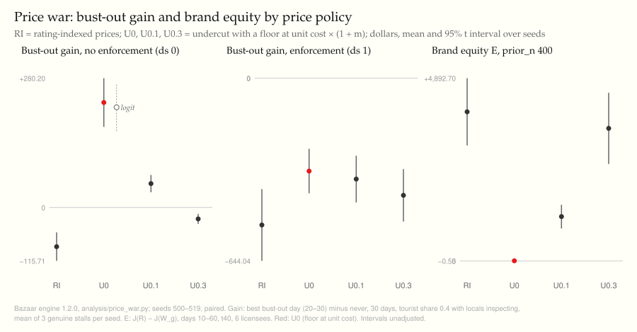

# Price-war study (Stage 2, engine 1.2.0)

Engine 1.2.0, commit 030e7cb, script sha256 ae1ac5b2f226; 3440 chains, 8.05 h on 4 workers; seeds 500–519, paired. Intervals: 95% t over seeds, unadjusted.

## Predictions

| | Prediction | Estimate [95% CI] | Verdict |
|---|---|---|---|
| PW1 | Outcome A, undercut m = 0, detect_scale 0: the bust-out gain is > 0. | +227.47 [+174.75, +280.20] * | **supported** |
| PW2 | Outcome A, detect_scale 0: the slope of the gain over m ∈ {0, 0.1, 0.3} is < 0. | −775.07 [−942.20, −607.94] * per unit of m | **supported** |
| PW3 | Outcome B: the slope of brand equity E over m ∈ {0, 0.1, 0.3} is > 0. | +11,825.51 [+8,644.22, +15,006.79] * per unit of m | **supported** |
| PW4 | Outcome A, undercut m = 0, detect_scale 1: the bust-out gain is < 0. | −327.37 [−406.06, −248.68] * | **supported** |

Rule (fixed before the run): supported if the interval lies on the predicted side of 0; contradicted if on the other side; otherwise not supported. Slopes are in dollars per unit of m (per seed, least squares over m = 0, 0.1, 0.3).

## Outcome A: bust-out gain by cell

| Cell | Gain [95% CI] |
|---|---|
| A|RI|ds0|lex | −84.89 [−115.71, −54.07] * |
| A|RI|ds1|lex | −517.55 [−644.04, −391.06] * |
| A|U0|ds0|lex | +227.47 [+174.75, +280.20] * |
| A|U0|ds1|lex | −327.37 [−406.06, −248.68] * |
| A|U0.1|ds0|lex | +51.72 [+33.02, +70.43] * |
| A|U0.1|ds1|lex | −355.75 [−438.04, −273.46] * |
| A|U0.3|ds0|lex | −24.70 [−35.49, −13.90] * |
| A|U0.3|ds1|lex | −412.92 [−505.37, −320.47] * |
| A|U0|ds0|sharp | +217.09 [+165.56, +268.62] * |

## Outcome B: brand equity E by cell

| Cell | E [95% CI] |
|---|---|
| B|RI|lex | +3,991.74 [+3,090.78, +4,892.70] * |
| B|U0|lex | +0.88 [−0.55, +2.30] |
| B|U0.1|lex | +1,185.26 [+866.56, +1,503.96] * |
| B|U0.3|lex | +3,548.89 [+2,594.42, +4,503.37] * |

## PW5 (exploratory)

### Undercut m = 0 against rating-indexed (paired)

| Outcome | U0 − RI [95% CI] |
|---|---|
| Gain, ds 0 | −312.36 [−381.02, −243.71] * |
| Gain, ds 1 | −190.17 [−248.02, −132.33] * |
| E, prior_n 400 | +3,990.86 [+3,090.57, +4,891.16] * |
| Gain slope over m, ds 1 | −285.25 [−353.12, −217.39] * |
| Logit sharp − lex, U0, ds 0 | +10.38 [+0.05, +20.72] * |

### Prices, margins and buyers (never chains, outcome A market)

Posted prices: own-name stalls every morning; margin = (price − unit cost) / price; at floor = share of stall-days posting exactly the undercut floor. Buyer surplus = value − paid − inspection cost, per buyer who arrived, dollars; shortfall = share of purchases below the buyer's quality requirement.

| Cell | Genuine price | Genuine margin | All margin | At floor | Surplus per buyer | Shortfall |
|---|---|---|---|---|---|---|
| A|RI|ds0|lex | 66.82 | 40.0% | 38.1% | 0.0% | −0.70 [−1.20, −0.19] * | 27.2% |
| A|RI|ds1|lex | 66.82 | 40.0% | 39.5% | 0.0% | +0.57 [+0.03, +1.11] * | 17.6% |
| A|U0|ds0|lex | 40.57 | 1.0% | 11.2% | 36.6% | +26.31 [+25.74, +26.89] * | 27.6% |
| A|U0|ds1|lex | 40.56 | 1.0% | 11.2% | 36.6% | +31.08 [+30.55, +31.62] * | 17.5% |
| A|U0.1|ds0|lex | 44.43 | 9.8% | 15.0% | 49.6% | +22.98 [+22.41, +23.55] * | 27.9% |
| A|U0.1|ds1|lex | 44.43 | 9.8% | 15.0% | 49.6% | +27.45 [+26.92, +27.98] * | 17.7% |
| A|U0.3|ds0|lex | 52.16 | 23.3% | 24.6% | 75.7% | +15.33 [+14.86, +15.80] * | 28.3% |
| A|U0.3|ds1|lex | 52.16 | 23.3% | 24.6% | 75.1% | +19.35 [+18.88, +19.82] * | 17.8% |
| A|U0|ds0|sharp | 40.56 | 1.0% | 11.2% | 36.6% | +26.68 [+26.11, +27.26] * | 26.8% |

### Do the price war's lower prices outweigh its fraud for buyers? U0 − RI, never chains (paired)

| | Profile | Surplus per buyer [95% CI] | Shortfall rate [95% CI] |
|---|---|---|---|
| ds0 | tourist | −23.33 [−23.72, −22.93] * | −0.009 [−0.011, −0.008] * |
| ds0 | local | −29.37 [−30.05, −28.69] * | +0.000 [−0.000, +0.000] |
| ds0 | expert | −29.60 [−30.13, −29.07] * | +0.000 [+0.000, +0.000] |
| ds0 | all | −27.01 [−27.33, −26.69] * | −0.004 [−0.005, −0.003] * |
| ds1 | tourist | −31.23 [−31.78, −30.68] * | −0.009 [−0.012, −0.005] * |
| ds1 | local | −30.30 [−30.97, −29.62] * | +0.002 [+0.001, +0.003] * |
| ds1 | expert | −29.77 [−30.31, −29.23] * | +0.000 [+0.000, +0.000] |
| ds1 | all | −30.51 [−30.87, −30.16] * | +0.001 [−0.001, +0.003] |

## Checks

- G2, reproduction of the 1.1.0 undercut chains with m = 0: 60 of 60 match (pass).
- Guard (stuck, parked, idle, invalid actions) summed over 3440 chains: 0, 0, 0, 0.
- Flags: 0.

