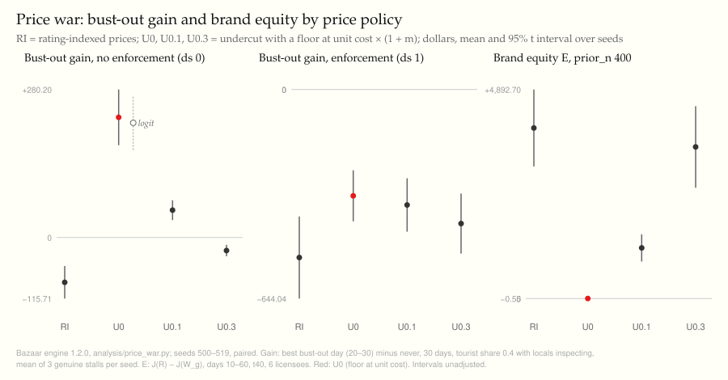

# Price-war study (Stage 2, engine 1.2.0)

Engine 1.2.0. Chains run at commit 030e7cb (script sha256 ae1ac5b2f226), 3440 chains, 8.05 h on 4 workers; seeds 500–519, paired. Tables regenerated from the chain cache at db0abba (script sha256 118d855272b8) after deviation D4, which put the PW5 paired differences in their labelled direction; nothing else changed (the as-run outputs are in `runs/price_war_as_run/`). Intervals: 95% t over seeds, unadjusted.

## Predictions

| | Prediction | Estimate [95% CI] | Verdict |
|---|---|---|---|
| PW1 | Outcome A, undercut m = 0, detect_scale 0: the bust-out gain is > 0. | +227.47 [+174.75, +280.20] * | **supported** |
| PW2 | Outcome A, detect_scale 0: the slope of the gain over m ∈ {0, 0.1, 0.3} is < 0. | −775.07 [−942.20, −607.94] * per unit of m | **supported** |
| PW3 | Outcome B: the slope of brand equity E over m ∈ {0, 0.1, 0.3} is > 0. | +11,825.51 [+8,644.22, +15,006.79] * per unit of m | **supported** |
| PW4 | Outcome A, undercut m = 0, detect_scale 1: the bust-out gain is < 0. | −327.37 [−406.06, −248.68] * | **supported** |

Rule (fixed before the run): supported if the interval lies on the predicted side of 0; contradicted if on the other side; otherwise not supported. Slopes are in dollars per unit of m (per seed, least squares over m = 0, 0.1, 0.3).

## Outcome A: bust-out gain by cell

| Cell | Gain [95% CI] |
|---|---|
| A|RI|ds0|lex | −84.89 [−115.71, −54.07] * |
| A|RI|ds1|lex | −517.55 [−644.04, −391.06] * |
| A|U0|ds0|lex | +227.47 [+174.75, +280.20] * |
| A|U0|ds1|lex | −327.37 [−406.06, −248.68] * |
| A|U0.1|ds0|lex | +51.72 [+33.02, +70.43] * |
| A|U0.1|ds1|lex | −355.75 [−438.04, −273.46] * |
| A|U0.3|ds0|lex | −24.70 [−35.49, −13.90] * |
| A|U0.3|ds1|lex | −412.92 [−505.37, −320.47] * |
| A|U0|ds0|sharp | +217.09 [+165.56, +268.62] * |

## Outcome B: brand equity E by cell

| Cell | E [95% CI] |
|---|---|
| B|RI|lex | +3,991.74 [+3,090.78, +4,892.70] * |
| B|U0|lex | +0.88 [−0.55, +2.30] |
| B|U0.1|lex | +1,185.26 [+866.56, +1,503.96] * |
| B|U0.3|lex | +3,548.89 [+2,594.42, +4,503.37] * |

## PW5 (exploratory)

### Undercut m = 0 against rating-indexed (paired)

| Outcome | U0 − RI [95% CI] |
|---|---|
| Gain, ds 0 | +312.36 [+243.71, +381.02] * |
| Gain, ds 1 | +190.17 [+132.33, +248.02] * |
| E, prior_n 400 | −3,990.86 [−4,891.16, −3,090.57] * |
| Gain slope over m, ds 1 | −285.25 [−353.12, −217.39] * |
| Logit sharp − lex, U0, ds 0 | −10.38 [−20.72, −0.05] * |

### Prices, margins and buyers (never chains, outcome A market)

Posted prices: own-name stalls every morning; margin = (price − unit cost) / price; at floor = share of stall-days posting exactly the undercut floor. Buyer surplus = value − paid − inspection cost, per buyer who arrived, dollars; shortfall = share of purchases below the buyer's quality requirement.

| Cell | Genuine price | Genuine margin | All margin | At floor | Surplus per buyer | Shortfall |
|---|---|---|---|---|---|---|
| A|RI|ds0|lex | 66.82 | 40.0% | 38.1% | 0.0% | −0.70 [−1.20, −0.19] * | 27.2% |
| A|RI|ds1|lex | 66.82 | 40.0% | 39.5% | 0.0% | +0.57 [+0.03, +1.11] * | 17.6% |
| A|U0|ds0|lex | 40.57 | 1.0% | 11.2% | 36.6% | +26.31 [+25.74, +26.89] * | 27.6% |
| A|U0|ds1|lex | 40.56 | 1.0% | 11.2% | 36.6% | +31.08 [+30.55, +31.62] * | 17.5% |
| A|U0.1|ds0|lex | 44.43 | 9.8% | 15.0% | 49.6% | +22.98 [+22.41, +23.55] * | 27.9% |
| A|U0.1|ds1|lex | 44.43 | 9.8% | 15.0% | 49.6% | +27.45 [+26.92, +27.98] * | 17.7% |
| A|U0.3|ds0|lex | 52.16 | 23.3% | 24.6% | 75.7% | +15.33 [+14.86, +15.80] * | 28.3% |
| A|U0.3|ds1|lex | 52.16 | 23.3% | 24.6% | 75.1% | +19.35 [+18.88, +19.82] * | 17.8% |
| A|U0|ds0|sharp | 40.56 | 1.0% | 11.2% | 36.6% | +26.68 [+26.11, +27.26] * | 26.8% |

### Do the price war's lower prices outweigh its fraud for buyers? U0 − RI, never chains (paired)

| | Profile | Surplus per buyer [95% CI] | Shortfall rate [95% CI] |
|---|---|---|---|
| ds0 | tourist | +23.33 [+22.93, +23.72] * | +0.009 [+0.008, +0.011] * |
| ds0 | local | +29.37 [+28.69, +30.05] * | −0.000 [−0.000, +0.000] |
| ds0 | expert | +29.60 [+29.07, +30.13] * | +0.000 [+0.000, +0.000] |
| ds0 | all | +27.01 [+26.69, +27.33] * | +0.004 [+0.003, +0.005] * |
| ds1 | tourist | +31.23 [+30.68, +31.78] * | +0.009 [+0.005, +0.012] * |
| ds1 | local | +30.30 [+29.62, +30.97] * | −0.002 [−0.003, −0.001] * |
| ds1 | expert | +29.77 [+29.23, +30.31] * | +0.000 [+0.000, +0.000] |
| ds1 | all | +30.51 [+30.16, +30.87] * | −0.001 [−0.003, +0.001] |

## Checks

- G2, reproduction of the 1.1.0 undercut chains with m = 0: 60 of 60 match (pass).
- Guard (stuck, parked, idle, invalid actions) summed over 3440 chains: 0, 0, 0, 0.
- Flags: 0.

## Reading (written after the results)

- **BLUF: a price war at unit cost makes a bust-out pay when nobody enforces, and a margin floor or enforcement takes the payoff away.** All four confirmatory predictions are supported, each interval on the predicted side of 0.
  - With genuine stalls pricing at unit cost (U0) and no enforcement, a bust-out gains +$227 per stall [+$175, +$280] (PW1).
  - Under rating-indexed prices the same bust-out loses −$85 [−$116, −$54].
- **A higher floor shrinks the gain** (PW2, −$775 per unit of m, i.e. about −$78 per 0.1 of markup).
  - At a 10% floor the gain falls to +$52 [+$33, +$70].
  - At a 30% floor it is −$25 [−$35, −$14], back on the losing side.
- **The brand is worth nothing at cost and recovers with the floor** (PW3).
  - Equity E is +$0.88 [−$0.55, +$2.30] under U0, an interval that includes 0.
  - E is +$1,185 at a 10% floor, +$3,549 at 30%, and +$3,992 under rating-indexed prices.
  - Read together with PW1 and PW2: what a seller loses by cheating is the margin honesty earns, and at cost that margin is about 1% of the price (genuine stalls' margin, U0 row of the price table). This is an interpretation, consistent with the reputation-rent argument; the study does not test the mechanism separately.
- **Enforcement still wins** (PW4).
  - With detect_scale 1 the bust-out loses under every policy: −$327 [−$406, −$249] under U0, down to −$518 under rating-indexed prices.
  - The loss is smaller under the price war than under rating-indexed prices (U0 − RI +$190 [+$132, +$248], exploratory), because there is less honest margin to give up.
  - With enforcement, the gain still falls as the floor rises (slope −$285 per unit of m, exploratory).
- **Buyers gain from the price war, in the chains where nobody busts out** (PW5, exploratory).
  - Surplus per arriving buyer is about $27 higher under U0 than under rating-indexed prices with no enforcement (+$31 with enforcement), for every buyer profile.
  - The share of purchases below a buyer's quality requirement barely moves (−0.4 points with no enforcement; +0.1 with enforcement, interval includes 0).
  - The shortfall depends on enforcement (about 27% without, 17.5% with), not on the price rule.
  - These are never chains, so the buyer figures leave out what a bust-out itself would cost buyers.
- **The buyer choice rule does not matter here.** Sharp logit choice gives a gain of +$217 against +$227 under lexicographic choice (sharp − lex −$10 [−$21, −$0.05], exploratory), the same story.

## Caveats

- **Deviation D4 (after the run).** The script passed its PW5 pairs to `paired_diff(a, b)` (which returns b − a) in the wrong order, so the as-run PW5 tables printed RI − U0 and lex − sharp under U0 − RI and sharp − lex labels.
  - The argument order was fixed (db0abba) and the tables regenerated from the chain cache with no new chains.
  - The regeneration was checked: PW1–PW4, every cell estimate, the price and buyer tables, guards and seed samples are identical, and all 20 PW5 differences flip sign exactly.
  - The as-run outputs are kept in `runs/price_war_as_run/`.
- **The gain is the best of five bust-out days (20, 25, 28, 29, 30) minus never.** Taking the best day biases each level upward, the same in every cell, so the comparisons across policies stand better than the levels. This is the liability study's benchmark, kept unchanged.
- **One market for outcome A**: 30 days, tourist share 0.4 with locals inspecting, 2 patrolling inspectors with collectible fines. Outcome B is the t40 equity market at prior_n 400. Other markets may differ.
- **Twenty seeds; intervals are 95% t over seeds, unadjusted.** The PW5 rows are exploratory, and with 21 paired differences some intervals that exclude 0 are expected by chance.
- **The figure** has two cosmetic flaws in the frozen plotting code: in the third panel the "−0.58" and "0" tick labels overprint, and the middle panel's zero line runs under the third panel's top tick label. The numbers are in the tables above.
