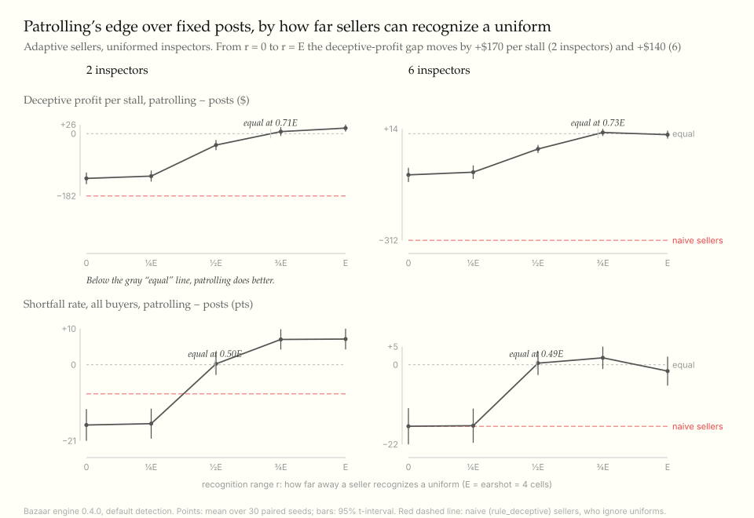

# Recognition-range dose-response

How far away must a seller recognize a uniform for adaptivity to erase patrolling's advantage?

## Run record

- Engine version: `0.4.0`
- Commit: `b9c88fb688c1247753d0b492cbb905bff6451e4d`; uncommitted at run time: `?? analysis/recognition_sweep.py`
- Run script: `analysis/recognition_sweep.py`, sha256 `0f0491760d68c87e…`
- Command: `.venv/bin/python -m analysis.recognition_sweep --seeds 0-29 --out runs/recognition_sweep.json`
- Wall-clock: 492 s for 900 runs on 8 workers; load average 65.2 at start, 23.8 at end
- Seeds: 0–29 (30), paired across all 30 conditions
- Python 3.12.7, numpy 2.5.4, macOS-26.6.2-arm64-arm-64bit
- Bootstrap: 10000 resamples of seeds, numpy default_rng(20261105)

E = market.earshot = 4 cells. Condition names: `posts2_r0.50` = 2 uniformed posts, recognized within 0.5E;
`disguised_fs6` = 6 full-shift disguised inspectors; naive cells use r = E (naive sellers ignore uniforms).
Notation: mean [95% t-interval over seeds]; money in dollars, shares in percent; signed differences;
`*` = interval excludes 0; unadjusted.

## Gate (checked first)

- Equal effort: every placement has count × 240 dedicated inspector-active ticks in every seed.
- r = E cells against c7cf7fe: 2160 per-seed values compared (adaptive and naive, posts and patrolling, both counts, 9 outcomes), 0 mismatches.
- r = 0, seed 0, full logs of all four adaptive r = 0 cells: 266449 passer-by rows, 38407 of them uniformed inspectors, 0 showing `uniform: true`.
- **Gate passed.**

## Verdicts

| prediction | status | verdict |
|---|---|---|
| P1: slope > 0, deceptive profit, 2 inspectors | confirmatory | **supported**: +$170 [+146, +194] per unit r/E |
| P1: slope > 0, all-buyer shortfall, 2 inspectors | confirmatory | **supported**: +27.7 pts [+21.6, +33.8] |
| P1: slope > 0, deceptive profit, 6 inspectors | confirmatory | **supported**: +$140 [+114, +167] |
| P1: slope > 0, all-buyer shortfall, 6 inspectors | confirmatory | **supported**: +19.3 pts [+14.5, +24.0] |
| P2: equal-effort disguised beats uniformed patrolling against adaptive sellers (r = E) | exploratory | supported at both counts: deceptive profit −$147 and −$181 per stall, shortfall −16.7 and −11.1 pts |
| P3: catch notices alone (adaptive at r = 0 − naive) | exploratory | reported, no direction predicted: deceptive profit higher in all four cells (+$11 to +$256), shortfall lower in all four (−2.9 to −11.3 pts) |

All 4 confirmatory intervals exclude 0 (unadjusted; the narrowest lower bound is +$114 per stall).

## Reading (written after the results)

**Patrolling's advantage fades with recognition range, but in a step, not a slope.** Against adaptive sellers,
patrolling beats posts by $131 per stall in deceptive profit and by 16 points in shortfall when uniforms are
never recognized (r = 0); against naive sellers the gaps are $182 and 8 points. The shortfall gap is larger with
adaptive sellers because a patrol's frequent catches post notices across the market, and adaptive sellers hide
when they see them. Almost nothing changes at r = ¼E
(1 cell). Most of the advantage is gone by r = ½E (2 cells), and by r = ¾E (3 cells) patrolling is no better than
posts on any outcome. The linear slopes in P1 summarize this staircase; they do not describe a straight line.

**Why the step falls where it does: grid geometry and graded detection.** On the grid, an inspector is 1, 1.41, 2,
2.24, 2.83, 3, 3.16, 3.61 or 4 cells from a stall. Posts never stand within 1 cell of a stall, so for posts r = 0
and r = ¼E give identical results in every seed. A patrol is within 1 cell only when it stands directly in front
of a stall, which is too late to hide. Detection probability falls linearly to zero at each channel's range, so
an inspector 3–4 cells away rarely catches anyone. A seller that recognizes a uniform at 2 cells therefore hides
just before the inspector is close enough to matter. Catches show it directly: patrolling's catch advantage over
posts drops from 16 per run (r = 0) to 6 (r = ½E) and to 2 (r = ¾E) at 2 inspectors.

**Crossover (descriptive).** On buyer shortfall, patrolling stops beating posts at about half earshot: 0.50E
[0.46, 0.58] at 2 inspectors and 0.49E [0.45, 0.72] at 6. On deceptive profit it stops at about three-quarters:
0.71E [0.65, 0.85] and 0.73E [0.68, 0.78]. At 6 inspectors, 21% of bootstrap resamples never cross on profit,
because there the curve flattens near 0 instead of passing through it. These crossover points interpolate
between grid levels, so read them as "between ½E and ¾E", not as precise values.

**At equal effort, disguised inspectors are the strongest placement against adaptive sellers.** Full-shift
disguised inspectors hold adaptive sellers to −$100 per stall (2 inspectors) and −$154 (6), with shortfall at
9.3% and 3.5%. With uniformed patrols at full recognition the same sellers earn +$47 and +$28, with shortfall at
26.0% and 14.5%. Effort matters: the earlier single-trip disguised inspectors (c7cf7fe) left adaptive sellers at
−$12 per stall with 19.2% shortfall at 2 inspectors. Against naive sellers, full-shift disguised inspectors match
uniformed patrolling at 6 (−$402 vs −$413; difference +$11 [−2, +24]) and edge it at 2 (−$25 [−41, −10]).

**Catch notices alone shift outcomes in both directions (P3).** With no uniform recognition (r = 0), adaptive
sellers still react to posted catches and their own reopening. Compared with naive sellers, they are caught much
less (−4 to −48 catches per run), so they keep more profit (+$11 to +$256 per stall). They also deceive less often,
so buyers do better (shortfall 3 to 11 points lower). Notices trade penalties collected for deterrence.

### Caveats

- **The dose axis is a staircase.** Only nine inspector-to-stall distances exist within earshot, so any
  recognition range between two of them gives the same run. A finer grid of r would reproduce the same steps.
- **Recognition is perfect within r.** Inside its range the adaptive seller never misses a uniform, and beyond it
  never sees one. Noisy or partial recognition would smooth the steps.
- **Disguised inspectors ask each stall at most once per stall epoch.** This engine rule predates this run. A
  full-shift inspector who walks past a stall again cannot ask again unless the stall has been caught and reopened.
  It still hears yells and receives whispers on every pass, and sees signs once per epoch. Full-shift results may
  therefore understate what repeated disguised visits could do.
- **Floor cells.** Adaptive sellers are never caught by uniformed posts or patrols at r = E (0 catches in every
  seed, as in c7cf7fe). This is the positive control working, and it bounds the r = E end of every curve.
- **Plot.** In the top-left panel, the "+26" and "0" tick labels sit close together. They are drawn by the run
  script and were left as rendered, so the recorded script hash stays valid.
- **Calibration.** Detection weights, the proximity rule, ad costs and the 40-tick closure (also the
  catch-notice window) are placeholder or calibration choices, not research claims.
- **Run conditions.** The machine's load average was 65 at the start (other jobs running). Results do not depend
  on timing.

### Choices made where the design left room

- r values are fractions of E = 4 cells: 0, 1, 2, 3, 4.
- Naive cells run at r = E only. Engine tests show naive outcomes are byte-identical across r.
- The P1 slope is the per-seed OLS slope on r/E over all five levels, so it equals the change in D from r = 0 to
  r = E if the response were linear. The verdict rule: "supported" if the 95% t-interval is above 0.
- Crossover: the first r/E at which the advantage (sign-adjusted D) stops being positive, linearly interpolated
  between adjacent levels on the mean curve. The bootstrap resamples seeds (10,000, fixed seed), and CIs use the
  resamples that cross.
- Gate check 2 compared 9 outcomes per seed for both seller policies (2,160 values), not only the adaptive cells.

## P1 (confirmatory): the patrolling advantage shrinks as recognition range grows

Per seed, the OLS slope of D(r) = patrolling − posts on r/E over the five levels (adaptive sellers,
uniformed inspectors). The slope is the change in D from r = 0 to r = E. Predicted > 0 for deceptive profit
and for all-buyer shortfall rate at both counts. The other rows are exploratory; for surplus, task
completion and catches, a shrinking advantage means a slope < 0.

| count | outcome | slope (per unit r/E) | verdict |
|---|---|---|---|
| 2 | deceptive profit ($/stall) **(confirmatory)** | +169.65 [+145.51, +193.79] * | supported |
| 2 | shortfall rate, all buyers (%) **(confirmatory)** | +27.7 [+21.6, +33.8] * | supported |
| 2 | buyer surplus, reachable ($) | −17.85 [−23.61, −12.08] * | exploratory |
| 2 | task complete, reachable (%) | −23.4 [−28.6, −18.1] * | exploratory |
| 2 | catches | −18.7 [−20.3, −17.1] * | exploratory |
| 6 | deceptive profit ($/stall) **(confirmatory)** | +140.49 [+114.17, +166.82] * | supported |
| 6 | shortfall rate, all buyers (%) **(confirmatory)** | +19.3 [+14.5, +24.0] * | supported |
| 6 | buyer surplus, reachable ($) | −13.74 [−18.92, −8.55] * | exploratory |
| 6 | task complete, reachable (%) | −15.7 [−19.5, −11.9] * | exploratory |
| 6 | catches | −17.5 [−19.3, −15.7] * | exploratory |

## Dose-response

D(r) = patrolling − posts, adaptive sellers, paired over seeds. The last column is the same contrast for naive
sellers (independent of r).

**2 inspectors**

| outcome | r = 0E | r = 0.25E | r = 0.5E | r = 0.75E | r = 1E | naive sellers |
|---|---|---|---|---|---|---|
| deceptive profit ($/stall) | −130.63 [−147.77, −113.49] * | −124.08 [−140.20, −107.96] * | −33.13 [−48.09, −18.17] * | +6.15 [−6.58, +18.87] | +16.32 [+6.24, +26.40] * | −182.03 [−205.83, −158.22] * |
| shortfall rate, all buyers (%) | −16.3 [−20.6, −12.0] * | −15.9 [−20.0, −11.9] * | +0.2 [−2.8, +3.2] | +6.8 [+4.1, +9.6] * | +6.9 [+4.1, +9.7] * | −7.9 [−10.9, −4.9] * |
| buyer surplus, reachable ($) | +10.68 [+7.33, +14.02] * | +10.21 [+7.07, +13.34] * | +1.97 [−0.69, +4.63] | −4.39 [−7.56, −1.22] * | −4.33 [−7.20, −1.46] * | +4.43 [+2.05, +6.82] * |
| task complete, reachable (%) | +14.1 [+10.3, +17.8] * | +13.8 [+10.2, +17.3] * | −0.1 [−2.7, +2.6] | −5.3 [−7.7, −3.0] * | −5.6 [−8.0, −3.2] * | +6.8 [+4.1, +9.6] * |
| catches | +16.3 [+14.9, +17.7] * | +15.9 [+14.5, +17.2] * | +5.8 [+4.6, +6.9] * | +1.8 [+1.1, +2.5] * | +0.0 [+0.0, +0.0] | +28.8 [+25.2, +32.4] * |

**6 inspectors**

| outcome | r = 0E | r = 0.25E | r = 0.5E | r = 0.75E | r = 1E | naive sellers |
|---|---|---|---|---|---|---|
| deceptive profit ($/stall) | −120.39 [−141.25, −99.54] * | −112.61 [−132.36, −92.86] * | −44.75 [−56.63, −32.88] * | +3.57 [−6.86, +14.00] | −2.86 [−14.45, +8.72] | −311.65 [−339.41, −283.88] * |
| shortfall rate, all buyers (%) | −16.7 [−21.5, −11.8] * | −16.5 [−21.1, −11.9] * | +0.4 [−2.8, +3.6] | +1.9 [−1.2, +4.9] | −1.7 [−5.7, +2.2] | −16.7 [−21.1, −12.2] * |
| buyer surplus, reachable ($) | +10.20 [+6.52, +13.88] * | +10.62 [+7.23, +14.01] * | −0.89 [−3.58, +1.80] | −2.14 [−4.70, +0.42] | −0.59 [−3.76, +2.58] | +8.92 [+5.89, +11.95] * |
| task complete, reachable (%) | +14.5 [+10.2, +18.7] * | +14.3 [+10.3, +18.3] * | +0.1 [−2.6, +2.8] | −0.6 [−3.3, +2.1] | +2.3 [−1.0, +5.6] | +14.4 [+10.5, +18.2] * |
| catches | +15.2 [+13.8, +16.6] * | +14.4 [+12.9, +15.9] * | +8.6 [+7.6, +9.6] * | +1.0 [−0.0, +2.1] | +0.0 [+0.0, +0.0] | +50.6 [+48.0, +53.1] * |

Levels by placement (adaptive sellers):

**2 inspectors**

| outcome | placement | r = 0E | r = 0.25E | r = 0.5E | r = 0.75E | r = 1E |
|---|---|---|---|---|---|---|
| deceptive profit ($/stall) | posts | 19.89 [2.75, 37.03] | 19.89 [2.75, 37.03] | 25.62 [8.41, 42.82] | 27.78 [12.19, 43.38] | 31.09 [16.78, 45.39] |
| deceptive profit ($/stall) | patrolling | −110.74 [−122.55, −98.93] | −104.19 [−114.69, −93.69] | −7.51 [−25.02, 10.00] | 33.93 [14.13, 53.73] | 47.41 [29.63, 65.19] |
| shortfall rate, all buyers (%) | posts | 23.8 [18.4, 29.2] | 23.8 [18.4, 29.2] | 20.7 [15.6, 25.8] | 19.4 [14.6, 24.2] | 19.1 [14.6, 23.6] |
| shortfall rate, all buyers (%) | patrolling | 7.5 [5.4, 9.6] | 7.8 [5.6, 10.1] | 20.9 [16.1, 25.8] | 26.2 [20.7, 31.7] | 26.0 [21.0, 31.0] |

**6 inspectors**

| outcome | placement | r = 0E | r = 0.25E | r = 0.5E | r = 0.75E | r = 1E |
|---|---|---|---|---|---|---|
| deceptive profit ($/stall) | posts | −36.50 [−58.34, −14.66] | −36.50 [−58.34, −14.66] | 6.41 [−9.28, 22.09] | 6.41 [−9.28, 22.09] | 30.82 [17.53, 44.10] |
| deceptive profit ($/stall) | patrolling | −156.89 [−164.26, −149.52] | −149.11 [−157.39, −140.83] | −38.35 [−55.35, −21.35] | 9.98 [−8.95, 28.91] | 27.95 [13.55, 42.35] |
| shortfall rate, all buyers (%) | posts | 20.3 [15.0, 25.7] | 20.3 [15.0, 25.7] | 16.6 [11.8, 21.4] | 16.6 [11.8, 21.4] | 16.2 [11.7, 20.8] |
| shortfall rate, all buyers (%) | patrolling | 3.7 [2.7, 4.6] | 3.8 [2.6, 5.1] | 17.0 [13.4, 20.7] | 18.5 [14.3, 22.7] | 14.5 [11.1, 17.9] |

## Crossover (descriptive)

The interpolated r/E at which the mean of D(r) over seeds reaches 0 (patrolling no longer ahead), with a
paired percentile bootstrap CI over seeds. Shares give how often a resample crossed, never crossed
(patrolling ahead at every level) or started at or past 0 (patrolling not ahead even at r = 0).

| count | outcome | crossover | bootstrap 95% CI (crossing resamples) | resamples: cross / always ahead / never ahead |
|---|---|---|---|---|
| 2 | deceptive profit ($/stall) | 0.71E | [0.65E, 0.85E] | 100% / 0% / 0% |
| 2 | shortfall rate, all buyers (%) | 0.50E | [0.46E, 0.58E] | 100% / 0% / 0% |
| 2 | buyer surplus, reachable ($) | 0.58E | [0.49E, 0.65E] | 100% / 0% / 0% |
| 2 | task complete, reachable (%) | 0.50E | [0.46E, 0.59E] | 100% / 0% / 0% |
| 2 | catches | 1.00E | [1.00E, 1.00E] | 100% / 0% / 0% |
| 6 | deceptive profit ($/stall) | 0.73E | [0.68E, 0.78E] | 79% / 21% / 0% |
| 6 | shortfall rate, all buyers (%) | 0.49E | [0.45E, 0.72E] | 90% / 10% / 0% |
| 6 | buyer surplus, reachable ($) | 0.48E | [0.43E, 0.68E] | 98% / 2% / 0% |
| 6 | task complete, reachable (%) | 0.54E | [0.46E, 0.73E] | 70% / 30% / 0% |
| 6 | catches | 1.00E | [1.00E, 1.00E] | 100% / 0% / 0% |

## P2 (exploratory): equal-effort disguised vs uniformed patrolling, full recognition

Disguised full-shift − uniformed patrolling (and − uniformed posts), r = E, paired. Predicted for adaptive
sellers: deceptive profit lower and shortfall lower.

| count | sellers | contrast | deceptive profit ($/stall) | shortfall rate, all buyers (%) | buyer surplus, reachable ($) | task complete, reachable (%) | catches |
|---|---|---|---|---|---|---|---|
| 2 | rule_deceptive_adaptive | disguised − patrolling | −147.17 [−164.33, −130.02] * | −16.7 [−20.6, −12.7] * | +10.97 [+7.33, +14.61] * | +14.0 [+10.5, +17.4] * | +20.4 [+19.3, +21.4] * |
| 2 | rule_deceptive_adaptive | disguised − posts | −130.85 [−145.15, −116.55] * | −9.8 [−13.7, −5.8] * | +6.64 [+3.58, +9.69] * | +8.4 [+4.8, +11.9] * | +20.4 [+19.3, +21.4] * |
| 2 | rule_deceptive | disguised − patrolling | −25.05 [−40.57, −9.53] * | +1.6 [−0.2, +3.4] | −0.58 [−2.21, +1.05] | −1.5 [−3.1, +0.2] | +2.8 [+0.7, +4.9] * |
| 2 | rule_deceptive | disguised − posts | −207.08 [−232.17, −181.98] * | −6.3 [−8.8, −3.8] * | +3.85 [+2.25, +5.46] * | +5.4 [+3.2, +7.6] * | +31.6 [+28.3, +34.9] * |
| 6 | rule_deceptive_adaptive | disguised − patrolling | −181.49 [−195.99, −167.00] * | −11.1 [−13.9, −8.2] * | +7.21 [+3.83, +10.59] * | +8.9 [+6.7, +11.2] * | +28.4 [+27.4, +29.3] * |
| 6 | rule_deceptive_adaptive | disguised − posts | −184.36 [−198.59, −170.12] * | −12.8 [−16.8, −8.8] * | +6.62 [+3.30, +9.93] * | +11.2 [+7.8, +14.7] * | +28.4 [+27.4, +29.3] * |
| 6 | rule_deceptive | disguised − patrolling | +11.20 [−1.95, +24.35] | +0.3 [−1.3, +1.8] | +0.44 [−1.07, +1.95] | +0.0 [−1.4, +1.5] | −2.6 [−4.0, −1.1] * |
| 6 | rule_deceptive | disguised − posts | −300.44 [−328.06, −272.83] * | −16.4 [−20.7, −12.1] * | +9.36 [+6.18, +12.55] * | +14.4 [+10.6, +18.2] * | +48.0 [+45.4, +50.6] * |

Verdict: count 2 supported; count 6 supported.

## P3 (exploratory): catch notices alone

Adaptive sellers at r = 0 can respond only to public catch notices and their own reopening.
Adaptive (r = 0) − naive, same placement and count, paired. For comparison, the same contrast at r = E.

| count | placement | recognition | deceptive profit ($/stall) | shortfall rate, all buyers (%) | buyer surplus, reachable ($) | task complete, reachable (%) | catches | deceptive share of units (%) |
|---|---|---|---|---|---|---|---|---|
| 2 | posts | r = 0 | +11.06 [+3.67, +18.45] * | −2.9 [−4.3, −1.4] * | +1.75 [+0.52, +2.98] * | +2.5 [+1.2, +3.9] * | −4.2 [−5.5, −3.0] * | −3.0 [−4.7, −1.4] * |
| 2 | posts | r = E | +22.26 [+9.60, +34.93] * | −7.6 [−10.2, −4.9] * | +4.70 [+1.78, +7.63] * | +6.6 [+4.3, +8.8] * | −9.8 [−11.7, −7.9] * | −8.3 [−11.3, −5.4] * |
| 2 | patrolling | r = 0 | +62.46 [+45.28, +79.65] * | −11.3 [−14.0, −8.5] * | +7.99 [+4.96, +11.03] * | +9.8 [+7.4, +12.2] * | −16.7 [−19.3, −14.0] * | −11.9 [−14.9, −8.9] * |
| 2 | patrolling | r = E | +220.61 [+197.80, +243.43] * | +7.2 [+4.7, +9.8] * | −4.06 [−6.25, −1.87] * | −5.9 [−8.1, −3.6] * | −38.5 [−42.2, −34.8] * | +7.8 [+5.0, +10.6] * |
| 6 | posts | r = 0 | +64.90 [+47.85, +81.95] * | −4.6 [−6.7, −2.5] * | +2.20 [+0.92, +3.48] * | +4.0 [+2.3, +5.8] * | −12.7 [−14.7, −10.6] * | −4.9 [−7.2, −2.6] * |
| 6 | posts | r = E | +132.21 [+105.25, +159.18] * | −8.7 [−11.4, −6.0] * | +6.47 [+3.66, +9.27] * | +7.5 [+5.1, +9.8] * | −27.0 [−30.2, −23.9] * | −9.8 [−12.7, −6.8] * |
| 6 | patrolling | r = 0 | +256.15 [+241.80, +270.50] * | −4.6 [−6.2, −3.0] * | +3.48 [+1.38, +5.58] * | +4.2 [+2.7, +5.6] * | −48.0 [−49.7, −46.4] * | −5.2 [−7.2, −3.2] * |
| 6 | patrolling | r = E | +441.00 [+428.32, +453.67] * | +6.2 [+3.9, +8.5] * | −3.04 [−4.78, −1.30] * | −4.6 [−6.5, −2.7] * | −77.6 [−79.5, −75.7] * | +6.4 [+4.0, +8.9] * |

## Outcomes by condition

### Primary and buyer outcomes

| sellers | condition | deceptive profit ($/stall) | shortfall rate, all buyers (%) | buyer surplus, reachable ($) | task complete, reachable (%) |
|---|---|---|---|---|---|
| rule_deceptive_adaptive | control | 49.24 [30.43, 68.05] | 30.2 [24.4, 36.0] | −1.02 [−5.74, 3.70] | 35.3 [30.5, 40.1] |
| rule_deceptive_adaptive | posts2_r0.00 | 19.89 [2.75, 37.03] | 23.8 [18.4, 29.2] | 2.22 [−1.92, 6.36] | 40.9 [36.3, 45.5] |
| rule_deceptive_adaptive | posts2_r0.25 | 19.89 [2.75, 37.03] | 23.8 [18.4, 29.2] | 2.22 [−1.92, 6.36] | 40.9 [36.3, 45.5] |
| rule_deceptive_adaptive | posts2_r0.50 | 25.62 [8.41, 42.82] | 20.7 [15.6, 25.8] | 3.01 [−1.10, 7.13] | 43.5 [39.1, 47.9] |
| rule_deceptive_adaptive | posts2_r0.75 | 27.78 [12.19, 43.38] | 19.4 [14.6, 24.2] | 5.01 [1.24, 8.78] | 44.6 [40.4, 48.8] |
| rule_deceptive_adaptive | posts2_r1.00 | 31.09 [16.78, 45.39] | 19.1 [14.6, 23.6] | 5.18 [1.59, 8.77] | 44.9 [41.0, 48.8] |
| rule_deceptive_adaptive | patrolling2_r0.00 | −110.74 [−122.55, −98.93] | 7.5 [5.4, 9.6] | 12.90 [11.09, 14.72] | 54.9 [52.6, 57.2] |
| rule_deceptive_adaptive | patrolling2_r0.25 | −104.19 [−114.69, −93.69] | 7.8 [5.6, 10.1] | 12.43 [10.58, 14.28] | 54.6 [52.3, 57.0] |
| rule_deceptive_adaptive | patrolling2_r0.50 | −7.51 [−25.02, 10.00] | 20.9 [16.1, 25.8] | 4.98 [1.16, 8.80] | 43.4 [39.4, 47.5] |
| rule_deceptive_adaptive | patrolling2_r0.75 | 33.93 [14.13, 53.73] | 26.2 [20.7, 31.7] | 0.62 [−4.11, 5.35] | 39.3 [34.9, 43.7] |
| rule_deceptive_adaptive | patrolling2_r1.00 | 47.41 [29.63, 65.19] | 26.0 [21.0, 31.0] | 0.85 [−3.52, 5.22] | 39.3 [35.2, 43.3] |
| rule_deceptive_adaptive | disguised_fs2 | −99.76 [−108.50, −91.03] | 9.3 [7.3, 11.3] | 11.82 [10.25, 13.39] | 53.2 [51.2, 55.3] |
| rule_deceptive_adaptive | posts6_r0.00 | −36.50 [−58.34, −14.66] | 20.3 [15.0, 25.7] | 4.59 [0.50, 8.69] | 43.7 [39.1, 48.3] |
| rule_deceptive_adaptive | posts6_r0.25 | −36.50 [−58.34, −14.66] | 20.3 [15.0, 25.7] | 4.59 [0.50, 8.69] | 43.7 [39.1, 48.3] |
| rule_deceptive_adaptive | posts6_r0.50 | 6.41 [−9.28, 22.09] | 16.6 [11.8, 21.4] | 7.98 [4.29, 11.67] | 46.9 [42.7, 51.2] |
| rule_deceptive_adaptive | posts6_r0.75 | 6.41 [−9.28, 22.09] | 16.6 [11.8, 21.4] | 7.98 [4.29, 11.67] | 46.9 [42.7, 51.2] |
| rule_deceptive_adaptive | posts6_r1.00 | 30.82 [17.53, 44.10] | 16.2 [11.7, 20.8] | 8.86 [5.43, 12.29] | 47.1 [43.0, 51.2] |
| rule_deceptive_adaptive | patrolling6_r0.00 | −156.89 [−164.26, −149.52] | 3.7 [2.7, 4.6] | 14.79 [13.69, 15.90] | 58.2 [56.6, 59.8] |
| rule_deceptive_adaptive | patrolling6_r0.25 | −149.11 [−157.39, −140.83] | 3.8 [2.6, 5.1] | 15.21 [14.02, 16.40] | 58.0 [56.3, 59.7] |
| rule_deceptive_adaptive | patrolling6_r0.50 | −38.35 [−55.35, −21.35] | 17.0 [13.4, 20.7] | 7.09 [3.83, 10.35] | 47.0 [43.7, 50.4] |
| rule_deceptive_adaptive | patrolling6_r0.75 | 9.98 [−8.95, 28.91] | 18.5 [14.3, 22.7] | 5.84 [1.66, 10.02] | 46.3 [43.0, 49.6] |
| rule_deceptive_adaptive | patrolling6_r1.00 | 27.95 [13.55, 42.35] | 14.5 [11.1, 17.9] | 8.27 [4.82, 11.71] | 49.4 [46.7, 52.1] |
| rule_deceptive_adaptive | disguised_fs6 | −153.54 [−162.95, −144.13] | 3.5 [2.4, 4.5] | 15.47 [14.51, 16.44] | 58.3 [56.8, 59.9] |
| rule_deceptive | control | 49.24 [30.43, 68.05] | 30.2 [24.4, 36.0] | −1.02 [−5.74, 3.70] | 35.3 [30.5, 40.1] |
| rule_deceptive | posts2_r1.00 | 8.82 [−12.03, 29.68] | 26.7 [20.8, 32.5] | 0.48 [−4.28, 5.23] | 38.3 [33.4, 43.2] |
| rule_deceptive | patrolling2_r1.00 | −173.20 [−198.06, −148.35] | 18.8 [14.7, 22.8] | 4.91 [0.89, 8.93] | 45.1 [41.8, 48.4] |
| rule_deceptive | disguised_fs2 | −198.25 [−222.22, −174.29] | 20.4 [16.0, 24.7] | 4.33 [0.55, 8.11] | 43.7 [40.2, 47.2] |
| rule_deceptive | posts6_r1.00 | −101.40 [−137.18, −65.62] | 24.9 [19.2, 30.7] | 2.39 [−2.26, 7.04] | 39.7 [34.8, 44.5] |
| rule_deceptive | patrolling6_r1.00 | −413.04 [−429.59, −396.50] | 8.3 [6.2, 10.4] | 11.31 [8.82, 13.80] | 54.0 [51.9, 56.1] |
| rule_deceptive | disguised_fs6 | −401.84 [−415.77, −387.91] | 8.5 [6.6, 10.5] | 11.75 [9.84, 13.67] | 54.1 [52.1, 56.1] |

### Enforcement and diagnostics

| sellers | condition | catches | deceptive share of units (%) | active inspector-ticks | false impressions to post/patrol inspectors | false messages, no post/patrol inspector in earshot (%) |
|---|---|---|---|---|---|---|
| rule_deceptive_adaptive | control | 0.0 [0.0, 0.0] | 32.7 [26.4, 39.0] | 0.0 [0.0, 0.0] | 0.0 [0.0, 0.0] | 100.0 [100.0, 100.0] |
| rule_deceptive_adaptive | posts2_r0.00 | 5.5 [4.8, 6.3] | 25.7 [19.9, 31.6] | 480.0 [480.0, 480.0] | 21.7 [18.0, 25.4] | 84.1 [81.3, 87.0] |
| rule_deceptive_adaptive | posts2_r0.25 | 5.5 [4.8, 6.3] | 25.7 [19.9, 31.6] | 480.0 [480.0, 480.0] | 21.7 [18.0, 25.4] | 84.1 [81.3, 87.0] |
| rule_deceptive_adaptive | posts2_r0.50 | 1.6 [1.1, 2.1] | 22.3 [16.9, 27.7] | 480.0 [480.0, 480.0] | 13.0 [8.8, 17.2] | 89.3 [86.1, 92.5] |
| rule_deceptive_adaptive | posts2_r0.75 | 0.9 [0.5, 1.3] | 20.8 [15.7, 25.9] | 480.0 [480.0, 480.0] | 9.6 [5.5, 13.7] | 92.2 [89.5, 94.9] |
| rule_deceptive_adaptive | posts2_r1.00 | 0.0 [0.0, 0.0] | 20.4 [15.7, 25.2] | 480.0 [480.0, 480.0] | 0.0 [0.0, 0.0] | 100.0 [100.0, 100.0] |
| rule_deceptive_adaptive | patrolling2_r0.00 | 21.9 [20.4, 23.3] | 8.6 [6.2, 11.0] | 480.0 [480.0, 480.0] | 44.9 [42.1, 47.8] | 59.0 [56.2, 61.8] |
| rule_deceptive_adaptive | patrolling2_r0.25 | 21.4 [20.0, 22.8] | 9.1 [6.5, 11.7] | 480.0 [480.0, 480.0] | 45.0 [42.0, 47.9] | 61.4 [59.4, 63.4] |
| rule_deceptive_adaptive | patrolling2_r0.50 | 7.4 [6.4, 8.4] | 22.7 [17.5, 27.8] | 480.0 [480.0, 480.0] | 51.9 [47.3, 56.5] | 74.1 [73.3, 74.9] |
| rule_deceptive_adaptive | patrolling2_r0.75 | 2.7 [2.1, 3.2] | 28.6 [22.5, 34.7] | 480.0 [480.0, 480.0] | 31.4 [26.2, 36.6] | 87.2 [86.7, 87.7] |
| rule_deceptive_adaptive | patrolling2_r1.00 | 0.0 [0.0, 0.0] | 28.3 [22.8, 33.8] | 480.0 [480.0, 480.0] | 0.0 [0.0, 0.0] | 100.0 [100.0, 100.0] |
| rule_deceptive_adaptive | disguised_fs2 | 20.4 [19.3, 21.4] | 10.4 [8.2, 12.7] | 480.0 [480.0, 480.0] | 0.0 [0.0, 0.0] | 100.0 [100.0, 100.0] |
| rule_deceptive_adaptive | posts6_r0.00 | 14.4 [13.1, 15.6] | 22.2 [16.3, 28.0] | 1440.0 [1440.0, 1440.0] | 62.5 [57.3, 67.6] | 22.7 [18.5, 26.9] |
| rule_deceptive_adaptive | posts6_r0.25 | 14.4 [13.1, 15.6] | 22.2 [16.3, 28.0] | 1440.0 [1440.0, 1440.0] | 62.5 [57.3, 67.6] | 22.7 [18.5, 26.9] |
| rule_deceptive_adaptive | posts6_r0.50 | 4.0 [3.1, 4.8] | 17.7 [12.5, 22.9] | 1440.0 [1440.0, 1440.0] | 38.3 [30.2, 46.3] | 32.4 [26.2, 38.7] |
| rule_deceptive_adaptive | posts6_r0.75 | 4.0 [3.1, 4.8] | 17.7 [12.5, 22.9] | 1440.0 [1440.0, 1440.0] | 38.3 [30.2, 46.3] | 32.4 [26.2, 38.7] |
| rule_deceptive_adaptive | posts6_r1.00 | 0.0 [0.0, 0.0] | 17.3 [12.5, 22.1] | 1440.0 [1440.0, 1440.0] | 0.0 [0.0, 0.0] | 100.0 [100.0, 100.0] |
| rule_deceptive_adaptive | patrolling6_r0.00 | 29.6 [28.7, 30.5] | 4.1 [3.0, 5.3] | 1440.0 [1440.0, 1440.0] | 67.1 [62.6, 71.7] | 19.6 [18.2, 21.0] |
| rule_deceptive_adaptive | patrolling6_r0.25 | 28.8 [27.8, 29.8] | 4.3 [2.7, 5.9] | 1440.0 [1440.0, 1440.0] | 65.9 [62.0, 69.7] | 22.7 [20.8, 24.5] |
| rule_deceptive_adaptive | patrolling6_r0.50 | 12.6 [11.8, 13.4] | 18.6 [14.5, 22.6] | 1440.0 [1440.0, 1440.0] | 96.6 [89.5, 103.6] | 33.4 [31.8, 35.1] |
| rule_deceptive_adaptive | patrolling6_r0.75 | 5.0 [4.2, 5.8] | 20.0 [15.4, 24.7] | 1440.0 [1440.0, 1440.0] | 61.0 [53.6, 68.5] | 57.2 [55.6, 58.7] |
| rule_deceptive_adaptive | patrolling6_r1.00 | 0.0 [0.0, 0.0] | 15.8 [12.0, 19.5] | 1440.0 [1440.0, 1440.0] | 0.0 [0.0, 0.0] | 100.0 [100.0, 100.0] |
| rule_deceptive_adaptive | disguised_fs6 | 28.4 [27.4, 29.3] | 4.0 [2.7, 5.3] | 1440.0 [1440.0, 1440.0] | 0.0 [0.0, 0.0] | 100.0 [100.0, 100.0] |
| rule_deceptive | control | 0.0 [0.0, 0.0] | 32.7 [26.4, 39.0] | 0.0 [0.0, 0.0] | 0.0 [0.0, 0.0] | 100.0 [100.0, 100.0] |
| rule_deceptive | posts2_r1.00 | 9.8 [7.9, 11.7] | 28.8 [22.4, 35.1] | 480.0 [480.0, 480.0] | 42.4 [34.4, 50.4] | 77.3 [73.7, 80.9] |
| rule_deceptive | patrolling2_r1.00 | 38.5 [34.8, 42.2] | 20.5 [16.1, 24.9] | 480.0 [480.0, 480.0] | 138.1 [126.6, 149.6] | 62.6 [61.3, 64.0] |
| rule_deceptive | disguised_fs2 | 41.3 [38.6, 44.1] | 22.4 [17.6, 27.2] | 480.0 [480.0, 480.0] | 0.0 [0.0, 0.0] | 100.0 [100.0, 100.0] |
| rule_deceptive | posts6_r1.00 | 27.0 [23.9, 30.2] | 27.1 [20.8, 33.4] | 1440.0 [1440.0, 1440.0] | 136.1 [121.7, 150.5] | 17.1 [14.0, 20.2] |
| rule_deceptive | patrolling6_r1.00 | 77.6 [75.7, 79.5] | 9.3 [6.8, 11.9] | 1440.0 [1440.0, 1440.0] | 293.2 [285.8, 300.5] | 16.4 [15.2, 17.7] |
| rule_deceptive | disguised_fs6 | 75.0 [73.6, 76.4] | 9.7 [7.3, 12.0] | 1440.0 [1440.0, 1440.0] | 0.0 [0.0, 0.0] | 100.0 [100.0, 100.0] |

## Each condition − control, within policy (paired, exploratory)

| sellers | condition | deceptive profit ($/stall) | shortfall rate, all buyers (%) | buyer surplus, reachable ($) | task complete, reachable (%) | catches |
|---|---|---|---|---|---|---|
| rule_deceptive_adaptive | posts2_r0.00 | −29.35 [−36.80, −21.90] * | −6.4 [−8.6, −4.3] * | +3.25 [+1.84, +4.65] * | +5.5 [+3.6, +7.4] * | +5.5 [+4.8, +6.3] * |
| rule_deceptive_adaptive | posts2_r0.25 | −29.35 [−36.80, −21.90] * | −6.4 [−8.6, −4.3] * | +3.25 [+1.84, +4.65] * | +5.5 [+3.6, +7.4] * | +5.5 [+4.8, +6.3] * |
| rule_deceptive_adaptive | posts2_r0.50 | −23.62 [−31.69, −15.55] * | −9.5 [−12.3, −6.7] * | +4.04 [+2.54, +5.54] * | +8.2 [+5.7, +10.6] * | +1.6 [+1.1, +2.1] * |
| rule_deceptive_adaptive | posts2_r0.75 | −21.45 [−32.12, −10.79] * | −10.9 [−13.9, −7.8] * | +6.03 [+3.01, +9.05] * | +9.3 [+6.7, +11.9] * | +0.9 [+0.5, +1.3] * |
| rule_deceptive_adaptive | posts2_r1.00 | −18.15 [−28.72, −7.58] * | −11.1 [−14.3, −8.0] * | +6.20 [+3.21, +9.20] * | +9.5 [+6.9, +12.2] * | +0.0 [+0.0, +0.0] |
| rule_deceptive_adaptive | patrolling2_r0.00 | −159.98 [−177.90, −142.06] * | −22.7 [−27.5, −18.0] * | +13.93 [+10.14, +17.71] * | +19.6 [+15.4, +23.7] * | +21.9 [+20.4, +23.3] * |
| rule_deceptive_adaptive | patrolling2_r0.25 | −153.43 [−170.75, −136.11] * | −22.4 [−26.9, −17.9] * | +13.45 [+9.86, +17.04] * | +19.3 [+15.3, +23.3] * | +21.4 [+20.0, +22.8] * |
| rule_deceptive_adaptive | patrolling2_r0.50 | −56.75 [−69.59, −43.91] * | −9.3 [−11.8, −6.8] * | +6.01 [+3.41, +8.61] * | +8.1 [+6.0, +10.2] * | +7.4 [+6.4, +8.4] * |
| rule_deceptive_adaptive | patrolling2_r0.75 | −15.31 [−21.98, −8.64] * | −4.0 [−5.3, −2.7] * | +1.64 [+0.56, +2.71] * | +3.9 [+2.7, +5.1] * | +2.7 [+2.1, +3.2] * |
| rule_deceptive_adaptive | patrolling2_r1.00 | −1.83 [−4.43, +0.77] | −4.2 [−5.5, −3.0] * | +1.87 [+1.16, +2.58] * | +3.9 [+2.8, +5.0] * | +0.0 [+0.0, +0.0] |
| rule_deceptive_adaptive | disguised_fs2 | −149.00 [−166.86, −131.15] * | −20.9 [−25.6, −16.3] * | +12.84 [+8.93, +16.75] * | +17.9 [+13.8, +22.0] * | +20.4 [+19.3, +21.4] * |
| rule_deceptive_adaptive | posts6_r0.00 | −85.74 [−99.29, −72.19] * | −9.9 [−12.8, −7.0] * | +5.62 [+3.54, +7.69] * | +8.4 [+5.9, +10.8] * | +14.4 [+13.1, +15.6] * |
| rule_deceptive_adaptive | posts6_r0.25 | −85.74 [−99.29, −72.19] * | −9.9 [−12.8, −7.0] * | +5.62 [+3.54, +7.69] * | +8.4 [+5.9, +10.8] * | +14.4 [+13.1, +15.6] * |
| rule_deceptive_adaptive | posts6_r0.50 | −42.83 [−55.57, −30.10] * | −13.6 [−17.0, −10.2] * | +9.00 [+5.72, +12.28] * | +11.6 [+8.7, +14.5] * | +4.0 [+3.1, +4.8] * |
| rule_deceptive_adaptive | posts6_r0.75 | −42.83 [−55.57, −30.10] * | −13.6 [−17.0, −10.2] * | +9.00 [+5.72, +12.28] * | +11.6 [+8.7, +14.5] * | +4.0 [+3.1, +4.8] * |
| rule_deceptive_adaptive | posts6_r1.00 | −18.42 [−31.47, −5.38] * | −14.0 [−17.5, −10.5] * | +9.88 [+6.35, +13.41] * | +11.8 [+8.8, +14.8] * | +0.0 [+0.0, +0.0] |
| rule_deceptive_adaptive | patrolling6_r0.00 | −206.13 [−224.79, −187.47] * | −26.6 [−31.7, −21.4] * | +15.81 [+11.50, +20.13] * | +22.9 [+18.3, +27.4] * | +29.6 [+28.7, +30.5] * |
| rule_deceptive_adaptive | patrolling6_r0.25 | −198.35 [−215.65, −181.04] * | −26.4 [−31.3, −21.5] * | +16.24 [+12.16, +20.32] * | +22.7 [+18.3, +27.0] * | +28.8 [+27.8, +29.8] * |
| rule_deceptive_adaptive | patrolling6_r0.50 | −87.59 [−98.10, −77.08] * | −13.2 [−16.2, −10.3] * | +8.11 [+5.53, +10.69] * | +11.7 [+9.1, +14.3] * | +12.6 [+11.8, +13.4] * |
| rule_deceptive_adaptive | patrolling6_r0.75 | −39.26 [−49.92, −28.61] * | −11.8 [−13.9, −9.6] * | +6.86 [+4.57, +9.15] * | +11.0 [+8.9, +13.1] * | +5.0 [+4.2, +5.8] * |
| rule_deceptive_adaptive | patrolling6_r1.00 | −21.29 [−32.63, −9.95] * | −15.7 [−19.4, −12.1] * | +9.29 [+6.22, +12.36] * | +14.1 [+10.9, +17.3] * | +0.0 [+0.0, +0.0] |
| rule_deceptive_adaptive | disguised_fs6 | −202.78 [−221.56, −184.00] * | −26.8 [−31.9, −21.7] * | +16.50 [+12.00, +21.00] * | +23.0 [+18.6, +27.4] * | +28.4 [+27.4, +29.3] * |
| rule_deceptive | posts2_r1.00 | −40.42 [−48.97, −31.86] * | −3.6 [−5.0, −2.1] * | +1.50 [+0.54, +2.46] * | +3.0 [+1.7, +4.3] * | +9.8 [+7.9, +11.7] * |
| rule_deceptive | patrolling2_r1.00 | −222.44 [−244.71, −200.18] * | −11.5 [−14.4, −8.5] * | +5.93 [+3.70, +8.16] * | +9.8 [+7.2, +12.4] * | +38.5 [+34.8, +42.2] * |
| rule_deceptive | disguised_fs2 | −247.49 [−270.49, −224.50] * | −9.9 [−12.3, −7.4] * | +5.35 [+3.79, +6.92] * | +8.3 [+6.2, +10.5] * | +41.3 [+38.6, +44.1] * |
| rule_deceptive | posts6_r1.00 | −150.64 [−177.56, −123.72] * | −5.3 [−7.2, −3.4] * | +3.41 [+1.49, +5.33] * | +4.3 [+2.6, +6.0] * | +27.0 [+23.9, +30.2] * |
| rule_deceptive | patrolling6_r1.00 | −462.28 [−478.69, −445.88] * | −22.0 [−26.3, −17.6] * | +12.33 [+9.09, +15.58] * | +18.7 [+14.9, +22.4] * | +77.6 [+75.7, +79.5] * |
| rule_deceptive | disguised_fs6 | −451.08 [−467.16, −435.00] * | −21.7 [−25.9, −17.5] * | +12.78 [+9.65, +15.91] * | +18.7 [+15.0, +22.4] * | +75.0 [+73.6, +76.4] * |

## Ceiling and floor flags

Automatic: any primary or secondary outcome constant across all seeds in a condition, and any condition
whose catch count reaches its maximum (15 deceptive stalls × 6 catches in 240 ticks).

- rule_deceptive_adaptive / posts2_r1.00: catches = 0 in every seed
- rule_deceptive_adaptive / patrolling2_r1.00: catches = 0 in every seed
- rule_deceptive_adaptive / posts6_r1.00: catches = 0 in every seed
- rule_deceptive_adaptive / patrolling6_r1.00: catches = 0 in every seed

## Erratum (2026-11-05, added with the grid-refinement run)

The inspector-to-stall distances within earshot on the default layout are eight, not nine: 1, 1.41, 2, 2.24, 2.83, 3.16, 3.61 and 4. A distance of 3 cannot occur. Counted in `runs/grid_refinement.json` (`geometry`). No result above depends on it.
