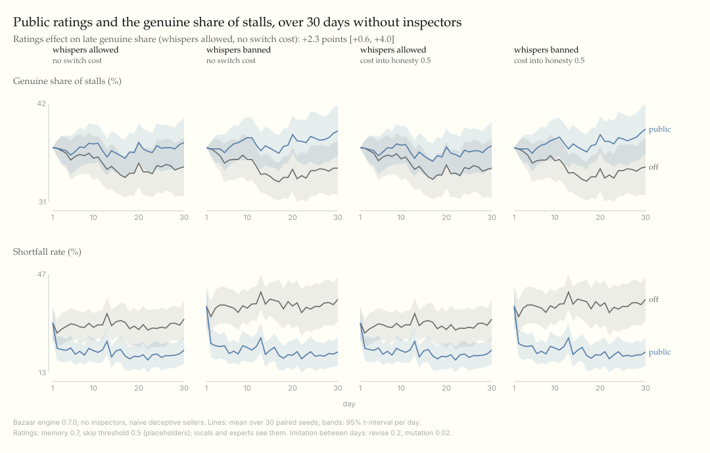

# Reputation, switching costs and the medium

Part D of the decomposition / grid-refinement / entry-exit spec (2026-11-05).

## Run record

- Engine `0.7.0`; commit `29ceac52bbda26a9f4d6d00f3b42921e46f8c318`; uncommitted at run time: ['?? analysis/reputation.py']
- Script sha256 `5098f148786c5ed53665cee4464fbb6941e8b9c5ab8e8c709fbb803bd76ba3fb`
- Command: `.venv/bin/python -m analysis.reputation --out runs/reputation.json`
- Python 3.12.7, numpy 2.5.4, macOS-26.6.2-arm64-arm-64bit
- 240 chains x 30 days on 8 workers; wall clock 31.4 min; load average [27.39, 38.09, 53.82] at start, [19.43, 24.91, 31.12] at end
- Seeds 0-29, paired

## Design (prespecified)

- No inspectors; naive deceptive sellers (`rule_deceptive`); 30 days; between-day imitation as in Part C.
- Factorial: ratings off / public x whispers allowed / banned x switch cost into honesty 0 / 0.5 of base price (cost into deception 0): 8 conditions. "Off" runs compute ratings but show them to no one (`ratings.mode=hidden`), so rugpulls are counted in every condition.
- Ratings (decided 2026-11-05): each day, a stall's rating blends yesterday's (memory 0.7) with the share of that day's units whose true Q met the latest claim the stall made to the buyer before the sale; a first rating is that day's share; days with no claimed units leave it unchanged; unrated stalls are neutral. Locals and experts see ratings; the rule buyer skips stalls rated below 0.5. Switching cost is charged in the stall's accounts on its first day in the new type. Whisper ban: sellers are told, and rule sellers do not whisper.
- Late = mean of days 26–30. Intervals 95% paired t over 30 seeds, unadjusted; confirmatory: PD1, PD2 (genuine share), PD2 (shortfall).

## Gate

- Day 1 equals the single-day engine (ratings hidden): **passed** (120 of 120 chains)
- Day 1 identical with ratings public and hidden: **passed** (120 of 120 pairs)
- No whisper delivered when whispers are banned: **passed** (120 of 120 chains with zero whispers on every day)

## Confirmatory

- **PD1**: late genuine share, ratings public − off (whispers allowed, no switch cost): +2.3 [+0.6, +4.0] * points. Prediction > 0. **Verdict: supported.**
- **PD2, genuine share**: [(public − off) | whispers banned] − [(public − off) | whispers allowed] = +1.3 [−0.2, +2.9] points. Prediction > 0. **Verdict: not supported (interval includes 0).**
- **PD2, shortfall**: the same interaction on shortfall = −7.2 [−10.0, −4.5] * points. Prediction < 0. **Verdict: supported.**

### Ratings effect (public − off) on late outcomes, by cell

| Whispers | Switch cost | Genuine share (pts) | Shortfall (pts) |
|---|---|---|---|
| whispers allowed | no switch cost | +2.3 [+0.6, +4.0] * | −10.6 [−12.9, −8.2] * |
| whispers allowed | cost into honesty 0.5 | +2.1 [+0.5, +3.7] * | −10.6 [−12.9, −8.2] * |
| whispers banned | no switch cost | +3.7 [+2.0, +5.4] * | −17.8 [−22.0, −13.6] * |
| whispers banned | cost into honesty 0.5 | +3.7 [+2.0, +5.5] * | −18.0 [−22.1, −13.9] * |

## PD3 (exploratory): switching cost into honesty

| Ratings | Whispers | Cost effect on late genuine share (0.5 − 0, pts) |
|---|---|---|
| ratings off | whispers allowed | −0.1 [−0.3, +0.1] |
| ratings off | whispers banned | +0.0 [−0.2, +0.2] |
| ratings public | whispers allowed | −0.4 [−0.8, +0.0] |
| ratings public | whispers banned | +0.1 [−0.4, +0.5] |

Does the cost hurt less with ratings? (cost effect with ratings − without; > 0 = less):

- whispers allowed: −0.2 [−0.6, +0.2] points
- whispers banned: +0.0 [−0.4, +0.5] points

Rugpulls (genuine → deceptive while rated ≥ 0.8) per stall-day (rugpulls / (48 × 30)), per thousand:

| Condition | Rugpulls per 1,000 stall-days |
|---|---|
| ratings off, whispers allowed, no switch cost | 4.65 [3.80, 5.51] |
| ratings off, whispers allowed, cost into honesty 0.5 | 4.72 [3.87, 5.58] |
| ratings off, whispers banned, no switch cost | 4.81 [4.00, 5.63] |
| ratings off, whispers banned, cost into honesty 0.5 | 4.81 [4.00, 5.63] |
| ratings public, whispers allowed, no switch cost | 3.63 [3.04, 4.23] |
| ratings public, whispers allowed, cost into honesty 0.5 | 3.68 [3.08, 4.28] |
| ratings public, whispers banned, no switch cost | 3.63 [3.04, 4.23] |
| ratings public, whispers banned, cost into honesty 0.5 | 3.59 [2.98, 4.20] |

## Late levels (days 26–30)

| Ratings | Whispers | Switch cost | Genuine share (%) | Shortfall (%) | Genuine profit/stall ($) | Deceptive profit/stall ($) | Mean rating, genuine | Mean rating, deceptive | Switches/day |
|---|---|---|---|---|---|---|---|---|---|
| ratings off | whispers allowed | no switch cost | 35.3 [32.4, 38.3] | 29.9 [24.0, 35.8] | 44 | 40 | 0.90 | 0.26 | 0.89 |
| ratings off | whispers allowed | cost into honesty 0.5 | 35.2 [32.2, 38.1] | 29.9 [24.0, 35.8] | 44 | 40 | 0.91 | 0.26 | 0.89 |
| ratings off | whispers banned | no switch cost | 35.1 [32.4, 37.8] | 37.1 [29.5, 44.7] | 71 | 75 | 0.93 | 0.27 | 0.83 |
| ratings off | whispers banned | cost into honesty 0.5 | 35.1 [32.3, 37.9] | 37.1 [29.5, 44.7] | 70 | 75 | 0.93 | 0.27 | 0.83 |
| ratings public | whispers allowed | no switch cost | 37.7 [35.2, 40.1] | 19.3 [15.1, 23.5] | 47 | 27 | 0.76 | 0.21 | 0.87 |
| ratings public | whispers allowed | cost into honesty 0.5 | 37.3 [34.9, 39.7] | 19.3 [15.1, 23.5] | 46 | 27 | 0.77 | 0.21 | 0.88 |
| ratings public | whispers banned | no switch cost | 38.8 [36.1, 41.4] | 19.3 [14.9, 23.6] | 77 | 47 | 0.77 | 0.22 | 0.90 |
| ratings public | whispers banned | cost into honesty 0.5 | 38.8 [36.2, 41.5] | 19.1 [14.7, 23.5] | 76 | 47 | 0.76 | 0.21 | 0.90 |

## Day 1 levels

| Ratings | Whispers | Switch cost | Genuine share (%) | Shortfall (%) |
|---|---|---|---|---|
| ratings off | whispers allowed | no switch cost | 37.5 [37.5, 37.5] | 30.2 [24.4, 36.0] |
| ratings off | whispers allowed | cost into honesty 0.5 | 37.5 [37.5, 37.5] | 30.2 [24.4, 36.0] |
| ratings off | whispers banned | no switch cost | 37.5 [37.5, 37.5] | 36.0 [29.1, 42.9] |
| ratings off | whispers banned | cost into honesty 0.5 | 37.5 [37.5, 37.5] | 36.0 [29.1, 42.9] |
| ratings public | whispers allowed | no switch cost | 37.5 [37.5, 37.5] | 30.2 [24.4, 36.0] |
| ratings public | whispers allowed | cost into honesty 0.5 | 37.5 [37.5, 37.5] | 30.2 [24.4, 36.0] |
| ratings public | whispers banned | no switch cost | 37.5 [37.5, 37.5] | 36.0 [29.1, 42.9] |
| ratings public | whispers banned | cost into honesty 0.5 | 37.5 [37.5, 37.5] | 36.0 [29.1, 42.9] |

## Stability (change over days 21–30, per-seed OLS slope × 9)

| Condition | Genuine share (pts) | Shortfall (pts) |
|---|---|---|
| ratings off, whispers allowed, no switch cost | +0.6 [−1.6, +2.7] | +2.3 [−2.4, +7.0] |
| ratings off, whispers allowed, cost into honesty 0.5 | +0.6 [−1.5, +2.8] | +2.3 [−2.4, +7.0] |
| ratings off, whispers banned, no switch cost | +1.1 [−0.9, +3.2] | +2.5 [−3.3, +8.3] |
| ratings off, whispers banned, cost into honesty 0.5 | +1.1 [−0.9, +3.2] | +2.5 [−3.3, +8.3] |
| ratings public, whispers allowed, no switch cost | +0.7 [−1.6, +3.1] | +1.5 [−1.8, +4.8] |
| ratings public, whispers allowed, cost into honesty 0.5 | +0.8 [−1.6, +3.2] | +1.5 [−1.8, +4.8] |
| ratings public, whispers banned, no switch cost | +1.0 [−1.2, +3.1] | +0.5 [−3.1, +4.1] |
| ratings public, whispers banned, cost into honesty 0.5 | +1.2 [−1.0, +3.4] | +0.2 [−3.3, +3.8] |

Still trending over days 21–30 (interval excludes 0):

- none

## Verdicts

- **PD1 (confirmatory): supported.** With whispers allowed and no switch cost, public ratings raise the late genuine share by +2.3 [+0.6, +4.0] points (35.3% → 37.7%) and cut shortfall by 10.6 [8.2, 12.9] points.
- **PD2, genuine share (confirmatory): not supported.** Ratings raise the genuine share by 3.7 points when whispers are banned against 2.3 when they are allowed; the interaction, +1.3 [−0.2, +2.9], points the predicted way but its interval includes 0.
- **PD2, shortfall (confirmatory): supported.** Ratings cut shortfall by 17.8 points when whispers are banned against 10.6 when they are allowed: interaction −7.2 [−10.0, −4.5].
- **PD3 (exploratory).** A switching cost of 0.5 × base price into honesty has no detectable effect on the genuine share in any cell (−0.4 to +0.1 points, all intervals include 0), with or without ratings. Rugpulls run at about 4.7–4.8 per 1,000 stall-days with ratings hidden and 3.6–3.7 with ratings public.
- No condition is still trending over days 21–30.

## Reading (written after the results)

*Written after the results.*

Ratings work mainly through buyers, not through the stall population. Within a day, locals and experts who see a low rating skip the stall, so shortfall drops by 11–18 points from the first day ratings exist (day 2, in the plot). The genuine share moves much less: +2 to +4 points over a month, against a background of weak selection (about 0.9 switches a day; in Part C, with the same rule, about 60% of switches were mutations). Ratings make deception pay less ($40 → $27 per deceptive stall with whispers allowed), but the switching rule turns that into stall-type change only slowly.

The whisper ban runs the other way from the thesis's premise, for a reason built into the rule buyer. A local inspects before buying from a stall that yelled or whispered at it; a whisper is a red flag. Banning whispers removes that flag, so with ratings off, deceptive stalls earn more ($40 → $75 per stall) and shortfall rises from 29.9% to 37.1%. Ratings then have more deception to remove, and remove more of it (−17.8 against −10.6 points), so PD2 holds on shortfall. Whether that supports the thesis depends on the mechanism one has in mind. Here the private channel does not hide deception from the reputation system; it alerts the buyer. Under a buyer who trusts whispers, the sign could flip.

The switching cost does nothing because, under the agreed rule, it lowers only the switcher's profit on its first day in the new type. That affects later imitation only through one day's profit comparison, a small change in a few switch probabilities. A cost that entered the switching decision itself would be a different and much stronger manipulation.

Mean ratings of genuine stalls are lower with ratings public (0.76 against 0.90). A genuine stall is always truthful, so a genuine rating below 1 is carried over from earlier days as a deceiver. One explanation, not tested here, is that stalls that reform after being rated low are skipped by locals and experts and so rebuild their ratings slowly (only tourists' purchases update them): reputation could trap reformed sellers.

## Caveats

- "Ratings off" is `ratings.mode=hidden`: ratings are computed and logged so rugpulls can be counted, but no buyer or seller sees them. The gate confirms day 1 is identical across hidden and public, and that hidden runs equal the single-day engine.
- Ratings memory 0.7 and skip threshold 0.5 are placeholders. Ratings count only units bought after a claim from the stall; inspected purchases still count against the latest claim (decided 2026-11-05).
- The whisper effects depend on the rule buyer treating yells and whispers as reasons to inspect. That is a modelling choice made in engine 0.1 for locals, not a measured behaviour.
- No inspectors, naive sellers only. Selection is weak (revision 0.2, mutation 0.02), so 30 days moves the genuine share only a few points; effects on stall composition are small by construction, and effects on buyers are immediate.
- Rugpulls are counted for every genuine → deceptive switch of a stall rated ≥ 0.8; most such switches are likely mutations (not tested), so the rugpull rate mostly tracks how many high-rated genuine stalls exist.
- Run script: the run used `analysis/reputation.py` with sha256 `5098f148…` (recorded above). The committed script differs only in its plotting code: a wider canvas, a `--replot` option and the engine version taken from the run record (sha256 `da96b81d…`). The SVG was redrawn from `runs/reputation.json` with `--replot`; no numbers changed and the simulation was not re-run.
- Machine load was 20–60 during the run; wall clock only.
