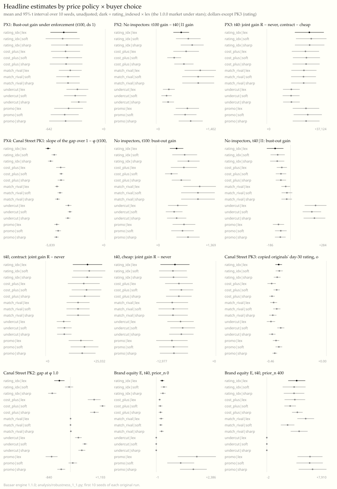

# Robustness sweep at engine 1.1.0 (Stage 3C)

**BLUF.** Three of four confirmatory predictions hold in all 15 price-policy × buyer-choice cells. Enforcement makes
a bust-out lose money (PX1). Tourists-only markets reward it more than markets where locals inspect (PX2). Contract
licensing beats cheap licensing (PX3). PX4 is contradicted: under sharp logit choice, where a 5% price cut wins 73%
of a two-way choice, Canal Street's counterfeits still lose more the deeper they undercut. The slope is −$5,358
[−5,607, −5,108], and it is negative in every cell. The 1.0.0 baseline reproduces exactly: 650 of 650 chains. Guards
and flags are 0. The largest exploratory change is the `undercut` price policy, which pushes prices to unit cost. There,
brand equity is about 0, and a bust-out pays even where locals inspect.

Engine 1.1.0, commit 8d2bfe9, script sha256 a53a90b73351; 11100 chains, 25.70 h on 4 workers. Cells: rating_indexed|lex, rating_indexed|soft, rating_indexed|sharp, cost_plus|lex, cost_plus|soft, cost_plus|sharp, match_rival|lex, match_rival|soft, match_rival|sharp, undercut|lex, undercut|soft, undercut|sharp, promo|lex, promo|soft, promo|sharp. Seeds: verification 200-209, liability 230-239, licensing 300-309, canal 270-279, equity 330-339. Intervals: 95% t over seeds, unadjusted.

## Predictions

| | Prediction | Verdict | Cells supported / not supported / contradicted |
|---|---|---|---|
| PX1 | In every cell, the bust-out gain under enforcement is < 0. | **supported** | 15 / 0 / 0 |
| PX2 | In every cell, the tourist-only gain without inspectors exceeds the t40|l1 gain. | **supported** | 15 / 0 / 0 |
| PX3 | In every cell, contract licensing's joint gain exceeds cheap licensing's. | **supported** | 15 / 0 / 0 |
| PX4 | Under logit sharp with rating_indexed, Canal Street's PK1 slope is > 0. | **contradicted** | 0 / 0 / 1 |

Rule (fixed before the run): supported if every cell's interval is on the predicted side of 0; contradicted if any cell's interval is on the opposite side; otherwise not supported.

## PX1: Bust-out gain under enforcement (t100, ds 1)

| Cell | Estimate | Side of 0 | Verdict |
|---|---|---|---|
| rating_indexed|lex | −447.11 [−590.53, −303.70] * | below | supported |
| rating_indexed|soft | −458.91 [−641.96, −275.87] * | below | supported |
| rating_indexed|sharp | −412.23 [−583.37, −241.10] * | below | supported |
| cost_plus|lex | −427.88 [−584.29, −271.48] * | below | supported |
| cost_plus|soft | −409.38 [−569.38, −249.38] * | below | supported |
| cost_plus|sharp | −421.87 [−597.77, −245.97] * | below | supported |
| match_rival|lex | −377.25 [−499.95, −254.55] * | below | supported |
| match_rival|soft | −401.13 [−527.88, −274.38] * | below | supported |
| match_rival|sharp | −401.13 [−527.88, −274.38] * | below | supported |
| undercut|lex | −300.41 [−417.77, −183.05] * | below | supported |
| undercut|soft | −323.87 [−444.04, −203.70] * | below | supported |
| undercut|sharp | −285.41 [−369.26, −201.56] * | below | supported |
| promo|lex | −395.24 [−550.06, −240.41] * | below | supported |
| promo|soft | −436.88 [−587.23, −286.52] * | below | supported |
| promo|sharp | −426.95 [−603.83, −250.07] * | below | supported |

## PX2: No inspectors: t100 gain − t40|l1 gain

| Cell | Estimate | Side of 0 | Verdict |
|---|---|---|---|
| rating_indexed|lex | +587.58 [+402.06, +773.09] * | above | supported |
| rating_indexed|soft | +753.41 [+464.68, +1,042.13] * | above | supported |
| rating_indexed|sharp | +845.03 [+575.36, +1,114.70] * | above | supported |
| cost_plus|lex | +702.84 [+402.14, +1,003.53] * | above | supported |
| cost_plus|soft | +422.29 [+259.37, +585.22] * | above | supported |
| cost_plus|sharp | +650.52 [+424.29, +876.75] * | above | supported |
| match_rival|lex | +1,033.85 [+665.70, +1,402.01] * | above | supported |
| match_rival|soft | +985.46 [+609.86, +1,361.05] * | above | supported |
| match_rival|sharp | +987.30 [+612.86, +1,361.75] * | above | supported |
| undercut|lex | +296.87 [+156.81, +436.93] * | above | supported |
| undercut|soft | +242.94 [+121.17, +364.71] * | above | supported |
| undercut|sharp | +279.88 [+141.92, +417.84] * | above | supported |
| promo|lex | +731.17 [+457.40, +1,004.93] * | above | supported |
| promo|soft | +679.51 [+413.43, +945.60] * | above | supported |
| promo|sharp | +810.03 [+527.48, +1,092.57] * | above | supported |

## PX3: t40: joint gain R − never, contract − cheap

| Cell | Estimate | Side of 0 | Verdict |
|---|---|---|---|
| rating_indexed|lex | +26,461.34 [+17,417.94, +35,504.75] * | above | supported |
| rating_indexed|soft | +27,640.53 [+18,157.25, +37,123.82] * | above | supported |
| rating_indexed|sharp | +26,650.99 [+17,473.04, +35,828.94] * | above | supported |
| cost_plus|lex | +24,033.40 [+15,551.98, +32,514.82] * | above | supported |
| cost_plus|soft | +24,658.93 [+16,224.61, +33,093.25] * | above | supported |
| cost_plus|sharp | +24,454.09 [+16,028.08, +32,880.10] * | above | supported |
| match_rival|lex | +23,101.42 [+15,286.47, +30,916.38] * | above | supported |
| match_rival|soft | +22,831.54 [+15,082.99, +30,580.10] * | above | supported |
| match_rival|sharp | +22,959.57 [+15,162.72, +30,756.42] * | above | supported |
| undercut|lex | +15,274.38 [+10,068.93, +20,479.83] * | above | supported |
| undercut|soft | +15,111.06 [+9,854.34, +20,367.77] * | above | supported |
| undercut|sharp | +15,338.87 [+10,140.66, +20,537.08] * | above | supported |
| promo|lex | +24,359.98 [+16,126.97, +32,592.98] * | above | supported |
| promo|soft | +25,492.57 [+16,726.83, +34,258.31] * | above | supported |
| promo|sharp | +24,465.88 [+16,120.64, +32,811.13] * | above | supported |

## PX4: Canal Street PK1: slope of the gap over 1 − φ (t100, ds 1)

| Cell | Estimate | Side of 0 | Verdict |
|---|---|---|---|
| rating_indexed|lex | −5,604.74 [−5,839.00, −5,370.48] * | below | – |
| rating_indexed|soft | −4,999.04 [−5,259.95, −4,738.13] * | below | – |
| rating_indexed|sharp | −5,357.60 [−5,607.23, −5,107.97] * | below | contradicted |
| cost_plus|lex | −4,364.62 [−4,806.92, −3,922.31] * | below | – |
| cost_plus|soft | −4,316.81 [−4,501.61, −4,132.01] * | below | – |
| cost_plus|sharp | −4,330.44 [−4,664.38, −3,996.50] * | below | – |
| match_rival|lex | −4,729.40 [−4,923.54, −4,535.26] * | below | – |
| match_rival|soft | −4,435.76 [−4,671.39, −4,200.13] * | below | – |
| match_rival|sharp | −4,674.09 [−4,913.58, −4,434.59] * | below | – |
| undercut|lex | −3,607.03 [−3,902.02, −3,312.03] * | below | – |
| undercut|soft | −3,460.85 [−3,666.17, −3,255.52] * | below | – |
| undercut|sharp | −3,659.86 [−3,897.29, −3,422.42] * | below | – |
| promo|lex | −4,753.74 [−4,995.45, −4,512.03] * | below | – |
| promo|soft | −4,613.17 [−4,891.88, −4,334.45] * | below | – |
| promo|sharp | −4,791.85 [−5,010.39, −4,573.31] * | below | – |

## PX5 (exploratory): No inspectors, t100: bust-out gain

| Cell | Estimate | Side of 0 |
|---|---|---|
| rating_indexed|lex | +466.72 [+311.48, +621.96] * | above |
| rating_indexed|soft | +652.82 [+368.28, +937.36] * | above |
| rating_indexed|sharp | +740.73 [+486.40, +995.06] * | above |
| cost_plus|lex | +634.95 [+335.24, +934.66] * | above |
| cost_plus|soft | +347.79 [+202.13, +493.45] * | above |
| cost_plus|sharp | +575.33 [+356.73, +793.93] * | above |
| match_rival|lex | +996.66 [+624.29, +1,369.03] * | above |
| match_rival|soft | +957.90 [+571.97, +1,343.82] * | above |
| match_rival|sharp | +957.90 [+571.97, +1,343.82] * | above |
| undercut|lex | +494.73 [+270.89, +718.57] * | above |
| undercut|soft | +411.75 [+220.20, +603.29] * | above |
| undercut|sharp | +468.87 [+247.93, +689.81] * | above |
| promo|lex | +636.86 [+376.20, +897.52] * | above |
| promo|soft | +603.57 [+344.63, +862.51] * | above |
| promo|sharp | +730.00 [+463.71, +996.30] * | above |

## PX5 (exploratory): No inspectors, t40|l1: bust-out gain

| Cell | Estimate | Side of 0 |
|---|---|---|
| rating_indexed|lex | −120.86 [−186.35, −55.37] * | below |
| rating_indexed|soft | −100.58 [−156.72, −44.45] * | below |
| rating_indexed|sharp | −104.30 [−160.36, −48.25] * | below |
| cost_plus|lex | −67.89 [−108.07, −27.71] * | below |
| cost_plus|soft | −74.50 [−115.65, −33.35] * | below |
| cost_plus|sharp | −75.19 [−115.92, −34.46] * | below |
| match_rival|lex | −37.19 [−71.70, −2.68] * | below |
| match_rival|soft | −27.56 [−69.66, +14.54] | includes |
| match_rival|sharp | −29.41 [−71.13, +12.31] | includes |
| undercut|lex | +197.85 [+111.99, +283.72] * | above |
| undercut|soft | +168.81 [+96.09, +241.52] * | above |
| undercut|sharp | +188.99 [+103.46, +274.52] * | above |
| promo|lex | −94.31 [−138.62, −50.00] * | below |
| promo|soft | −75.94 [−121.98, −29.91] * | below |
| promo|sharp | −80.02 [−122.55, −37.49] * | below |

## PX5 (exploratory): t40, contract: joint gain R − never

| Cell | Estimate | Side of 0 |
|---|---|---|
| rating_indexed|lex | +17,562.21 [+11,399.52, +23,724.90] * | above |
| rating_indexed|soft | +18,299.17 [+11,565.94, +25,032.40] * | above |
| rating_indexed|sharp | +17,434.18 [+11,057.37, +23,811.00] * | above |
| cost_plus|lex | +15,991.49 [+9,302.29, +22,680.70] * | above |
| cost_plus|soft | +17,152.15 [+10,938.42, +23,365.88] * | above |
| cost_plus|sharp | +16,398.37 [+9,956.96, +22,839.78] * | above |
| match_rival|lex | +13,603.04 [+8,785.07, +18,421.01] * | above |
| match_rival|soft | +13,584.47 [+8,747.73, +18,421.20] * | above |
| match_rival|sharp | +13,625.02 [+8,759.76, +18,490.29] * | above |
| undercut|lex | +7,586.11 [+4,660.41, +10,511.82] * | above |
| undercut|soft | +7,886.33 [+4,867.84, +10,904.82] * | above |
| undercut|sharp | +7,825.66 [+4,807.04, +10,844.28] * | above |
| promo|lex | +14,799.08 [+9,666.25, +19,931.90] * | above |
| promo|soft | +16,302.02 [+10,464.40, +22,139.64] * | above |
| promo|sharp | +15,342.77 [+9,752.43, +20,933.12] * | above |

## PX5 (exploratory): t40, cheap: joint gain R − never

| Cell | Estimate | Side of 0 |
|---|---|---|
| rating_indexed|lex | −8,899.13 [−12,057.98, −5,740.28] * | below |
| rating_indexed|soft | −9,341.37 [−12,356.76, −6,325.97] * | below |
| rating_indexed|sharp | −9,216.81 [−12,258.62, −6,175.00] * | below |
| cost_plus|lex | −8,041.91 [−11,049.74, −5,034.08] * | below |
| cost_plus|soft | −7,506.78 [−10,088.97, −4,924.60] * | below |
| cost_plus|sharp | −8,055.72 [−10,839.09, −5,272.35] * | below |
| match_rival|lex | −9,498.38 [−12,942.83, −6,053.93] * | below |
| match_rival|soft | −9,247.08 [−12,463.15, −6,031.00] * | below |
| match_rival|sharp | −9,334.55 [−12,554.30, −6,114.80] * | below |
| undercut|lex | −7,688.26 [−10,560.72, −4,815.80] * | below |
| undercut|soft | −7,224.73 [−9,917.02, −4,532.43] * | below |
| undercut|sharp | −7,513.21 [−10,168.27, −4,858.16] * | below |
| promo|lex | −9,560.90 [−12,977.04, −6,144.76] * | below |
| promo|soft | −9,190.55 [−12,346.08, −6,035.01] * | below |
| promo|sharp | −9,123.11 [−12,184.16, −6,062.07] * | below |

## PX5 (exploratory): Canal Street PK3: copied originals' day-30 rating, on − off (φ 0.6)

| Cell | Estimate | Side of 0 |
|---|---|---|
| rating_indexed|lex | −0.367 [−0.392, −0.341] * | below |
| rating_indexed|soft | −0.362 [−0.390, −0.334] * | below |
| rating_indexed|sharp | −0.378 [−0.405, −0.352] * | below |
| cost_plus|lex | −0.421 [−0.453, −0.388] * | below |
| cost_plus|soft | −0.382 [−0.406, −0.358] * | below |
| cost_plus|sharp | −0.418 [−0.439, −0.397] * | below |
| match_rival|lex | −0.405 [−0.432, −0.379] * | below |
| match_rival|soft | −0.382 [−0.410, −0.354] * | below |
| match_rival|sharp | −0.412 [−0.440, −0.384] * | below |
| undercut|lex | −0.426 [−0.458, −0.394] * | below |
| undercut|soft | −0.351 [−0.378, −0.323] * | below |
| undercut|sharp | −0.416 [−0.442, −0.391] * | below |
| promo|lex | −0.387 [−0.412, −0.362] * | below |
| promo|soft | −0.365 [−0.391, −0.339] * | below |
| promo|sharp | −0.397 [−0.414, −0.379] * | below |

## PX5 (exploratory): Canal Street PK2: gap at φ 1.0

| Cell | Estimate | Side of 0 |
|---|---|---|
| rating_indexed|lex | −372.19 [−547.61, −196.76] * | below |
| rating_indexed|soft | −39.99 [−178.95, +98.97] | includes |
| rating_indexed|sharp | −614.98 [−755.07, −474.89] * | below |
| cost_plus|lex | +812.92 [+594.87, +1,030.97] * | above |
| cost_plus|soft | +1,098.56 [+1,003.65, +1,193.47] * | above |
| cost_plus|sharp | +821.85 [+674.81, +968.88] * | above |
| match_rival|lex | +9.08 [−4.77, +22.92] | includes |
| match_rival|soft | +6.88 [−5.10, +18.87] | includes |
| match_rival|sharp | +18.18 [−7.74, +44.10] | includes |
| undercut|lex | +276.22 [+161.74, +390.70] * | above |
| undercut|soft | +496.86 [+419.67, +574.05] * | above |
| undercut|sharp | +393.23 [+274.61, +511.84] * | above |
| promo|lex | −637.50 [−840.36, −434.64] * | below |
| promo|soft | +85.35 [−59.93, +230.62] | includes |
| promo|sharp | −308.93 [−442.25, −175.62] * | below |

## PX5 (exploratory): Brand equity E, t40, prior_n 0

| Cell | Estimate | Side of 0 |
|---|---|---|
| rating_indexed|lex | +236.41 [+155.19, +317.62] * | above |
| rating_indexed|soft | +307.44 [+181.26, +433.62] * | above |
| rating_indexed|sharp | +266.67 [+159.53, +373.80] * | above |
| cost_plus|lex | +136.08 [+92.30, +179.85] * | above |
| cost_plus|soft | +159.61 [+74.90, +244.31] * | above |
| cost_plus|sharp | +171.55 [+96.15, +246.96] * | above |
| match_rival|lex | +197.36 [+111.86, +282.86] * | above |
| match_rival|soft | +179.65 [+107.22, +252.08] * | above |
| match_rival|sharp | +216.78 [+131.18, +302.38] * | above |
| undercut|lex | +0.03 [−0.22, +0.28] | includes |
| undercut|soft | +0.58 [−0.87, +2.03] | includes |
| undercut|sharp | +0.38 [−0.71, +1.47] | includes |
| promo|lex | +1,623.85 [+861.78, +2,385.92] * | above |
| promo|soft | +979.07 [+440.59, +1,517.55] * | above |
| promo|sharp | +1,485.23 [+949.51, +2,020.94] * | above |

## PX5 (exploratory): Brand equity E, t40, prior_n 400

| Cell | Estimate | Side of 0 |
|---|---|---|
| rating_indexed|lex | +3,964.03 [+2,830.92, +5,097.13] * | above |
| rating_indexed|soft | +3,623.35 [+2,101.17, +5,145.53] * | above |
| rating_indexed|sharp | +3,610.49 [+2,247.64, +4,973.33] * | above |
| cost_plus|lex | +3,717.37 [+2,351.85, +5,082.89] * | above |
| cost_plus|soft | +3,095.27 [+2,325.28, +3,865.27] * | above |
| cost_plus|sharp | +4,045.76 [+3,337.89, +4,753.63] * | above |
| match_rival|lex | +5,155.61 [+4,042.41, +6,268.81] * | above |
| match_rival|soft | +2,755.68 [+1,856.90, +3,654.47] * | above |
| match_rival|sharp | +4,286.23 [+3,161.38, +5,411.08] * | above |
| undercut|lex | −0.10 [−1.06, +0.85] | includes |
| undercut|soft | +0.31 [−1.35, +1.98] | includes |
| undercut|sharp | −0.63 [−2.17, +0.90] | includes |
| promo|lex | +5,728.46 [+4,071.86, +7,385.05] * | above |
| promo|soft | +5,679.59 [+3,927.19, +7,431.98] * | above |
| promo|sharp | +6,067.30 [+4,224.85, +7,909.75] * | above |

## Changes against rating_indexed × lex (PX5 flags)

| Endpoint | Cell | Sign change | Side of 0: base → cell |
|---|---|---|---|
| ver_t40l1 | match_rival|soft | no | below → includes |
| ver_t40l1 | match_rival|sharp | no | below → includes |
| ver_t40l1 | undercut|lex | yes | below → above |
| ver_t40l1 | undercut|soft | yes | below → above |
| ver_t40l1 | undercut|sharp | yes | below → above |
| PK2_gap | rating_indexed|soft | no | below → includes |
| PK2_gap | cost_plus|lex | yes | below → above |
| PK2_gap | cost_plus|soft | yes | below → above |
| PK2_gap | cost_plus|sharp | yes | below → above |
| PK2_gap | match_rival|lex | yes | below → includes |
| PK2_gap | match_rival|soft | yes | below → includes |
| PK2_gap | match_rival|sharp | yes | below → includes |
| PK2_gap | undercut|lex | yes | below → above |
| PK2_gap | undercut|soft | yes | below → above |
| PK2_gap | undercut|sharp | yes | below → above |
| PK2_gap | promo|soft | yes | below → includes |
| E_pn0 | undercut|lex | no | above → includes |
| E_pn0 | undercut|soft | no | above → includes |
| E_pn0 | undercut|sharp | no | above → includes |
| E_pn400 | undercut|lex | yes | above → includes |
| E_pn400 | undercut|soft | no | above → includes |
| E_pn400 | undercut|sharp | yes | above → includes |

## Checks

- Reproduction of the saved stars chains by rating_indexed × lex: 650 of 650 match (20 without a saved chain); pass.
- Guard (stuck, parked, invalid actions) summed over 11100 chains: 0, 0, 0.
- Flags: 0.

## Reading (written after the results)

- **The baseline's main results do not depend on the price rule or the buyer rule.** PX1–PX3 hold in every one of
  the 15 cells, each interval on the predicted side of 0:
  - The bust-out gain under enforcement is −$285 to −$459.
  - The tourists-only gain exceeds the t40|l1 gain by $243 to $1,034.
  - Contract licensing's joint gain exceeds cheap licensing's by $15,111 to $27,641.

  Within a price policy, the three buyer rules give close estimates. The price policy moves the numbers more than
  the choice rule does.
- **PX4 is contradicted. A demand rule that rewards a lower price does not make undercutting pay.** In 1.0.0,
  PK1 was contradicted (B24, slope −$5,812). The explanation offered then was that the lexicographic rule ranks by
  rating and then price, so any φ < 1 wins the same buyers. `runs/canal_street_summary.md` called a price-sensitive
  rule "untested". It is now tested:
  - Under sharp logit with rating_indexed, the slope is −$5,358 [−5,607, −5,108].
  - Under soft logit it is −$4,999, and under lex (the base cell) −$5,605.
  - In the other 12 cells it is between −$3,461 and −$4,792. Every interval is below 0.

  The step-shaped lexicographic rule was not what made deeper cuts lose. Here the margin lost to a lower price
  outweighs the share it wins. The rating damage to copied originals (PK3) is −0.35 to −0.43 in every cell.
- **`undercut` drives prices to unit cost, and that changes several exploratory results.** In the brand-equity
  chains, 1,182 of 1,789 stall windows under undercut|lex have revenue exactly equal to cost (median gross margin
  0.000). Under rating_indexed|lex there are none (median 0.402). With no honest margin:
  - Brand equity E is about 0 at prior_n 0 and at prior_n 400; every interval is within ±$2.2 of 0. The plan asked
    whether E at prior_n 400 stays positive under each price policy. It does under rating_indexed, cost_plus,
    match_rival and promo, but not under undercut.
  - The t40|l1 bust-out gain turns positive: +$169 to +$198, against −$121 in the base cell. When honest selling
    earns nothing, cheap supply's cost saving is the only profit, and buyers who inspect no longer outweigh it.
    PX2 still holds under undercut, because the tourists-only gain is larger again.
  - Licensing gains are smaller (contract R − never about $7,600–7,900, against $17,562 in the base cell) but keep
    their sign.

  This is a property of `undercut` as built: a price war with a floor at unit cost. It is not an estimate of real
  pricing.
- **PK2 (the gap at φ 1.0, a context endpoint) has no stable sign.** It is below 0 under rating_indexed and promo,
  above 0 under cost_plus and undercut, and about 0 under match_rival. A counterfeit sold at the original's price
  gains or loses relative to "off" depending on how rivals reprice. Only the slope (PK1) is consistently signed.
- **match_rival makes soft and sharp logit identical in many chains.** 96 of 160 liability chains and 77 of 320
  verification chains are identical between soft and sharp, so PX1 and the t100 bust-out gain match to the cent.
  When stalls charge the same price, the logit weight has nothing to act on. This is not a bug: the other studies
  differ between the two rules, and every chain's engine settings were checked (0 flags).
- These readings are about this market under its own rules. The confirmatory verdicts follow the rule fixed in
  `analysis/robustness_1_1.py` before the run; every other line is exploratory.

## Caveats

- 10 seeds per study, as planned. The base cell's estimates differ from the 1.0.0 headline numbers because of the
  seed count and the stars display, not because of the engine: chain-level reproduction is exact.
- Licensing chains and canal chains at φ 0.8 and 0.4 have no saved stars counterpart, so the reproduction check
  covers 650 of the base cell's 740 chains.
- Wall clock 25.7 h, against the timing pilot's 21.8 h. Load average was 4–6 throughout, from other processes on
  the machine. No memory pauses.
- The plot is drawn by the frozen script. Two panel titles (PX4 and PK3) are cut off at the panel width. The tables
  above have the full labels.
- Intervals are 95% t over seeds, per cell, unadjusted for the 15 cells or the 12 endpoints.
