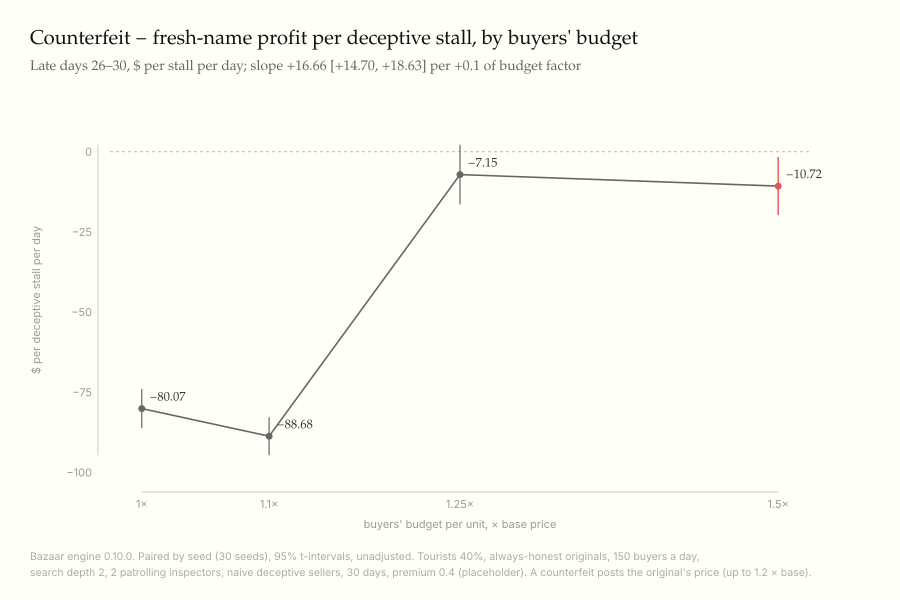
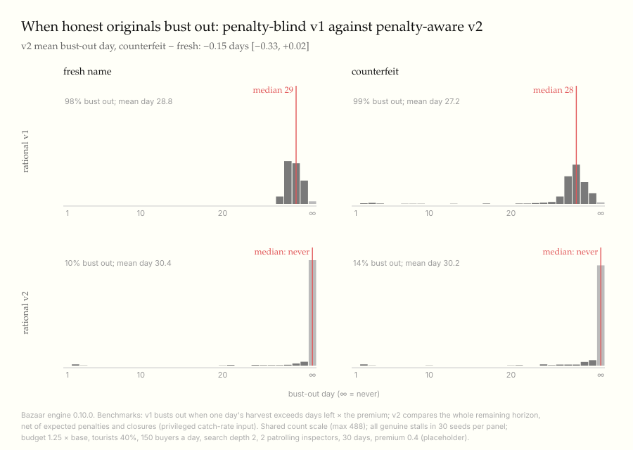
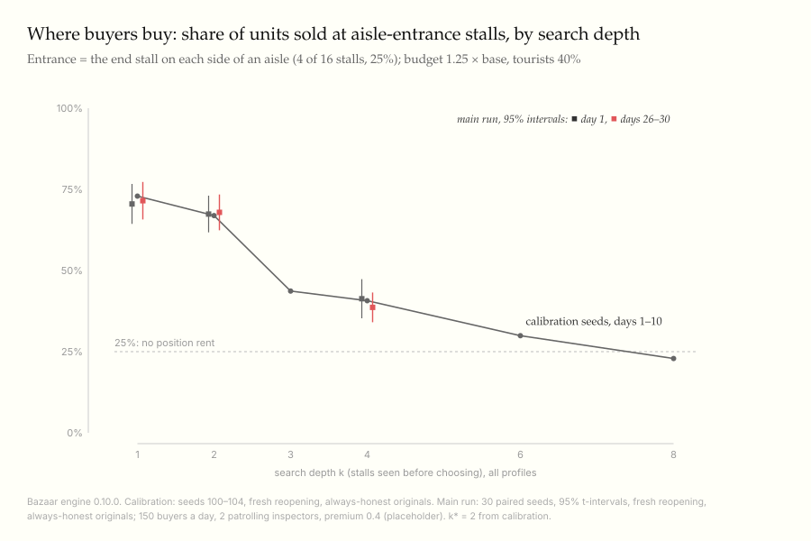

# Search depth, then counterfeits and bust-outs

> **Provisional: demand design flaw (most stalls unreachable) and an unexplained bust-out loss size; see the redesign run.** (Note added 2026-11-08.)

Run spec "search depth, then counterfeits and bust-outs (rule-based only)"; predictions written 2026-11-06, before any run.

## Run record

- Engine `0.10.0`; commit `063aee586c458d739420ae3adeb1d26944951283`; uncommitted at run time: ['?? analysis/search_counterfeit.py', '?? runs/search_calibration.json', '?? runs/search_calibration.log', '?? runs/search_counterfeit_run.log']
- Script sha256 `218a59e433e8da4e45f7d375df6343df58acf6313f4b261092575796c050709c`
- Command: `.venv/bin/python -m analysis.search_counterfeit --calibration runs/search_calibration.json --tests full suite at 063aee5: 418 passed (32.2 min), including every 0.9.0 reference cell at depth 1 --out runs/search_counterfeit.json`
- Tests at the engine commit: full suite at 063aee5: 418 passed (32.2 min), including every 0.9.0 reference cell at depth 1
- Python 3.12.7, numpy 2.5.4, macOS-26.6.2-arm64-arm-64bit
- 540 chains × 30 days + 60 single-day robustness runs on 8 workers; wall clock 262.7 min; load average [302.62, 315.11, 313.38] at start, [63.13, 232.55, 298.57] at end
- Seeds 2–31, paired; buyers.count = 150; search depth k* = 2

## Calibration (seeds 100–104)

Budget 1.25, tourists 40%, fresh reopening, always-honest originals, 150 buyers, 10 days; equal depth for all profiles. Criterion: ≥ 80% of genuine brands rated at the end of day 10, pooled. All six depths were run for the table. Calibration commit `063aee586c458d739420ae3adeb1d26944951283`, 5.1 min. Entrance = the end stall on each side of an aisle (12 of 48 stalls); mid-aisle = the other 36. Units, exposure, walking and stalls seen are means over the 10 days.

| k | Genuine rated by day 10 | Share | Rated: entrance | Rated: mid-aisle | Units at entrance (%) | Units/stall-day: entrance | mid-aisle | Exposed (%): entrance | mid-aisle | Stalls seen per buyer | Walking ticks per buyer |
|---|---|---|---|---|---|---|---|---|---|---|---|
| 1 | 62/90 | 68.9% | 21/21 | 41/69 | 72.9 | 9.05 | 1.11 | 100 | 35 | 2.63 | 0.00 |
| 2 | 73/90 | 81.1% | 21/21 | 52/69 | 66.9 | 8.27 | 1.34 | 100 | 51 | 3.00 | 0.18 |
| 3 | 90/90 | 100.0% | 21/21 | 69/69 | 43.7 | 5.25 | 2.26 | 100 | 84 | 4.68 | 0.96 |
| 4 | 90/90 | 100.0% | 21/21 | 69/69 | 40.7 | 4.81 | 2.32 | 100 | 93 | 5.44 | 1.35 |
| 6 | 90/90 | 100.0% | 21/21 | 69/69 | 29.9 | 3.39 | 2.65 | 100 | 100 | 7.77 | 2.64 |
| 8 | 90/90 | 100.0% | 21/21 | 69/69 | 22.9 | 2.50 | 2.83 | 100 | 100 | 9.75 | 3.73 |

**k* = 2.**

## Gate

- Calibration met on the main-run seeds: >= 80% of genuine brands rated by day 10 (budget 1.25, tourists 40%, fresh, always-honest, depth 2): **passed** (446/540 = 82.6% over 30 seeds)
- Defaults reproduce 0.9.0 (test suite): **passed** (full suite at 063aee5: 418 passed (32.2 min), including every 0.9.0 reference cell at depth 1)

## Design (prespecified)

- As the counterfeit run (`runs/counterfeit_summary.md`): ratings public (memory 0.7, threshold 0.5; locals and experts see them); 2 patrolling inspectors, not uniformed; naive deceptive sellers; 30 days known to sellers; imitation off; brands on, premium 0.4 (placeholder); tourists 40% = 0.4 / 0.3 / 0.3. buyers.count = 150; depth k* = 2 for all profiles unless stated.
- Search (decided 2026-11-06): a buyer with depth k records open stalls of its category within reach, learns as the 0.9.0 rule does (asks, inspects), and buys only after k stalls or at the end of its route, choosing among stalls it believes meet Q_req, pass the rating threshold and fit its budget: highest visible rating (unrated = 0.5) then lowest price; tourists lowest price; ties by stall id. It walks back to a stall seen earlier; a chosen stall found closed is skipped. After buying it walks on.
- Grids as listed in the script docstring; robustness: single-day default bazaar, 2 inspectors, posts vs patrolling, depth 2, seeds 2–31.
- Late = days 26–30; 95% paired t-intervals, unadjusted. Confirmatory: PF1–PF4, PR. Two-sided question: v2 − always-honest. Everything else exploratory.

## Confirmatory

- **PF1**: slope of the late counterfeit − fresh gap in profit per deceptive stall over budget 1.0–1.5: $+16.66 [+14.70, +18.63] * per +0.1 of budget factor. Prediction > 0. **Verdict: supported.**
- **PF2**: the gap at budget 1.5: $−10.72 [−19.78, −1.67] * per stall per day. Prediction > 0. **Verdict: contradicted (interval on the opposite side of 0).**
- **PF3**: late genuine profit per stall, v2 − v1 (fresh): $+164.48 [+149.88, +179.09] * per day. Prediction > 0. **Verdict: supported.**
- **PF4**: under v2, mean bust-out day (never = 31), counterfeit − fresh: −0.15 [−0.33, +0.02] days. Prediction < 0. **Verdict: not supported (interval includes 0).** Share busting out: fresh 9.6 [5.4, 13.8]%, counterfeit 14.1 [8.9, 19.2]%.
- **PR** (single-day robustness at k = 2): patrolling − posts, deceptive profit per stall $−183.45 [−206.59, −160.31] * (**supported**); shortfall −7.8 [−10.7, −4.9] * points (**supported**). Prediction < 0 for both.

## Two-sided question: is honesty irrational?

Late genuine profit per stall, v2 − always-honest (fresh): $−17.04 [−26.09, −7.98] * per day; **negative (interval below 0)**. Counterfeit reopening (exploratory): $−25.20 [−37.33, −13.07] *. v1 − always-honest: fresh $−181.52 [−193.09, −169.95] *, counterfeit $−266.45 [−287.43, −245.47] *.

## Grid 1: counterfeit economics by budget

| Budget | Deceptive profit: fresh ($) | counterfeit ($) | counterfeit − fresh ($) | Genuine profit, cf − fresh ($) | Shortfall, cf − fresh (pts) | Surplus, cf − fresh ($) |
|---|---|---|---|---|---|---|
| 1× | −96.15 [−109.72, −82.58] | −176.22 [−186.96, −165.47] | −80.07 [−86.18, −73.95] * | +0.96 [−1.15, +3.07] | −39.2 [−41.0, −37.4] * | +10.85 [+10.19, +11.51] * |
| 1.1× | −86.75 [−98.85, −74.64] | −175.43 [−186.68, −164.18] | −88.68 [−94.59, −82.78] * | +8.71 [+4.76, +12.65] * | −43.1 [−44.6, −41.6] * | +13.25 [+12.63, +13.86] * |
| 1.25× | −139.49 [−154.83, −124.15] | −146.63 [−163.78, −129.48] | −7.15 [−16.43, +2.14] | +10.78 [+4.95, +16.61] * | −7.9 [−9.9, −5.8] * | +3.37 [+2.37, +4.36] * |
| 1.5× | −140.43 [−155.11, −125.76] | −151.16 [−168.17, −134.14] | −10.72 [−19.78, −1.67] * | +4.91 [−2.29, +12.10] | −7.4 [−9.3, −5.4] * | +3.31 [+2.33, +4.30] * |

## Grid 2: bust-out rules

| Rule | Reopen | Mean bust-out day | Median (pooled) | Share bust out (%) | Genuine profit ($) | Shortfall (%) | Surplus ($) |
|---|---|---|---|---|---|---|---|
| rule_genuine | fresh name | – | – | – | 152.95 [144.00, 161.89] | 18.9 [16.5, 21.3] | −3.32 [−4.65, −1.98] |
| rule_genuine | counterfeit | – | – | – | 163.72 [154.45, 173.00] | 11.0 [8.6, 13.4] | 0.05 [−1.24, 1.34] |
| rational v1 | fresh name | 28.75 [28.70, 28.81] | 29 | 97.8 [96.7, 98.8] | −28.57 [−39.08, −18.06] | 42.6 [40.8, 44.5] | −10.28 [−11.34, −9.22] |
| rational v1 | counterfeit | 27.22 [26.68, 27.76] | 28 | 98.7 [97.7, 99.7] | −102.72 [−128.52, −76.92] | 53.2 [49.3, 57.1] | −11.54 [−12.95, −10.14] |
| rational v2 | fresh name | 30.36 [29.88, 30.85] | 31 | 9.6 [5.4, 13.8] | 135.91 [122.12, 149.70] | 21.5 [19.2, 23.8] | −4.09 [−5.42, −2.76] |
| rational v2 | counterfeit | 30.21 [29.67, 30.74] | 31 | 14.1 [8.9, 19.2] | 138.53 [123.15, 153.90] | 14.7 [12.3, 17.1] | −1.34 [−2.58, −0.09] |

Paired contrasts:

| Reopen | Contrast | Genuine profit ($) | Deceptive profit ($) | Shortfall (pts) | Surplus ($) |
|---|---|---|---|---|---|
| fresh name | rational v1 − rule_genuine | −181.52 [−193.09, −169.95] * | +23.41 [+16.58, +30.24] * | +23.8 [+22.0, +25.5] * | −6.96 [−7.84, −6.08] * |
| fresh name | rational v2 − rule_genuine | −17.04 [−26.09, −7.98] * | +1.95 [−1.00, +4.91] | +2.6 [+1.5, +3.8] * | −0.77 [−1.22, −0.33] * |
| counterfeit | rational v1 − rule_genuine | −266.45 [−287.43, −245.47] * | +39.50 [+28.96, +50.04] * | +42.2 [+39.7, +44.7] * | −11.59 [−12.51, −10.68] * |
| counterfeit | rational v2 − rule_genuine | −25.20 [−37.33, −13.07] * | +3.08 [−1.30, +7.46] | +3.6 [+2.0, +5.3] * | −1.39 [−2.14, −0.64] * |
| fresh name | v2 − v1 | +164.48 [+149.88, +179.09] * |  |  |  |
| counterfeit | v2 − v1 | +241.25 [+215.14, +267.36] * |  |  |  |

Bust-out timing (days; share in points):

| Contrast | Mean bust-out day | Share bust out |
|---|---|---|
| v1: counterfeit − fresh | −1.53 [−2.09, −0.98] * | +0.9 [−0.2, +2.0] |
| v2: counterfeit − fresh | −0.15 [−0.33, +0.02] | +4.4 [+1.8, +7.1] * |
| v2 − v1, fresh | +1.61 [+1.13, +2.09] * |  |
| v2 − v1, counterfeit | +2.99 [+2.13, +3.85] * |  |

## Grid 3: search depth and tourists (exploratory)

Counterfeit − fresh gap in late profit per deceptive stall, by depth (budget 1.25, always-honest):

| Depth | Gap ($/stall/day) |
|---|---|
| all 1 | −7.99 [−17.02, +1.03] |
| all 2 | −7.15 [−16.43, +2.14] |
| all 4 | −51.05 [−61.82, −40.27] * |
| tourists 1, others 2 | −4.29 [−12.94, +4.36] |

Gap with tourists at depth 1 (others 2) minus gap with everyone at 2: $+2.86 [+0.39, +5.33] *.

Contrasts against everyone at depth 2 (late):

| Reopen | Contrast | Deceptive profit ($) | Genuine profit ($) | Shortfall (pts) | Surplus ($) | Entrance unit share (pts) | Genuine rated (pts) |
|---|---|---|---|---|---|---|---|
| fresh name | all 1 − all 2 | −0.24 [−3.76, +3.27] | +1.98 [+0.21, +3.75] * | −0.6 [−1.0, −0.2] * | +0.40 [+0.20, +0.61] * | +3.6 [+1.6, +5.6] * | −15.9 [−20.8, −10.9] * |
| fresh name | all 4 − all 2 | +28.22 [+16.38, +40.06] * | −35.14 [−43.42, −26.87] * | +11.5 [+9.0, +14.1] * | −5.09 [−6.54, −3.65] * | −29.3 [−34.5, −24.0] * | +13.9 [+9.2, +18.5] * |
| fresh name | tourists 1, others 2 − all 2 | −3.77 [−6.12, −1.42] * | +1.83 [+0.48, +3.18] * | −0.8 [−1.2, −0.4] * | +0.34 [+0.13, +0.55] * | +1.8 [+0.9, +2.7] * | +0.6 [−0.3, +1.4] |
| counterfeit | all 1 − all 2 | −1.09 [−4.97, +2.79] | −6.82 [−11.44, −2.20] * | +0.5 [−0.2, +1.3] | +1.19 [+0.58, +1.80] * | +3.0 [+1.5, +4.5] * | −13.6 [−18.2, −9.0] * |
| counterfeit | all 4 − all 2 | −15.68 [−25.33, −6.04] * | +5.82 [−0.39, +12.02] | −5.8 [−7.2, −4.3] * | +0.96 [+0.11, +1.81] * | −26.5 [−30.3, −22.7] * | +26.3 [+20.7, +31.9] * |
| counterfeit | tourists 1, others 2 − all 2 | −0.91 [−3.15, +1.33] | −0.48 [−2.12, +1.16] | +0.5 [−0.0, +1.0] | +0.05 [−0.26, +0.36] | +2.3 [+1.3, +3.3] * | +1.6 [+0.3, +2.9] * |

Deceptive stalls' late revenue by buyer profile, counterfeit − fresh ($ per stall-day):

| Depth | Tourists | Locals | Experts | Penalties | Catches |
|---|---|---|---|---|---|
| all 1 | −22.18 [−35.59, −8.78] * | −0.80 [−2.58, +0.97] | +0.00 [+0.00, +0.00] | −0.14 [−2.13, +1.84] | +0.01 [−0.01, +0.02] |
| all 2 | −25.44 [−38.97, −11.91] * | +0.50 [−2.06, +3.05] | +0.00 [+0.00, +0.00] | −1.54 [−3.72, +0.63] | +0.00 [−0.02, +0.02] |
| all 4 | −87.16 [−103.62, −70.70] * | −15.11 [−17.74, −12.47] * | +0.00 [+0.00, +0.00] | −1.17 [−4.98, +2.65] | −0.01 [−0.05, +0.02] |
| tourists 1, others 2 | −20.48 [−33.35, −7.60] * | +0.14 [−2.35, +2.64] | +0.00 [+0.00, +0.00] | −1.86 [−3.71, −0.00] * | −0.00 [−0.02, +0.01] |

Position rent (fresh, always-honest): share of units sold at entrance stalls (25% = none):

| Depth | Day 1 (%) | Days 26–30 (%) | Mid-aisle stalls exposed on day 1 (%) |
|---|---|---|---|
| all 1 | 70.5 [64.4, 76.7] | 71.5 [65.7, 77.3] | 17.4 [13.5, 21.3] |
| tourists 1, others 2 | 69.1 [63.3, 74.9] | 69.8 [64.3, 75.2] | 24.1 [20.7, 27.4] |
| all 2 | 67.4 [61.8, 73.0] | 67.9 [62.4, 73.4] | 24.6 [21.3, 28.0] |
| all 4 | 41.3 [35.3, 47.3] | 38.6 [34.1, 43.2] | 64.8 [61.7, 68.0] |

## Robustness: single-day bazaar (PR)

| Outcome | Posts | Patrolling | Patrolling − posts |
|---|---|---|---|
| deceptive_profit | 10.13 [−11.16, 31.43] | −173.31 [−197.58, −149.05] | −183.45 [−206.59, −160.31] * |
| shortfall_rate | 26.5 [21.2, 31.9] | 18.8 [15.0, 22.5] | −7.8 [−10.7, −4.9] * |
| surplus | −0.09 [−3.31, 3.14] | 2.94 [0.29, 5.60] | +3.03 [+1.47, +4.58] * |
| task_complete | 25.6 [22.5, 28.6] | 29.9 [27.8, 32.0] | +4.4 [+2.7, +6.1] * |
| catches | 10.1 [8.1, 12.1] | 38.3 [34.7, 41.9] | +28.2 [+24.7, +31.7] * |

## Late levels (days 26–30)

| Condition | Deceptive profit ($) | Genuine profit ($) | Shortfall (%) | Surplus ($) | Task complete (%) | Genuine premium (%) | Genuine rated (%) | Entrance units (%) | Catches/day | Counterfeit stalls | Busted stalls | Walking ticks/buyer |
|---|---|---|---|---|---|---|---|---|---|---|---|---|
| 1|fresh|t40|honest|2-2-2 | −96.15 [−109.72, −82.58] | 35.37 [32.36, 38.38] | 49.3 [47.9, 50.7] | −11.02 [−11.81, −10.24] | 0.0 [0.0, 0.0] | 20.0 [20.0, 20.0] | 100.0 [100.0, 100.0] | 56.4 [52.8, 60.0] | 32.1 [30.3, 33.8] | 0.0 [0.0, 0.0] | 0.0 [0.0, 0.0] | 0.09 [0.06, 0.12] |
| 1|counterfeit|t40|honest|2-2-2 | −176.22 [−186.96, −165.47] | 36.33 [33.13, 39.54] | 10.1 [8.1, 12.2] | −0.17 [−0.56, 0.22] | 0.1 [−0.1, 0.3] | 13.1 [12.1, 14.0] | 100.0 [100.0, 100.0] | 66.1 [60.3, 71.8] | 32.0 [30.3, 33.7] | 15.0 [15.0, 15.0] | 0.0 [0.0, 0.0] | 0.07 [0.05, 0.09] |
| 1.1|fresh|t40|honest|2-2-2 | −86.75 [−98.85, −74.64] | 35.27 [32.25, 38.29] | 52.0 [51.1, 52.9] | −12.89 [−13.52, −12.26] | 0.0 [0.0, 0.0] | 20.0 [20.0, 20.0] | 100.0 [100.0, 100.0] | 51.0 [47.6, 54.3] | 31.9 [30.2, 33.7] | 0.0 [0.0, 0.0] | 0.0 [0.0, 0.0] | 0.10 [0.06, 0.13] |
| 1.1|counterfeit|t40|honest|2-2-2 | −175.43 [−186.68, −164.18] | 43.98 [40.05, 47.90] | 8.9 [7.2, 10.6] | 0.35 [0.01, 0.70] | 4.6 [2.8, 6.3] | 15.2 [14.5, 15.8] | 100.0 [100.0, 100.0] | 61.4 [55.3, 67.4] | 31.9 [30.1, 33.7] | 15.0 [15.0, 15.0] | 0.0 [0.0, 0.0] | 0.07 [0.05, 0.09] |
| 1.25|fresh|t40|honest|2-2-2 | −139.49 [−154.83, −124.15] | 152.95 [144.00, 161.89] | 18.9 [16.5, 21.3] | −3.32 [−4.65, −1.98] | 51.4 [49.6, 53.3] | 17.1 [16.2, 18.1] | 85.7 [81.1, 90.4] | 67.9 [62.4, 73.4] | 32.1 [30.3, 33.8] | 0.0 [0.0, 0.0] | 0.0 [0.0, 0.0] | 0.12 [0.08, 0.16] |
| 1.25|counterfeit|t40|honest|2-2-2 | −146.63 [−163.78, −129.48] | 163.72 [154.45, 173.00] | 11.0 [8.6, 13.4] | 0.05 [−1.24, 1.34] | 59.1 [57.5, 60.7] | 8.1 [7.0, 9.3] | 73.6 [68.0, 79.2] | 66.8 [61.2, 72.3] | 32.1 [30.4, 33.8] | 15.0 [15.0, 15.0] | 0.0 [0.0, 0.0] | 0.13 [0.09, 0.17] |
| 1.5|fresh|t40|honest|2-2-2 | −140.43 [−155.11, −125.76] | 161.98 [153.86, 170.10] | 17.3 [15.2, 19.5] | −2.84 [−4.05, −1.62] | 55.1 [53.6, 56.6] | 9.6 [9.0, 10.3] | 48.2 [45.0, 51.3] | 65.9 [60.2, 71.6] | 32.1 [30.4, 33.8] | 0.0 [0.0, 0.0] | 0.0 [0.0, 0.0] | 0.12 [0.08, 0.17] |
| 1.5|counterfeit|t40|honest|2-2-2 | −151.16 [−168.17, −134.14] | 166.88 [157.40, 176.36] | 10.0 [7.6, 12.3] | 0.48 [−0.76, 1.71] | 60.0 [58.4, 61.6] | 6.2 [5.4, 7.0] | 57.4 [53.3, 61.6] | 66.6 [61.1, 72.2] | 32.1 [30.4, 33.9] | 15.0 [15.0, 15.0] | 0.0 [0.0, 0.0] | 0.14 [0.10, 0.18] |
| 1.25|fresh|t40|v1|2-2-2 | −116.08 [−130.79, −101.36] | −28.57 [−39.08, −18.06] | 42.6 [40.8, 44.5] | −10.28 [−11.34, −9.22] | 33.5 [32.1, 34.9] | 16.5 [15.8, 17.1] | 93.5 [91.3, 95.7] | 43.5 [40.7, 46.2] | 63.1 [61.1, 65.0] | 0.0 [0.0, 0.0] | 8.1 [7.9, 8.3] | 0.14 [0.10, 0.17] |
| 1.25|counterfeit|t40|v1|2-2-2 | −107.13 [−124.13, −90.13] | −102.72 [−128.52, −76.92] | 53.2 [49.3, 57.1] | −11.54 [−12.95, −10.14] | 27.8 [25.1, 30.4] | 5.9 [4.9, 7.0] | 91.0 [88.6, 93.5] | 43.9 [40.6, 47.2] | 74.9 [71.2, 78.5] | 15.0 [15.0, 15.0] | 11.2 [10.5, 11.8] | 0.15 [0.11, 0.19] |
| 1.25|fresh|t40|v2|2-2-2 | −137.53 [−152.75, −122.32] | 135.91 [122.12, 149.70] | 21.5 [19.2, 23.8] | −4.09 [−5.42, −2.76] | 49.3 [47.4, 51.2] | 16.9 [15.9, 17.9] | 89.7 [86.0, 93.5] | 62.5 [57.4, 67.7] | 35.9 [33.8, 38.1] | 0.0 [0.0, 0.0] | 1.0 [0.5, 1.4] | 0.15 [0.10, 0.20] |
| 1.25|counterfeit|t40|v2|2-2-2 | −143.55 [−160.88, −126.22] | 138.53 [123.15, 153.90] | 14.7 [12.3, 17.1] | −1.34 [−2.58, −0.09] | 56.6 [54.8, 58.4] | 8.0 [7.0, 8.9] | 80.1 [75.4, 84.8] | 59.2 [53.3, 65.0] | 37.4 [35.0, 39.9] | 15.0 [15.0, 15.0] | 1.4 [0.9, 2.0] | 0.15 [0.10, 0.19] |
| 1.25|fresh|t40|honest|1-1-1 | −139.73 [−154.53, −124.93] | 154.93 [146.24, 163.62] | 18.3 [15.9, 20.7] | −2.91 [−4.19, −1.63] | 52.2 [50.4, 54.1] | 14.0 [12.6, 15.3] | 69.9 [62.9, 76.8] | 71.5 [65.7, 77.3] | 32.1 [30.5, 33.8] | 0.0 [0.0, 0.0] | 0.0 [0.0, 0.0] | 0.00 [0.00, 0.00] |
| 1.25|counterfeit|t40|honest|1-1-1 | −147.72 [−164.75, −130.70] | 156.90 [145.30, 168.50] | 11.6 [9.0, 14.1] | 1.24 [0.06, 2.43] | 58.9 [57.2, 60.6] | 4.3 [3.7, 4.9] | 60.0 [54.7, 65.3] | 69.8 [63.9, 75.7] | 32.2 [30.6, 33.9] | 15.0 [15.0, 15.0] | 0.0 [0.0, 0.0] | 0.00 [0.00, 0.00] |
| 1.25|fresh|t40|honest|4-4-4 | −111.27 [−125.12, −97.41] | 117.81 [110.18, 125.43] | 30.4 [28.3, 32.5] | −8.41 [−9.45, −7.36] | 38.7 [37.0, 40.5] | 19.9 [19.8, 20.1] | 99.6 [98.9, 100.4] | 38.6 [34.1, 43.2] | 31.8 [30.0, 33.6] | 0.0 [0.0, 0.0] | 0.0 [0.0, 0.0] | 1.23 [1.11, 1.36] |
| 1.25|counterfeit|t40|honest|4-4-4 | −162.32 [−177.29, −147.34] | 169.54 [162.88, 176.19] | 5.3 [3.4, 7.2] | 1.01 [−0.02, 2.03] | 59.3 [58.0, 60.5] | 16.5 [15.6, 17.3] | 99.9 [99.8, 100.1] | 40.3 [35.2, 45.4] | 31.6 [29.8, 33.4] | 15.0 [15.0, 15.0] | 0.0 [0.0, 0.0] | 1.34 [1.19, 1.49] |
| 1.25|fresh|t40|honest|1-2-2 | −143.26 [−158.40, −128.11] | 154.78 [146.04, 163.53] | 18.1 [15.7, 20.5] | −2.98 [−4.27, −1.68] | 51.9 [50.1, 53.8] | 17.3 [16.3, 18.2] | 86.3 [81.7, 90.9] | 69.8 [64.3, 75.2] | 32.2 [30.5, 34.0] | 0.0 [0.0, 0.0] | 0.0 [0.0, 0.0] | 0.07 [0.04, 0.09] |
| 1.25|counterfeit|t40|honest|1-2-2 | −147.54 [−165.22, −129.87] | 163.24 [153.72, 172.77] | 11.5 [9.1, 13.9] | 0.10 [−1.20, 1.40] | 58.8 [57.3, 60.4] | 7.5 [6.4, 8.6] | 75.2 [69.3, 81.1] | 69.0 [63.3, 74.8] | 32.2 [30.5, 33.9] | 15.0 [15.0, 15.0] | 0.0 [0.0, 0.0] | 0.10 [0.07, 0.12] |

Condition key: budget factor | reopen | tourist share | original policy | depth tourist-local-expert.

## Floors, ceilings and invalid actions

- none

## Verdicts

Confirmatory family: PF1–PF4 and PR (six intervals: PR has two outcomes). Intervals are unadjusted.

| Prediction | Estimate | Verdict |
|---|---|---|
| PF1: the counterfeit − fresh gap rises with budget | slope +16.66 [+14.70, +18.63] per +0.1 | supported |
| PF2: counterfeiting pays at budget 1.5 | −10.72 [−19.78, −1.67] | **contradicted** |
| PF3: v2 beats v1 for genuine sellers | +164.48 [+149.88, +179.09] | supported |
| PF4: counterfeits bring v2's bust-outs forward | −0.15 [−0.33, +0.02] days | not supported |
| PR: patrolling − posts, deceptive profit | −183.45 [−206.59, −160.31] | supported |
| PR: patrolling − posts, shortfall | −7.8 [−10.7, −4.9] points | supported |

Two-sided question, v2 − always-honest (fresh): −17.04 [−26.09, −7.98]. Always-honest earns more than the penalty-aware bust-out benchmark.

## Reading (written after the results)

*Written on 2026-11-06, after all results were seen. Nothing below was prespecified.*

1. **Searching two stalls is enough to meet the rating target, but not enough to remove entrance capture.** At k = 2, 82.6% of genuine brands are rated by day 10 on the main seeds, compared with 81.1% on the calibration seeds. Entrance stalls are 25% of stalls but still sell 68% of units, against 71% at k = 1. Only at k = 4 does the share fall to about 39%. The counterfeit results below therefore come from a market that is still mostly entrance-captured, only less so.

2. **PF1 holds as a slope but not as a trend.** The gap does not rise steadily with budget. It is about −$80 to −$89 at 1.0× and 1.1×, then jumps to about −$7 to −$11 at 1.25× and 1.5×. The step lies between 1.1× and 1.25×. That is where buyers' budgets first cover a counterfeit's posted price, which is the original's price and is capped at 1.2 × base. Two other things change at the same step: task completion goes from 0% to about 51%, and genuine profit rises from about $35 to about $153. The fitted slope therefore measures the crossing of a price threshold, not a gradual effect of budget.

3. **Counterfeiting did not pay at any budget tested.** At 1.25×, the interval includes 0. At 1.5×, the gap is negative and its interval excludes 0, which contradicts PF2. This extends the 2026-11-06 brands result ("look-alikes damage originals but do not pay at base budgets") to budgets up to 1.5× and to buyers who compare two stalls. The deceptive-revenue split shows where the loss comes from: counterfeit stalls lose about $20–25 a day in tourist revenue at depths 1–2, with no detectable change from locals. One account fits this: tourists take the lowest price, and a counterfeit posts the original's higher price. I have not tested that account directly.

4. **Counterfeits cut the originals' premium but not their profit.** At 1.25×, the original's price premium falls from 17.1% to 8.1%. Yet late genuine profit rises by $10.78 [+4.95, +16.61] a stall per day, shortfall falls by 7.9 points, and buyer surplus rises. In this model, the counterfeit choice mainly harms the deceptive seller who makes it. I have not separated why genuine profit rises. One candidate is sales that tourists move from the counterfeits to genuine stalls.

5. **The penalty-aware benchmark rarely busts out, and honesty still wins.** v2 busts out in 10–14% of genuine stall-chains, against 98–99% for v1. It earns $164 a day more than v1 under fresh reopening and $241 more under counterfeit reopening. Even so, it earns $17 a day less than staying honest, and the interval excludes 0. This compares one benchmark rule with honesty, not every possible bust-out rule. Under v2, counterfeits raise the share of stalls that bust out by 4.4 points (interval excludes 0) but do not detectably move the mean bust-out day. PF4 was about the day, so it is not supported.

6. **Patrolling still beats fixed posts with searching buyers.** In the single-day bazaar at k = 2, patrolling lowers deceptive profit by $183 a stall and shortfall by 7.8 points. It raises catches from 10 to 38 a day. This matches the earlier robustness results at depth 1.

7. **Deeper search helps fresh-name deception (exploratory).** At k = 4 under fresh reopening, compared with k = 2, deceptive profit rises by $28, genuine profit falls by $35 and shortfall rises by 11.5 points. Buyers who browse further reach more mid-aisle stalls, and some of those are deceptive. Under counterfeit reopening the same change makes counterfeiting worse, widening the gap to −$51, mostly through lost tourist and local revenue. Tourists at depth 1 with others at 2 differ from everyone at 2 by only a few dollars on every outcome. These are Grid 3 results and are exploratory.

## Caveats

- **Pipeline-check seeds.** Seeds 200–201 were used once, at k = 2, to check the pipeline before launch. That check showed 61.1% of genuine brands rated. Its outputs were discarded, and they informed no choice. No main-run seed (2–31) and no calibration seed was used before the main run.
- **Narrow calibration pass.** k* = 2 met the criterion only just: 81.1% on the calibration seeds and 82.6% on the main seeds. At budget 1.5× the late rated share is only 48% under fresh reopening (57% under counterfeit), so rating coverage is not equal across Grid 1 cells. Comparisons across budgets include that difference.
- **Floor at budgets 1.0× and 1.1×.** No buyer completes a task at these budgets: task completion is 0.0% late, and was already 0 at base budget in the brands run. The script's floor check covers only shortfall and invalid actions, so it did not flag this. I found it while reading the tables. The PF1 slope runs across this floor (see Reading 2).
- **Mechanism accounts not tested.** The accounts in Reading 3 and 4 (tourists avoid counterfeits' higher price; sales move to genuine stalls) are consistent with the revenue split, but I have not tested them separately.
- **Machine load.** Load averaged about 300–400 for most of the run. It came from 198 leaked background processes of the claude-mem plugin, which were stopped at about 23:00 with your approval, and it fell to 63 by the end. This affected wall-clock time only. The engine is deterministic and seeded, so the results do not depend on load.
- **Script hash.** The script sha256 above is the hash recorded at launch. The script was not edited after launch, and the committed file is the one that ran.
- **Placeholder premium.** The premium is 0.4, a placeholder, as in the brands and counterfeit runs. The price threshold in Reading 2 (1.2 × base) follows from it.
