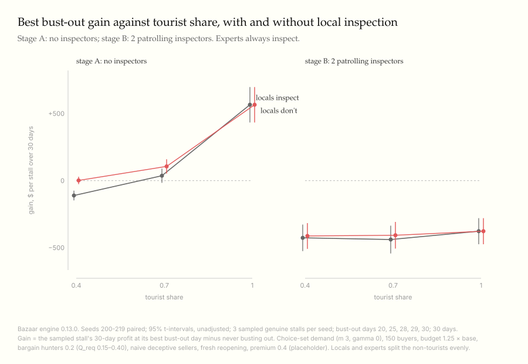
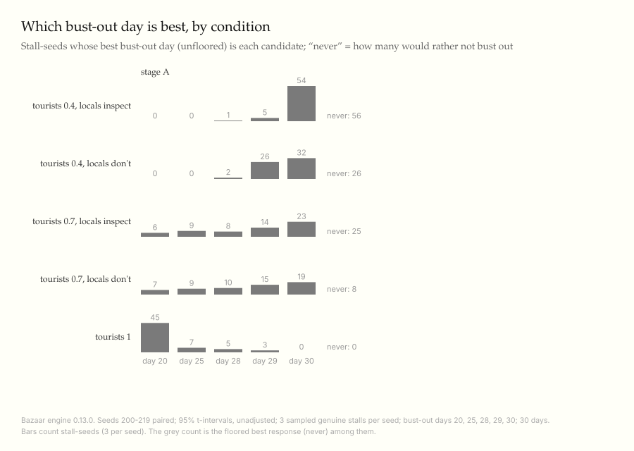
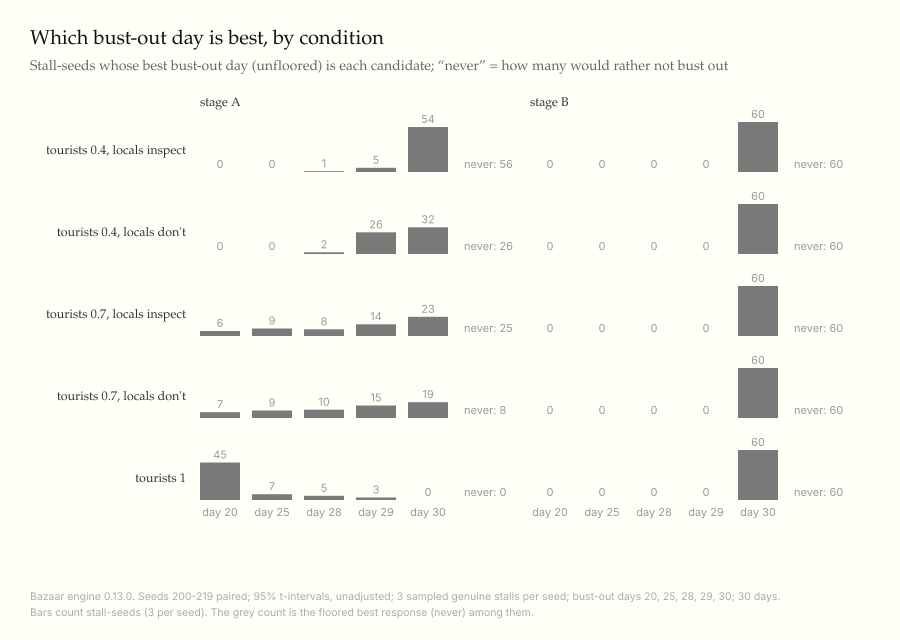

# The verification boundary

Run spec "fixes, pilot gate, then the verification boundary (rule-based only)"; predictions written 2026-11-08, before any run. Pilot gate: `runs/pilot_verification.md`.

## Design (prespecified)

- Engine 0.13.0, choice-set demand: m 3, gamma 0, 150 buyers, budget 1.25 × base, bargain hunters 0.2 with Q_req 0.15–0.40; D = 30 known; ratings public (memory 0.7); brands on (premium 0.4, placeholder); naive deceptive sellers, fresh reopening; every genuine stall honest except the stall under test.
- Conditions: tourist share {0.4, 0.7} × local inspection probability {1.0, 0.0}, plus tourist share 1.0; locals and experts split the non-tourists evenly; experts always inspect. Stage A: no inspectors. Stage B: 2 patrolling inspectors, not uniformed.
- Benchmark: per seed 3 genuine stalls from `default_rng([seed, 17])`, the same in every condition, each busting out on day 20, 25, 28, 29 or 30; one shared never chain per seed and condition. Gain = the stall's 30-day profit at the best bust-out day minus never (**unfloored, primary**, the convention decided 2026-11-07); the floored version (best of never and the bust-out days) is also reported.
- Verifying share = experts + locals × local inspection probability (the share of buyers who inspect an advertising stall): 0.60, 0.30, 0.30, 0.15, 0.
- Paired by seed; 95% t-intervals, unadjusted. Confirmatory: PV1–PV3 (stage A), PV4 (stage B − stage A at tourist share 1.0). Everything else exploratory.

## Stage A: no inspectors

### Run record

- Engine `0.13.0`; commit `175e0421494c2315e303ca9544d011ca9821cc7e`; uncommitted at run time: ['?? runs/verification_A_run.log', '?? runs/verification_A_stdout.log']
- Script sha256 `fcf2193baccc12f63142069dcef3410859dc300c9d1e12cab650e1b76a245822`
- Command: `python -m analysis.verification --stage A --seeds 200-219 --seed-note 20 seeds (200-219) per the G4 rule: 10.2 h projected at 30 seeds (runs/pilot_verification.md) --tests full suite at 64dd293: 678 passed (19.2 min), including 76 reference cells from engine 0.12.0 (5ea5f24)`
- Tests: full suite at 64dd293: 678 passed (19.2 min), including 76 reference cells from engine 0.12.0 (5ea5f24)
- Python 3.12.7, numpy 2.5.4, macOS-26.6.2-arm64-arm-64bit
- 1600 chains × 30 days on 4 workers (nice 19); wall clock 2.70 h; load average [1.79, 2.04, 2.47] at start, [5.39, 5.61, 5.63] at end; memory at start {'swap_free_mb': 1057.69, 'free_pct': 86}, at end {'swap_free_mb': 1105.69, 'free_pct': 83}; memory-guard pauses: 0
- Seeds 200-219 (20), paired; 20 seeds (200-219) per the G4 rule: 10.2 h projected at 30 seeds (runs/pilot_verification.md)
- Sampled stalls per seed: 200: s42, s41, s01; 201: s30, s14, s19; 202: s31, s38, s06; 203: s37, s15, s28; 204: s22, s37, s38; 205: s38, s08, s06; 206: s25, s43, s13; 207: s15, s32, s37; 208: s08, s17, s19; 209: s07, s03, s06; 210: s23, s38, s31; 211: s27, s28, s15; 212: s26, s11, s29; 213: s42, s09, s00; 214: s42, s07, s15; 215: s12, s42, s35; 216: s03, s40, s00; 217: s20, s37, s44; 218: s11, s39, s32; 219: s02, s38, s22

### Gain by condition

| Condition | Verifying share | Unfloored gain ($) | Floored gain ($) | Stall-seeds with a positive gain | Never-bust total ($) |
|---|---|---|---|---|---|
| t40|l1 | 0.60 | −110.99 [−147.32, −74.66] * | +0.33 [−0.01, +0.68] | 7% | 4,651.82 [3,527.84, 5,775.81] |
| t40|l0 | 0.30 | +1.39 [−26.05, +28.83] | +34.53 [+14.79, +54.26] * | 57% | 4,673.50 [3,536.59, 5,810.41] |
| t70|l1 | 0.30 | +36.61 [−16.42, +89.64] | +62.88 [+16.99, +108.76] * | 58% | 3,227.37 [2,393.16, 4,061.58] |
| t70|l0 | 0.15 | +105.97 [+52.79, +159.15] * | +108.99 [+56.72, +161.27] * | 87% | 3,234.59 [2,391.69, 4,077.50] |
| t100 | 0.00 | +565.27 [+433.55, +697.00] * | +565.27 [+433.55, +697.00] * | 100% | 1,817.90 [1,296.08, 2,339.72] |

### Predictions (confirmatory)

Gain in $ per sampled stall over 30 days (per-seed mean of 3 stalls).

| Prediction | Unfloored gain (primary) | Verdict | Floored gain | Verdict |
|---|---|---|---|---|
| **PV1**: local 1.0: slope of the gain over tourist share (per +0.1 of tourist share) | +112.71 [+87.65, +137.77] * | supported | +94.16 [+72.21, +116.10] * | supported |
| **PV2**: tourists 0.4: local inspection off − on | +112.38 [+72.39, +152.37] * | supported | +34.19 [+14.37, +54.02] * | supported |
| **PV3**: tourists 1.0: gain | +565.27 [+433.55, +697.00] * | supported | +565.27 [+433.55, +697.00] * | supported |

### Where the gain crosses 0 (exploratory)

Mean unfloored gain crosses 0 at a verifying share of about 0.34 (linear interpolation between 0.30 and 0.60).

### Best bust-out day (exploratory)

| Condition | day 20 | day 25 | day 28 | day 29 | day 30 | never best (floored) |
|---|---|---|---|---|---|---|
| t40|l1 | 0 | 0 | 1 | 5 | 54 | 56 |
| t40|l0 | 0 | 0 | 2 | 26 | 32 | 26 |
| t70|l1 | 6 | 9 | 8 | 14 | 23 | 25 |
| t70|l0 | 7 | 9 | 10 | 15 | 19 | 8 |
| t100 | 45 | 7 | 5 | 3 | 0 | 0 |

### Harvest and ratings after a bust-out (exploratory)

From the chain where each sampled stall busts out on day 20 (the longest harvest window). Collapse = the stall's daily units first below half its mean over the 5 days before; 0 days = on the bust-out day. Rating moved = its brand rating fell below its pre-bust value at some point by day 30.

| Condition | Collapsed by day 30 | Same day | Median days to collapse | Rating moved | Rating below τ | Rating at day 30 (bust) | Rating at day 30 (never) |
|---|---|---|---|---|---|---|---|
| t40|l1 | 60/60 | 49 | 0 | 60/60 | 60/60 | 0.07 [0.06, 0.08] | 1.00 [1.00, 1.00] |
| t40|l0 | 60/60 | 26 | 1 | 60/60 | 60/60 | 0.05 [0.04, 0.05] | 1.00 [1.00, 1.00] |
| t70|l1 | 59/60 | 37 | 0 | 60/60 | 60/60 | 0.04 [0.03, 0.04] | 1.00 [1.00, 1.00] |
| t70|l0 | 56/60 | 22 | 2 | 60/60 | 60/60 | 0.03 [0.03, 0.03] | 1.00 [1.00, 1.00] |
| t100 | 40/60 | 20 | 0.5 | 60/60 | 60/60 | 0.03 [0.02, 0.03] | 1.00 [1.00, 1.00] |

### Harm by buyer profile at the best bust-out day (exploratory)

Bust chain at the stall's best day minus the never chain, days from the bust-out to 30; per seed the mean over the 3 stalls. Shortfall in points of purchases; surplus in $ per buyer of the profile.

| Condition | tourist: shortfall (pts) | local: shortfall (pts) | expert: shortfall (pts) | tourist: surplus ($) | local: surplus ($) | expert: surplus ($) |
|---|---|---|---|---|---|---|
| t40|l1 | +1.2 [+0.9, +1.6] * | +0.3 [+0.1, +0.6] * | +0.0 [+0.0, +0.0] | −1.02 [−1.56, −0.47] * | −0.44 [−0.63, −0.25] * | −0.24 [−0.32, −0.16] * |
| t40|l0 | +1.6 [+1.3, +1.9] * | +4.5 [+3.8, +5.2] * | +0.0 [+0.0, +0.0] | −1.16 [−1.71, −0.61] * | −3.13 [−4.20, −2.06] * | −0.23 [−0.31, −0.16] * |
| t70|l1 | +1.9 [+1.6, +2.1] * | +0.3 [−0.0, +0.7] | +0.0 [+0.0, +0.0] | −1.43 [−1.95, −0.91] * | −0.42 [−0.73, −0.11] * | −0.21 [−0.30, −0.12] * |
| t70|l0 | +1.9 [+1.7, +2.2] * | +4.8 [+3.5, +6.0] * | +0.0 [+0.0, +0.0] | −1.45 [−1.95, −0.95] * | −3.98 [−5.82, −2.13] * | −0.21 [−0.30, −0.13] * |
| t100 | +2.2 [+2.0, +2.3] * | – | – | −1.32 [−1.68, −0.96] * | – | – |

### Floors, invalid actions and schedule checks

- none

## Stage B: 2 patrolling inspectors

### Run record

- Engine `0.13.0`; commit `c8c04074676c069f72421a83b538cc993cdecd15`; uncommitted at run time: ['?? runs/verification_B_run.log', '?? runs/verification_B_stdout.log']
- Script sha256 `fcf2193baccc12f63142069dcef3410859dc300c9d1e12cab650e1b76a245822`
- Command: `python -m analysis.verification --stage B --seeds 200-219 --seed-note 20 seeds (200-219) per the G4 rule: 10.2 h projected at 30 seeds (runs/pilot_verification.md) --tests full suite at 64dd293: 678 passed (19.2 min), including 76 reference cells from engine 0.12.0 (5ea5f24)`
- Tests: full suite at 64dd293: 678 passed (19.2 min), including 76 reference cells from engine 0.12.0 (5ea5f24)
- Python 3.12.7, numpy 2.5.4, macOS-26.6.2-arm64-arm-64bit
- 1600 chains × 30 days on 4 workers (nice 19); wall clock 4.20 h; load average [2.49, 4.37, 5.13] at start, [5.34, 5.66, 5.63] at end; memory at start {'swap_free_mb': 1105.69, 'free_pct': 83}, at end {'swap_free_mb': 1217.75, 'free_pct': 82}; memory-guard pauses: 0
- Seeds 200-219 (20), paired; 20 seeds (200-219) per the G4 rule: 10.2 h projected at 30 seeds (runs/pilot_verification.md)
- Sampled stalls per seed: 200: s42, s41, s01; 201: s30, s14, s19; 202: s31, s38, s06; 203: s37, s15, s28; 204: s22, s37, s38; 205: s38, s08, s06; 206: s25, s43, s13; 207: s15, s32, s37; 208: s08, s17, s19; 209: s07, s03, s06; 210: s23, s38, s31; 211: s27, s28, s15; 212: s26, s11, s29; 213: s42, s09, s00; 214: s42, s07, s15; 215: s12, s42, s35; 216: s03, s40, s00; 217: s20, s37, s44; 218: s11, s39, s32; 219: s02, s38, s22

### Gain by condition

| Condition | Verifying share | Unfloored gain ($) | Floored gain ($) | Stall-seeds with a positive gain | Never-bust total ($) |
|---|---|---|---|---|---|
| t40|l1 | 0.60 | −426.26 [−525.21, −327.30] * | +0.00 [+0.00, +0.00] | 0% | 3,255.11 [2,454.17, 4,056.04] |
| t40|l0 | 0.30 | −412.53 [−508.71, −316.35] * | +0.00 [+0.00, +0.00] | 0% | 3,464.92 [2,623.72, 4,306.12] |
| t70|l1 | 0.30 | −439.13 [−542.54, −335.73] * | +0.00 [+0.00, +0.00] | 0% | 2,445.87 [1,798.24, 3,093.50] |
| t70|l0 | 0.15 | −407.06 [−506.32, −307.80] * | +0.00 [+0.00, +0.00] | 0% | 2,566.20 [1,872.96, 3,259.44] |
| t100 | 0.00 | −376.89 [−473.84, −279.95] * | +0.00 [+0.00, +0.00] | 0% | 1,901.91 [1,360.54, 2,443.29] |

### Predictions (stage B analogues: exploratory)

Gain in $ per sampled stall over 30 days (per-seed mean of 3 stalls).

| Prediction | Unfloored gain (primary) | Verdict | Floored gain | Verdict |
|---|---|---|---|---|
| **PV1b**: local 1.0: slope of the gain over tourist share (stage B analogue, exploratory) (per +0.1 of tourist share) | +8.23 [+0.15, +16.30] * | supported | +0.00 [+0.00, +0.00] | not supported (interval includes 0) |
| **PV2b**: tourists 0.4: local inspection off − on (stage B analogue, exploratory) | +13.73 [−13.67, +41.12] | not supported (interval includes 0) | +0.00 [+0.00, +0.00] | not supported (interval includes 0) |
| **PV3b**: tourists 1.0: gain (stage B analogue, exploratory) | −376.89 [−473.84, −279.95] * | contradicted (interval on the opposite side of 0) | +0.00 [+0.00, +0.00] | not supported (interval includes 0) |

### Where the gain crosses 0 (exploratory)

The mean unfloored gain does not change sign across the verifying shares tested (0.00: −376.89, 0.15: −407.06, 0.30: −425.83, 0.60: −426.26).

### Best bust-out day (exploratory)

| Condition | day 20 | day 25 | day 28 | day 29 | day 30 | never best (floored) |
|---|---|---|---|---|---|---|
| t40|l1 | 0 | 0 | 0 | 0 | 60 | 60 |
| t40|l0 | 0 | 0 | 0 | 0 | 60 | 60 |
| t70|l1 | 0 | 0 | 0 | 0 | 60 | 60 |
| t70|l0 | 0 | 0 | 0 | 0 | 60 | 60 |
| t100 | 0 | 0 | 0 | 0 | 60 | 60 |

### Harvest and ratings after a bust-out (exploratory)

From the chain where each sampled stall busts out on day 20 (the longest harvest window). Collapse = the stall's daily units first below half its mean over the 5 days before; 0 days = on the bust-out day. Rating moved = its brand rating fell below its pre-bust value at some point by day 30.

| Condition | Collapsed by day 30 | Same day | Median days to collapse | Rating moved | Rating below τ | Rating at day 30 (bust) | Rating at day 30 (never) |
|---|---|---|---|---|---|---|---|
| t40|l1 | 60/60 | 58 | 0 | 55/60 | 51/60 | 0.30 [0.23, 0.37] | 1.00 [1.00, 1.00] |
| t40|l0 | 60/60 | 52 | 0 | 59/60 | 57/60 | 0.20 [0.15, 0.24] | 1.00 [1.00, 1.00] |
| t70|l1 | 59/60 | 50 | 0 | 57/60 | 52/60 | 0.21 [0.14, 0.27] | 1.00 [1.00, 1.00] |
| t70|l0 | 59/60 | 46 | 0 | 58/60 | 56/60 | 0.16 [0.11, 0.21] | 1.00 [1.00, 1.00] |
| t100 | 58/60 | 41 | 0 | 59/60 | 58/60 | 0.13 [0.09, 0.17] | 1.00 [1.00, 1.00] |

### Harm by buyer profile at the best bust-out day (exploratory)

Bust chain at the stall's best day minus the never chain, days from the bust-out to 30; per seed the mean over the 3 stalls. Shortfall in points of purchases; surplus in $ per buyer of the profile.

| Condition | tourist: shortfall (pts) | local: shortfall (pts) | expert: shortfall (pts) | tourist: surplus ($) | local: surplus ($) | expert: surplus ($) |
|---|---|---|---|---|---|---|
| t40|l1 | +0.5 [−1.8, +2.8] | +0.4 [−0.8, +1.6] | +0.0 [+0.0, +0.0] | −0.18 [−1.62, +1.26] | +0.11 [−0.73, +0.96] | −0.63 [−1.23, −0.04] * |
| t40|l0 | +0.4 [−1.2, +2.0] | +2.9 [+0.8, +4.9] * | +0.0 [+0.0, +0.0] | −0.46 [−1.65, +0.74] | −0.92 [−2.45, +0.60] | −0.32 [−0.74, +0.10] |
| t70|l1 | +1.0 [−0.7, +2.7] | +0.3 [−0.7, +1.3] | +0.0 [+0.0, +0.0] | −0.00 [−0.85, +0.85] | −0.86 [−1.56, −0.16] * | +0.30 [−0.57, +1.17] |
| t70|l0 | +1.3 [−0.2, +2.7] | +0.1 [−3.1, +3.3] | +0.0 [+0.0, +0.0] | +0.16 [−0.76, +1.08] | −0.56 [−2.76, +1.64] | +0.18 [−0.68, +1.04] |
| t100 | +1.2 [−0.4, +2.8] | – | – | −0.06 [−0.96, +0.84] | – | – |

### Floors, invalid actions and schedule checks

- none

## Stage B − stage A

**PV4** (confirmatory): tourists 1.0: stage B − stage A: −942.17 [−1,147.28, −737.06] * — supported.

Gap by condition (exploratory): does enforcement matter more when verification is low?

| Condition | Verifying share | Stage B − stage A, unfloored gain ($) |
|---|---|---|
| t40|l1 | 0.60 | −315.27 [−394.35, −236.19] * |
| t40|l0 | 0.30 | −413.92 [−516.77, −311.08] * |
| t70|l1 | 0.30 | −475.74 [−605.42, −346.06] * |
| t70|l0 | 0.15 | −513.03 [−653.83, −372.23] * |
| t100 | 0.00 | −942.17 [−1,147.28, −737.06] * |

## Reading (written after the results)

*Written after the Stage A results were seen.*

All three confirmatory predictions are supported, under both the unfloored (primary) and floored gains.

- **PV1.** With locals always inspecting, the bust-out gain rises by about $113 for each +0.1 of tourist share. It goes from −$111 at tourist share 0.4 (a bust-out loses money; the floored gain is $0.33, so never busting out is best in 56 of 60 stall-seeds) to +$565 at 1.0.
- **PV2.** At tourist share 0.4, switching local inspection off raises the gain by $112. The gain goes from −$111 to +$1, and the share of stall-seeds with a positive gain from 7% to 57%.
- **PV3.** In a market of tourists only, every one of the 60 stall-seeds gains from busting out: +$565 [+434, +697] on a never-bust total of $1,818. That is about a third of the stall's whole 30-day honest profit.

Verification is the lever, and composition matters beyond it. The mean gain crosses 0 at a verifying share of about 0.34. The two conditions at a verifying share of 0.30 differ, though: +$1 with tourists at 0.4 and locals not inspecting, against +$37 with tourists at 0.7 and locals inspecting. Their intervals overlap, so this is suggestive only.

The best bust-out day moves earlier as verification falls:
- At a verifying share of 0.60, the stall waits until day 30 (54 of 60) or does not bust out at all.
- In the tourist-only market, day 20, the earliest candidate, is best in 45 of 60. There the mean gain falls steadily from $535 (day 20) to $49 (day 30), so the best day probably lies before day 20 and +$565 is a lower bound. The candidate set was prespecified, so it was not extended.

Unlike walk mode (`runs/loss_diagnostic.txt`), ratings do respond in choice-set mode. Every day-20 bust-out drives the brand rating below τ by day 30 (to 0.03–0.07, against 1.00 in the never chain). Sales collapse on the bust-out day itself in most stall-seeds where anyone verifies (49/60 at a verifying share of 0.60). With no verifiers the response is split: 20 of 60 collapse on the bust-out day and 20 of 60 have not collapsed by day 30. This is consistent with tourists learning only through the public rating.

Harm (exploratory) falls on whoever does not inspect:
- With local inspection on, tourists lose the most per buyer ($1.0–1.4).
- With local inspection off, locals lose $3.1–4.0 per buyer, several times more than tourists. They are the stall's repeat customers.
- Experts never buy the bad product but still lose about $0.2 each, because their preferred honest option is gone.

The honest market also gets worse as tourists rise, regardless of bust-outs. The deceptive sellers' share of sales goes from 29% at tourist share 0.4 to 65% at 1.0, and the never-bust total of a genuine stall falls from $4,652 to $1,818. Part of the rising gain is a falling outside option.

*Stage B: written after the Stage B results were seen.*

**PV4 is supported.** In the tourist-only market, two patrolling inspectors change the bust-out gain by −$942 [−1,147, −737]: from +$565 in Stage A to −$377.

With inspectors, a bust-out loses money in every condition and every one of the 60 stall-seeds per condition, at every candidate day:
- The least bad bust-out day is always day 30, and the floored gain is exactly $0 everywhere: never busting out is always best.
- Even a single day of busting out (day 30) costs $377–439. A bust-out on day 20 costs $3,850–4,710.
- The likely mechanism is the catch penalty: 1.5 × base price per catch, plus a 40-tick closure. Patrolling inspectors make 28–43 catches a day across the market. I did not decompose the loss into penalties, closure and lost sales, since that would be a post-hoc analysis.

Enforcement makes the verification gradient almost disappear:
- The Stage B gains run from −$377 to −$439. The slope over tourist share is +$8 per 0.1 [+0.2, +16], against +$113 in Stage A.
- Local inspection off − on at tourist share 0.4 is +$14 [−14, +41].
- These Stage B analogues are exploratory.
- The Stage B − Stage A gap grows as verification falls: −$315 at a verifying share of 0.60, −$414 and −$476 at 0.30, −$513 at 0.15 and −$942 at 0. Inspectors matter most where buyers verify least. This is exploratory and was not prespecified as a test.

The harm by profile is small and mostly indistinguishable from 0 in Stage B. Stalls bust out only on day 30, so there is one day of exposure.

**Unexplained, flagged for follow-up.** Inspectors also lower the honest stall's own never-bust profit where locals and experts are present: from $4,652 to $3,255 at tourist share 0.4, and from $3,227 to $2,446 at 0.7 (locals inspecting). In the tourist-only market it is unchanged ($1,818 against $1,902). Total sales per day fall from about 198 to 140 at tourist share 0.4. The deceptive sellers' share of sales falls too, from 29% to 25%. This run does not show why genuine stalls sell less when inspectors patrol; it changes the baseline against which the Stage B − Stage A gap is read. A diagnostic would be needed, for example per-stall sales and penalties in the never chains of both stages.

## Caveats

- 20 seeds, not 30 (G4 rule; see Deviations). The intervals are correspondingly wider; all three confirmatory results clear 0 by a wide margin.
- Rule-based agents only; no LLM agents. Naive deceptive sellers with fresh reopening; all genuine stalls but the one under test are honest.
- The bust-out benchmark is restricted to the candidates {never, 20, 25, 28, 29, 30}. Where day 20 is best (the tourist-only market), the gain is a lower bound.
- Verifying share is a summary, not a single dial: the two conditions at 0.30 differ in which profile verifies, and in how many tourists there are.
- Seconds stalls averaged 0.88 customers a day in the pilot (G1 failed and was waived). No prediction here depends on them.
- Stage B uses one enforcement level (2 patrolling inspectors, not uniformed) and the existing penalty (1.5 × base price, 40-tick closure). The Stage B result says the bust-out does not pay at this level of enforcement. It does not locate the enforcement boundary.
- The Stage B predictions table repeats PV1–PV3 for Stage B as labelled exploratory analogues. Only PV4 is confirmatory for Stage B.
- Intervals are unadjusted 95% t-intervals across seeds. The three sampled stalls per seed are averaged first, so seeds are the unit.

## Deviations

- **G1 waived (decision by the PI, 2026-11-08).** Bargain share 0.2 and bargain Q_req [0.15, 0.40] were kept unchanged. Seconds stalls average 0.88 customers/day against a gate of 1.0; about half of them fall short. That is an acceptable rate of struggling businesses, and no prespecified prediction in this run depends on seconds stalls (all outcomes are genuine-stall bust-out gains). The gate was waived after seeing the failure, by the PI, without changing any prediction or analysis.
- **One throwaway seed seen.** Seed 905 (a pilot seed, not in the main set) was seen in the pipeline check before the main run, showing a positive bust-out gain in the tourist-only condition (+$663 in Stage A). Its Stage B − Stage A difference at tourist share 1.0 was also shown (−$902).
- **20 seeds (200–219) instead of 30.** This follows the prespecified G4 rule: 10.2 h projected at 30 seeds (`runs/pilot_verification.md`).
- **G4 timing method.** G4 timed one condition per stage (A|t40|l1 and B|t40|l1) instead of a single mixed sample, because Stage B chains are about 1.5× slower. The projection rule is unchanged.
- **Memory-guard swap floor lowered to 512 MB** (from 1,024 MB). macOS had shrunk total swap to 2 GB, with about 1 GB of stale pages, while memory stayed over 80% free. The free-memory floor (15%) is unchanged. No pauses occurred in Stage A.
- **First Stage B launch failed before any chain ran.** It was wrapped in `nice -n 19`, so the script's own `os.nice(19)` raised a permission error at startup. It was relaunched at 17:23 with the same command as Stage A (no cache, no partial results). The failed attempt's stdout was overwritten.

## Superseded (trapped-buyer bug)

The first Stage B run (engine 0.13.0, 2026-11-08, `runs/verification_B_run_v0130.log`, data `runs/verification_B_v0130.json.gz`) is superseded. Under choice-set demand, a buyer whose chosen set stall was closed by a catch stayed in the market and could not buy (the trapped-buyer bug; `runs/honest_profit_diagnostic.md`, fixed in engine 0.14.0, `runs/bugfix_trapped_buyers.md`). Stage A had no closures and is unaffected. The old numbers are kept below unchanged, with their reading.

### Stage B: 2 patrolling inspectors

#### Run record

- Engine `0.13.0`; commit `c8c04074676c069f72421a83b538cc993cdecd15`; uncommitted at run time: ['?? runs/verification_B_run.log', '?? runs/verification_B_stdout.log']
- Script sha256 `fcf2193baccc12f63142069dcef3410859dc300c9d1e12cab650e1b76a245822`
- Command: `python -m analysis.verification --stage B --seeds 200-219 --seed-note 20 seeds (200-219) per the G4 rule: 10.2 h projected at 30 seeds (runs/pilot_verification.md) --tests full suite at 64dd293: 678 passed (19.2 min), including 76 reference cells from engine 0.12.0 (5ea5f24)`
- Tests: full suite at 64dd293: 678 passed (19.2 min), including 76 reference cells from engine 0.12.0 (5ea5f24)
- Python 3.12.7, numpy 2.5.4, macOS-26.6.2-arm64-arm-64bit
- 1600 chains × 30 days on 4 workers (nice 19); wall clock 4.20 h; load average [2.49, 4.37, 5.13] at start, [5.34, 5.66, 5.63] at end; memory at start {'swap_free_mb': 1105.69, 'free_pct': 83}, at end {'swap_free_mb': 1217.75, 'free_pct': 82}; memory-guard pauses: 0
- Seeds 200-219 (20), paired; 20 seeds (200-219) per the G4 rule: 10.2 h projected at 30 seeds (runs/pilot_verification.md)
- Sampled stalls per seed: 200: s42, s41, s01; 201: s30, s14, s19; 202: s31, s38, s06; 203: s37, s15, s28; 204: s22, s37, s38; 205: s38, s08, s06; 206: s25, s43, s13; 207: s15, s32, s37; 208: s08, s17, s19; 209: s07, s03, s06; 210: s23, s38, s31; 211: s27, s28, s15; 212: s26, s11, s29; 213: s42, s09, s00; 214: s42, s07, s15; 215: s12, s42, s35; 216: s03, s40, s00; 217: s20, s37, s44; 218: s11, s39, s32; 219: s02, s38, s22

#### Gain by condition

| Condition | Verifying share | Unfloored gain ($) | Floored gain ($) | Stall-seeds with a positive gain | Never-bust total ($) |
|---|---|---|---|---|---|
| t40|l1 | 0.60 | −426.26 [−525.21, −327.30] * | +0.00 [+0.00, +0.00] | 0% | 3,255.11 [2,454.17, 4,056.04] |
| t40|l0 | 0.30 | −412.53 [−508.71, −316.35] * | +0.00 [+0.00, +0.00] | 0% | 3,464.92 [2,623.72, 4,306.12] |
| t70|l1 | 0.30 | −439.13 [−542.54, −335.73] * | +0.00 [+0.00, +0.00] | 0% | 2,445.87 [1,798.24, 3,093.50] |
| t70|l0 | 0.15 | −407.06 [−506.32, −307.80] * | +0.00 [+0.00, +0.00] | 0% | 2,566.20 [1,872.96, 3,259.44] |
| t100 | 0.00 | −376.89 [−473.84, −279.95] * | +0.00 [+0.00, +0.00] | 0% | 1,901.91 [1,360.54, 2,443.29] |

#### Predictions (stage B analogues: exploratory)

Gain in $ per sampled stall over 30 days (per-seed mean of 3 stalls).

| Prediction | Unfloored gain (primary) | Verdict | Floored gain | Verdict |
|---|---|---|---|---|
| **PV1b**: local 1.0: slope of the gain over tourist share (stage B analogue, exploratory) (per +0.1 of tourist share) | +8.23 [+0.15, +16.30] * | supported | +0.00 [+0.00, +0.00] | not supported (interval includes 0) |
| **PV2b**: tourists 0.4: local inspection off − on (stage B analogue, exploratory) | +13.73 [−13.67, +41.12] | not supported (interval includes 0) | +0.00 [+0.00, +0.00] | not supported (interval includes 0) |
| **PV3b**: tourists 1.0: gain (stage B analogue, exploratory) | −376.89 [−473.84, −279.95] * | contradicted (interval on the opposite side of 0) | +0.00 [+0.00, +0.00] | not supported (interval includes 0) |

#### Where the gain crosses 0 (exploratory)

The mean unfloored gain does not change sign across the verifying shares tested (0.00: −376.89, 0.15: −407.06, 0.30: −425.83, 0.60: −426.26).

#### Best bust-out day (exploratory)

| Condition | day 20 | day 25 | day 28 | day 29 | day 30 | never best (floored) |
|---|---|---|---|---|---|---|
| t40|l1 | 0 | 0 | 0 | 0 | 60 | 60 |
| t40|l0 | 0 | 0 | 0 | 0 | 60 | 60 |
| t70|l1 | 0 | 0 | 0 | 0 | 60 | 60 |
| t70|l0 | 0 | 0 | 0 | 0 | 60 | 60 |
| t100 | 0 | 0 | 0 | 0 | 60 | 60 |

#### Harvest and ratings after a bust-out (exploratory)

From the chain where each sampled stall busts out on day 20 (the longest harvest window). Collapse = the stall's daily units first below half its mean over the 5 days before; 0 days = on the bust-out day. Rating moved = its brand rating fell below its pre-bust value at some point by day 30.

| Condition | Collapsed by day 30 | Same day | Median days to collapse | Rating moved | Rating below τ | Rating at day 30 (bust) | Rating at day 30 (never) |
|---|---|---|---|---|---|---|---|
| t40|l1 | 60/60 | 58 | 0 | 55/60 | 51/60 | 0.30 [0.23, 0.37] | 1.00 [1.00, 1.00] |
| t40|l0 | 60/60 | 52 | 0 | 59/60 | 57/60 | 0.20 [0.15, 0.24] | 1.00 [1.00, 1.00] |
| t70|l1 | 59/60 | 50 | 0 | 57/60 | 52/60 | 0.21 [0.14, 0.27] | 1.00 [1.00, 1.00] |
| t70|l0 | 59/60 | 46 | 0 | 58/60 | 56/60 | 0.16 [0.11, 0.21] | 1.00 [1.00, 1.00] |
| t100 | 58/60 | 41 | 0 | 59/60 | 58/60 | 0.13 [0.09, 0.17] | 1.00 [1.00, 1.00] |

#### Harm by buyer profile at the best bust-out day (exploratory)

Bust chain at the stall's best day minus the never chain, days from the bust-out to 30; per seed the mean over the 3 stalls. Shortfall in points of purchases; surplus in $ per buyer of the profile.

| Condition | tourist: shortfall (pts) | local: shortfall (pts) | expert: shortfall (pts) | tourist: surplus ($) | local: surplus ($) | expert: surplus ($) |
|---|---|---|---|---|---|---|
| t40|l1 | +0.5 [−1.8, +2.8] | +0.4 [−0.8, +1.6] | +0.0 [+0.0, +0.0] | −0.18 [−1.62, +1.26] | +0.11 [−0.73, +0.96] | −0.63 [−1.23, −0.04] * |
| t40|l0 | +0.4 [−1.2, +2.0] | +2.9 [+0.8, +4.9] * | +0.0 [+0.0, +0.0] | −0.46 [−1.65, +0.74] | −0.92 [−2.45, +0.60] | −0.32 [−0.74, +0.10] |
| t70|l1 | +1.0 [−0.7, +2.7] | +0.3 [−0.7, +1.3] | +0.0 [+0.0, +0.0] | −0.00 [−0.85, +0.85] | −0.86 [−1.56, −0.16] * | +0.30 [−0.57, +1.17] |
| t70|l0 | +1.3 [−0.2, +2.7] | +0.1 [−3.1, +3.3] | +0.0 [+0.0, +0.0] | +0.16 [−0.76, +1.08] | −0.56 [−2.76, +1.64] | +0.18 [−0.68, +1.04] |
| t100 | +1.2 [−0.4, +2.8] | – | – | −0.06 [−0.96, +0.84] | – | – |

#### Floors, invalid actions and schedule checks

- none

### Stage B − stage A

**PV4** (confirmatory): tourists 1.0: stage B − stage A: −942.17 [−1,147.28, −737.06] * — supported.

Gap by condition (exploratory): does enforcement matter more when verification is low?

| Condition | Verifying share | Stage B − stage A, unfloored gain ($) |
|---|---|---|
| t40|l1 | 0.60 | −315.27 [−394.35, −236.19] * |
| t40|l0 | 0.30 | −413.92 [−516.77, −311.08] * |
| t70|l1 | 0.30 | −475.74 [−605.42, −346.06] * |
| t70|l0 | 0.15 | −513.03 [−653.83, −372.23] * |
| t100 | 0.00 | −942.17 [−1,147.28, −737.06] * |

### Stage B reading at engine 0.13.0 (superseded)

**PV4 is supported.** In the tourist-only market, two patrolling inspectors change the bust-out gain by −$942 [−1,147, −737]: from +$565 in Stage A to −$377.

With inspectors, a bust-out loses money in every condition and every one of the 60 stall-seeds per condition, at every candidate day:
- The least bad bust-out day is always day 30, and the floored gain is exactly $0 everywhere: never busting out is always best.
- Even a single day of busting out (day 30) costs $377–439. A bust-out on day 20 costs $3,850–4,710.
- The likely mechanism is the catch penalty: 1.5 × base price per catch, plus a 40-tick closure. Patrolling inspectors make 28–43 catches a day across the market. I did not decompose the loss into penalties, closure and lost sales, since that would be a post-hoc analysis.

Enforcement makes the verification gradient almost disappear:
- The Stage B gains run from −$377 to −$439. The slope over tourist share is +$8 per 0.1 [+0.2, +16], against +$113 in Stage A.
- Local inspection off − on at tourist share 0.4 is +$14 [−14, +41].
- These Stage B analogues are exploratory.
- The Stage B − Stage A gap grows as verification falls: −$315 at a verifying share of 0.60, −$414 and −$476 at 0.30, −$513 at 0.15 and −$942 at 0. Inspectors matter most where buyers verify least. This is exploratory and was not prespecified as a test.

The harm by profile is small and mostly indistinguishable from 0 in Stage B. Stalls bust out only on day 30, so there is one day of exposure.

**Unexplained, flagged for follow-up.** Inspectors also lower the honest stall's own never-bust profit where locals and experts are present: from $4,652 to $3,255 at tourist share 0.4, and from $3,227 to $2,446 at 0.7 (locals inspecting). In the tourist-only market it is unchanged ($1,818 against $1,902). Total sales per day fall from about 198 to 140 at tourist share 0.4. The deceptive sellers' share of sales falls too, from 29% to 25%. This run does not show why genuine stalls sell less when inspectors patrol; it changes the baseline against which the Stage B − Stage A gap is read. A diagnostic would be needed, for example per-stall sales and penalties in the never chains of both stages.
